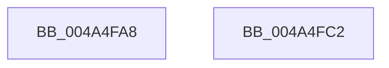

# KeGetProcessorNode

- RVA: `0x004A4FA8`–`0x004A4FC3` (길이 `27` bytes)
- VA: `0x00000001404A4FA8`
- 실행 섹션: `.text`
- PDB 이름 있음: `예`; PDB Function 태그: `아니요`
- unwind 정보 RVA: `0x000DB714`
- 디코드: `6`개 명령, `27/27` bytes 표시
- 미해석 바이트: `0` (있으면 어셈블리에 `.byte`로 보존)

> 이 문서는 커널 이미지의 기계어와 PDB 기호를 분석해 생성했습니다. 4번과 5번은 함수 원형과 자료형을 바이너리 사용 방식에서 추정한 C 해석이며 원본 소스 복구 결과는 아닙니다.

## 1. Dependencies

- 직접 호출 지점: **0**; 고유 호출 대상: **0**
- 직접 호출자로 확인된 함수: **2**
- RIP 상대 이미지 참조: **1**

### Outgoing calls
- 직접 디코드된 call 명령이 없습니다.

### Direct callers
- [KiInitializeTopologyStructures](../../pagelk/B6/KiInitializeTopologyStructures_function_00B69708.md) at `0x00B699D1`
- [KiInitializeTopologyStructures](../../pagelk/B6/KiInitializeTopologyStructures_function_00B69708.md) at `0x00B699DC`
- [KiInitializeTopologyStructures](../../pagelk/B6/KiInitializeTopologyStructures_function_00B69708.md) at `0x00B69AED`
- [KiSetCacheInformationAmd](../../pagelk/B6/KiSetCacheInformationAmd_function_00B69CBC.md) at `0x00B69DE7`
- [KiSetCacheInformationAmd](../../pagelk/B6/KiSetCacheInformationAmd_function_00B69CBC.md) at `0x00B69DF2`

### Static image references
- `0x004A4FAF` → RVA `0x00FCF6C0` (`CACHEALI`; read)

## 2. Other-region calls and transfers

- 다른 실행 섹션으로 향하는 call: **0**
- 별도 외부 분기/꼬리 이동을 확인하지 못했습니다.

## 3. Assembly (complete function range)

```asm
004A4FA8  48 8B 81 C0 00 00 00            mov rax, qword ptr [rcx + 0xc0]
004A4FAF  48 8D 0D 0A A7 B2 00            lea rcx, [rip + 0xb2a70a]
004A4FB6  0F B7 80 8A 00 00 00            movzx eax, word ptr [rax + 0x8a]
004A4FBD  48 8B 04 C1                     mov rax, qword ptr [rcx + rax*8]
004A4FC1  C3                              ret
004A4FC2  CC                              int3
```

## 4. C-style interpretation (structured pseudocode)

```c
__int64 __fastcall KeGetProcessorNode(__int64 a1)
{
    return *(unsigned __int64 *)(v_rip + 11708170 + *(unsigned __int16 *)(*(unsigned __int64 *)(a1 + 192) + 138) * 8);
}
```

## 5. (Beta) C Style

```c
int64_t KeGetProcessorNode(void *Arg1)
{
    uint8_t *arg1 = (uint8_t *)Arg1;

    return *(uint64_t *)(v_rip + 0xB2A70A + *(uint16_t *)(*(uint64_t *)(arg1 + 0xC0) + 0x8A) * 8);
}
```

### 관측된 메모리 오프셋

구조체 형식이 확인되지 않은 접근은 인자 기준의 오프셋으로만 기록했습니다.

| 기준 인자 | 오프셋 표현 | 폭 (bit) | 접근 |
|---|---:|---:|---|
| `Arg1` | `+ 0xC0` | `64` | `R` |

## 6. Execution-region graph

[열기: 2D/3D 그래프와 함수 탐색 컨트롤 패널](../../../control-panel.html?section=text&rva=0x004A4FA8&view=graph)

- 2D 그래프는 위에서 아래로 흐르고, 3D 그래프는 빈 공간을 드래그해 회전합니다. Shift+드래그는 이동, 휠은 확대·축소, 함수 노드 선택은 대상 보고서 이동입니다.

### Static fallback


