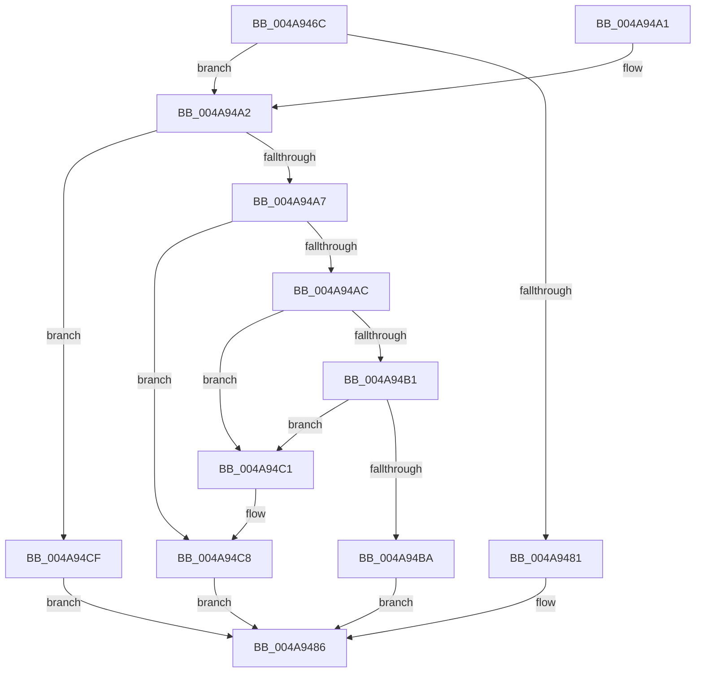

# KeGetTopologySiblingAffinityForProcessor

- RVA: `0x004A946C`–`0x004A94D6` (길이 `106` bytes)
- VA: `0x00000001404A946C`
- 실행 섹션: `.text`
- PDB 이름 있음: `예`; PDB Function 태그: `아니요`
- unwind 정보 RVA: `0x0008E1C0`
- 디코드: `34`개 명령, `106/106` bytes 표시
- 미해석 바이트: `0` (있으면 어셈블리에 `.byte`로 보존)

> 이 문서는 커널 이미지의 기계어와 PDB 기호를 분석해 생성했습니다. 4번과 5번은 함수 원형과 자료형을 바이너리 사용 방식에서 추정한 C 해석이며 원본 소스 복구 결과는 아닙니다.

## 1. Dependencies

- 직접 호출 지점: **2**; 고유 호출 대상: **2**
- 직접 호출자로 확인된 함수: **3**
- RIP 상대 이미지 참조: **0**

### Outgoing calls
- `0x004A9491` → [KiCopyAffinityEx](../2C/KiCopyAffinityEx_function_002CE860.md) (function, `0x002CE860`)
- `0x004A94B1` → [Feature_PpmParkEx__private_IsEnabledNoReportingNoInline](../4F/Feature_PpmParkEx__private_IsEnabledNoReportingNoInline_function_004F40E0.md) (function, `0x004F40E0`)

### Direct callers
- [PpmHeteroHgsDetectContainmentPresence](../5D/PpmHeteroHgsDetectContainmentPresence_function_005D8768.md) at `0x005D885D`
- [PpmParkComputeUnparkMaskEx](../5E/PpmParkComputeUnparkMaskEx_function_005E05E0.md) at `0x005E1170`
- [PpmParkComputeUnparkMaskEx](../5E/PpmParkComputeUnparkMaskEx_function_005E05E0.md) at `0x005E1206`
- [sub_006DCD34](../6D/Unknown_function_006DCD34.md) at `0x006DCD3F`

### Static image references
- 디코드된 RIP-relative 메모리 참조가 없습니다.

## 2. Other-region calls and transfers

- 다른 실행 섹션으로 향하는 call: **0**
- 별도 외부 분기/꼬리 이동을 확인하지 못했습니다.

## 3. Assembly (complete function range)

```asm
004A946C  48 89 5C 24 08                  mov qword ptr [rsp + 8], rbx
004A9471  57                              push rdi
004A9472  48 83 EC 20                     sub rsp, 0x20
004A9476  49 8B D8                        mov rbx, r8
004A9479  48 8B F9                        mov rdi, rcx
004A947C  83 EA 02                        sub edx, 2
004A947F  75 21                           jne 0x1404a94a2
004A9481  B8 10 9F 00 00                  mov eax, 0x9f10
004A9486  0F B7 53 02                     movzx edx, word ptr [rbx + 2]
004A948A  4C 8D 04 07                     lea r8, [rdi + rax]
004A948E  48 8B CB                        mov rcx, rbx
004A9491  E8 CA 53 E2 FF                  call 0x1402ce860
004A9496  48 8B 5C 24 30                  mov rbx, qword ptr [rsp + 0x30]
004A949B  48 83 C4 20                     add rsp, 0x20
004A949F  5F                              pop rdi
004A94A0  C3                              ret
004A94A1  CC                              int3
004A94A2  83 EA 01                        sub edx, 1
004A94A5  74 28                           je 0x1404a94cf
004A94A7  83 EA 01                        sub edx, 1
004A94AA  74 1C                           je 0x1404a94c8
004A94AC  83 FA 01                        cmp edx, 1
004A94AF  75 10                           jne 0x1404a94c1
004A94B1  E8 2A AC 04 00                  call 0x1404f40e0
004A94B6  85 C0                           test eax, eax
004A94B8  74 07                           je 0x1404a94c1
004A94BA  B8 40 B9 00 00                  mov eax, 0xb940
004A94BF  EB C5                           jmp 0x1404a9486
004A94C1  B9 05 00 00 00                  mov ecx, 5
004A94C6  CD 29                           int 0x29
004A94C8  B8 10 8C 00 00                  mov eax, 0x8c10
004A94CD  EB B7                           jmp 0x1404a9486
004A94CF  B8 C0 9C 00 00                  mov eax, 0x9cc0
004A94D4  EB B0                           jmp 0x1404a9486
```

## 4. C-style interpretation (structured pseudocode)

```c
__int64 __fastcall KeGetTopologySiblingAffinityForProcessor(__int64 a1, int a2, __int64 a3)
{
    __int64 result;
    __int64 v_rsp;
    unsigned __int64 v_stack_p8;

    v_stack_p8 = v_rbx;
    v_rsp = (v_rsp) - (32);
    a2 = (unsigned int)((a2) - (2));
    if (condition_is_not_equal) goto loc_004A94A2;
loc_004A9486:
    result = KiCopyAffinityEx(a3, *(unsigned __int16 *)(a3 + 2), a1 + (unsigned int)(0x9F10ULL) * 1, a4);
    v_rsp = (v_rsp) + (32);
    return result;
loc_004A94A2:
    a2 = (unsigned int)((*(unsigned __int16 *)(a3 + 2)) - (1));
    if (condition_is_equal) goto loc_004A94CF;
    a2 = (unsigned int)((a2) - (1));
    if (condition_is_equal) goto loc_004A94C8;
    if (a2 != 1) goto loc_004A94C1;
    result = Feature_PpmParkEx__private_IsEnabledNoReportingNoInline(a3, a2, a1 + (unsigned int)(0x9F10ULL) * 1, a4);
    if ((unsigned int)(result) == 0) goto loc_004A94C1;
    goto loc_004A9486;
loc_004A94C1:
loc_004A94C8:
    goto loc_004A9486;
loc_004A94CF:
    goto loc_004A9486;
}
```

## 5. (Beta) C Style

```c
int64_t KeGetTopologySiblingAffinityForProcessor(void *Arg1, int32_t Arg2, void *Arg3)
{
    uint8_t *arg1 = (uint8_t *)Arg1;
    uint8_t *arg3 = (uint8_t *)Arg3;

    int64_t result;
    int64_t local_rsp;
    uint64_t v_stack_p8;

    v_stack_p8 = local_rbx;
    local_rsp = (local_rsp) - (32);
    Arg2 = (uint32_t)((Arg2) - (2));
    if (condition_is_not_equal) goto loc_004A94A2;
loc_004A9486:
    result = KiCopyAffinityEx(Arg3, *(uint16_t *)(arg3 + 0x2), Arg1 + (uint32_t)(0x9F10ULL) * 1, a4);
    local_rsp = (local_rsp) + (32);
    return result;
loc_004A94A2:
    Arg2 = (uint32_t)((*(uint16_t *)(arg3 + 0x2)) - (1));
    if (condition_is_equal) goto loc_004A94CF;
    Arg2 = (uint32_t)((Arg2) - (1));
    if (condition_is_equal) goto loc_004A94C8;
    if (Arg2 != 1) goto loc_004A94C1;
    result = Feature_PpmParkEx__private_IsEnabledNoReportingNoInline(Arg3, Arg2, Arg1 + (uint32_t)(0x9F10ULL) * 1, a4);
    if ((uint32_t)(result) == 0) goto loc_004A94C1;
    goto loc_004A9486;
loc_004A94C1:
loc_004A94C8:
    goto loc_004A9486;
loc_004A94CF:
    goto loc_004A9486;
}
```

### 관측된 메모리 오프셋

구조체 형식이 확인되지 않은 접근은 인자 기준의 오프셋으로만 기록했습니다.

| 기준 인자 | 오프셋 표현 | 폭 (bit) | 접근 |
|---|---:|---:|---|
| `Arg1` | `+ 0x0 + rax*1` | `64` | `R` |
| `Arg3` | `+ 0x2` | `16` | `R` |

## 6. Execution-region graph

[열기: 2D/3D 그래프와 함수 탐색 컨트롤 패널](../../../control-panel.html?section=text&rva=0x004A946C&view=graph)

- 2D 그래프는 위에서 아래로 흐르고, 3D 그래프는 빈 공간을 드래그해 회전합니다. Shift+드래그는 이동, 휠은 확대·축소, 함수 노드 선택은 대상 보고서 이동입니다.

### Static fallback


