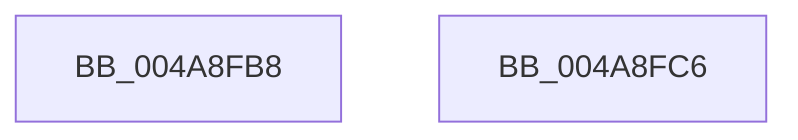

# KeIsImportOptimizationEnabled

- RVA: `0x004A8FB8`–`0x004A8FC7` (길이 `15` bytes)
- VA: `0x00000001404A8FB8`
- 실행 섹션: `.text`
- PDB 이름 있음: `예`; PDB Function 태그: `아니요`
- unwind 정보 RVA: `0x000DB714`
- 디코드: `6`개 명령, `15/15` bytes 표시
- 미해석 바이트: `0` (있으면 어셈블리에 `.byte`로 보존)

> 이 문서는 커널 이미지의 기계어와 PDB 기호를 분석해 생성했습니다. 4번과 5번은 함수 원형과 자료형을 바이너리 사용 방식에서 추정한 C 해석이며 원본 소스 복구 결과는 아닙니다.

## 1. Dependencies

- 직접 호출 지점: **0**; 고유 호출 대상: **0**
- 직접 호출자로 확인된 함수: **7**
- RIP 상대 이미지 참조: **1**

### Outgoing calls
- 직접 디코드된 call 명령이 없습니다.

### Direct callers
- [MmHasImageBeenImportOptimized](../../page/70/MmHasImageBeenImportOptimized_function_00704CD8.md) at `0x00704CDC`
- [KeQuerySpeculationControlInformation](../../page/74/KeQuerySpeculationControlInformation_function_007468A8.md) at `0x00746A73`
- [MiReserveBestDriverRange](../../page/7F/MiReserveBestDriverRange_function_007F92E0.md) at `0x007F932A`
- [MiParseImageLoadConfig](../../page/94/MiParseImageLoadConfig_function_00940D18.md) at `0x00941356`
- [MiApplyImportOptimizationToRuntimeDriver](../../page/A9/MiApplyImportOptimizationToRuntimeDriver_function_00A9F93C.md) at `0x00A9F96D`
- [VfUtilIsProtectedDriver](../../pagevrfy/B9/VfUtilIsProtectedDriver_function_00B9349C.md) at `0x00B934A0`
- [MmApplyVerifierToRunningImage](../../pagevrfy/BB/MmApplyVerifierToRunningImage_function_00BB4780.md) at `0x00BB47A1`

### Static image references
- `0x004A8FB8` → RVA `0x00F10EC0` (`.data`; read)

## 2. Other-region calls and transfers

- 다른 실행 섹션으로 향하는 call: **0**
- 별도 외부 분기/꼬리 이동을 확인하지 못했습니다.

## 3. Assembly (complete function range)

```asm
004A8FB8  8B 05 02 7F A6 00               mov eax, dword ptr [rip + 0xa67f02]
004A8FBE  C1 E8 11                        shr eax, 0x11
004A8FC1  F6 D0                           not al
004A8FC3  24 01                           and al, 1
004A8FC5  C3                              ret
004A8FC6  CC                              int3
```

## 4. C-style interpretation (structured pseudocode)

```c
__int64 __fastcall KeIsImportOptimizationEnabled(void)
{
    __int64 result;

    result = (unsigned int)(((unsigned int)(*(unsigned int *)(v_rip + 10911490))) >> (17));
    result = (unsigned __int8)(~(result));
    result = (unsigned __int8)((result) & (1));
    return result;
}
```

## 5. (Beta) C Style

```c
void KeIsImportOptimizationEnabled(void)
{
    int64_t result;

    result = (uint32_t)(((uint32_t)(*(uint32_t *)(v_rip + 0xA67F02))) >> (17));
    result = (uint8_t)(~(result));
    result = (uint8_t)((result) & (1));
    return result;
}
```

## 6. Execution-region graph

[열기: 2D/3D 그래프와 함수 탐색 컨트롤 패널](../../../control-panel.html?section=text&rva=0x004A8FB8&view=graph)

- 2D 그래프는 위에서 아래로 흐르고, 3D 그래프는 빈 공간을 드래그해 회전합니다. Shift+드래그는 이동, 휠은 확대·축소, 함수 노드 선택은 대상 보고서 이동입니다.

### Static fallback


