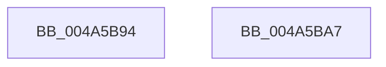

# KeMakeUserDirectoryTableBase

- RVA: `0x004A5B94`–`0x004A5BA8` (길이 `20` bytes)
- VA: `0x00000001404A5B94`
- 실행 섹션: `.text`
- PDB 이름 있음: `예`; PDB Function 태그: `아니요`
- unwind 정보 RVA: `0x000DB714`
- 디코드: `6`개 명령, `20/20` bytes 표시
- 미해석 바이트: `0` (있으면 어셈블리에 `.byte`로 보존)

> 이 문서는 커널 이미지의 기계어와 PDB 기호를 분석해 생성했습니다. 4번과 5번은 함수 원형과 자료형을 바이너리 사용 방식에서 추정한 C 해석이며 원본 소스 복구 결과는 아닙니다.

## 1. Dependencies

- 직접 호출 지점: **0**; 고유 호출 대상: **0**
- 직접 호출자로 확인된 함수: **1**
- RIP 상대 이미지 참조: **1**

### Outgoing calls
- 직접 디코드된 call 명령이 없습니다.

### Direct callers
- [MiAllocateProcessShadow](../../page/A5/MiAllocateProcessShadow_function_00A5F1A0.md) at `0x00A5F23F`

### Static image references
- `0x004A5B9B` → RVA `0x00FC6A87` (`ALMOSTRO`; read)

## 2. Other-region calls and transfers

- 다른 실행 섹션으로 향하는 call: **0**
- 별도 외부 분기/꼬리 이동을 확인하지 못했습니다.

## 3. Assembly (complete function range)

```asm
004A5B94  48 8B C1                        mov rax, rcx
004A5B97  48 83 C8 01                     or rax, 1
004A5B9B  80 3D E5 0E B2 00 00            cmp byte ptr [rip + 0xb20ee5], 0
004A5BA2  48 0F 44 C1                     cmove rax, rcx
004A5BA6  C3                              ret
004A5BA7  CC                              int3
```

## 4. C-style interpretation (structured pseudocode)

```c
__int64 __fastcall KeMakeUserDirectoryTableBase(__int64 a1)
{
    __int64 result;

    result = (a1) | (1);
    if ((*(unsigned __int8 *)(v_rip + 11669221)) == 0) { result = a1; }
    return result;
}
```

## 5. (Beta) C Style

```c
int64_t KeMakeUserDirectoryTableBase(int64_t Arg1)
{
    int64_t result;

    result = (Arg1) | (1);
    if ((*(uint8_t *)(v_rip + 0xB20EE5)) == 0) { result = Arg1; }
    return result;
}
```

## 6. Execution-region graph

[열기: 2D/3D 그래프와 함수 탐색 컨트롤 패널](../../../control-panel.html?section=text&rva=0x004A5B94&view=graph)

- 2D 그래프는 위에서 아래로 흐르고, 3D 그래프는 빈 공간을 드래그해 회전합니다. Shift+드래그는 이동, 휠은 확대·축소, 함수 노드 선택은 대상 보고서 이동입니다.

### Static fallback


