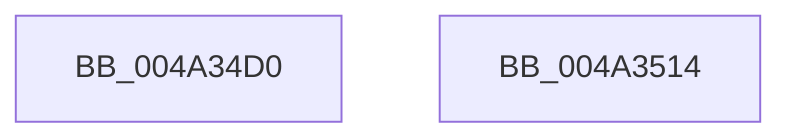

# KeProfileInterruptWithSource

- RVA: `0x004A34D0`–`0x004A3515` (길이 `69` bytes)
- VA: `0x00000001404A34D0`
- 실행 섹션: `.text`
- PDB 이름 있음: `예`; PDB Function 태그: `아니요`
- unwind 정보 RVA: `0x0005CAAC`
- 디코드: `18`개 명령, `69/69` bytes 표시
- 미해석 바이트: `0` (있으면 어셈블리에 `.byte`로 보존)

> 이 문서는 커널 이미지의 기계어와 PDB 기호를 분석해 생성했습니다. 4번과 5번은 함수 원형과 자료형을 바이너리 사용 방식에서 추정한 C 해석이며 원본 소스 복구 결과는 아닙니다.

## 1. Dependencies

- 직접 호출 지점: **2**; 고유 호출 대상: **1**
- 직접 호출자로 확인된 함수: **7**
- RIP 상대 이미지 참조: **1**

### Outgoing calls
- `0x004A34F3` → [KiProcessProfileList](KiProcessProfileList_function_004A351C.md) (function, `0x004A351C`)
- `0x004A3504` → [KiProcessProfileList](KiProcessProfileList_function_004A351C.md) (function, `0x004A351C`)

### Direct callers
- [DefaultOverflowHandler](../54/DefaultOverflowHandler_function_0054DBE0.md) at `0x0054DBF9`
- [EmonOverflowHandlerInternalV1Enhanced](../55/EmonOverflowHandlerInternalV1Enhanced_function_0055D88C.md) at `0x0055DA3D`
- [EmonOverflowHandlerInternalV1Enhanced](../55/EmonOverflowHandlerInternalV1Enhanced_function_0055D88C.md) at `0x0055DBD0`
- [EmonOverflowHandlerInternalV1Original](../55/EmonOverflowHandlerInternalV1Original_function_0055DCD8.md) at `0x0055DE73`
- [EmonOverflowHandlerInternalV1Original](../55/EmonOverflowHandlerInternalV1Original_function_0055DCD8.md) at `0x0055E006`
- [EmonOverflowHandlerInternalV2Enhanced](../55/EmonOverflowHandlerInternalV2Enhanced_function_0055E110.md) at `0x0055E327`
- [EmonOverflowHandlerInternalV2Enhanced](../55/EmonOverflowHandlerInternalV2Enhanced_function_0055E110.md) at `0x0055E4B3`
- [EmonOverflowHandlerInternalV2Original](../55/EmonOverflowHandlerInternalV2Original_function_0055E5BC.md) at `0x0055E7BE`
- [EmonOverflowHandlerInternalV2Original](../55/EmonOverflowHandlerInternalV2Original_function_0055E5BC.md) at `0x0055E94A`
- [HalpTimerProfileInterrupt](../56/HalpTimerProfileInterrupt_function_00560560.md) at `0x005605A0`
- [Amd64OverflowHandlerInternal](../56/Amd64OverflowHandlerInternal_function_0056D330.md) at `0x0056D4FF`
- [Amd64OverflowHandlerInternal](../56/Amd64OverflowHandlerInternal_function_0056D330.md) at `0x0056D6E5`

### Static image references
- `0x004A34F8` → RVA `0x00F22D50` (`.data`; read)

## 2. Other-region calls and transfers

- 다른 실행 섹션으로 향하는 call: **0**
- 별도 외부 분기/꼬리 이동을 확인하지 못했습니다.

## 3. Assembly (complete function range)

```asm
004A34D0  48 89 5C 24 08                  mov qword ptr [rsp + 8], rbx
004A34D5  57                              push rdi
004A34D6  48 83 EC 20                     sub rsp, 0x20
004A34DA  65 48 8B 04 25 88 01 00 00      mov rax, qword ptr gs:[0x188]
004A34E3  8B DA                           mov ebx, edx
004A34E5  48 8B F9                        mov rdi, rcx
004A34E8  4C 8B 80 B8 00 00 00            mov r8, qword ptr [rax + 0xb8]
004A34EF  49 83 C0 18                     add r8, 0x18
004A34F3  E8 24 00 00 00                  call 0x1404a351c
004A34F8  4C 8D 05 51 F8 A7 00            lea r8, [rip + 0xa7f851]
004A34FF  8B D3                           mov edx, ebx
004A3501  48 8B CF                        mov rcx, rdi
004A3504  E8 13 00 00 00                  call 0x1404a351c
004A3509  48 8B 5C 24 30                  mov rbx, qword ptr [rsp + 0x30]
004A350E  48 83 C4 20                     add rsp, 0x20
004A3512  5F                              pop rdi
004A3513  C3                              ret
004A3514  CC                              int3
```

## 4. C-style interpretation (structured pseudocode)

```c
__int64 __fastcall KeProfileInterruptWithSource(__int64 a1, int a2)
{
    __int64 result;
    __int64 v_rsp;
    unsigned __int64 v_stack_p8;

    v_stack_p8 = v_rbx;
    v_rsp = (v_rsp) - (32);
    a3 = (*(unsigned __int64 *)(*(unsigned __int64 *)(gs_base + (0 + 392)) + 184)) + (24);
    result = KiProcessProfileList(a1, a2, a3, a4);
    result = KiProcessProfileList(a1, (unsigned int)((unsigned int)((unsigned int)(a2))), v_rip + 11008081, a4);
    v_rsp = (v_rsp) + (32);
    return result;
}
```

## 5. (Beta) C Style

```c
int64_t KeProfileInterruptWithSource(int64_t Arg1, int32_t Arg2)
{
    int64_t result;
    int64_t local_rsp;
    uint64_t v_stack_p8;

    v_stack_p8 = local_rbx;
    local_rsp = (local_rsp) - (32);
    a3 = (*(uint64_t *)(*(uint64_t *)(gs_base + (0 + 0x188)) + 0xB8)) + (24);
    result = KiProcessProfileList(Arg1, Arg2, a3, a4);
    result = KiProcessProfileList(Arg1, (uint32_t)((uint32_t)((uint32_t)(Arg2))), v_rip + 11008081, a4);
    local_rsp = (local_rsp) + (32);
    return result;
}
```

## 6. Execution-region graph

[열기: 2D/3D 그래프와 함수 탐색 컨트롤 패널](../../../control-panel.html?section=text&rva=0x004A34D0&view=graph)

- 2D 그래프는 위에서 아래로 흐르고, 3D 그래프는 빈 공간을 드래그해 회전합니다. Shift+드래그는 이동, 휠은 확대·축소, 함수 노드 선택은 대상 보고서 이동입니다.

### Static fallback


