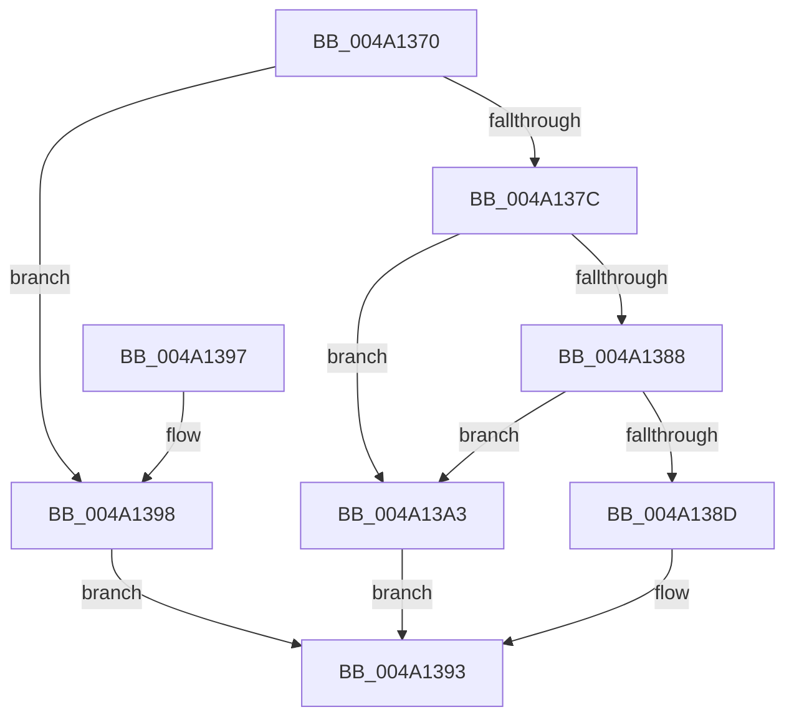

# KeQueryInterruptPartitionCount

- RVA: `0x004A1370`–`0x004A13AB` (길이 `59` bytes)
- VA: `0x00000001404A1370`
- 실행 섹션: `.text`
- PDB 이름 있음: `예`; PDB Function 태그: `아니요`
- unwind 정보 RVA: `0x000DB714`
- 디코드: `18`개 명령, `59/59` bytes 표시
- 미해석 바이트: `0` (있으면 어셈블리에 `.byte`로 보존)

> 이 문서는 커널 이미지의 기계어와 PDB 기호를 분석해 생성했습니다. 4번과 5번은 함수 원형과 자료형을 바이너리 사용 방식에서 추정한 C 해석이며 원본 소스 복구 결과는 아닙니다.

## 1. Dependencies

- 직접 호출 지점: **0**; 고유 호출 대상: **0**
- 직접 호출자로 확인된 함수: **0**
- RIP 상대 이미지 참조: **2**

### Outgoing calls
- 직접 디코드된 call 명령이 없습니다.

### Direct callers
- 이 함수 시작 RVA로 연결되는 직접 call은 확인되지 않았습니다. 간접 호출은 완전히 역산할 수 없습니다.

### Static image references
- `0x004A1373` → RVA `0x00F10E60` (`.data`; read)
- `0x004A137C` → RVA `0x00F10E68` (`.data`; read)

## 2. Other-region calls and transfers

- 다른 실행 섹션으로 향하는 call: **0**
- 별도 외부 분기/꼬리 이동을 확인하지 못했습니다.

## 3. Assembly (complete function range)

```asm
004A1370  45 33 C0                        xor r8d, r8d
004A1373  44 38 05 E6 FA A6 00            cmp byte ptr [rip + 0xa6fae6], r8b
004A137A  74 1C                           je 0x1404a1398
004A137C  48 8B 05 E5 FA A6 00            mov rax, qword ptr [rip + 0xa6fae5]
004A1383  48 85 C0                        test rax, rax
004A1386  74 1B                           je 0x1404a13a3
004A1388  66 85 C9                        test cx, cx
004A138B  75 16                           jne 0x1404a13a3
004A138D  0F B6 40 02                     movzx eax, byte ptr [rax + 2]
004A1391  89 02                           mov dword ptr [rdx], eax
004A1393  41 8B C0                        mov eax, r8d
004A1396  C3                              ret
004A1397  CC                              int3
004A1398  44 89 02                        mov dword ptr [rdx], r8d
004A139B  41 B8 03 01 00 00               mov r8d, 0x103
004A13A1  EB F0                           jmp 0x1404a1393
004A13A3  41 B8 BB 00 00 C0               mov r8d, 0xc00000bb
004A13A9  EB E8                           jmp 0x1404a1393
```

## 4. C-style interpretation (structured pseudocode)

```c
__int64 __fastcall KeQueryInterruptPartitionCount(unsigned __int16 a1, __int64 a2, int a3)
{
    a3 = 0;
    if ((*(unsigned __int8 *)(v_rip + 10943206)) == 0) goto loc_004A1398;
    if (*(unsigned __int64 *)(v_rip + 10943205) == 0) goto loc_004A13A3;
    if (a1 != 0) goto loc_004A13A3;
    *(unsigned int *)(a2) = (unsigned int)(*(unsigned __int8 *)(*(unsigned __int64 *)(v_rip + 10943205) + 2));
loc_004A1393:
    return 0;
loc_004A1398:
    *(unsigned int *)(a2) = 0;
    goto loc_004A1393;
loc_004A13A3:
    goto loc_004A1393;
}
```

## 5. (Beta) C Style

```c
int64_t KeQueryInterruptPartitionCount(uint16_t Arg1, void *Arg2, int32_t Arg3)
{
    uint8_t *arg2 = (uint8_t *)Arg2;

    Arg3 = 0;
    if ((*(uint8_t *)(v_rip + 0xA6FAE6)) == 0) goto loc_004A1398;
    if (*(uint64_t *)(v_rip + 0xA6FAE5) == 0) goto loc_004A13A3;
    if (Arg1 != 0) goto loc_004A13A3;
    *(uint32_t *)(arg2) = (uint32_t)(*(uint8_t *)(*(uint64_t *)(v_rip + 0xA6FAE5) + 0x2));
loc_004A1393:
    return 0;
loc_004A1398:
    *(uint32_t *)(arg2) = 0;
    goto loc_004A1393;
loc_004A13A3:
    goto loc_004A1393;
}
```

### 관측된 메모리 오프셋

구조체 형식이 확인되지 않은 접근은 인자 기준의 오프셋으로만 기록했습니다.

| 기준 인자 | 오프셋 표현 | 폭 (bit) | 접근 |
|---|---:|---:|---|
| `Arg2` | `+ 0x0` | `32` | `W` |

## 6. Execution-region graph

[열기: 2D/3D 그래프와 함수 탐색 컨트롤 패널](../../../control-panel.html?section=text&rva=0x004A1370&view=graph)

- 2D 그래프는 위에서 아래로 흐르고, 3D 그래프는 빈 공간을 드래그해 회전합니다. Shift+드래그는 이동, 휠은 확대·축소, 함수 노드 선택은 대상 보고서 이동입니다.

### Static fallback


