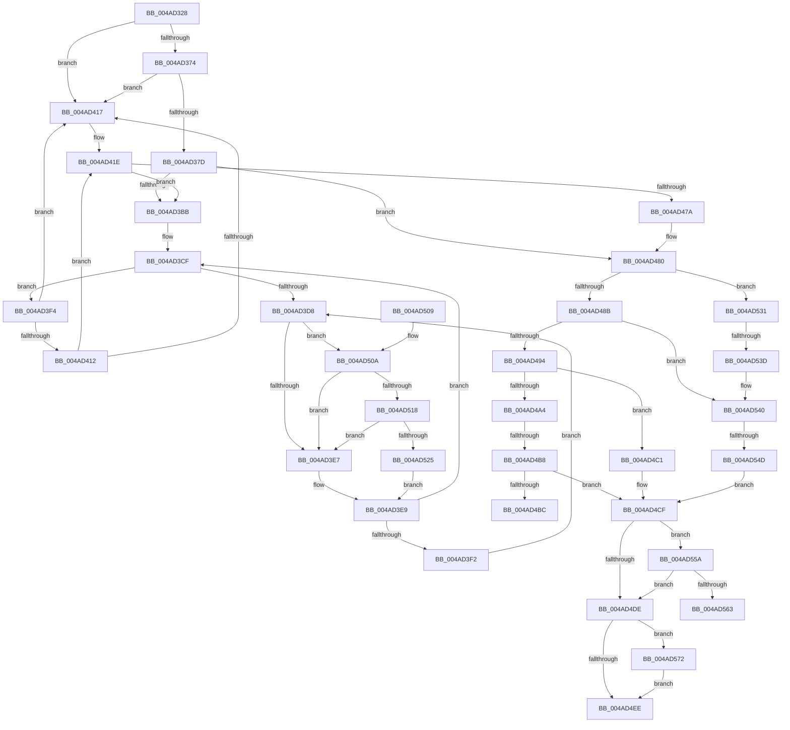

# KeRemoveSchedulingGroup

- RVA: `0x004AD328`–`0x004AD584` (길이 `604` bytes)
- VA: `0x00000001404AD328`
- 실행 섹션: `.text`
- PDB 이름 있음: `예`; PDB Function 태그: `예`
- unwind 정보 RVA: `0x000B8410`
- 디코드: `146`개 명령, `604/604` bytes 표시
- 미해석 바이트: `0` (있으면 어셈블리에 `.byte`로 보존)

> 이 문서는 커널 이미지의 기계어와 PDB 기호를 분석해 생성했습니다. 4번과 5번은 함수 원형과 자료형을 바이너리 사용 방식에서 추정한 C 해석이며 원본 소스 복구 결과는 아닙니다.

## 1. Dependencies

- 직접 호출 지점: **6**; 고유 호출 대상: **6**
- 직접 호출자로 확인된 함수: **4**
- RIP 상대 이미지 참조: **9**

### Outgoing calls
- `0x004AD35A` → [KeAcquireInStackQueuedSpinLock](../27/KeAcquireInStackQueuedSpinLock_function_002757A0.md) (function, `0x002757A0`)
- `0x004AD4AB` → [KiUpdateMinimumWeight](KiUpdateMinimumWeight_function_004A9DCC.md) (function, `0x004A9DCC`)
- `0x004AD4D4` → [KeReleaseInStackQueuedSpinLock](../34/KeReleaseInStackQueuedSpinLock_function_00342CE0.md) (function, `0x00342CE0`)
- `0x004AD518` → [KiCheckVpBackingLongSpinWaitHypercall](../30/KiCheckVpBackingLongSpinWaitHypercall_function_0030F490.md) (function, `0x0030F490`)
- `0x004AD527` → [HvlNotifyLongSpinWait](../30/HvlNotifyLongSpinWait_function_0030F460.md) (function, `0x0030F460`)
- `0x004AD57A` → [EtwTraceSchedulingGroup](../65/EtwTraceSchedulingGroup_function_00650108.md) (function, `0x00650108`)

### Direct callers
- [PspEstablishDfssHierarchy](../../page/78/PspEstablishDfssHierarchy_function_00784EF0.md) at `0x00784FAB`
- [PsSessionObjectDelete](../../page/78/PsSessionObjectDelete_function_00788E70.md) at `0x00788E92`
- [PspEstablishJobHierarchy](../../page/87/PspEstablishJobHierarchy_function_0087E17C.md) at `0x0087E547`
- [PspRemoveCpuRateControl](../../page/99/PspRemoveCpuRateControl_function_0099E134.md) at `0x0099E15B`

### Static image references
- `0x004AD347` → RVA `0x00FCF180` (`CACHEALI`; read)
- `0x004AD380` → RVA `0x00FC8C40` (`ALMOSTRO`; read)
- `0x004AD38E` → RVA `0x00FC6A80` (`ALMOSTRO`; read)
- `0x004AD3DB` → RVA `0x00FC52AC` (`ALMOSTRO`; reference)
- `0x004AD494` → RVA `0x00F23420` (`.data`; read)
- `0x004AD4C1` → RVA `0x00F23434` (`.data`; read/write)
- `0x004AD4C8` → RVA `0x00F23438` (`.data`; read/write)
- `0x004AD4DE` → RVA `0x00FC6B14` (`ALMOSTRO`; read)
- `0x004AD50A` → RVA `0x00FC6AB8` (`ALMOSTRO`; read)

## 2. Other-region calls and transfers

- 다른 실행 섹션으로 향하는 call: **0**
- call이 아닌 외부 분기/꼬리 이동: **5**
  - `0x004AD4B2` → [sub_006FA7F8 + 0x13](../6F/Unknown_function_006FA7F8.md) (`tail-transfer`)
  - `0x004AD4BC` → [sub_006FA7F8 + 0x13](../6F/Unknown_function_006FA7F8.md) (`tail-transfer`)
  - `0x004AD537` → [sub_006FA7F8](../6F/Unknown_function_006FA7F8.md) (`tail-transfer`)
  - `0x004AD547` → [sub_006FA7F8 + 0xB](../6F/Unknown_function_006FA7F8.md) (`tail-transfer`)
  - `0x004AD56D` → [sub_006FA7F8 + 0x22](../6F/Unknown_function_006FA7F8.md) (`tail-transfer`)

## 3. Assembly (complete function range)

```asm
004AD328  48 89 5C 24 18                  mov qword ptr [rsp + 0x18], rbx
004AD32D  55                              push rbp
004AD32E  56                              push rsi
004AD32F  57                              push rdi
004AD330  41 54                           push r12
004AD332  41 55                           push r13
004AD334  41 56                           push r14
004AD336  41 57                           push r15
004AD338  48 83 EC 40                     sub rsp, 0x40
004AD33C  48 8B F1                        mov rsi, rcx
004AD33F  48 8D 54 24 20                  lea rdx, [rsp + 0x20]
004AD344  0F 57 C0                        xorps xmm0, xmm0
004AD347  48 8D 0D 32 1E B2 00            lea rcx, [rip + 0xb21e32]
004AD34E  33 C0                           xor eax, eax
004AD350  0F 11 44 24 20                  movups xmmword ptr [rsp + 0x20], xmm0
004AD355  48 89 44 24 30                  mov qword ptr [rsp + 0x30], rax
004AD35A  E8 41 84 DC FF                  call 0x1402757a0
004AD35F  48 8D 46 38                     lea rax, [rsi + 0x38]
004AD363  48 8B 10                        mov rdx, qword ptr [rax]
004AD366  48 8B 48 08                     mov rcx, qword ptr [rax + 8]
004AD36A  48 39 42 08                     cmp qword ptr [rdx + 8], rax
004AD36E  0F 85 A3 00 00 00               jne 0x1404ad417
004AD374  48 39 01                        cmp qword ptr [rcx], rax
004AD377  0F 85 9A 00 00 00               jne 0x1404ad417
004AD37D  48 89 11                        mov qword ptr [rcx], rdx
004AD380  4C 8D 3D B9 B8 B1 00            lea r15, [rip + 0xb1b8b9]
004AD387  45 33 ED                        xor r13d, r13d
004AD38A  48 89 4A 08                     mov qword ptr [rdx + 8], rcx
004AD38E  44 8B 35 EB 96 B1 00            mov r14d, dword ptr [rip + 0xb196eb]
004AD395  40 32 ED                        xor bpl, bpl
004AD398  48 8B 7E 60                     mov rdi, qword ptr [rsi + 0x60]
004AD39C  45 33 E4                        xor r12d, r12d
004AD39F  4C 89 AC 24 88 00 00 00         mov qword ptr [rsp + 0x88], r13
004AD3A7  89 AC 24 80 00 00 00            mov dword ptr [rsp + 0x80], ebp
004AD3AE  41 8D 45 01                     lea eax, [r13 + 1]
004AD3B2  45 85 F6                        test r14d, r14d
004AD3B5  0F 84 C5 00 00 00               je 0x1404ad480
004AD3BB  4B 8B 2C E7                     mov rbp, qword ptr [r15 + r12*8]
004AD3BF  41 8B C4                        mov eax, r12d
004AD3C2  4C 69 E8 B8 01 00 00            imul r13, rax, 0x1b8
004AD3C9  33 DB                           xor ebx, ebx
004AD3CB  44 8D 7B 01                     lea r15d, [rbx + 1]
004AD3CF  F0 48 0F BA 6D 30 00            lock bts qword ptr [rbp + 0x30], 0
004AD3D6  73 1C                           jae 0x1404ad3f4
004AD3D8  41 03 DF                        add ebx, r15d
004AD3DB  85 1D CB 7E B1 00               test dword ptr [rip + 0xb17ecb], ebx
004AD3E1  0F 84 23 01 00 00               je 0x1404ad50a
004AD3E7  F3 90                           pause
004AD3E9  48 8B 45 30                     mov rax, qword ptr [rbp + 0x30]
004AD3ED  48 85 C0                        test rax, rax
004AD3F0  74 DD                           je 0x1404ad3cf
004AD3F2  EB E4                           jmp 0x1404ad3d8
004AD3F4  48 8D 86 C8 00 00 00            lea rax, [rsi + 0xc8]
004AD3FB  49 03 C5                        add rax, r13
004AD3FE  4C 8D 3D 3B B8 B1 00            lea r15, [rip + 0xb1b83b]
004AD405  48 8B 10                        mov rdx, qword ptr [rax]
004AD408  48 8B 48 08                     mov rcx, qword ptr [rax + 8]
004AD40C  48 39 42 08                     cmp qword ptr [rdx + 8], rax
004AD410  75 05                           jne 0x1404ad417
004AD412  48 39 01                        cmp qword ptr [rcx], rax
004AD415  74 07                           je 0x1404ad41e
004AD417  B9 03 00 00 00                  mov ecx, 3
004AD41C  CD 29                           int 0x29
004AD41E  44 8B 84 24 80 00 00 00         mov r8d, dword ptr [rsp + 0x80]
004AD426  B8 00 01 00 00                  mov eax, 0x100
004AD42B  48 89 11                        mov qword ptr [rcx], rdx
004AD42E  48 89 4A 08                     mov qword ptr [rdx + 8], rcx
004AD432  66 41 85 84 35 F0 00 00 00      test word ptr [r13 + rsi + 0xf0], ax
004AD43B  B8 01 00 00 00                  mov eax, 1
004AD440  45 0F B6 C0                     movzx r8d, r8b
004AD444  44 0F 45 C0                     cmovne r8d, eax
004AD448  44 89 84 24 80 00 00 00         mov dword ptr [rsp + 0x80], r8d
004AD450  F0 48 83 65 30 00               lock and qword ptr [rbp + 0x30], 0
004AD456  4C 8B 8C 24 88 00 00 00         mov r9, qword ptr [rsp + 0x88]
004AD45E  44 03 E0                        add r12d, eax
004AD461  4D 03 8C 35 B8 00 00 00         add r9, qword ptr [r13 + rsi + 0xb8]
004AD469  4C 89 8C 24 88 00 00 00         mov qword ptr [rsp + 0x88], r9
004AD471  45 3B E6                        cmp r12d, r14d
004AD474  0F 82 41 FF FF FF               jb 0x1404ad3bb
004AD47A  41 8B E8                        mov ebp, r8d
004AD47D  4D 8B E9                        mov r13, r9
004AD480  8B 5E 04                        mov ebx, dword ptr [rsi + 4]
004AD483  23 D8                           and ebx, eax
004AD485  0F 84 A6 00 00 00               je 0x1404ad531
004AD48B  48 85 FF                        test rdi, rdi
004AD48E  0F 85 AC 00 00 00               jne 0x1404ad540
004AD494  48 8D 05 85 5F A7 00            lea rax, [rip + 0xa75f85]
004AD49B  48 39 05 7E 5F A7 00            cmp qword ptr [rip + 0xa75f7e], rax
004AD4A2  74 1D                           je 0x1404ad4c1
004AD4A4  45 33 C0                        xor r8d, r8d
004AD4A7  33 D2                           xor edx, edx
004AD4A9  8B CB                           mov ecx, ebx
004AD4AB  E8 1C C9 FF FF                  call 0x1404a9dcc
004AD4B0  84 C0                           test al, al
004AD4B2  0F 85 53 D3 24 00               jne 0x1406fa80b
004AD4B8  85 DB                           test ebx, ebx
004AD4BA  75 13                           jne 0x1404ad4cf
004AD4BC  E9 4A D3 24 00                  jmp 0x1406fa80b
004AD4C1  83 25 6C 5F A7 00 00            and dword ptr [rip + 0xa75f6c], 0
004AD4C8  83 25 69 5F A7 00 00            and dword ptr [rip + 0xa75f69], 0
004AD4CF  48 8D 4C 24 20                  lea rcx, [rsp + 0x20]
004AD4D4  E8 07 58 E9 FF                  call 0x140342ce0
004AD4D9  40 84 ED                        test bpl, bpl
004AD4DC  75 7C                           jne 0x1404ad55a
004AD4DE  F7 05 2C 96 B1 00 00 40 00 00   test dword ptr [rip + 0xb1962c], 0x4000
004AD4E8  0F 85 84 00 00 00               jne 0x1404ad572
004AD4EE  48 8B 9C 24 90 00 00 00         mov rbx, qword ptr [rsp + 0x90]
004AD4F6  49 8B C5                        mov rax, r13
004AD4F9  48 83 C4 40                     add rsp, 0x40
004AD4FD  41 5F                           pop r15
004AD4FF  41 5E                           pop r14
004AD501  41 5D                           pop r13
004AD503  41 5C                           pop r12
004AD505  5F                              pop rdi
004AD506  5E                              pop rsi
004AD507  5D                              pop rbp
004AD508  C3                              ret
004AD509  CC                              int3
004AD50A  8B 05 A8 95 B1 00               mov eax, dword ptr [rip + 0xb195a8]
004AD510  A8 40                           test al, 0x40
004AD512  0F 84 CF FE FF FF               je 0x1404ad3e7
004AD518  E8 73 1F E6 FF                  call 0x14030f490
004AD51D  84 C0                           test al, al
004AD51F  0F 84 C2 FE FF FF               je 0x1404ad3e7
004AD525  8B CB                           mov ecx, ebx
004AD527  E8 34 1F E6 FF                  call 0x14030f460
004AD52C  E9 B8 FE FF FF                  jmp 0x1404ad3e9
004AD531  0F B7 06                        movzx eax, word ptr [rsi]
004AD534  48 85 FF                        test rdi, rdi
004AD537  0F 84 BB D2 24 00               je 0x1406fa7f8
004AD53D  29 47 14                        sub dword ptr [rdi + 0x14], eax
004AD540  48 8D 47 50                     lea rax, [rdi + 0x50]
004AD544  48 39 00                        cmp qword ptr [rax], rax
004AD547  0F 85 B6 D2 24 00               jne 0x1406fa803
004AD54D  83 67 10 00                     and dword ptr [rdi + 0x10], 0
004AD551  83 67 0C 00                     and dword ptr [rdi + 0xc], 0
004AD555  E9 75 FF FF FF                  jmp 0x1404ad4cf
004AD55A  45 85 F6                        test r14d, r14d
004AD55D  0F 84 7B FF FF FF               je 0x1404ad4de
004AD563  48 8D 9E 80 00 00 00            lea rbx, [rsi + 0x80]
004AD56A  49 8B FE                        mov rdi, r14
004AD56D  E9 A8 D2 24 00                  jmp 0x1406fa81a
004AD572  BA 63 05 00 00                  mov edx, 0x563
004AD577  48 8B CE                        mov rcx, rsi
004AD57A  E8 89 2B 1A 00                  call 0x140650108
004AD57F  E9 6A FF FF FF                  jmp 0x1404ad4ee
```

## 4. C-style interpretation (structured pseudocode)

```c
__int64 __fastcall KeRemoveSchedulingGroup(__int64 a1)
{
    __int64 result;
    __int64 v_r12;
    __int64 v_r13;
    __int64 v_rbp;
    __int64 v_rbx;
    __int64 v_rsp;
    unsigned __int64 v_stack_m48;
    unsigned __int64 v_stack_m58;
    unsigned __int64 v_stack_p10;
    unsigned __int64 v_stack_p18;
    unsigned int v_stack_p8;

    v_stack_p18 = v_rbx;
    v_rsp = (v_rsp) - (64);
    result = 0;
    v_stack_m58 = v_xmm0;
    v_stack_m48 = 0;
    result = KeAcquireInStackQueuedSpinLock(v_rip + 11673138, v_stack_m58, a3, a4);
    if ((*(unsigned __int64 *)(*(unsigned __int64 *)(a1 + 56) + 8)) != (a1 + 56)) goto loc_004AD417;
    if ((*(unsigned __int64 *)(*(unsigned __int64 *)(a1 + 56 + 8))) != (a1 + 56)) goto loc_004AD417;
    *(unsigned __int64 *)(*(unsigned __int64 *)(a1 + 56 + 8)) = *(unsigned __int64 *)(a1 + 56);
    v_r13 = 0;
    *(unsigned __int64 *)(*(unsigned __int64 *)(a1 + 56) + 8) = *(unsigned __int64 *)(a1 + 56 + 8);
    v_rbp = 0;
    v_r12 = 0;
    v_stack_p10 = 0;
    v_stack_p8 = 0;
    if ((unsigned int)((unsigned int)(*(unsigned int *)(v_rip + 11638507))) == 0) goto loc_004AD480;
loc_004AD3BB:
    v_r13 = (v_r13) * (0);
    v_rbx = 0;
loc_004AD3CF:
    if (condition_is_above_or_equal) goto loc_004AD3F4;
loc_004AD3D8:
    v_rbx = (unsigned int)((v_rbx) + ((unsigned int)(v_rbx + 1)));
    if (((*(unsigned int *)(v_rip + 11632331)) & ((unsigned int)(v_rbx))) == 0) goto loc_004AD50A;
loc_004AD3E7:
loc_004AD3E9:
    if (*(unsigned __int64 *)(*(unsigned __int64 *)(v_rip + 11647161 + v_r12 * 8) + 48) == 0) goto loc_004AD3CF;
    goto loc_004AD3D8;
loc_004AD3F4:
    result = (a1 + 200) + (v_r13);
    if ((*(unsigned __int64 *)(*(unsigned __int64 *)(result) + 8)) != result) goto loc_004AD417;
    if ((*(unsigned __int64 *)(*(unsigned __int64 *)(result + 8))) != result) {
        a1 = 3;
    }
    *(unsigned __int64 *)(a1) = *(unsigned __int64 *)(result);
    *(unsigned __int64 *)(*(unsigned __int64 *)(result) + 8) = a1;
    a3 = (unsigned __int8)((unsigned int)(v_stack_p8));
    if (((*(unsigned __int16 *)(v_r13 + a1 * 1 + 240)) & (256)) != 0) { a3 = 1; }
    v_stack_p8 = (unsigned int)(a3);
    v_r12 = (unsigned int)((v_r12) + (1));
    a4 = (v_stack_p10) + (*(unsigned __int64 *)(v_r13 + a1 * 1 + 184));
    v_stack_p10 = a4;
    if (((unsigned int)(v_r12)) < ((unsigned int)((unsigned int)(*(unsigned int *)(v_rip + 11638507))))) goto loc_004AD3BB;
loc_004AD480:
    v_rbx = (unsigned int)(((unsigned int)(*(unsigned int *)(a1 + 4))) & (1));
    if (condition_is_equal) goto loc_004AD531;
    if (*(unsigned __int64 *)(a1 + 96) != 0) goto loc_004AD540;
    if ((*(unsigned __int64 *)(v_rip + 10968958)) == (v_rip + 10968965)) goto loc_004AD4C1;
    a3 = 0;
    a2 = 0;
    result = KiUpdateMinimumWeight((unsigned int)((unsigned int)(v_rbx)), a2, a3, a4);
    if ((unsigned int)(v_rbx) != 0) goto loc_004AD4CF;
loc_004AD4C1:
loc_004AD4CF:
    result = KeReleaseInStackQueuedSpinLock(v_stack_m58, a2, a3, a4);
    if ((unsigned __int8)((unsigned int)((unsigned int)(a3))) != 0) goto loc_004AD55A;
loc_004AD4DE:
    if (((*(unsigned int *)(v_rip + 11638316)) & (0x4000ULL)) != 0) goto loc_004AD572;
loc_004AD4EE:
    v_rsp = (v_rsp) + (64);
    return a4;
loc_004AD50A:
    if ((((unsigned __int8)((unsigned int)(*(unsigned int *)(v_rip + 11638184)))) & (64)) == 0) goto loc_004AD3E7;
    result = KiCheckVpBackingLongSpinWaitHypercall(v_stack_m58, a2, a3, a4);
    if ((unsigned __int8)(result) == 0) goto loc_004AD3E7;
    result = HvlNotifyLongSpinWait((unsigned int)((unsigned int)(v_stack_p18)), a2, a3, a4);
    goto loc_004AD3E9;
loc_004AD531:
loc_004AD540:
    goto loc_004AD4CF;
loc_004AD55A:
    if ((unsigned int)((unsigned int)(*(unsigned int *)(v_rip + 11638507))) == 0) goto loc_004AD4DE;
loc_004AD572:
    result = EtwTraceSchedulingGroup(a1, (unsigned int)(0x563ULL), a3, a4);
    goto loc_004AD4EE;
}
```

## 5. (Beta) C Style

```c
int64_t KeRemoveSchedulingGroup(void *Arg1)
{
    uint8_t *arg1 = (uint8_t *)Arg1;

    int64_t result;
    int64_t local_r12;
    int64_t local_r13;
    int64_t local_rbp;
    int64_t local_rbx;
    int64_t local_rsp;
    uint64_t v_stack_m48;
    uint64_t v_stack_m58;
    uint64_t v_stack_p10;
    uint64_t v_stack_p18;
    uint32_t v_stack_p8;

    v_stack_p18 = local_rbx;
    local_rsp = (local_rsp) - (64);
    result = 0;
    v_stack_m58 = v_xmm0;
    v_stack_m48 = 0;
    result = KeAcquireInStackQueuedSpinLock(v_rip + 11673138, v_stack_m58, a3, a4);
    if ((*(uint64_t *)(*(uint64_t *)(arg1 + 0x38) + 0x8)) != (Arg1 + 56)) goto loc_004AD417;
    if ((*(uint64_t *)(*(uint64_t *)(arg1 + 0x38 + 0x8))) != (Arg1 + 56)) goto loc_004AD417;
    *(uint64_t *)(*(uint64_t *)(arg1 + 0x38 + 0x8)) = *(uint64_t *)(arg1 + 0x38);
    local_r13 = 0;
    *(uint64_t *)(*(uint64_t *)(arg1 + 0x38) + 0x8) = *(uint64_t *)(arg1 + 0x38 + 0x8);
    local_rbp = 0;
    local_r12 = 0;
    v_stack_p10 = 0;
    v_stack_p8 = 0;
    if ((uint32_t)((uint32_t)(*(uint32_t *)(v_rip + 0xB196EB))) == 0) goto loc_004AD480;
loc_004AD3BB:
    local_r13 = (local_r13) * (0);
    local_rbx = 0;
loc_004AD3CF:
    if (condition_is_above_or_equal) goto loc_004AD3F4;
loc_004AD3D8:
    local_rbx = (uint32_t)((local_rbx) + ((uint32_t)(local_rbx + 1)));
    if (((*(uint32_t *)(v_rip + 0xB17ECB)) & ((uint32_t)(local_rbx))) == 0) goto loc_004AD50A;
loc_004AD3E7:
loc_004AD3E9:
    if (*(uint64_t *)(*(uint64_t *)(v_rip + 0xB1B8B9 + local_r12 * 8) + 0x30) == 0) goto loc_004AD3CF;
    goto loc_004AD3D8;
loc_004AD3F4:
    result = (Arg1 + 200) + (local_r13);
    if ((*(uint64_t *)(*(uint64_t *)(result) + 0x8)) != result) goto loc_004AD417;
    if ((*(uint64_t *)(*(uint64_t *)(result + 0x8))) != result) {
        Arg1 = 3;
    }
    *(uint64_t *)(arg1) = *(uint64_t *)(result);
    *(void **)(*(uint64_t *)(result) + 0x8) = Arg1;
    a3 = (uint8_t)((uint32_t)(v_stack_p8));
    if (((*(uint16_t *)(local_r13 + arg1 * 1 + 0xF0)) & (256)) != 0) { a3 = 1; }
    v_stack_p8 = (uint32_t)(a3);
    local_r12 = (uint32_t)((local_r12) + (1));
    a4 = (v_stack_p10) + (*(uint64_t *)(local_r13 + arg1 * 1 + 0xB8));
    v_stack_p10 = a4;
    if (((uint32_t)(local_r12)) < ((uint32_t)((uint32_t)(*(uint32_t *)(v_rip + 0xB196EB))))) goto loc_004AD3BB;
loc_004AD480:
    local_rbx = (uint32_t)(((uint32_t)(*(uint32_t *)(arg1 + 0x4))) & (1));
    if (condition_is_equal) goto loc_004AD531;
    if (*(uint64_t *)(arg1 + 0x60) != 0) goto loc_004AD540;
    if ((*(uint64_t *)(v_rip + 0xA75F7E)) == (v_rip + 10968965)) goto loc_004AD4C1;
    a3 = 0;
    a2 = 0;
    result = KiUpdateMinimumWeight((uint32_t)((uint32_t)(local_rbx)), a2, a3, a4);
    if ((uint32_t)(local_rbx) != 0) goto loc_004AD4CF;
loc_004AD4C1:
loc_004AD4CF:
    result = KeReleaseInStackQueuedSpinLock(v_stack_m58, a2, a3, a4);
    if ((uint8_t)((uint32_t)((uint32_t)(a3))) != 0) goto loc_004AD55A;
loc_004AD4DE:
    if (((*(uint32_t *)(v_rip + 0xB1962C)) & (0x4000ULL)) != 0) goto loc_004AD572;
loc_004AD4EE:
    local_rsp = (local_rsp) + (64);
    return a4;
loc_004AD50A:
    if ((((uint8_t)((uint32_t)(*(uint32_t *)(v_rip + 0xB195A8)))) & (64)) == 0) goto loc_004AD3E7;
    result = KiCheckVpBackingLongSpinWaitHypercall(v_stack_m58, a2, a3, a4);
    if ((uint8_t)(result) == 0) goto loc_004AD3E7;
    result = HvlNotifyLongSpinWait((uint32_t)((uint32_t)(v_stack_p18)), a2, a3, a4);
    goto loc_004AD3E9;
loc_004AD531:
loc_004AD540:
    goto loc_004AD4CF;
loc_004AD55A:
    if ((uint32_t)((uint32_t)(*(uint32_t *)(v_rip + 0xB196EB))) == 0) goto loc_004AD4DE;
loc_004AD572:
    result = EtwTraceSchedulingGroup(Arg1, (uint32_t)(0x563ULL), a3, a4);
    goto loc_004AD4EE;
}
```

### 관측된 메모리 오프셋

구조체 형식이 확인되지 않은 접근은 인자 기준의 오프셋으로만 기록했습니다.

| 기준 인자 | 오프셋 표현 | 폭 (bit) | 접근 |
|---|---:|---:|---|
| `Arg1` | `+ 0x0` | `16` | `R` |
| `Arg1` | `+ 0x0` | `64` | `R` |
| `Arg1` | `+ 0x4` | `32` | `R` |
| `Arg1` | `+ 0x8` | `64` | `R` |
| `Arg1` | `+ 0x38` | `64` | `R` |
| `Arg1` | `+ 0x60` | `64` | `R` |
| `Arg1` | `+ 0x80` | `64` | `R` |
| `Arg1` | `+ 0xC8` | `64` | `R` |

## 6. Execution-region graph

[열기: 2D/3D 그래프와 함수 탐색 컨트롤 패널](../../../control-panel.html?section=text&rva=0x004AD328&view=graph)

- 2D 그래프는 위에서 아래로 흐르고, 3D 그래프는 빈 공간을 드래그해 회전합니다. Shift+드래그는 이동, 휠은 확대·축소, 함수 노드 선택은 대상 보고서 이동입니다.

### Static fallback


