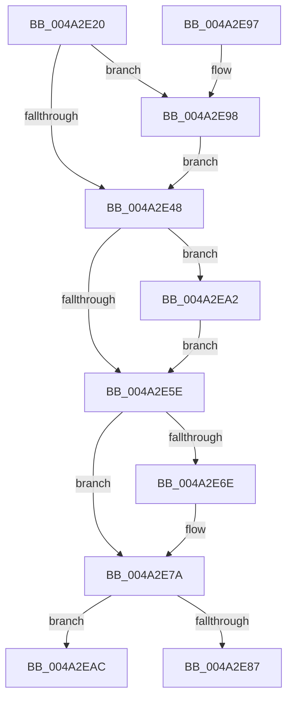

# KeRetryOutswapProcess

- RVA: `0x004A2E20`–`0x004A2EC3` (길이 `163` bytes)
- VA: `0x00000001404A2E20`
- 실행 섹션: `.text`
- PDB 이름 있음: `예`; PDB Function 태그: `예`
- unwind 정보 RVA: `0x000743B0`
- 디코드: `41`개 명령, `163/163` bytes 표시
- 미해석 바이트: `0` (있으면 어셈블리에 `.byte`로 보존)

> 이 문서는 커널 이미지의 기계어와 PDB 기호를 분석해 생성했습니다. 4번과 5번은 함수 원형과 자료형을 바이너리 사용 방식에서 추정한 C 해석이며 원본 소스 복구 결과는 아닙니다.

## 1. Dependencies

- 직접 호출 지점: **3**; 고유 호출 대상: **3**
- 직접 호출자로 확인된 함수: **2**
- RIP 상대 이미지 참조: **2**

### Outgoing calls
- `0x004A2E4B` → [KiAcquireKobjectLockSafe](../25/KiAcquireKobjectLockSafe_function_00251C90.md) (function, `0x00251C90`)
- `0x004A2E75` → [KiLowerIrqlProcessIrqlFlags](../4F/KiLowerIrqlProcessIrqlFlags_function_004F5698.md) (function, `0x004F5698`)
- `0x004A2E9B` → [KiRaiseIrqlProcessIrqlFlags](../4F/KiRaiseIrqlProcessIrqlFlags_function_004F56FC.md) (function, `0x004F56FC`)

### Direct callers
- [MiProcessWorkingSets](../34/MiProcessWorkingSets_function_0034E710.md) at `0x0034EC49`
- [MmReleaseCommitForMemResetPages](../66/MmReleaseCommitForMemResetPages_function_0066FDCC.md) at `0x0066FF23`

### Static image references
- `0x004A2E3F` → RVA `0x00FC6D20` (`ALMOSTRO`; read)
- `0x004A2EB0` → RVA `0x00F22D40` (`.data`; read)

## 2. Other-region calls and transfers

- 다른 실행 섹션으로 향하는 call: **0**
- call이 아닌 외부 분기/꼬리 이동: **1**
  - `0x004A2EBE` → [sub_006F8878](../6F/Unknown_function_006F8878.md) (`tail-transfer`)

## 3. Assembly (complete function range)

```asm
004A2E20  48 89 5C 24 08                  mov qword ptr [rsp + 8], rbx
004A2E25  48 89 74 24 10                  mov qword ptr [rsp + 0x10], rsi
004A2E2A  57                              push rdi
004A2E2B  48 83 EC 20                     sub rsp, 0x20
004A2E2F  48 8B F9                        mov rdi, rcx
004A2E32  44 0F 20 C6                     mov rsi, cr8
004A2E36  BA 02 00 00 00                  mov edx, 2
004A2E3B  44 0F 22 C2                     mov cr8, rdx
004A2E3F  83 3D DA 3E B2 00 00            cmp dword ptr [rip + 0xb23eda], 0
004A2E46  75 50                           jne 0x1404a2e98
004A2E48  48 8B CF                        mov rcx, rdi
004A2E4B  E8 40 EE DA FF                  call 0x140251c90
004A2E50  8B 9F 08 01 00 00               mov ebx, dword ptr [rdi + 0x108]
004A2E56  83 E3 07                        and ebx, 7
004A2E59  83 FB 01                        cmp ebx, 1
004A2E5C  74 44                           je 0x1404a2ea2
004A2E5E  F0 81 27 7F FF FF FF            lock and dword ptr [rdi], 0xffffff7f
004A2E65  83 3D B4 3E B2 00 00            cmp dword ptr [rip + 0xb23eb4], 0
004A2E6C  74 0C                           je 0x1404a2e7a
004A2E6E  44 0F 20 C1                     mov rcx, cr8
004A2E72  40 8A D6                        mov dl, sil
004A2E75  E8 1E 28 05 00                  call 0x1404f5698
004A2E7A  40 0F B6 C6                     movzx eax, sil
004A2E7E  44 0F 22 C0                     mov cr8, rax
004A2E82  83 FB 01                        cmp ebx, 1
004A2E85  74 25                           je 0x1404a2eac
004A2E87  48 8B 5C 24 30                  mov rbx, qword ptr [rsp + 0x30]
004A2E8C  48 8B 74 24 38                  mov rsi, qword ptr [rsp + 0x38]
004A2E91  48 83 C4 20                     add rsp, 0x20
004A2E95  5F                              pop rdi
004A2E96  C3                              ret
004A2E97  CC                              int3
004A2E98  40 8A CE                        mov cl, sil
004A2E9B  E8 5C 28 05 00                  call 0x1404f56fc
004A2EA0  EB A6                           jmp 0x1404a2e48
004A2EA2  F0 83 B7 08 01 00 00 07         lock xor dword ptr [rdi + 0x108], 7
004A2EAA  EB B2                           jmp 0x1404a2e5e
004A2EAC  48 83 C7 78                     add rdi, 0x78
004A2EB0  0F 0D 0D 89 FE A7 00            prefetchw byte ptr [rip + 0xa7fe89]
004A2EB7  48 8B 05 82 FE A7 00            mov rax, qword ptr [rip + 0xa7fe82]
004A2EBE  E9 B5 59 25 00                  jmp 0x1406f8878
```

## 4. C-style interpretation (structured pseudocode)

```c
__int64 __fastcall KeRetryOutswapProcess(__int64 a1)
{
    __int64 result;
    __int64 v_rbx;
    __int64 v_rdi;
    __int64 v_rsp;
    unsigned __int64 v_stack_p10;
    unsigned __int64 v_stack_p8;

    v_stack_p8 = v_rbx;
    v_stack_p10 = v_rsi;
    v_rsp = (v_rsp) - (32);
    if ((*(unsigned int *)(v_rip + 11681498)) != 0) goto loc_004A2E98;
loc_004A2E48:
    result = KiAcquireKobjectLockSafe(a1, 2, a3, a4);
    v_rbx = (unsigned int)(((unsigned int)(*(unsigned int *)(a1 + 264))) & (7));
    if (((unsigned int)(v_rbx)) == 1) goto loc_004A2EA2;
loc_004A2E5E:
    if ((*(unsigned int *)(v_rip + 11681460)) != 0) {
        a1 = 2;
        a2 = (unsigned __int8)(v_cr8);
        result = KiLowerIrqlProcessIrqlFlags(a1, a2, a3, a4);
    }
    if (((unsigned int)(v_rbx)) == 1) goto loc_004A2EAC;
    v_rsp = (v_rsp) + (32);
    return (unsigned __int8)(v_cr8);
loc_004A2E98:
    result = KiRaiseIrqlProcessIrqlFlags((unsigned __int8)(v_stack_p10), a2, a3, a4);
    goto loc_004A2E48;
loc_004A2EA2:
    goto loc_004A2E5E;
loc_004A2EAC:
    v_rdi = (a1) + (120);
}
```

## 5. (Beta) C Style

```c
int64_t KeRetryOutswapProcess(void *Arg1)
{
    uint8_t *arg1 = (uint8_t *)Arg1;

    int64_t result;
    int64_t local_rbx;
    int64_t local_rdi;
    int64_t local_rsp;
    uint64_t v_stack_p10;
    uint64_t v_stack_p8;

    v_stack_p8 = local_rbx;
    v_stack_p10 = local_rsi;
    local_rsp = (local_rsp) - (32);
    if ((*(uint32_t *)(v_rip + 0xB23EDA)) != 0) goto loc_004A2E98;
loc_004A2E48:
    result = KiAcquireKobjectLockSafe(Arg1, 2, a3, a4);
    local_rbx = (uint32_t)(((uint32_t)(*(uint32_t *)(arg1 + 0x108))) & (7));
    if (((uint32_t)(local_rbx)) == 1) goto loc_004A2EA2;
loc_004A2E5E:
    if ((*(uint32_t *)(v_rip + 0xB23EB4)) != 0) {
        Arg1 = 2;
        a2 = (uint8_t)(v_cr8);
        result = KiLowerIrqlProcessIrqlFlags(Arg1, a2, a3, a4);
    }
    if (((uint32_t)(local_rbx)) == 1) goto loc_004A2EAC;
    local_rsp = (local_rsp) + (32);
    return (uint8_t)(v_cr8);
loc_004A2E98:
    result = KiRaiseIrqlProcessIrqlFlags((uint8_t)(v_stack_p10), a2, a3, a4);
    goto loc_004A2E48;
loc_004A2EA2:
    goto loc_004A2E5E;
loc_004A2EAC:
    local_rdi = (Arg1) + (120);
}
```

### 관측된 메모리 오프셋

구조체 형식이 확인되지 않은 접근은 인자 기준의 오프셋으로만 기록했습니다.

| 기준 인자 | 오프셋 표현 | 폭 (bit) | 접근 |
|---|---:|---:|---|
| `Arg1` | `+ 0x0` | `32` | `R/W` |
| `Arg1` | `+ 0x108` | `32` | `R` |
| `Arg1` | `+ 0x108` | `32` | `R/W` |

## 6. Execution-region graph

[열기: 2D/3D 그래프와 함수 탐색 컨트롤 패널](../../../control-panel.html?section=text&rva=0x004A2E20&view=graph)

- 2D 그래프는 위에서 아래로 흐르고, 3D 그래프는 빈 공간을 드래그해 회전합니다. Shift+드래그는 이동, 휠은 확대·축소, 함수 노드 선택은 대상 보고서 이동입니다.

### Static fallback


