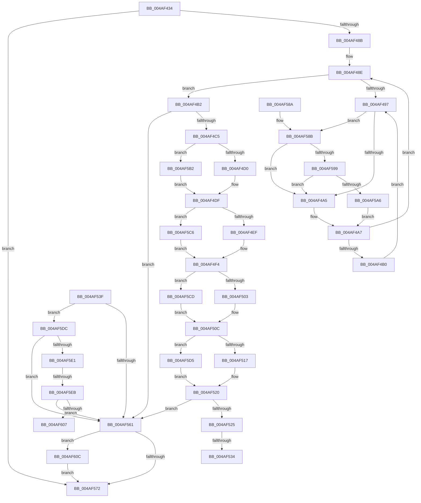

# KiAdaptThreadIdealProcessorForProcessIdealSetChange

- RVA: `0x004AF434`–`0x004AF61E` (길이 `490` bytes)
- VA: `0x00000001404AF434`
- 실행 섹션: `.text`
- PDB 이름 있음: `예`; PDB Function 태그: `예`
- unwind 정보 RVA: `0x000B877C`
- 디코드: `122`개 명령, `490/490` bytes 표시
- 미해석 바이트: `0` (있으면 어셈블리에 `.byte`로 보존)

> 이 문서는 커널 이미지의 기계어와 PDB 기호를 분석해 생성했습니다. 4번과 5번은 함수 원형과 자료형을 바이너리 사용 방식에서 추정한 C 해석이며 원본 소스 복구 결과는 아닙니다.

## 1. Dependencies

- 직접 호출 지점: **3**; 고유 호출 대상: **3**
- 직접 호출자로 확인된 함수: **1**
- RIP 상대 이미지 참조: **3**

### Outgoing calls
- `0x004AF599` → [KiCheckVpBackingLongSpinWaitHypercall](../30/KiCheckVpBackingLongSpinWaitHypercall_function_0030F490.md) (function, `0x0030F490`)
- `0x004AF5A8` → [HvlNotifyLongSpinWait](../30/HvlNotifyLongSpinWait_function_0030F460.md) (function, `0x0030F460`)
- `0x004AF611` → [ExGenRandom](../41/ExGenRandom_function_0041B010.md) (function, `0x0041B010`)

### Direct callers
- [KiSetProcessConcurrencyCount](../24/KiSetProcessConcurrencyCount_function_00249F2C.md) at `0x0024A049`

### Static image references
- `0x004AF499` → RVA `0x00FC52AC` (`ALMOSTRO`; reference)
- `0x004AF545` → RVA `0x00FC8C40` (`ALMOSTRO`; read)
- `0x004AF58B` → RVA `0x00FC6AB8` (`ALMOSTRO`; read)

## 2. Other-region calls and transfers

- 다른 실행 섹션으로 향하는 call: **0**
- call이 아닌 외부 분기/꼬리 이동: **4**
  - `0x004AF52E` → [sub_006FAFDA](../6F/Unknown_function_006FAFDA.md) (`tail-transfer`)
  - `0x004AF53A` → [sub_006FAFDA + 0x1C](../6F/Unknown_function_006FAFDA.md) (`tail-transfer`)
  - `0x004AF5E5` → [sub_006FAFDA + 0x24](../6F/Unknown_function_006FAFDA.md) (`tail-transfer`)
  - `0x004AF607` → [sub_006FAFDA + 0x24](../6F/Unknown_function_006FAFDA.md) (`tail-transfer`)

## 3. Assembly (complete function range)

```asm
004AF434  48 8B C4                        mov rax, rsp
004AF437  48 89 58 18                     mov qword ptr [rax + 0x18], rbx
004AF43B  48 89 48 08                     mov qword ptr [rax + 8], rcx
004AF43F  55                              push rbp
004AF440  56                              push rsi
004AF441  57                              push rdi
004AF442  41 54                           push r12
004AF444  41 55                           push r13
004AF446  41 56                           push r14
004AF448  41 57                           push r15
004AF44A  48 83 EC 40                     sub rsp, 0x40
004AF44E  4C 8B A4 24 A0 00 00 00         mov r12, qword ptr [rsp + 0xa0]
004AF456  45 33 F6                        xor r14d, r14d
004AF459  4C 8B AC 24 A8 00 00 00         mov r13, qword ptr [rsp + 0xa8]
004AF461  0F 57 C0                        xorps xmm0, xmm0
004AF464  4C 89 70 10                     mov qword ptr [rax + 0x10], r14
004AF468  49 8B E9                        mov rbp, r9
004AF46B  0F 11 40 B8                     movups xmmword ptr [rax - 0x48], xmm0
004AF46F  8B 42 78                        mov eax, dword ptr [rdx + 0x78]
004AF472  49 8B F0                        mov rsi, r8
004AF475  45 88 34 24                     mov byte ptr [r12], r14b
004AF479  48 8B DA                        mov rbx, rdx
004AF47C  45 88 75 00                     mov byte ptr [r13], r14b
004AF480  45 8A FE                        mov r15b, r14b
004AF483  A8 01                           test al, 1
004AF485  0F 85 E7 00 00 00               jne 0x1404af572
004AF48B  41 8B FE                        mov edi, r14d
004AF48E  F0 48 0F BA 6B 40 00            lock bts qword ptr [rbx + 0x40], 0
004AF495  73 1B                           jae 0x1404af4b2
004AF497  FF C7                           inc edi
004AF499  85 3D 0D 5E B1 00               test dword ptr [rip + 0xb15e0d], edi
004AF49F  0F 84 E6 00 00 00               je 0x1404af58b
004AF4A5  F3 90                           pause
004AF4A7  48 8B 43 40                     mov rax, qword ptr [rbx + 0x40]
004AF4AB  48 85 C0                        test rax, rax
004AF4AE  74 DE                           je 0x1404af48e
004AF4B0  EB E5                           jmp 0x1404af497
004AF4B2  8B 43 78                        mov eax, dword ptr [rbx + 0x78]
004AF4B5  4C 8B B4 24 B0 00 00 00         mov r14, qword ptr [rsp + 0xb0]
004AF4BD  A8 01                           test al, 1
004AF4BF  0F 85 9C 00 00 00               jne 0x1404af561
004AF4C5  8B 43 74                        mov eax, dword ptr [rbx + 0x74]
004AF4C8  A8 08                           test al, 8
004AF4CA  0F 85 E2 00 00 00               jne 0x1404af5b2
004AF4D0  44 0F B7 83 48 02 00 00         movzx r8d, word ptr [rbx + 0x248]
004AF4D8  48 8B 93 40 02 00 00            mov rdx, qword ptr [rbx + 0x240]
004AF4DF  66 44 89 44 24 38               mov word ptr [rsp + 0x38], r8w
004AF4E5  66 44 3B 02                     cmp r8w, word ptr [rdx]
004AF4E9  0F 83 D7 00 00 00               jae 0x1404af5c6
004AF4EF  4A 8B 54 C2 08                  mov rdx, qword ptr [rdx + r8*8 + 8]
004AF4F4  48 89 54 24 30                  mov qword ptr [rsp + 0x30], rdx
004AF4F9  66 44 3B 06                     cmp r8w, word ptr [rsi]
004AF4FD  0F 83 CA 00 00 00               jae 0x1404af5cd
004AF503  41 0F B7 C0                     movzx eax, r8w
004AF507  4C 8B 4C C6 08                  mov r9, qword ptr [rsi + rax*8 + 8]
004AF50C  66 44 3B 45 00                  cmp r8w, word ptr [rbp]
004AF511  0F 83 BE 00 00 00               jae 0x1404af5d5
004AF517  41 0F B7 C0                     movzx eax, r8w
004AF51B  48 8B 4C C5 08                  mov rcx, qword ptr [rbp + rax*8 + 8]
004AF520  4C 3B C9                        cmp r9, rcx
004AF523  74 3C                           je 0x1404af561
004AF525  48 8B C1                        mov rax, rcx
004AF528  49 23 C1                        and rax, r9
004AF52B  48 3B C1                        cmp rax, rcx
004AF52E  0F 85 A6 BA 24 00               jne 0x1406fafda
004AF534  41 BB 01 00 00 00               mov r11d, 1
004AF53A  E9 B7 BA 24 00                  jmp 0x1406faff6
004AF53F  8B BB C4 00 00 00               mov edi, dword ptr [rbx + 0xc4]
004AF545  48 8D 35 F4 96 B1 00            lea rsi, [rip + 0xb196f4]
004AF54C  4C 89 94 24 88 00 00 00         mov qword ptr [rsp + 0x88], r10
004AF554  48 8B 2C FE                     mov rbp, qword ptr [rsi + rdi*8]
004AF558  4C 85 95 C8 00 00 00            test qword ptr [rbp + 0xc8], r10
004AF55F  74 7B                           je 0x1404af5dc
004AF561  48 C7 43 40 00 00 00 00         mov qword ptr [rbx + 0x40], 0
004AF569  45 84 FF                        test r15b, r15b
004AF56C  0F 85 9A 00 00 00               jne 0x1404af60c
004AF572  48 8B 9C 24 90 00 00 00         mov rbx, qword ptr [rsp + 0x90]
004AF57A  48 83 C4 40                     add rsp, 0x40
004AF57E  41 5F                           pop r15
004AF580  41 5E                           pop r14
004AF582  41 5D                           pop r13
004AF584  41 5C                           pop r12
004AF586  5F                              pop rdi
004AF587  5E                              pop rsi
004AF588  5D                              pop rbp
004AF589  C3                              ret
004AF58A  CC                              int3
004AF58B  8B 05 27 75 B1 00               mov eax, dword ptr [rip + 0xb17527]
004AF591  A8 40                           test al, 0x40
004AF593  0F 84 0C FF FF FF               je 0x1404af4a5
004AF599  E8 F2 FE E5 FF                  call 0x14030f490
004AF59E  84 C0                           test al, al
004AF5A0  0F 84 FF FE FF FF               je 0x1404af4a5
004AF5A6  8B CF                           mov ecx, edi
004AF5A8  E8 B3 FE E5 FF                  call 0x14030f460
004AF5AD  E9 F5 FE FF FF                  jmp 0x1404af4a7
004AF5B2  44 0F B7 83 30 02 00 00         movzx r8d, word ptr [rbx + 0x230]
004AF5BA  48 8B 93 28 02 00 00            mov rdx, qword ptr [rbx + 0x228]
004AF5C1  E9 19 FF FF FF                  jmp 0x1404af4df
004AF5C6  33 D2                           xor edx, edx
004AF5C8  E9 27 FF FF FF                  jmp 0x1404af4f4
004AF5CD  45 33 C9                        xor r9d, r9d
004AF5D0  E9 37 FF FF FF                  jmp 0x1404af50c
004AF5D5  33 C9                           xor ecx, ecx
004AF5D7  E9 44 FF FF FF                  jmp 0x1404af520
004AF5DC  49 85 D2                        test r10, rdx
004AF5DF  74 80                           je 0x1404af561
004AF5E1  41 83 FB 02                     cmp r11d, 2
004AF5E5  0F 85 13 BA 24 00               jne 0x1406faffe
004AF5EB  41 8B 06                        mov eax, dword ptr [r14]
004AF5EE  33 D2                           xor edx, edx
004AF5F0  F3 48 0F B8 C9                  popcnt rcx, rcx
004AF5F5  F7 F1                           div ecx
004AF5F7  F3 49 0F B8 C1                  popcnt rax, r9
004AF5FC  41 B7 01                        mov r15b, 1
004AF5FF  3B D0                           cmp edx, eax
004AF601  0F 82 5A FF FF FF               jb 0x1404af561
004AF607  E9 F2 B9 24 00                  jmp 0x1406faffe
004AF60C  B9 01 00 00 00                  mov ecx, 1
004AF611  E8 FA B9 F6 FF                  call 0x14041b010
004AF616  41 89 06                        mov dword ptr [r14], eax
004AF619  E9 54 FF FF FF                  jmp 0x1404af572
```

## 4. C-style interpretation (structured pseudocode)

```c
__int64 __fastcall KiAdaptThreadIdealProcessorForProcessIdealSetChange(__int64 a1, __int64 a2, __int64 a3, __int64 a4, __int64 a5, __int64 a6, __int64 a7)
{
    __int64 result;
    __int64 v_r14;
    __int64 v_rdi;
    __int64 v_rsp;
    unsigned __int16 v_stack_m40;
    unsigned __int64 v_stack_m48;
    unsigned __int64 v_stack_p10;
    unsigned __int64 v_stack_p18;

    *(unsigned __int64 *)(v_rsp + 24) = v_rbx;
    *(unsigned __int64 *)(v_rsp + 8) = a1;
    v_rsp = (v_rsp) - (64);
    v_r14 = 0;
    *(unsigned __int64 *)(v_rsp + 16) = 0;
    *(unsigned __int64 *)(v_rsp - 72) = v_xmm0;
    *(unsigned __int8 *)(a5) = 0;
    *(unsigned __int8 *)(a6) = 0;
    if ((((unsigned __int8)((unsigned int)(*(unsigned int *)(a2 + 120)))) & (1)) != 0) goto loc_004AF572;
loc_004AF48E:
    if (condition_is_above_or_equal) goto loc_004AF4B2;
loc_004AF497:
    v_rdi = (unsigned int)((0) + 1);
    if (((*(unsigned int *)(v_rip + 11623949)) & ((unsigned int)(v_rdi))) == 0) goto loc_004AF58B;
loc_004AF4A5:
loc_004AF4A7:
    if (*(unsigned __int64 *)(a2 + 64) == 0) goto loc_004AF48E;
    goto loc_004AF497;
loc_004AF4B2:
    if ((((unsigned __int8)((unsigned int)(*(unsigned int *)(a2 + 120)))) & (1)) != 0) goto loc_004AF561;
    if ((((unsigned __int8)((unsigned int)(*(unsigned int *)(a2 + 116)))) & (8)) != 0) goto loc_004AF5B2;
loc_004AF4DF:
    v_stack_m40 = (unsigned __int16)(*(unsigned __int16 *)(a2 + 584));
    if (((unsigned __int16)(*(unsigned __int16 *)(a2 + 584))) >= (*(unsigned __int16 *)(*(unsigned __int64 *)(a2 + 576)))) goto loc_004AF5C6;
loc_004AF4F4:
    v_stack_m48 = *(unsigned __int64 *)(*(unsigned __int64 *)(a2 + 576) + *(unsigned __int16 *)(a2 + 584) * 8 + 8);
    if (((unsigned __int16)(*(unsigned __int16 *)(a2 + 584))) >= (*(unsigned __int16 *)(a3))) goto loc_004AF5CD;
loc_004AF50C:
    if (((unsigned __int16)(*(unsigned __int16 *)(a2 + 584))) >= (*(unsigned __int16 *)(a4))) goto loc_004AF5D5;
loc_004AF520:
    if ((*(unsigned __int64 *)(a3 + (unsigned __int16)(*(unsigned __int16 *)(a2 + 584)) * 8 + 8)) == (*(unsigned __int64 *)(a4 + (unsigned __int16)(*(unsigned __int16 *)(a2 + 584)) * 8 + 8))) goto loc_004AF561;
    result = (*(unsigned __int64 *)(a4 + (unsigned __int16)(*(unsigned __int16 *)(a2 + 584)) * 8 + 8)) & (*(unsigned __int64 *)(a3 + (unsigned __int16)(*(unsigned __int16 *)(a2 + 584)) * 8 + 8));
loc_004AF561:
    *(unsigned __int64 *)(a2 + 64) = 0;
    if (0 != 0) goto loc_004AF60C;
loc_004AF572:
    v_rsp = (v_rsp) + (64);
    return result;
loc_004AF58B:
    if ((((unsigned __int8)((unsigned int)(*(unsigned int *)(v_rip + 11629863)))) & (64)) == 0) goto loc_004AF4A5;
    result = KiCheckVpBackingLongSpinWaitHypercall(*(unsigned __int64 *)(a4 + (unsigned __int16)(*(unsigned __int16 *)(a2 + 584)) * 8 + 8), *(unsigned __int64 *)(*(unsigned __int64 *)(a2 + 576) + *(unsigned __int16 *)(a2 + 584) * 8 + 8), *(unsigned __int16 *)(a2 + 584), *(unsigned __int64 *)(a3 + (unsigned __int16)(*(unsigned __int16 *)(a2 + 584)) * 8 + 8));
    if ((unsigned __int8)(result) == 0) goto loc_004AF4A5;
    result = HvlNotifyLongSpinWait((unsigned int)((unsigned int)(v_rdi)), *(unsigned __int64 *)(*(unsigned __int64 *)(a2 + 576) + *(unsigned __int16 *)(a2 + 584) * 8 + 8), *(unsigned __int16 *)(a2 + 584), *(unsigned __int64 *)(a3 + (unsigned __int16)(*(unsigned __int16 *)(a2 + 584)) * 8 + 8));
    goto loc_004AF4A7;
loc_004AF5B2:
    goto loc_004AF4DF;
loc_004AF5C6:
    a2 = 0;
    goto loc_004AF4F4;
loc_004AF5CD:
    a4 = 0;
    goto loc_004AF50C;
loc_004AF5D5:
    a1 = 0;
    goto loc_004AF520;
loc_004AF60C:
    result = ExGenRandom(1, a2, *(unsigned __int16 *)(v_stack_p18 + 560), a4);
    *(unsigned int *)(a7) = (unsigned int)(result);
    goto loc_004AF572;
}
```

## 5. (Beta) C Style

```c
int64_t KiAdaptThreadIdealProcessorForProcessIdealSetChange(int64_t Arg1, void *Arg2, void *Arg3, void *Arg4, void *Arg5, void *Arg6, void *Arg7)
{
    uint8_t *arg2 = (uint8_t *)Arg2;
    uint8_t *arg3 = (uint8_t *)Arg3;
    uint8_t *arg4 = (uint8_t *)Arg4;
    uint8_t *arg5 = (uint8_t *)Arg5;
    uint8_t *arg6 = (uint8_t *)Arg6;
    uint8_t *arg7 = (uint8_t *)Arg7;

    int64_t result;
    int64_t local_r14;
    int64_t local_rdi;
    int64_t local_rsp;
    uint16_t v_stack_m40;
    uint64_t v_stack_m48;
    uint64_t v_stack_p10;
    uint64_t v_stack_p18;

    *(uint64_t *)(local_rsp + 0x18) = local_rbx;
    *(uint64_t *)(local_rsp + 0x8) = Arg1;
    local_rsp = (local_rsp) - (64);
    local_r14 = 0;
    *(uint64_t *)(local_rsp + 0x10) = 0;
    *(uint64_t *)(local_rsp - 0x48) = v_xmm0;
    *(uint8_t *)(arg5) = 0;
    *(uint8_t *)(arg6) = 0;
    if ((((uint8_t)((uint32_t)(*(uint32_t *)(arg2 + 0x78)))) & (1)) != 0) goto loc_004AF572;
loc_004AF48E:
    if (condition_is_above_or_equal) goto loc_004AF4B2;
loc_004AF497:
    local_rdi = (uint32_t)((0) + 1);
    if (((*(uint32_t *)(v_rip + 0xB15E0D)) & ((uint32_t)(local_rdi))) == 0) goto loc_004AF58B;
loc_004AF4A5:
loc_004AF4A7:
    if (*(uint64_t *)(arg2 + 0x40) == 0) goto loc_004AF48E;
    goto loc_004AF497;
loc_004AF4B2:
    if ((((uint8_t)((uint32_t)(*(uint32_t *)(arg2 + 0x78)))) & (1)) != 0) goto loc_004AF561;
    if ((((uint8_t)((uint32_t)(*(uint32_t *)(arg2 + 0x74)))) & (8)) != 0) goto loc_004AF5B2;
loc_004AF4DF:
    v_stack_m40 = (uint16_t)(*(uint16_t *)(arg2 + 0x248));
    if (((uint16_t)(*(uint16_t *)(arg2 + 0x248))) >= (*(uint16_t *)(*(uint64_t *)(arg2 + 0x240)))) goto loc_004AF5C6;
loc_004AF4F4:
    v_stack_m48 = *(uint64_t *)(*(uint64_t *)(arg2 + 0x240) + *(uint16_t *)(arg2 + 0x248) * 8 + 0x8);
    if (((uint16_t)(*(uint16_t *)(arg2 + 0x248))) >= (*(uint16_t *)(arg3))) goto loc_004AF5CD;
loc_004AF50C:
    if (((uint16_t)(*(uint16_t *)(arg2 + 0x248))) >= (*(uint16_t *)(arg4))) goto loc_004AF5D5;
loc_004AF520:
    if ((*(uint64_t *)(arg3 + (uint16_t)(*(uint16_t *)(arg2 + 0x248)) * 8 + 0x8)) == (*(uint64_t *)(arg4 + (uint16_t)(*(uint16_t *)(arg2 + 0x248)) * 8 + 0x8))) goto loc_004AF561;
    result = (*(uint64_t *)(arg4 + (uint16_t)(*(uint16_t *)(arg2 + 0x248)) * 8 + 0x8)) & (*(uint64_t *)(arg3 + (uint16_t)(*(uint16_t *)(arg2 + 0x248)) * 8 + 0x8));
loc_004AF561:
    *(uint64_t *)(arg2 + 0x40) = 0;
    if (0 != 0) goto loc_004AF60C;
loc_004AF572:
    local_rsp = (local_rsp) + (64);
    return result;
loc_004AF58B:
    if ((((uint8_t)((uint32_t)(*(uint32_t *)(v_rip + 0xB17527)))) & (64)) == 0) goto loc_004AF4A5;
    result = KiCheckVpBackingLongSpinWaitHypercall(*(uint64_t *)(arg4 + (uint16_t)(*(uint16_t *)(arg2 + 0x248)) * 8 + 0x8), *(uint64_t *)(*(uint64_t *)(arg2 + 0x240) + *(uint16_t *)(arg2 + 0x248) * 8 + 0x8), *(uint16_t *)(arg2 + 0x248), *(uint64_t *)(arg3 + (uint16_t)(*(uint16_t *)(arg2 + 0x248)) * 8 + 0x8));
    if ((uint8_t)(result) == 0) goto loc_004AF4A5;
    result = HvlNotifyLongSpinWait((uint32_t)((uint32_t)(local_rdi)), *(uint64_t *)(*(uint64_t *)(arg2 + 0x240) + *(uint16_t *)(arg2 + 0x248) * 8 + 0x8), *(uint16_t *)(arg2 + 0x248), *(uint64_t *)(arg3 + (uint16_t)(*(uint16_t *)(arg2 + 0x248)) * 8 + 0x8));
    goto loc_004AF4A7;
loc_004AF5B2:
    goto loc_004AF4DF;
loc_004AF5C6:
    Arg2 = 0;
    goto loc_004AF4F4;
loc_004AF5CD:
    Arg4 = 0;
    goto loc_004AF50C;
loc_004AF5D5:
    Arg1 = 0;
    goto loc_004AF520;
loc_004AF60C:
    result = ExGenRandom(1, Arg2, *(uint16_t *)(v_stack_p18 + 0x230), Arg4);
    *(uint32_t *)(arg7) = (uint32_t)(result);
    goto loc_004AF572;
}
```

### 관측된 메모리 오프셋

구조체 형식이 확인되지 않은 접근은 인자 기준의 오프셋으로만 기록했습니다.

| 기준 인자 | 오프셋 표현 | 폭 (bit) | 접근 |
|---|---:|---:|---|
| `Arg2` | `+ 0x40` | `64` | `R` |
| `Arg2` | `+ 0x40` | `64` | `R/W` |
| `Arg2` | `+ 0x40` | `64` | `W` |
| `Arg2` | `+ 0x74` | `32` | `R` |
| `Arg2` | `+ 0x78` | `32` | `R` |
| `Arg2` | `+ 0x228` | `64` | `R` |
| `Arg2` | `+ 0x230` | `16` | `R` |
| `Arg2` | `+ 0x240` | `64` | `R` |
| `Arg2` | `+ 0x248` | `16` | `R` |
| `Arg3` | `+ 0x0` | `16` | `R` |
| `Arg3` | `+ 0x8 + rax*8` | `64` | `R` |
| `Arg4` | `+ 0x0` | `16` | `R` |
| `Arg4` | `+ 0x8 + rax*8` | `64` | `R` |
| `Arg5` | `+ 0x0` | `8` | `W` |
| `Arg6` | `+ 0x0` | `8` | `W` |
| `Arg7` | `+ 0x0` | `32` | `W` |

## 6. Execution-region graph

[열기: 2D/3D 그래프와 함수 탐색 컨트롤 패널](../../../control-panel.html?section=text&rva=0x004AF434&view=graph)

- 2D 그래프는 위에서 아래로 흐르고, 3D 그래프는 빈 공간을 드래그해 회전합니다. Shift+드래그는 이동, 휠은 확대·축소, 함수 노드 선택은 대상 보고서 이동입니다.

### Static fallback


