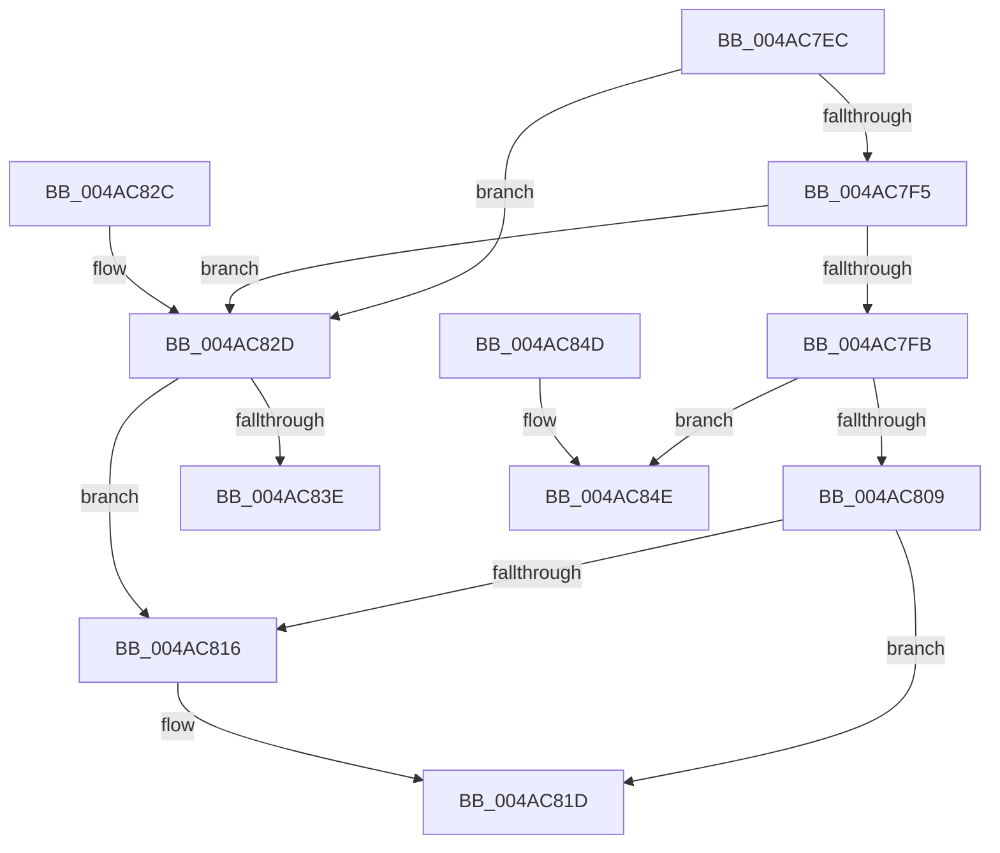

# KiInsertInterruptObjectOrdered

- RVA: `0x004AC7EC`–`0x004AC856` (길이 `106` bytes)
- VA: `0x00000001404AC7EC`
- 실행 섹션: `.text`
- PDB 이름 있음: `예`; PDB Function 태그: `예`
- unwind 정보 RVA: `0x000DB714`
- 디코드: `34`개 명령, `106/106` bytes 표시
- 미해석 바이트: `0` (있으면 어셈블리에 `.byte`로 보존)

> 이 문서는 커널 이미지의 기계어와 PDB 기호를 분석해 생성했습니다. 4번과 5번은 함수 원형과 자료형을 바이너리 사용 방식에서 추정한 C 해석이며 원본 소스 복구 결과는 아닙니다.

## 1. Dependencies

- 직접 호출 지점: **0**; 고유 호출 대상: **0**
- 직접 호출자로 확인된 함수: **2**
- RIP 상대 이미지 참조: **0**

### Outgoing calls
- 직접 디코드된 call 명령이 없습니다.

### Direct callers
- [KiConnectInterrupt](../2D/KiConnectInterrupt_function_002D3F58.md) at `0x002D419F`
- [sub_006DDA4E](../6D/Unknown_function_006DDA4E.md) at `0x006DDA6F`

### Static image references
- 디코드된 RIP-relative 메모리 참조가 없습니다.

## 2. Other-region calls and transfers

- 다른 실행 섹션으로 향하는 call: **0**
- call이 아닌 외부 분기/꼬리 이동: **1**
  - `0x004AC851` → `0x006FA63E` (`tail-transfer`)

## 3. Assembly (complete function range)

```asm
004AC7EC  45 33 C9                        xor r9d, r9d
004AC7EF  44 38 4A 5D                     cmp byte ptr [rdx + 0x5d], r9b
004AC7F3  74 38                           je 0x1404ac82d
004AC7F5  44 38 49 5D                     cmp byte ptr [rcx + 0x5d], r9b
004AC7F9  74 32                           je 0x1404ac82d
004AC7FB  48 8B 41 10                     mov rax, qword ptr [rcx + 0x10]
004AC7FF  4C 8D 41 08                     lea r8, [rcx + 8]
004AC803  44 38 48 55                     cmp byte ptr [rax + 0x55], r9b
004AC807  74 45                           je 0x1404ac84e
004AC809  49 8B 48 08                     mov rcx, qword ptr [r8 + 8]
004AC80D  48 8D 42 08                     lea rax, [rdx + 8]
004AC811  4C 39 01                        cmp qword ptr [rcx], r8
004AC814  74 07                           je 0x1404ac81d
004AC816  B9 03 00 00 00                  mov ecx, 3
004AC81B  CD 29                           int 0x29
004AC81D  4C 89 00                        mov qword ptr [rax], r8
004AC820  48 89 48 08                     mov qword ptr [rax + 8], rcx
004AC824  48 89 01                        mov qword ptr [rcx], rax
004AC827  49 89 40 08                     mov qword ptr [r8 + 8], rax
004AC82B  C3                              ret
004AC82C  CC                              int3
004AC82D  48 83 C1 08                     add rcx, 8
004AC831  48 8D 42 08                     lea rax, [rdx + 8]
004AC835  48 8B 51 08                     mov rdx, qword ptr [rcx + 8]
004AC839  48 39 0A                        cmp qword ptr [rdx], rcx
004AC83C  75 D8                           jne 0x1404ac816
004AC83E  48 89 08                        mov qword ptr [rax], rcx
004AC841  48 89 50 08                     mov qword ptr [rax + 8], rdx
004AC845  48 89 02                        mov qword ptr [rdx], rax
004AC848  48 89 41 08                     mov qword ptr [rcx + 8], rax
004AC84C  C3                              ret
004AC84D  CC                              int3
004AC84E  49 8B C0                        mov rax, r8
004AC851  E9 E8 DD 24 00                  jmp 0x1406fa63e
```

## 4. C-style interpretation (structured pseudocode)

```c
__int64 __fastcall KiInsertInterruptObjectOrdered(__int64 a1, __int64 a2, __int64 a3, int a4)
{
    a4 = 0;
    if ((*(unsigned __int8 *)(a2 + 93)) == 0) goto loc_004AC82D;
    if ((*(unsigned __int8 *)(a1 + 93)) == 0) goto loc_004AC82D;
    if ((*(unsigned __int8 *)(*(unsigned __int64 *)(a1 + 16) + 85)) == 0) goto loc_004AC84E;
    if ((*(unsigned __int64 *)(*(unsigned __int64 *)(a1 + 8 + 8))) != (a1 + 8)) {
        a1 = 3;
    }
    *(unsigned __int64 *)(a2 + 8) = a1 + 8;
    *(unsigned __int64 *)(a2 + 8 + 8) = a1;
    *(unsigned __int64 *)(a1) = a2 + 8;
    *(unsigned __int64 *)(a1 + 8 + 8) = a2 + 8;
    return a2 + 8;
loc_004AC82D:
    a1 = (a1) + (8);
    if ((*(unsigned __int64 *)(*(unsigned __int64 *)(a1 + 8))) != a1) goto loc_004AC816;
    *(unsigned __int64 *)(a2 + 8) = a1;
    *(unsigned __int64 *)(a2 + 8 + 8) = *(unsigned __int64 *)(a1 + 8);
    *(unsigned __int64 *)(*(unsigned __int64 *)(a1 + 8)) = a2 + 8;
    *(unsigned __int64 *)(a1 + 8) = a2 + 8;
    return a2 + 8;
loc_004AC84E:
}
```

## 5. (Beta) C Style

```c
void *KiInsertInterruptObjectOrdered(void *Arg1, void *Arg2, int64_t Arg3, int32_t Arg4)
{
    uint8_t *arg1 = (uint8_t *)Arg1;
    uint8_t *arg2 = (uint8_t *)Arg2;

    Arg4 = 0;
    if ((*(uint8_t *)(arg2 + 0x5D)) == 0) goto loc_004AC82D;
    if ((*(uint8_t *)(arg1 + 0x5D)) == 0) goto loc_004AC82D;
    if ((*(uint8_t *)(*(uint64_t *)(arg1 + 0x10) + 0x55)) == 0) goto loc_004AC84E;
    if ((*(uint64_t *)(*(uint64_t *)(arg1 + 0x8 + 0x8))) != (Arg1 + 8)) {
        Arg1 = 3;
    }
    *(void **)(arg2 + 0x8) = Arg1 + 8;
    *(void **)(arg2 + 0x8 + 0x8) = Arg1;
    *(void **)(arg1) = Arg2 + 8;
    *(void **)(arg1 + 0x8 + 0x8) = Arg2 + 8;
    return Arg2 + 8;
loc_004AC82D:
    Arg1 = (Arg1) + (8);
    if ((*(uint64_t *)(*(uint64_t *)(arg1 + 0x8))) != Arg1) goto loc_004AC816;
    *(void **)(arg2 + 0x8) = Arg1;
    *(uint64_t *)(arg2 + 0x8 + 0x8) = *(uint64_t *)(arg1 + 0x8);
    *(void **)(*(uint64_t *)(arg1 + 0x8)) = Arg2 + 8;
    *(void **)(arg1 + 0x8) = Arg2 + 8;
    return Arg2 + 8;
loc_004AC84E:
}
```

### 관측된 메모리 오프셋

구조체 형식이 확인되지 않은 접근은 인자 기준의 오프셋으로만 기록했습니다.

| 기준 인자 | 오프셋 표현 | 폭 (bit) | 접근 |
|---|---:|---:|---|
| `Arg1` | `+ 0x8` | `64` | `R` |
| `Arg1` | `+ 0x8` | `64` | `W` |
| `Arg1` | `+ 0x10` | `64` | `R` |
| `Arg1` | `+ 0x5D` | `8` | `R` |
| `Arg2` | `+ 0x0` | `64` | `W` |
| `Arg2` | `+ 0x8` | `64` | `R` |
| `Arg2` | `+ 0x8` | `64` | `W` |
| `Arg2` | `+ 0x5D` | `8` | `R` |

## 6. Execution-region graph

[열기: 2D/3D 그래프와 함수 탐색 컨트롤 패널](../../../control-panel.html?section=text&rva=0x004AC7EC&view=graph)

- 2D 그래프는 위에서 아래로 흐르고, 3D 그래프는 빈 공간을 드래그해 회전합니다. Shift+드래그는 이동, 휠은 확대·축소, 함수 노드 선택은 대상 보고서 이동입니다.

### Static fallback


