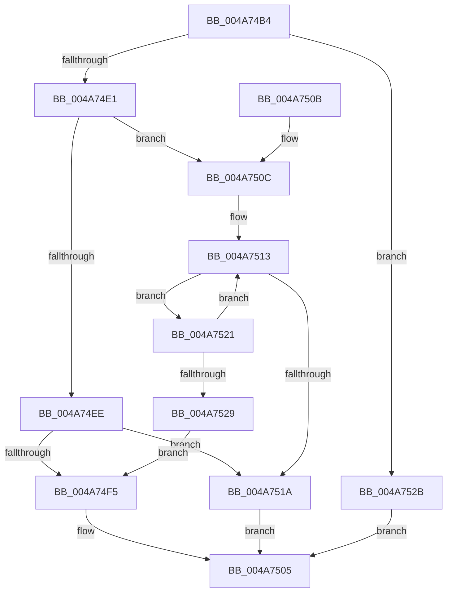

# KiMaskInterruptInternal

- RVA: `0x004A74B4`–`0x004A7532` (길이 `126` bytes)
- VA: `0x00000001404A74B4`
- 실행 섹션: `.text`
- PDB 이름 있음: `예`; PDB Function 태그: `아니요`
- unwind 정보 RVA: `0x000ABEFC`
- 디코드: `37`개 명령, `126/126` bytes 표시
- 미해석 바이트: `0` (있으면 어셈블리에 `.byte`로 보존)

> 이 문서는 커널 이미지의 기계어와 PDB 기호를 분석해 생성했습니다. 4번과 5번은 함수 원형과 자료형을 바이너리 사용 방식에서 추정한 C 해석이며 원본 소스 복구 결과는 아닙니다.

## 1. Dependencies

- 직접 호출 지점: **2**; 고유 호출 대상: **1**
- 직접 호출자로 확인된 함수: **2**
- RIP 상대 이미지 참조: **3**

### Outgoing calls
- `0x004A74C3` → [guard_dispatch_icall](../6B/guard_dispatch_icall_function_006BAAD0.md) (function, `0x006BAAD0`)
- `0x004A7500` → [guard_dispatch_icall](../6B/guard_dispatch_icall_function_006BAAD0.md) (function, `0x006BAAD0`)

### Direct callers
- [KeMaskInterrupt](../2D/KeMaskInterrupt_function_002D42FC.md) at `0x002D4384`
- [KeMaskInterrupt](../2D/KeMaskInterrupt_function_002D42FC.md) at `0x002D4482`
- [KiMaskInterruptDpc](../5B/KiMaskInterruptDpc_function_005BE4B0.md) at `0x005BE4E6`

### Static image references
- `0x004A74BA` → RVA `0x00E00878` (`.data`; read)
- `0x004A74E1` → RVA `0x006B3480` (`KiChainedDispatch`; read)
- `0x004A74F5` → RVA `0x00E009D0` (`.data`; read)

## 2. Other-region calls and transfers

- 다른 실행 섹션으로 향하는 call: **0**
- 별도 외부 분기/꼬리 이동을 확인하지 못했습니다.

## 3. Assembly (complete function range)

```asm
004A74B4  40 53                           push rbx
004A74B6  48 83 EC 20                     sub rsp, 0x20
004A74BA  48 8B 05 B7 93 95 00            mov rax, qword ptr [rip + 0x9593b7]
004A74C1  8B DA                           mov ebx, edx
004A74C3  E8 08 36 21 00                  call 0x1406baad0
004A74C8  0F B6 C8                        movzx ecx, al
004A74CB  65 48 8B 04 25 20 00 00 00      mov rax, qword ptr gs:[0x20]
004A74D4  48 8B 84 C8 00 39 00 00         mov rax, qword ptr [rax + rcx*8 + 0x3900]
004A74DC  48 85 C0                        test rax, rax
004A74DF  74 4A                           je 0x1404a752b
004A74E1  48 8D 0D 98 BF 20 00            lea rcx, [rip + 0x20bf98]
004A74E8  48 39 48 50                     cmp qword ptr [rax + 0x50], rcx
004A74EC  74 1E                           je 0x1404a750c
004A74EE  8B 40 68                        mov eax, dword ptr [rax + 0x68]
004A74F1  A8 01                           test al, 1
004A74F3  74 25                           je 0x1404a751a
004A74F5  48 8B 05 D4 94 95 00            mov rax, qword ptr [rip + 0x9594d4]
004A74FC  33 D2                           xor edx, edx
004A74FE  8B CB                           mov ecx, ebx
004A7500  E8 CB 35 21 00                  call 0x1406baad0
004A7505  48 83 C4 20                     add rsp, 0x20
004A7509  5B                              pop rbx
004A750A  C3                              ret
004A750B  CC                              int3
004A750C  48 8D 50 08                     lea rdx, [rax + 8]
004A7510  48 8B CA                        mov rcx, rdx
004A7513  8B 41 60                        mov eax, dword ptr [rcx + 0x60]
004A7516  A8 01                           test al, 1
004A7518  75 07                           jne 0x1404a7521
004A751A  B8 28 01 00 00                  mov eax, 0x128
004A751F  EB E4                           jmp 0x1404a7505
004A7521  48 8B 09                        mov rcx, qword ptr [rcx]
004A7524  48 3B CA                        cmp rcx, rdx
004A7527  75 EA                           jne 0x1404a7513
004A7529  EB CA                           jmp 0x1404a74f5
004A752B  B8 25 00 00 80                  mov eax, 0x80000025
004A7530  EB D3                           jmp 0x1404a7505
```

## 4. C-style interpretation (structured pseudocode)

```c
__int64 __fastcall KiMaskInterruptInternal(__int64 a1, int a2)
{
    __int64 result;
    __int64 v_rsp;

    v_rsp = (v_rsp) - (32);
    result = guard_dispatch_icall(a1, a2, a3, a4);
    if (*(unsigned __int64 *)(*(unsigned __int64 *)(gs_base + (0 + 32)) + (unsigned __int8)(result) * 8 + 14592) == 0) goto loc_004A752B;
    if ((*(unsigned __int64 *)(*(unsigned __int64 *)(*(unsigned __int64 *)(gs_base + (0 + 32)) + (unsigned __int8)(result) * 8 + 14592) + 80)) == (v_rip + 2146200)) goto loc_004A750C;
    if ((((unsigned __int8)((unsigned int)(*(unsigned int *)(*(unsigned __int64 *)(*(unsigned __int64 *)(gs_base + (0 + 32)) + (unsigned __int8)(result) * 8 + 14592) + 104)))) & (1)) == 0) goto loc_004A751A;
loc_004A74F5:
    a2 = 0;
    result = guard_dispatch_icall((unsigned int)((unsigned int)((unsigned int)(a2))), a2, a3, a4);
loc_004A7505:
    v_rsp = (v_rsp) + (32);
    return result;
loc_004A750C:
loc_004A7513:
    if ((((unsigned __int8)((unsigned int)(*(unsigned int *)(result + 8 + 96)))) & (1)) != 0) goto loc_004A7521;
loc_004A751A:
    goto loc_004A7505;
loc_004A7521:
    if ((*(unsigned __int64 *)(result + 8)) != (result + 8)) goto loc_004A7513;
    goto loc_004A74F5;
loc_004A752B:
    goto loc_004A7505;
}
```

## 5. (Beta) C Style

```c
int64_t KiMaskInterruptInternal(int64_t Arg1, int32_t Arg2)
{
    int64_t result;
    int64_t local_rsp;

    local_rsp = (local_rsp) - (32);
    result = guard_dispatch_icall(Arg1, Arg2, a3, a4);
    if (*(uint64_t *)(*(uint64_t *)(gs_base + (0 + 0x20)) + (uint8_t)(result) * 8 + 0x3900) == 0) goto loc_004A752B;
    if ((*(uint64_t *)(*(uint64_t *)(*(uint64_t *)(gs_base + (0 + 0x20)) + (uint8_t)(result) * 8 + 0x3900) + 0x50)) == (v_rip + 2146200)) goto loc_004A750C;
    if ((((uint8_t)((uint32_t)(*(uint32_t *)(*(uint64_t *)(*(uint64_t *)(gs_base + (0 + 0x20)) + (uint8_t)(result) * 8 + 0x3900) + 0x68)))) & (1)) == 0) goto loc_004A751A;
loc_004A74F5:
    Arg2 = 0;
    result = guard_dispatch_icall((uint32_t)((uint32_t)((uint32_t)(Arg2))), Arg2, a3, a4);
loc_004A7505:
    local_rsp = (local_rsp) + (32);
    return result;
loc_004A750C:
loc_004A7513:
    if ((((uint8_t)((uint32_t)(*(uint32_t *)(result + 0x8 + 0x60)))) & (1)) != 0) goto loc_004A7521;
loc_004A751A:
    goto loc_004A7505;
loc_004A7521:
    if ((*(uint64_t *)(result + 0x8)) != (result + 8)) goto loc_004A7513;
    goto loc_004A74F5;
loc_004A752B:
    goto loc_004A7505;
}
```

## 6. Execution-region graph

[열기: 2D/3D 그래프와 함수 탐색 컨트롤 패널](../../../control-panel.html?section=text&rva=0x004A74B4&view=graph)

- 2D 그래프는 위에서 아래로 흐르고, 3D 그래프는 빈 공간을 드래그해 회전합니다. Shift+드래그는 이동, 휠은 확대·축소, 함수 노드 선택은 대상 보고서 이동입니다.

### Static fallback


