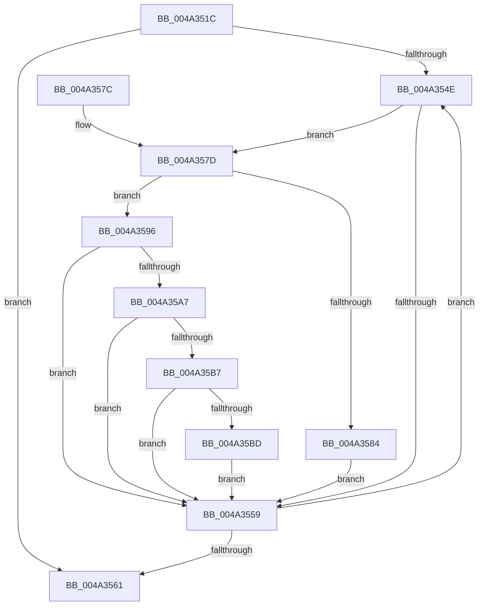

# KiProcessProfileList

- RVA: `0x004A351C`–`0x004A35D7` (길이 `187` bytes)
- VA: `0x00000001404A351C`
- 실행 섹션: `.text`
- PDB 이름 있음: `예`; PDB Function 태그: `아니요`
- unwind 정보 RVA: `0x000AB594`
- 디코드: `54`개 명령, `187/187` bytes 표시
- 미해석 바이트: `0` (있으면 어셈블리에 `.byte`로 보존)

> 이 문서는 커널 이미지의 기계어와 PDB 기호를 분석해 생성했습니다. 4번과 5번은 함수 원형과 자료형을 바이너리 사용 방식에서 추정한 C 해석이며 원본 소스 복구 결과는 아닙니다.

## 1. Dependencies

- 직접 호출 지점: **2**; 고유 호출 대상: **2**
- 직접 호출자로 확인된 함수: **1**
- RIP 상대 이미지 참조: **0**

### Outgoing calls
- `0x004A358F` → [guard_dispatch_icall](../6B/guard_dispatch_icall_function_006BAAD0.md) (function, `0x006BAAD0`)
- `0x004A359E` → [KeCheckProcessorAffinityEx](../30/KeCheckProcessorAffinityEx_function_00305150.md) (function, `0x00305150`)

### Direct callers
- [KeProfileInterruptWithSource](KeProfileInterruptWithSource_function_004A34D0.md) at `0x004A34F3`
- [KeProfileInterruptWithSource](KeProfileInterruptWithSource_function_004A34D0.md) at `0x004A3504`

### Static image references
- 디코드된 RIP-relative 메모리 참조가 없습니다.

## 2. Other-region calls and transfers

- 다른 실행 섹션으로 향하는 call: **0**
- 별도 외부 분기/꼬리 이동을 확인하지 못했습니다.

## 3. Assembly (complete function range)

```asm
004A351C  48 8B C4                        mov rax, rsp
004A351F  48 89 58 08                     mov qword ptr [rax + 8], rbx
004A3523  48 89 68 10                     mov qword ptr [rax + 0x10], rbp
004A3527  48 89 70 18                     mov qword ptr [rax + 0x18], rsi
004A352B  48 89 78 20                     mov qword ptr [rax + 0x20], rdi
004A352F  41 56                           push r14
004A3531  48 83 EC 20                     sub rsp, 0x20
004A3535  65 4C 8B 34 25 20 00 00 00      mov r14, qword ptr gs:[0x20]
004A353E  49 8B F8                        mov rdi, r8
004A3541  49 8B 18                        mov rbx, qword ptr [r8]
004A3544  8B EA                           mov ebp, edx
004A3546  48 8B F1                        mov rsi, rcx
004A3549  49 3B D8                        cmp rbx, r8
004A354C  74 13                           je 0x1404a3561
004A354E  0F BF 83 58 02 00 00            movsx eax, word ptr [rbx + 0x258]
004A3555  3B C5                           cmp eax, ebp
004A3557  74 24                           je 0x1404a357d
004A3559  48 8B 1B                        mov rbx, qword ptr [rbx]
004A355C  48 3B DF                        cmp rbx, rdi
004A355F  75 ED                           jne 0x1404a354e
004A3561  48 8B 5C 24 30                  mov rbx, qword ptr [rsp + 0x30]
004A3566  48 8B 6C 24 38                  mov rbp, qword ptr [rsp + 0x38]
004A356B  48 8B 74 24 40                  mov rsi, qword ptr [rsp + 0x40]
004A3570  48 8B 7C 24 48                  mov rdi, qword ptr [rsp + 0x48]
004A3575  48 83 C4 20                     add rsp, 0x20
004A3579  41 5E                           pop r14
004A357B  C3                              ret
004A357C  CC                              int3
004A357D  66 83 7B F8 11                  cmp word ptr [rbx - 8], 0x11
004A3582  75 12                           jne 0x1404a3596
004A3584  48 8B 43 18                     mov rax, qword ptr [rbx + 0x18]
004A3588  48 8B CE                        mov rcx, rsi
004A358B  48 8B 53 20                     mov rdx, qword ptr [rbx + 0x20]
004A358F  E8 3C 75 21 00                  call 0x1406baad0
004A3594  EB C3                           jmp 0x1404a3559
004A3596  41 8B 56 24                     mov edx, dword ptr [r14 + 0x24]
004A359A  48 8D 4B 40                     lea rcx, [rbx + 0x40]
004A359E  E8 AD 1B E6 FF                  call 0x140305150
004A35A3  85 C0                           test eax, eax
004A35A5  74 B2                           je 0x1404a3559
004A35A7  48 8B 86 68 01 00 00            mov rax, qword ptr [rsi + 0x168]
004A35AE  48 8B 4B 18                     mov rcx, qword ptr [rbx + 0x18]
004A35B2  48 3B C1                        cmp rax, rcx
004A35B5  72 A2                           jb 0x1404a3559
004A35B7  48 3B 43 20                     cmp rax, qword ptr [rbx + 0x20]
004A35BB  73 9C                           jae 0x1404a3559
004A35BD  48 2B C1                        sub rax, rcx
004A35C0  8B 4B 28                        mov ecx, dword ptr [rbx + 0x28]
004A35C3  48 D3 E8                        shr rax, cl
004A35C6  B9 FC FF FF FF                  mov ecx, 0xfffffffc
004A35CB  48 23 C1                        and rax, rcx
004A35CE  48 03 43 30                     add rax, qword ptr [rbx + 0x30]
004A35D2  F0 FF 00                        lock inc dword ptr [rax]
004A35D5  EB 82                           jmp 0x1404a3559
```

## 4. C-style interpretation (structured pseudocode)

```c
__int64 __fastcall KiProcessProfileList(__int64 a1, int a2, __int64 a3)
{
    __int64 result;
    __int64 v_rsp;
    unsigned __int64 v_stack_p10;
    unsigned __int64 v_stack_p18;
    unsigned __int64 v_stack_p20;
    unsigned __int64 v_stack_p8;

    *(unsigned __int64 *)(v_rsp + 8) = v_rbx;
    *(unsigned __int64 *)(v_rsp + 16) = v_rbp;
    *(unsigned __int64 *)(v_rsp + 24) = v_rsi;
    *(unsigned __int64 *)(v_rsp + 32) = v_rdi;
    v_rsp = (v_rsp) - (32);
    if ((*(unsigned __int64 *)(a3)) == a3) goto loc_004A3561;
loc_004A354E:
    if (((unsigned int)((__int16)(*(unsigned __int16 *)(*(unsigned __int64 *)(a3) + 600)))) == ((unsigned int)((unsigned int)(a2)))) goto loc_004A357D;
loc_004A3559:
    if ((*(unsigned __int64 *)(*(unsigned __int64 *)(a3))) != a3) goto loc_004A354E;
loc_004A3561:
    v_rsp = (v_rsp) + (32);
    return (__int16)(*(unsigned __int16 *)(*(unsigned __int64 *)(a3) + 600));
loc_004A357D:
    if ((*(unsigned __int16 *)(v_stack_p8 - 8)) != 17) goto loc_004A3596;
    result = guard_dispatch_icall(v_stack_p18, *(unsigned __int64 *)(v_stack_p8 + 32), a3, a4);
    goto loc_004A3559;
loc_004A3596:
    result = KeCheckProcessorAffinityEx(v_stack_p8 + 64, (unsigned int)(*(unsigned int *)(*(unsigned __int64 *)(gs_base + (0 + 32)) + 36)), a3, a4);
    if ((unsigned int)(result) == 0) goto loc_004A3559;
    if ((*(unsigned __int64 *)(v_stack_p18 + 360)) < (*(unsigned __int64 *)(v_stack_p8 + 24))) goto loc_004A3559;
    if ((*(unsigned __int64 *)(v_stack_p18 + 360)) >= (*(unsigned __int64 *)(v_stack_p8 + 32))) goto loc_004A3559;
    result = (*(unsigned __int64 *)(v_stack_p18 + 360)) - (*(unsigned __int64 *)(v_stack_p8 + 24));
    result = (result) >> ((unsigned __int8)((unsigned int)(*(unsigned int *)(v_stack_p8 + 40))));
    result = (result) & ((unsigned int)(0xFFFFFFFCULL));
    result = (result) + (*(unsigned __int64 *)(v_stack_p8 + 48));
    goto loc_004A3559;
}
```

## 5. (Beta) C Style

```c
int64_t KiProcessProfileList(void *Arg1, int32_t Arg2, void *Arg3)
{
    uint8_t *arg1 = (uint8_t *)Arg1;
    uint8_t *arg3 = (uint8_t *)Arg3;

    int64_t result;
    int64_t local_rsp;
    uint64_t v_stack_p10;
    uint64_t v_stack_p18;
    uint64_t v_stack_p20;
    uint64_t v_stack_p8;

    *(uint64_t *)(local_rsp + 0x8) = local_rbx;
    *(uint64_t *)(local_rsp + 0x10) = local_rbp;
    *(uint64_t *)(local_rsp + 0x18) = local_rsi;
    *(uint64_t *)(local_rsp + 0x20) = local_rdi;
    local_rsp = (local_rsp) - (32);
    if ((*(uint64_t *)(arg3)) == Arg3) goto loc_004A3561;
loc_004A354E:
    if (((uint32_t)((int16_t)(*(uint16_t *)(*(uint64_t *)(arg3) + 0x258)))) == ((uint32_t)((uint32_t)(Arg2)))) goto loc_004A357D;
loc_004A3559:
    if ((*(uint64_t *)(*(uint64_t *)(arg3))) != Arg3) goto loc_004A354E;
loc_004A3561:
    local_rsp = (local_rsp) + (32);
    return (int16_t)(*(uint16_t *)(*(uint64_t *)(arg3) + 0x258));
loc_004A357D:
    if ((*(uint16_t *)(v_stack_p8 - 0x8)) != 17) goto loc_004A3596;
    result = guard_dispatch_icall(v_stack_p18, *(uint64_t *)(v_stack_p8 + 0x20), Arg3, a4);
    goto loc_004A3559;
loc_004A3596:
    result = KeCheckProcessorAffinityEx(v_stack_p8 + 64, (uint32_t)(*(uint32_t *)(*(uint64_t *)(gs_base + (0 + 0x20)) + 0x24)), Arg3, a4);
    if ((uint32_t)(result) == 0) goto loc_004A3559;
    if ((*(uint64_t *)(v_stack_p18 + 0x168)) < (*(uint64_t *)(v_stack_p8 + 0x18))) goto loc_004A3559;
    if ((*(uint64_t *)(v_stack_p18 + 0x168)) >= (*(uint64_t *)(v_stack_p8 + 0x20))) goto loc_004A3559;
    result = (*(uint64_t *)(v_stack_p18 + 0x168)) - (*(uint64_t *)(v_stack_p8 + 0x18));
    result = (result) >> ((uint8_t)((uint32_t)(*(uint32_t *)(v_stack_p8 + 0x28))));
    result = (result) & ((uint32_t)(0xFFFFFFFCULL));
    result = (result) + (*(uint64_t *)(v_stack_p8 + 0x30));
    goto loc_004A3559;
}
```

### 관측된 메모리 오프셋

구조체 형식이 확인되지 않은 접근은 인자 기준의 오프셋으로만 기록했습니다.

| 기준 인자 | 오프셋 표현 | 폭 (bit) | 접근 |
|---|---:|---:|---|
| `Arg1` | `+ 0x168` | `64` | `R` |
| `Arg3` | `+ 0x0` | `64` | `R` |

## 6. Execution-region graph

[열기: 2D/3D 그래프와 함수 탐색 컨트롤 패널](../../../control-panel.html?section=text&rva=0x004A351C&view=graph)

- 2D 그래프는 위에서 아래로 흐르고, 3D 그래프는 빈 공간을 드래그해 회전합니다. Shift+드래그는 이동, 휠은 확대·축소, 함수 노드 선택은 대상 보고서 이동입니다.

### Static fallback


