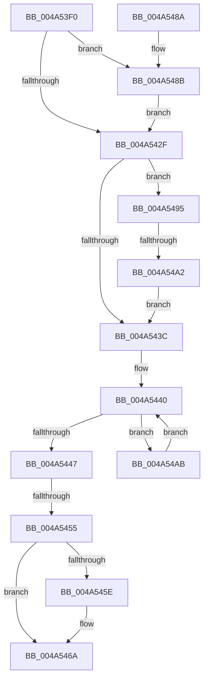

# KiStartProfileTarget

- RVA: `0x004A53F0`–`0x004A54AF` (길이 `191` bytes)
- VA: `0x00000001404A53F0`
- 실행 섹션: `.text`
- PDB 이름 있음: `예`; PDB Function 태그: `예`
- unwind 정보 RVA: `0x000B6930`
- 디코드: `57`개 명령, `191/191` bytes 표시
- 미해석 바이트: `0` (있으면 어셈블리에 `.byte`로 보존)

> 이 문서는 커널 이미지의 기계어와 PDB 기호를 분석해 생성했습니다. 4번과 5번은 함수 원형과 자료형을 바이너리 사용 방식에서 추정한 C 해석이며 원본 소스 복구 결과는 아닙니다.

## 1. Dependencies

- 직접 호출 지점: **2**; 고유 호출 대상: **2**
- 직접 호출자로 확인된 함수: **1**
- RIP 상대 이미지 참조: **2**

### Outgoing calls
- `0x004A5465` → [KiLowerIrqlProcessIrqlFlags](../4F/KiLowerIrqlProcessIrqlFlags_function_004F5698.md) (function, `0x004F5698`)
- `0x004A548E` → [KiRaiseIrqlProcessIrqlFlags](../4F/KiRaiseIrqlProcessIrqlFlags_function_004F56FC.md) (function, `0x004F56FC`)

### Direct callers
- [KeStartProfile](../4E/KeStartProfile_function_004E1120.md) at `0x004E1201`

### Static image references
- `0x004A540A` → RVA `0x00FC501A` (`ALMOSTRO`; read)
- `0x004A5426` → RVA `0x00FC6D20` (`ALMOSTRO`; read)

## 2. Other-region calls and transfers

- 다른 실행 섹션으로 향하는 call: **0**
- call이 아닌 외부 분기/꼬리 이동: **2**
  - `0x004A544F` → [sub_006F962E + 0x120](../6F/Unknown_function_006F962E.md) (`tail-transfer`)
  - `0x004A549C` → [sub_006F962E](../6F/Unknown_function_006F962E.md) (`tail-transfer`)

## 3. Assembly (complete function range)

```asm
004A53F0  48 89 5C 24 18                  mov qword ptr [rsp + 0x18], rbx
004A53F5  55                              push rbp
004A53F6  56                              push rsi
004A53F7  57                              push rdi
004A53F8  41 54                           push r12
004A53FA  41 55                           push r13
004A53FC  41 56                           push r14
004A53FE  41 57                           push r15
004A5400  48 83 EC 30                     sub rsp, 0x30
004A5404  48 8B 39                        mov rdi, qword ptr [rcx]
004A5407  45 33 ED                        xor r13d, r13d
004A540A  0F B6 15 09 FC B1 00            movzx edx, byte ptr [rip + 0xb1fc09]
004A5411  48 8B D9                        mov rbx, rcx
004A5414  44 89 6C 24 70                  mov dword ptr [rsp + 0x70], r13d
004A5419  4C 89 6C 24 78                  mov qword ptr [rsp + 0x78], r13
004A541E  45 0F 20 C4                     mov r12, cr8
004A5422  44 0F 22 C2                     mov cr8, rdx
004A5426  44 39 2D F3 18 B2 00            cmp dword ptr [rip + 0xb218f3], r13d
004A542D  75 5C                           jne 0x1404a548b
004A542F  83 C8 FF                        or eax, 0xffffffff
004A5432  F0 0F C1 43 08                  lock xadd dword ptr [rbx + 8], eax
004A5437  83 F8 01                        cmp eax, 1
004A543A  74 59                           je 0x1404a5495
004A543C  F0 FF 4B 0C                     lock dec dword ptr [rbx + 0xc]
004A5440  8B 43 0C                        mov eax, dword ptr [rbx + 0xc]
004A5443  85 C0                           test eax, eax
004A5445  7F 64                           jg 0x1404a54ab
004A5447  90                              nop
004A5448  44 38 AB 30 01 00 00            cmp byte ptr [rbx + 0x130], r13b
004A544F  0F 85 F9 42 25 00               jne 0x1406f974e
004A5455  83 3D C4 18 B2 00 00            cmp dword ptr [rip + 0xb218c4], 0
004A545C  74 0C                           je 0x1404a546a
004A545E  44 0F 20 C1                     mov rcx, cr8
004A5462  41 8A D4                        mov dl, r12b
004A5465  E8 2E 02 05 00                  call 0x1404f5698
004A546A  41 0F B6 C4                     movzx eax, r12b
004A546E  44 0F 22 C0                     mov cr8, rax
004A5472  48 8B 9C 24 80 00 00 00         mov rbx, qword ptr [rsp + 0x80]
004A547A  48 83 C4 30                     add rsp, 0x30
004A547E  41 5F                           pop r15
004A5480  41 5E                           pop r14
004A5482  41 5D                           pop r13
004A5484  41 5C                           pop r12
004A5486  5F                              pop rdi
004A5487  5E                              pop rsi
004A5488  5D                              pop rbp
004A5489  C3                              ret
004A548A  CC                              int3
004A548B  41 8A CC                        mov cl, r12b
004A548E  E8 69 02 05 00                  call 0x1404f56fc
004A5493  EB 9A                           jmp 0x1404a542f
004A5495  44 38 AF 62 02 00 00            cmp byte ptr [rdi + 0x262], r13b
004A549C  0F 84 8C 41 25 00               je 0x1406f962e
004A54A2  44 88 AB 30 01 00 00            mov byte ptr [rbx + 0x130], r13b
004A54A9  EB 91                           jmp 0x1404a543c
004A54AB  F3 90                           pause
004A54AD  EB 91                           jmp 0x1404a5440
```

## 4. C-style interpretation (structured pseudocode)

```c
__int64 __fastcall KiStartProfileTarget(__int64 a1)
{
    __int64 result;
    __int64 v_r13;
    __int64 v_rsp;
    unsigned __int64 v_stack_p10;
    unsigned __int64 v_stack_p18;
    unsigned int v_stack_p8;

    v_stack_p18 = v_rbx;
    v_rsp = (v_rsp) - (48);
    v_r13 = 0;
    v_stack_p8 = 0;
    v_stack_p10 = 0;
    if ((*(unsigned int *)(v_rip + 11671795)) != 0) goto loc_004A548B;
loc_004A542F:
    result = (unsigned int)((result) | (0xFFFFFFFFULL));
    if (((unsigned int)(result)) == 1) goto loc_004A5495;
loc_004A543C:
loc_004A5440:
    if (condition_is_greater) goto loc_004A54AB;
    result = (unsigned int)(*(unsigned int *)(a1 + 12));
    if ((*(unsigned int *)(v_rip + 11671748)) != 0) {
        a1 = *(unsigned __int8 *)(v_rip + 11664393);
        a2 = (unsigned __int8)(v_cr8);
        result = KiLowerIrqlProcessIrqlFlags(a1, a2, a3, a4);
    }
    v_rsp = (v_rsp) + (48);
    return (unsigned __int8)(v_cr8);
loc_004A548B:
    result = KiRaiseIrqlProcessIrqlFlags((unsigned __int8)(v_cr8), a2, a3, a4);
    goto loc_004A542F;
loc_004A5495:
    *(unsigned __int8 *)(v_stack_p18 + 304) = 0;
    goto loc_004A543C;
loc_004A54AB:
    goto loc_004A5440;
}
```

## 5. (Beta) C Style

```c
int64_t KiStartProfileTarget(void *Arg1)
{
    uint8_t *arg1 = (uint8_t *)Arg1;

    int64_t result;
    int64_t local_r13;
    int64_t local_rsp;
    uint64_t v_stack_p10;
    uint64_t v_stack_p18;
    uint32_t v_stack_p8;

    v_stack_p18 = local_rbx;
    local_rsp = (local_rsp) - (48);
    local_r13 = 0;
    v_stack_p8 = 0;
    v_stack_p10 = 0;
    if ((*(uint32_t *)(v_rip + 0xB218F3)) != 0) goto loc_004A548B;
loc_004A542F:
    result = (uint32_t)((result) | (0xFFFFFFFFULL));
    if (((uint32_t)(result)) == 1) goto loc_004A5495;
loc_004A543C:
loc_004A5440:
    if (condition_is_greater) goto loc_004A54AB;
    result = (uint32_t)(*(uint32_t *)(arg1 + 0xC));
    if ((*(uint32_t *)(v_rip + 0xB218C4)) != 0) {
        Arg1 = *(uint8_t *)(v_rip + 0xB1FC09);
        a2 = (uint8_t)(v_cr8);
        result = KiLowerIrqlProcessIrqlFlags(Arg1, a2, a3, a4);
    }
    local_rsp = (local_rsp) + (48);
    return (uint8_t)(v_cr8);
loc_004A548B:
    result = KiRaiseIrqlProcessIrqlFlags((uint8_t)(v_cr8), a2, a3, a4);
    goto loc_004A542F;
loc_004A5495:
    *(uint8_t *)(v_stack_p18 + 0x130) = 0;
    goto loc_004A543C;
loc_004A54AB:
    goto loc_004A5440;
}
```

### 관측된 메모리 오프셋

구조체 형식이 확인되지 않은 접근은 인자 기준의 오프셋으로만 기록했습니다.

| 기준 인자 | 오프셋 표현 | 폭 (bit) | 접근 |
|---|---:|---:|---|
| `Arg1` | `+ 0x0` | `64` | `R` |
| `Arg1` | `+ 0x8` | `32` | `R/W` |
| `Arg1` | `+ 0xC` | `32` | `R` |
| `Arg1` | `+ 0xC` | `32` | `R/W` |
| `Arg1` | `+ 0x130` | `8` | `R` |
| `Arg1` | `+ 0x130` | `8` | `W` |

## 6. Execution-region graph

[열기: 2D/3D 그래프와 함수 탐색 컨트롤 패널](../../../control-panel.html?section=text&rva=0x004A53F0&view=graph)

- 2D 그래프는 위에서 아래로 흐르고, 3D 그래프는 빈 공간을 드래그해 회전합니다. Shift+드래그는 이동, 휠은 확대·축소, 함수 노드 선택은 대상 보고서 이동입니다.

### Static fallback


