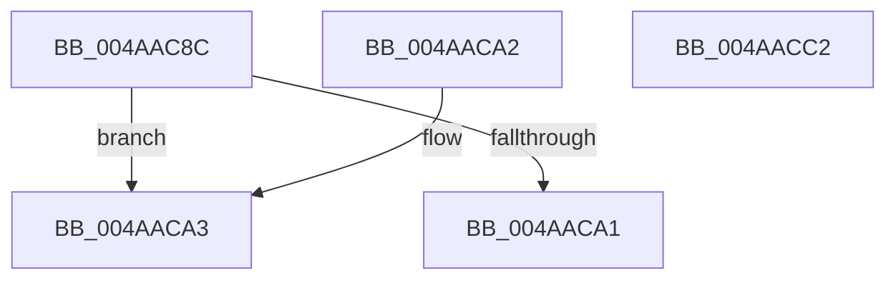

# KiThreadSetUnusualBoost

- RVA: `0x004AAC8C`–`0x004AACC3` (길이 `55` bytes)
- VA: `0x00000001404AAC8C`
- 실행 섹션: `.text`
- PDB 이름 있음: `예`; PDB Function 태그: `아니요`
- unwind 정보 RVA: `0x000DB714`
- 디코드: `17`개 명령, `55/55` bytes 표시
- 미해석 바이트: `0` (있으면 어셈블리에 `.byte`로 보존)

> 이 문서는 커널 이미지의 기계어와 PDB 기호를 분석해 생성했습니다. 4번과 5번은 함수 원형과 자료형을 바이너리 사용 방식에서 추정한 C 해석이며 원본 소스 복구 결과는 아닙니다.

## 1. Dependencies

- 직접 호출 지점: **0**; 고유 호출 대상: **0**
- 직접 호출자로 확인된 함수: **1**
- RIP 상대 이미지 참조: **0**

### Outgoing calls
- 직접 디코드된 call 명령이 없습니다.

### Direct callers
- [KiSetPriorityBoost](../39/KiSetPriorityBoost_function_00398A40.md) at `0x00398A5C`

### Static image references
- 디코드된 RIP-relative 메모리 참조가 없습니다.

## 2. Other-region calls and transfers

- 다른 실행 섹션으로 향하는 call: **0**
- 별도 외부 분기/꼬리 이동을 확인하지 못했습니다.

## 3. Assembly (complete function range)

```asm
004AAC8C  44 0F B7 81 06 02 00 00         movzx r8d, word ptr [rcx + 0x206]
004AAC94  41 8B C0                        mov eax, r8d
004AAC97  C1 E8 04                        shr eax, 4
004AAC9A  0F B6 C0                        movzx eax, al
004AAC9D  3B C2                           cmp eax, edx
004AAC9F  7C 02                           jl 0x1404aaca3
004AACA1  C3                              ret
004AACA2  CC                              int3
004AACA3  0F BE C2                        movsx eax, dl
004AACA6  BA F0 0F 00 00                  mov edx, 0xff0
004AACAB  66 C1 E0 04                     shl ax, 4
004AACAF  66 41 33 C0                     xor ax, r8w
004AACB3  66 23 C2                        and ax, dx
004AACB6  66 41 33 C0                     xor ax, r8w
004AACBA  66 89 81 06 02 00 00            mov word ptr [rcx + 0x206], ax
004AACC1  C3                              ret
004AACC2  CC                              int3
```

## 4. C-style interpretation (structured pseudocode)

```c
__int64 __fastcall KiThreadSetUnusualBoost(__int64 a1, int a2)
{
    __int64 result;

    result = (unsigned int)(((unsigned int)((unsigned int)(*(unsigned __int16 *)(a1 + 518)))) >> (4));
    if (((unsigned int)((unsigned __int8)(result))) < a2) goto loc_004AACA3;
    return (unsigned __int8)(result);
loc_004AACA3:
    result = (unsigned __int16)(((__int8)((unsigned __int8)(a2))) << (4));
    result = (unsigned __int16)((result) ^ ((unsigned __int16)(*(unsigned __int16 *)(a1 + 518))));
    result = (unsigned __int16)((result) & ((unsigned __int16)((unsigned int)(0xFF0ULL))));
    result = (unsigned __int16)((result) ^ ((unsigned __int16)(*(unsigned __int16 *)(a1 + 518))));
    *(unsigned __int16 *)(a1 + 518) = (unsigned __int16)(result);
    return result;
}
```

## 5. (Beta) C Style

```c
int64_t KiThreadSetUnusualBoost(void *Arg1, int32_t Arg2)
{
    uint8_t *arg1 = (uint8_t *)Arg1;

    int64_t result;

    result = (uint32_t)(((uint32_t)((uint32_t)(*(uint16_t *)(arg1 + 0x206)))) >> (4));
    if (((uint32_t)((uint8_t)(result))) < Arg2) goto loc_004AACA3;
    return (uint8_t)(result);
loc_004AACA3:
    result = (uint16_t)(((int8_t)((uint8_t)(Arg2))) << (4));
    result = (uint16_t)((result) ^ ((uint16_t)(*(uint16_t *)(arg1 + 0x206))));
    result = (uint16_t)((result) & ((uint16_t)((uint32_t)(0xFF0ULL))));
    result = (uint16_t)((result) ^ ((uint16_t)(*(uint16_t *)(arg1 + 0x206))));
    *(uint16_t *)(arg1 + 0x206) = (uint16_t)(result);
    return result;
}
```

### 관측된 메모리 오프셋

구조체 형식이 확인되지 않은 접근은 인자 기준의 오프셋으로만 기록했습니다.

| 기준 인자 | 오프셋 표현 | 폭 (bit) | 접근 |
|---|---:|---:|---|
| `Arg1` | `+ 0x206` | `16` | `R` |
| `Arg1` | `+ 0x206` | `16` | `W` |

## 6. Execution-region graph

[열기: 2D/3D 그래프와 함수 탐색 컨트롤 패널](../../../control-panel.html?section=text&rva=0x004AAC8C&view=graph)

- 2D 그래프는 위에서 아래로 흐르고, 3D 그래프는 빈 공간을 드래그해 회전합니다. Shift+드래그는 이동, 휠은 확대·축소, 함수 노드 선택은 대상 보고서 이동입니다.

### Static fallback


