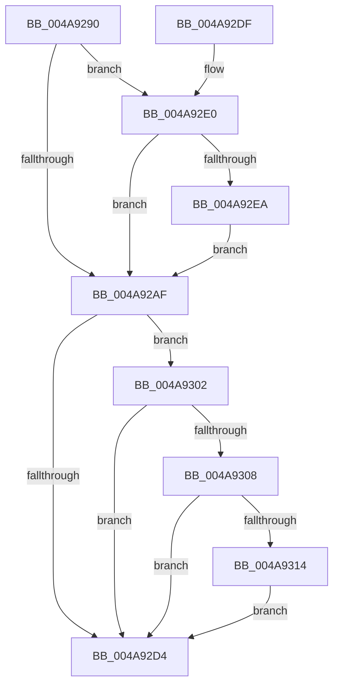

# KiUpdateLocalReadyQueueStatisticsOnInsertion

- RVA: `0x004A9290`–`0x004A931E` (길이 `142` bytes)
- VA: `0x00000001404A9290`
- 실행 섹션: `.text`
- PDB 이름 있음: `예`; PDB Function 태그: `아니요`
- unwind 정보 RVA: `0x000677AC`
- 디코드: `36`개 명령, `142/142` bytes 표시
- 미해석 바이트: `0` (있으면 어셈블리에 `.byte`로 보존)

> 이 문서는 커널 이미지의 기계어와 PDB 기호를 분석해 생성했습니다. 4번과 5번은 함수 원형과 자료형을 바이너리 사용 방식에서 추정한 C 해석이며 원본 소스 복구 결과는 아닙니다.

## 1. Dependencies

- 직접 호출 지점: **4**; 고유 호출 대상: **4**
- 직접 호출자로 확인된 함수: **2**
- RIP 상대 이미지 참조: **0**

### Outgoing calls
- `0x004A92C6` → [KiUpdateSoftParkElectionStatisticsOnInsertion](../21/KiUpdateSoftParkElectionStatisticsOnInsertion_function_00218F40.md) (function, `0x00218F40`)
- `0x004A92CB` → [KeIsForceParkingEnabled](../21/KeIsForceParkingEnabled_function_00218F20.md) (function, `0x00218F20`)
- `0x004A930B` → [KiIsThreadExemptFromForcePark](../4D/KiIsThreadExemptFromForcePark_function_004D7B80.md) (function, `0x004D7B80`)
- `0x004A9317` → [KiArmForceParkDutyCyclingForLocalReadyQueue](../4F/KiArmForceParkDutyCyclingForLocalReadyQueue_function_004FAB54.md) (function, `0x004FAB54`)

### Direct callers
- [KiQueueReadyThread](../21/KiQueueReadyThread_function_0021C7B0.md) at `0x0021CE88`
- [sub_002546EC](../25/Unknown_function_002546EC.md) at `0x0025483D`

### Static image references
- 디코드된 RIP-relative 메모리 참조가 없습니다.

## 2. Other-region calls and transfers

- 다른 실행 섹션으로 향하는 call: **0**
- 별도 외부 분기/꼬리 이동을 확인하지 못했습니다.

## 3. Assembly (complete function range)

```asm
004A9290  48 89 5C 24 08                  mov qword ptr [rsp + 8], rbx
004A9295  57                              push rdi
004A9296  48 83 EC 20                     sub rsp, 0x20
004A929A  FF 81 74 86 00 00               inc dword ptr [rcx + 0x8674]
004A92A0  48 8B FA                        mov rdi, rdx
004A92A3  83 B9 74 86 00 00 01            cmp dword ptr [rcx + 0x8674], 1
004A92AA  48 8B D9                        mov rbx, rcx
004A92AD  74 31                           je 0x1404a92e0
004A92AF  8B 42 54                        mov eax, dword ptr [rdx + 0x54]
004A92B2  89 82 F8 06 00 00               mov dword ptr [rdx + 0x6f8], eax
004A92B8  48 01 81 78 86 00 00            add qword ptr [rcx + 0x8678], rax
004A92BF  48 8B 89 48 8E 00 00            mov rcx, qword ptr [rcx + 0x8e48]
004A92C6  E8 75 FC D6 FF                  call 0x140218f40
004A92CB  E8 50 FC D6 FF                  call 0x140218f20
004A92D0  84 C0                           test al, al
004A92D2  75 2E                           jne 0x1404a9302
004A92D4  48 8B 5C 24 30                  mov rbx, qword ptr [rsp + 0x30]
004A92D9  48 83 C4 20                     add rsp, 0x20
004A92DD  5F                              pop rdi
004A92DE  C3                              ret
004A92DF  CC                              int3
004A92E0  48 83 B9 30 84 00 00 00         cmp qword ptr [rcx + 0x8430], 0
004A92E8  75 C5                           jne 0x1404a92af
004A92EA  4C 8B 81 C0 00 00 00            mov r8, qword ptr [rcx + 0xc0]
004A92F1  48 8B 81 C8 00 00 00            mov rax, qword ptr [rcx + 0xc8]
004A92F8  F0 49 09 80 80 01 00 00         lock or qword ptr [r8 + 0x180], rax
004A9300  EB AD                           jmp 0x1404a92af
004A9302  F6 43 23 20                     test byte ptr [rbx + 0x23], 0x20
004A9306  74 CC                           je 0x1404a92d4
004A9308  48 8B CF                        mov rcx, rdi
004A930B  E8 70 E8 02 00                  call 0x1404d7b80
004A9310  84 C0                           test al, al
004A9312  75 C0                           jne 0x1404a92d4
004A9314  48 8B CB                        mov rcx, rbx
004A9317  E8 38 18 05 00                  call 0x1404fab54
004A931C  EB B6                           jmp 0x1404a92d4
```

## 4. C-style interpretation (structured pseudocode)

```c
__int64 __fastcall KiUpdateLocalReadyQueueStatisticsOnInsertion(__int64 a1, __int64 a2)
{
    __int64 result;
    __int64 v_rsp;
    unsigned __int64 v_stack_p8;

    v_stack_p8 = v_rbx;
    v_rsp = (v_rsp) - (32);
    if ((*(unsigned int *)(a1 + 34420)) == 1) goto loc_004A92E0;
loc_004A92AF:
    *(unsigned int *)(a2 + 1784) = (unsigned int)((unsigned int)(*(unsigned int *)(a2 + 84)));
    result = KiUpdateSoftParkElectionStatisticsOnInsertion(*(unsigned __int64 *)(a1 + 36424), a2, a3, a4);
    result = KeIsForceParkingEnabled(*(unsigned __int64 *)(a1 + 36424), a2, a3, a4);
    if ((unsigned __int8)(result) != 0) goto loc_004A9302;
loc_004A92D4:
    v_rsp = (v_rsp) + (32);
    return result;
loc_004A92E0:
    if ((*(unsigned __int64 *)(*(unsigned __int64 *)(a1 + 36424) + 33840)) != 0) goto loc_004A92AF;
    goto loc_004A92AF;
loc_004A9302:
    if (((*(unsigned __int8 *)(v_stack_p8 + 35)) & (32)) == 0) goto loc_004A92D4;
    result = KiIsThreadExemptFromForcePark(a2, a2, *(unsigned __int64 *)(*(unsigned __int64 *)(a1 + 36424) + 192), a4);
    if ((unsigned __int8)(result) != 0) goto loc_004A92D4;
    result = KiArmForceParkDutyCyclingForLocalReadyQueue(v_stack_p8, a2, *(unsigned __int64 *)(*(unsigned __int64 *)(a1 + 36424) + 192), a4);
    goto loc_004A92D4;
}
```

## 5. (Beta) C Style

```c
int64_t KiUpdateLocalReadyQueueStatisticsOnInsertion(void *Arg1, void *Arg2)
{
    uint8_t *arg1 = (uint8_t *)Arg1;
    uint8_t *arg2 = (uint8_t *)Arg2;

    int64_t result;
    int64_t local_rsp;
    uint64_t v_stack_p8;

    v_stack_p8 = local_rbx;
    local_rsp = (local_rsp) - (32);
    if ((*(uint32_t *)(arg1 + 0x8674)) == 1) goto loc_004A92E0;
loc_004A92AF:
    *(uint32_t *)(arg2 + 0x6F8) = (uint32_t)((uint32_t)(*(uint32_t *)(arg2 + 0x54)));
    result = KiUpdateSoftParkElectionStatisticsOnInsertion(*(uint64_t *)(arg1 + 0x8E48), Arg2, a3, a4);
    result = KeIsForceParkingEnabled(*(uint64_t *)(arg1 + 0x8E48), Arg2, a3, a4);
    if ((uint8_t)(result) != 0) goto loc_004A9302;
loc_004A92D4:
    local_rsp = (local_rsp) + (32);
    return result;
loc_004A92E0:
    if ((*(uint64_t *)(*(uint64_t *)(arg1 + 0x8E48) + 0x8430)) != 0) goto loc_004A92AF;
    goto loc_004A92AF;
loc_004A9302:
    if (((*(uint8_t *)(v_stack_p8 + 0x23)) & (32)) == 0) goto loc_004A92D4;
    result = KiIsThreadExemptFromForcePark(Arg2, Arg2, *(uint64_t *)(*(uint64_t *)(arg1 + 0x8E48) + 0xC0), a4);
    if ((uint8_t)(result) != 0) goto loc_004A92D4;
    result = KiArmForceParkDutyCyclingForLocalReadyQueue(v_stack_p8, Arg2, *(uint64_t *)(*(uint64_t *)(arg1 + 0x8E48) + 0xC0), a4);
    goto loc_004A92D4;
}
```

### 관측된 메모리 오프셋

구조체 형식이 확인되지 않은 접근은 인자 기준의 오프셋으로만 기록했습니다.

| 기준 인자 | 오프셋 표현 | 폭 (bit) | 접근 |
|---|---:|---:|---|
| `Arg1` | `+ 0x23` | `8` | `R` |
| `Arg1` | `+ 0xC0` | `64` | `R` |
| `Arg1` | `+ 0xC8` | `64` | `R` |
| `Arg1` | `+ 0x8430` | `64` | `R` |
| `Arg1` | `+ 0x8674` | `32` | `R` |
| `Arg1` | `+ 0x8674` | `32` | `R/W` |
| `Arg1` | `+ 0x8678` | `64` | `R/W` |
| `Arg1` | `+ 0x8E48` | `64` | `R` |
| `Arg2` | `+ 0x54` | `32` | `R` |
| `Arg2` | `+ 0x6F8` | `32` | `W` |

## 6. Execution-region graph

[열기: 2D/3D 그래프와 함수 탐색 컨트롤 패널](../../../control-panel.html?section=text&rva=0x004A9290&view=graph)

- 2D 그래프는 위에서 아래로 흐르고, 3D 그래프는 빈 공간을 드래그해 회전합니다. Shift+드래그는 이동, 휠은 확대·축소, 함수 노드 선택은 대상 보고서 이동입니다.

### Static fallback


