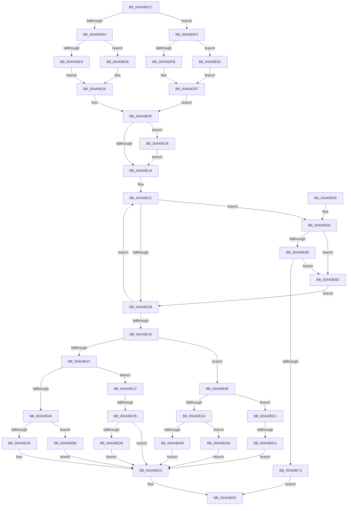

# KiUpdateMinimumWeight

- RVA: `0x004A9DCC`–`0x004A9EF4` (길이 `296` bytes)
- VA: `0x00000001404A9DCC`
- 실행 섹션: `.text`
- PDB 이름 있음: `예`; PDB Function 태그: `예`
- unwind 정보 RVA: `0x000B7BD4`
- 디코드: `84`개 명령, `296/296` bytes 표시
- 미해석 바이트: `0` (있으면 어셈블리에 `.byte`로 보존)

> 이 문서는 커널 이미지의 기계어와 PDB 기호를 분석해 생성했습니다. 4번과 5번은 함수 원형과 자료형을 바이너리 사용 방식에서 추정한 C 해석이며 원본 소스 복구 결과는 아닙니다.

## 1. Dependencies

- 직접 호출 지점: **0**; 고유 호출 대상: **0**
- 직접 호출자로 확인된 함수: **1**
- RIP 상대 이미지 참조: **6**

### Outgoing calls
- 직접 디코드된 call 명령이 없습니다.

### Direct callers
- [KeRemoveSchedulingGroup](KeRemoveSchedulingGroup_function_004AD328.md) at `0x004AD4AB`

### Static image references
- `0x004A9DE9` → RVA `0x00F23434` (`.data`; read)
- `0x004A9E45` → RVA `0x00F23434` (`.data`; read/write)
- `0x004A9E4C` → RVA `0x00F2343C` (`.data`; read/write)
- `0x004A9E78` → RVA `0x00F23420` (`.data`; read)
- `0x004A9E81` → RVA `0x00F23438` (`.data`; read)
- `0x004A9EAE` → RVA `0x00F23438` (`.data`; write)

## 2. Other-region calls and transfers

- 다른 실행 섹션으로 향하는 call: **0**
- call이 아닌 외부 분기/꼬리 이동: **2**
  - `0x004A9EC5` → [sub_006FA02A](../6F/Unknown_function_006FA02A.md) (`tail-transfer`)
  - `0x004A9EE4` → [sub_006FA02A + 0x1B](../6F/Unknown_function_006FA02A.md) (`tail-transfer`)

## 3. Assembly (complete function range)

```asm
004A9DCC  48 89 5C 24 08                  mov qword ptr [rsp + 8], rbx
004A9DD1  48 89 74 24 10                  mov qword ptr [rsp + 0x10], rsi
004A9DD6  48 89 7C 24 18                  mov qword ptr [rsp + 0x18], rdi
004A9DDB  40 8A FA                        mov dil, dl
004A9DDE  8B F1                           mov esi, ecx
004A9DE0  85 C9                           test ecx, ecx
004A9DE2  75 0E                           jne 0x1404a9df2
004A9DE4  4D 85 C0                        test r8, r8
004A9DE7  75 1D                           jne 0x1404a9e06
004A9DE9  44 8B 0D 44 96 A7 00            mov r9d, dword ptr [rip + 0xa79644]
004A9DF0  EB 18                           jmp 0x1404a9e0a
004A9DF2  4D 85 C0                        test r8, r8
004A9DF5  0F 84 86 00 00 00               je 0x1404a9e81
004A9DFB  45 8B 48 0C                     mov r9d, dword ptr [r8 + 0xc]
004A9DFF  B9 10 27 00 00                  mov ecx, 0x2710
004A9E04  EB 09                           jmp 0x1404a9e0f
004A9E06  45 8B 48 10                     mov r9d, dword ptr [r8 + 0x10]
004A9E0A  B9 09 00 00 00                  mov ecx, 9
004A9E0F  49 8D 58 50                     lea rbx, [r8 + 0x50]
004A9E13  4D 85 C0                        test r8, r8
004A9E16  74 60                           je 0x1404a9e78
004A9E18  48 8B 13                        mov rdx, qword ptr [rbx]
004A9E1B  45 33 D2                        xor r10d, r10d
004A9E1E  45 33 DB                        xor r11d, r11d
004A9E21  8B 42 CC                        mov eax, dword ptr [rdx - 0x34]
004A9E24  83 E0 01                        and eax, 1
004A9E27  3B C6                           cmp eax, esi
004A9E29  74 3B                           je 0x1404a9e66
004A9E2B  48 8B 12                        mov rdx, qword ptr [rdx]
004A9E2E  48 3B D3                        cmp rdx, rbx
004A9E31  75 EE                           jne 0x1404a9e21
004A9E33  85 F6                           test esi, esi
004A9E35  75 67                           jne 0x1404a9e9e
004A9E37  45 85 DB                        test r11d, r11d
004A9E3A  0F 85 82 00 00 00               jne 0x1404a9ec2
004A9E40  4D 85 C0                        test r8, r8
004A9E43  75 71                           jne 0x1404a9eb6
004A9E45  44 21 05 E8 95 A7 00            and dword ptr [rip + 0xa795e8], r8d
004A9E4C  44 21 05 E9 95 A7 00            and dword ptr [rip + 0xa795e9], r8d
004A9E53  B0 01                           mov al, 1
004A9E55  48 8B 5C 24 08                  mov rbx, qword ptr [rsp + 8]
004A9E5A  48 8B 74 24 10                  mov rsi, qword ptr [rsp + 0x10]
004A9E5F  48 8B 7C 24 18                  mov rdi, qword ptr [rsp + 0x18]
004A9E64  C3                              ret
004A9E65  CC                              int3
004A9E66  40 84 FF                        test dil, dil
004A9E69  75 22                           jne 0x1404a9e8d
004A9E6B  0F B7 42 C8                     movzx eax, word ptr [rdx - 0x38]
004A9E6F  41 3B C1                        cmp eax, r9d
004A9E72  75 19                           jne 0x1404a9e8d
004A9E74  32 C0                           xor al, al
004A9E76  EB DD                           jmp 0x1404a9e55
004A9E78  48 8D 1D A1 95 A7 00            lea rbx, [rip + 0xa795a1]
004A9E7F  EB 97                           jmp 0x1404a9e18
004A9E81  44 8B 0D B0 95 A7 00            mov r9d, dword ptr [rip + 0xa795b0]
004A9E88  E9 72 FF FF FF                  jmp 0x1404a9dff
004A9E8D  0F B7 42 C8                     movzx eax, word ptr [rdx - 0x38]
004A9E91  3B C1                           cmp eax, ecx
004A9E93  0F 42 C8                        cmovb ecx, eax
004A9E96  44 03 D0                        add r10d, eax
004A9E99  41 FF C3                        inc r11d
004A9E9C  EB 8D                           jmp 0x1404a9e2b
004A9E9E  45 85 DB                        test r11d, r11d
004A9EA1  74 3E                           je 0x1404a9ee1
004A9EA3  4D 85 C0                        test r8, r8
004A9EA6  74 06                           je 0x1404a9eae
004A9EA8  41 89 48 0C                     mov dword ptr [r8 + 0xc], ecx
004A9EAC  EB A5                           jmp 0x1404a9e53
004A9EAE  89 0D 84 95 A7 00               mov dword ptr [rip + 0xa79584], ecx
004A9EB4  EB 9D                           jmp 0x1404a9e53
004A9EB6  41 83 60 10 00                  and dword ptr [r8 + 0x10], 0
004A9EBB  41 83 60 14 00                  and dword ptr [r8 + 0x14], 0
004A9EC0  EB 91                           jmp 0x1404a9e53
004A9EC2  4D 85 C0                        test r8, r8
004A9EC5  0F 84 5F 01 25 00               je 0x1406fa02a
004A9ECB  41 89 48 10                     mov dword ptr [r8 + 0x10], ecx
004A9ECF  40 84 FF                        test dil, dil
004A9ED2  0F 84 7B FF FF FF               je 0x1404a9e53
004A9ED8  45 89 50 14                     mov dword ptr [r8 + 0x14], r10d
004A9EDC  E9 72 FF FF FF                  jmp 0x1404a9e53
004A9EE1  4D 85 C0                        test r8, r8
004A9EE4  0F 84 5B 01 25 00               je 0x1406fa045
004A9EEA  41 83 60 0C 00                  and dword ptr [r8 + 0xc], 0
004A9EEF  E9 5F FF FF FF                  jmp 0x1404a9e53
```

## 4. C-style interpretation (structured pseudocode)

```c
__int64 __fastcall KiUpdateMinimumWeight(int a1, unsigned __int8 a2, __int64 a3)
{
    __int64 result;
    __int64 v_r10;
    __int64 v_r11;
    unsigned __int64 v_stack_p10;
    unsigned __int64 v_stack_p18;
    unsigned __int64 v_stack_p8;

    v_stack_p8 = v_rbx;
    v_stack_p10 = v_rsi;
    v_stack_p18 = v_rdi;
    if (a1 != 0) goto loc_004A9DF2;
    if (a3 != 0) goto loc_004A9E06;
    goto loc_004A9E0A;
loc_004A9DF2:
    if (a3 == 0) goto loc_004A9E81;
loc_004A9DFF:
    goto loc_004A9E0F;
loc_004A9E06:
loc_004A9E0A:
loc_004A9E0F:
    if (a3 == 0) goto loc_004A9E78;
loc_004A9E18:
    v_r10 = 0;
    v_r11 = 0;
loc_004A9E21:
    result = (unsigned int)(((unsigned int)(*(unsigned int *)(*(unsigned __int64 *)(a3 + 80) - 52))) & (1));
    if (((unsigned int)(result)) == ((unsigned int)((unsigned int)(a1)))) goto loc_004A9E66;
loc_004A9E2B:
    if ((*(unsigned __int64 *)(*(unsigned __int64 *)(a3 + 80))) != (a3 + 80)) goto loc_004A9E21;
    if ((unsigned int)((unsigned int)(a1)) != 0) goto loc_004A9E9E;
    if (0 != 0) goto loc_004A9EC2;
    if (a3 != 0) goto loc_004A9EB6;
loc_004A9E53:
loc_004A9E55:
    return 1;
loc_004A9E66:
    if ((unsigned __int8)(v_stack_p18) != 0) goto loc_004A9E8D;
    if (((unsigned int)(*(unsigned __int16 *)(*(unsigned __int64 *)(*(unsigned __int64 *)(a3 + 80)) - 56))) != ((unsigned int)((unsigned int)(*(unsigned int *)(a3 + 16))))) goto loc_004A9E8D;
    result = 0;
    goto loc_004A9E55;
loc_004A9E78:
    goto loc_004A9E18;
loc_004A9E81:
    goto loc_004A9DFF;
loc_004A9E8D:
    a1 = 9;
    if (((unsigned int)(*(unsigned __int16 *)(*(unsigned __int64 *)(*(unsigned __int64 *)(a3 + 80)) - 56))) < 9) { a1 = (unsigned int)(*(unsigned __int16 *)(*(unsigned __int64 *)(*(unsigned __int64 *)(a3 + 80)) - 56)); }
    v_r10 = (unsigned int)((v_r10) + ((unsigned int)(*(unsigned __int16 *)(*(unsigned __int64 *)(*(unsigned __int64 *)(a3 + 80)) - 56))));
    v_r11 = (unsigned int)((v_r11) + 1);
    goto loc_004A9E2B;
loc_004A9E9E:
    if ((unsigned int)(v_r11) == 0) goto loc_004A9EE1;
    if (a3 == 0) goto loc_004A9EAE;
    *(unsigned int *)(a3 + 12) = a1;
    goto loc_004A9E53;
loc_004A9EAE:
    *(unsigned int *)(v_rip + 10982788) = a1;
    goto loc_004A9E53;
loc_004A9EB6:
    goto loc_004A9E53;
loc_004A9EC2:
    *(unsigned int *)(a3 + 16) = a1;
    if ((unsigned __int8)(v_stack_p18) == 0) goto loc_004A9E53;
    *(unsigned int *)(a3 + 20) = (unsigned int)(v_r10);
    goto loc_004A9E53;
loc_004A9EE1:
    goto loc_004A9E53;
}
```

## 5. (Beta) C Style

```c
int64_t KiUpdateMinimumWeight(int32_t Arg1, uint8_t Arg2, int64_t Arg3)
{
    int64_t result;
    int64_t local_r10;
    int64_t local_r11;
    uint64_t v_stack_p10;
    uint64_t v_stack_p18;
    uint64_t v_stack_p8;

    v_stack_p8 = local_rbx;
    v_stack_p10 = local_rsi;
    v_stack_p18 = local_rdi;
    if (Arg1 != 0) goto loc_004A9DF2;
    if (Arg3 != 0) goto loc_004A9E06;
    goto loc_004A9E0A;
loc_004A9DF2:
    if (Arg3 == 0) goto loc_004A9E81;
loc_004A9DFF:
    goto loc_004A9E0F;
loc_004A9E06:
loc_004A9E0A:
loc_004A9E0F:
    if (Arg3 == 0) goto loc_004A9E78;
loc_004A9E18:
    local_r10 = 0;
    local_r11 = 0;
loc_004A9E21:
    result = (uint32_t)(((uint32_t)(*(uint32_t *)(*(uint64_t *)(Arg3 + 0x50) - 0x34))) & (1));
    if (((uint32_t)(result)) == ((uint32_t)((uint32_t)(Arg1)))) goto loc_004A9E66;
loc_004A9E2B:
    if ((*(uint64_t *)(*(uint64_t *)(Arg3 + 0x50))) != (Arg3 + 80)) goto loc_004A9E21;
    if ((uint32_t)((uint32_t)(Arg1)) != 0) goto loc_004A9E9E;
    if (0 != 0) goto loc_004A9EC2;
    if (Arg3 != 0) goto loc_004A9EB6;
loc_004A9E53:
loc_004A9E55:
    return 1;
loc_004A9E66:
    if ((uint8_t)(v_stack_p18) != 0) goto loc_004A9E8D;
    if (((uint32_t)(*(uint16_t *)(*(uint64_t *)(*(uint64_t *)(Arg3 + 0x50)) - 0x38))) != ((uint32_t)((uint32_t)(*(uint32_t *)(Arg3 + 0x10))))) goto loc_004A9E8D;
    result = 0;
    goto loc_004A9E55;
loc_004A9E78:
    goto loc_004A9E18;
loc_004A9E81:
    goto loc_004A9DFF;
loc_004A9E8D:
    Arg1 = 9;
    if (((uint32_t)(*(uint16_t *)(*(uint64_t *)(*(uint64_t *)(Arg3 + 0x50)) - 0x38))) < 9) { Arg1 = (uint32_t)(*(uint16_t *)(*(uint64_t *)(*(uint64_t *)(Arg3 + 0x50)) - 0x38)); }
    local_r10 = (uint32_t)((local_r10) + ((uint32_t)(*(uint16_t *)(*(uint64_t *)(*(uint64_t *)(Arg3 + 0x50)) - 0x38))));
    local_r11 = (uint32_t)((local_r11) + 1);
    goto loc_004A9E2B;
loc_004A9E9E:
    if ((uint32_t)(local_r11) == 0) goto loc_004A9EE1;
    if (Arg3 == 0) goto loc_004A9EAE;
    *(uint32_t *)(Arg3 + 0xC) = Arg1;
    goto loc_004A9E53;
loc_004A9EAE:
    *(uint32_t *)(v_rip + 0xA79584) = Arg1;
    goto loc_004A9E53;
loc_004A9EB6:
    goto loc_004A9E53;
loc_004A9EC2:
    *(uint32_t *)(Arg3 + 0x10) = Arg1;
    if ((uint8_t)(v_stack_p18) == 0) goto loc_004A9E53;
    *(uint32_t *)(Arg3 + 0x14) = (uint32_t)(local_r10);
    goto loc_004A9E53;
loc_004A9EE1:
    goto loc_004A9E53;
}
```

## 6. Execution-region graph

[열기: 2D/3D 그래프와 함수 탐색 컨트롤 패널](../../../control-panel.html?section=text&rva=0x004A9DCC&view=graph)

- 2D 그래프는 위에서 아래로 흐르고, 3D 그래프는 빈 공간을 드래그해 회전합니다. Shift+드래그는 이동, 휠은 확대·축소, 함수 노드 선택은 대상 보고서 이동입니다.

### Static fallback


