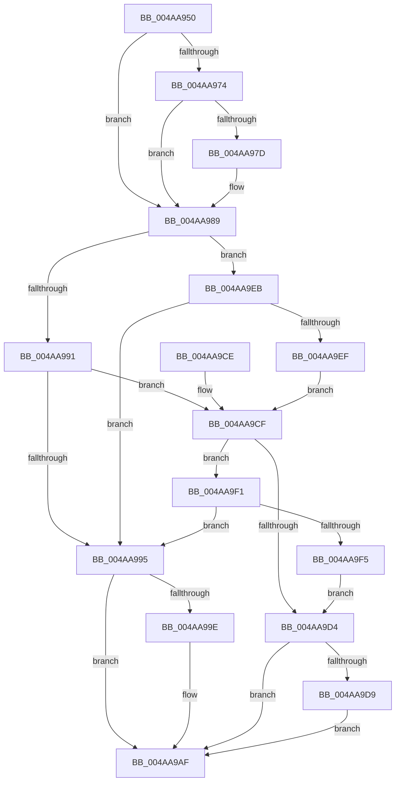

# KsepCompletionSafeWrapper

- RVA: `0x004AA950`–`0x004AA9F7` (길이 `167` bytes)
- VA: `0x00000001404AA950`
- 실행 섹션: `.text`
- PDB 이름 있음: `예`; PDB Function 태그: `아니요`
- unwind 정보 RVA: `0x000A1038`
- 디코드: `54`개 명령, `167/167` bytes 표시
- 미해석 바이트: `0` (있으면 어셈블리에 `.byte`로 보존)

> 이 문서는 커널 이미지의 기계어와 PDB 기호를 분석해 생성했습니다. 4번과 5번은 함수 원형과 자료형을 바이너리 사용 방식에서 추정한 C 해석이며 원본 소스 복구 결과는 아닙니다.

## 1. Dependencies

- 직접 호출 지점: **3**; 고유 호출 대상: **2**
- 직접 호출자로 확인된 함수: **0**
- RIP 상대 이미지 참조: **0**

### Outgoing calls
- `0x004AA984` → [guard_dispatch_icall](../6B/guard_dispatch_icall_function_006BAAD0.md) (function, `0x006BAAD0`)
- `0x004AA9A8` → [guard_dispatch_icall](../6B/guard_dispatch_icall_function_006BAAD0.md) (function, `0x006BAAD0`)
- `0x004AA9B2` → [KsepPoolFreeNonPaged](KsepPoolFreeNonPaged_function_004AAA00.md) (function, `0x004AAA00`)

### Direct callers
- 이 함수 시작 RVA로 연결되는 직접 call은 확인되지 않았습니다. 간접 호출은 완전히 역산할 수 없습니다.

### Static image references
- 디코드된 RIP-relative 메모리 참조가 없습니다.

## 2. Other-region calls and transfers

- 다른 실행 섹션으로 향하는 call: **0**
- 별도 외부 분기/꼬리 이동을 확인하지 못했습니다.

## 3. Assembly (complete function range)

```asm
004AA950  48 89 5C 24 08                  mov qword ptr [rsp + 8], rbx
004AA955  48 89 6C 24 10                  mov qword ptr [rsp + 0x10], rbp
004AA95A  48 89 74 24 18                  mov qword ptr [rsp + 0x18], rsi
004AA95F  57                              push rdi
004AA960  48 83 EC 20                     sub rsp, 0x20
004AA964  33 DB                           xor ebx, ebx
004AA966  49 8B F8                        mov rdi, r8
004AA969  48 8B F2                        mov rsi, rdx
004AA96C  48 8B E9                        mov rbp, rcx
004AA96F  4D 85 C0                        test r8, r8
004AA972  74 15                           je 0x1404aa989
004AA974  49 8B 40 08                     mov rax, qword ptr [r8 + 8]
004AA978  48 85 C0                        test rax, rax
004AA97B  74 0C                           je 0x1404aa989
004AA97D  4D 8B 40 10                     mov r8, qword ptr [r8 + 0x10]
004AA981  48 8B 0F                        mov rcx, qword ptr [rdi]
004AA984  E8 47 01 21 00                  call 0x1406baad0
004AA989  8B 47 28                        mov eax, dword ptr [rdi + 0x28]
004AA98C  39 5E 30                        cmp dword ptr [rsi + 0x30], ebx
004AA98F  7C 5A                           jl 0x1404aa9eb
004AA991  A8 40                           test al, 0x40
004AA993  74 3A                           je 0x1404aa9cf
004AA995  48 8B 47 18                     mov rax, qword ptr [rdi + 0x18]
004AA999  48 85 C0                        test rax, rax
004AA99C  74 11                           je 0x1404aa9af
004AA99E  4C 8B 47 20                     mov r8, qword ptr [rdi + 0x20]
004AA9A2  48 8B D6                        mov rdx, rsi
004AA9A5  48 8B CD                        mov rcx, rbp
004AA9A8  E8 23 01 21 00                  call 0x1406baad0
004AA9AD  8B D8                           mov ebx, eax
004AA9AF  48 8B CF                        mov rcx, rdi
004AA9B2  E8 49 00 00 00                  call 0x1404aaa00
004AA9B7  48 8B 6C 24 38                  mov rbp, qword ptr [rsp + 0x38]
004AA9BC  8B C3                           mov eax, ebx
004AA9BE  48 8B 5C 24 30                  mov rbx, qword ptr [rsp + 0x30]
004AA9C3  48 8B 74 24 40                  mov rsi, qword ptr [rsp + 0x40]
004AA9C8  48 83 C4 20                     add rsp, 0x20
004AA9CC  5F                              pop rdi
004AA9CD  C3                              ret
004AA9CE  CC                              int3
004AA9CF  38 5E 44                        cmp byte ptr [rsi + 0x44], bl
004AA9D2  75 1D                           jne 0x1404aa9f1
004AA9D4  38 5E 41                        cmp byte ptr [rsi + 0x41], bl
004AA9D7  74 D6                           je 0x1404aa9af
004AA9D9  48 8B 86 B8 00 00 00            mov rax, qword ptr [rsi + 0xb8]
004AA9E0  BB 03 01 00 00                  mov ebx, 0x103
004AA9E5  80 48 03 01                     or byte ptr [rax + 3], 1
004AA9E9  EB C4                           jmp 0x1404aa9af
004AA9EB  84 C0                           test al, al
004AA9ED  78 A6                           js 0x1404aa995
004AA9EF  EB DE                           jmp 0x1404aa9cf
004AA9F1  A8 20                           test al, 0x20
004AA9F3  75 A0                           jne 0x1404aa995
004AA9F5  EB DD                           jmp 0x1404aa9d4
```

## 4. C-style interpretation (structured pseudocode)

```c
__int64 __fastcall KsepCompletionSafeWrapper(__int64 a1, __int64 a2, __int64 a3)
{
    __int64 result;
    __int64 v_rbx;
    __int64 v_rsp;
    unsigned __int64 v_stack_p10;
    unsigned __int64 v_stack_p18;
    unsigned __int64 v_stack_p8;

    v_stack_p8 = v_rbx;
    v_stack_p10 = v_rbp;
    v_stack_p18 = v_rsi;
    v_rsp = (v_rsp) - (32);
    v_rbx = 0;
    if (a3 == 0) goto loc_004AA989;
    result = *(unsigned __int64 *)(a3 + 8);
    if (*(unsigned __int64 *)(a3 + 8) != 0) {
        a3 = *(unsigned __int64 *)(a3 + 16);
        a1 = *(unsigned __int64 *)(a3);
        result = guard_dispatch_icall(a1, a2, a3, a4);
    }
    if ((*(unsigned int *)(a2 + 48)) < 0) goto loc_004AA9EB;
    if ((((unsigned __int8)((unsigned int)(*(unsigned int *)(a3 + 40)))) & (64)) == 0) goto loc_004AA9CF;
loc_004AA995:
    result = *(unsigned __int64 *)(a3 + 24);
    if (*(unsigned __int64 *)(a3 + 24) != 0) {
        a3 = *(unsigned __int64 *)(a3 + 32);
        a2 = a2;
        a1 = a1;
        result = guard_dispatch_icall(a1, a2, a3, a4);
        v_rbx = (unsigned int)(result);
    }
    result = KsepPoolFreeNonPaged(a3, a2, a3, a4);
    v_rsp = (v_rsp) + (32);
    return (unsigned int)((unsigned int)(v_rbx));
loc_004AA9CF:
    if ((*(unsigned __int8 *)(v_stack_p18 + 68)) != ((unsigned __int8)(v_stack_p8))) goto loc_004AA9F1;
loc_004AA9D4:
    if ((*(unsigned __int8 *)(v_stack_p18 + 65)) == ((unsigned __int8)(v_stack_p8))) goto loc_004AA9AF;
    goto loc_004AA9AF;
loc_004AA9EB:
    if (sign_flag) goto loc_004AA995;
    goto loc_004AA9CF;
loc_004AA9F1:
    if ((((unsigned __int8)(*(unsigned __int64 *)(v_stack_p18 + 184))) & (32)) != 0) goto loc_004AA995;
    goto loc_004AA9D4;
}
```

## 5. (Beta) C Style

```c
int64_t KsepCompletionSafeWrapper(int64_t Arg1, void *Arg2, void *Arg3)
{
    uint8_t *arg2 = (uint8_t *)Arg2;
    uint8_t *arg3 = (uint8_t *)Arg3;

    int64_t result;
    int64_t local_rbx;
    int64_t local_rsp;
    uint64_t v_stack_p10;
    uint64_t v_stack_p18;
    uint64_t v_stack_p8;

    v_stack_p8 = local_rbx;
    v_stack_p10 = local_rbp;
    v_stack_p18 = local_rsi;
    local_rsp = (local_rsp) - (32);
    local_rbx = 0;
    if (Arg3 == NULL) goto loc_004AA989;
    result = *(uint64_t *)(arg3 + 0x8);
    if (*(uint64_t *)(arg3 + 0x8) != 0) {
        Arg3 = *(uint64_t *)(arg3 + 0x10);
        Arg1 = *(uint64_t *)(arg3);
        result = guard_dispatch_icall(Arg1, Arg2, Arg3, a4);
    }
    if ((*(uint32_t *)(arg2 + 0x30)) < 0) goto loc_004AA9EB;
    if ((((uint8_t)((uint32_t)(*(uint32_t *)(arg3 + 0x28)))) & (64)) == 0) goto loc_004AA9CF;
loc_004AA995:
    result = *(uint64_t *)(arg3 + 0x18);
    if (*(uint64_t *)(arg3 + 0x18) != 0) {
        Arg3 = *(uint64_t *)(arg3 + 0x20);
        Arg2 = Arg2;
        Arg1 = Arg1;
        result = guard_dispatch_icall(Arg1, Arg2, Arg3, a4);
        local_rbx = (uint32_t)(result);
    }
    result = KsepPoolFreeNonPaged(Arg3, Arg2, Arg3, a4);
    local_rsp = (local_rsp) + (32);
    return (uint32_t)((uint32_t)(local_rbx));
loc_004AA9CF:
    if ((*(uint8_t *)(v_stack_p18 + 0x44)) != ((uint8_t)(v_stack_p8))) goto loc_004AA9F1;
loc_004AA9D4:
    if ((*(uint8_t *)(v_stack_p18 + 0x41)) == ((uint8_t)(v_stack_p8))) goto loc_004AA9AF;
    goto loc_004AA9AF;
loc_004AA9EB:
    if (sign_flag) goto loc_004AA995;
    goto loc_004AA9CF;
loc_004AA9F1:
    if ((((uint8_t)(*(uint64_t *)(v_stack_p18 + 0xB8))) & (32)) != 0) goto loc_004AA995;
    goto loc_004AA9D4;
}
```

### 관측된 메모리 오프셋

구조체 형식이 확인되지 않은 접근은 인자 기준의 오프셋으로만 기록했습니다.

| 기준 인자 | 오프셋 표현 | 폭 (bit) | 접근 |
|---|---:|---:|---|
| `Arg2` | `+ 0x30` | `32` | `R` |
| `Arg2` | `+ 0x41` | `8` | `R` |
| `Arg2` | `+ 0x44` | `8` | `R` |
| `Arg2` | `+ 0xB8` | `64` | `R` |
| `Arg3` | `+ 0x0` | `64` | `R` |
| `Arg3` | `+ 0x18` | `64` | `R` |
| `Arg3` | `+ 0x20` | `64` | `R` |
| `Arg3` | `+ 0x28` | `32` | `R` |

## 6. Execution-region graph

[열기: 2D/3D 그래프와 함수 탐색 컨트롤 패널](../../../control-panel.html?section=text&rva=0x004AA950&view=graph)

- 2D 그래프는 위에서 아래로 흐르고, 3D 그래프는 빈 공간을 드래그해 회전합니다. Shift+드래그는 이동, 휠은 확대·축소, 함수 노드 선택은 대상 보고서 이동입니다.

### Static fallback


