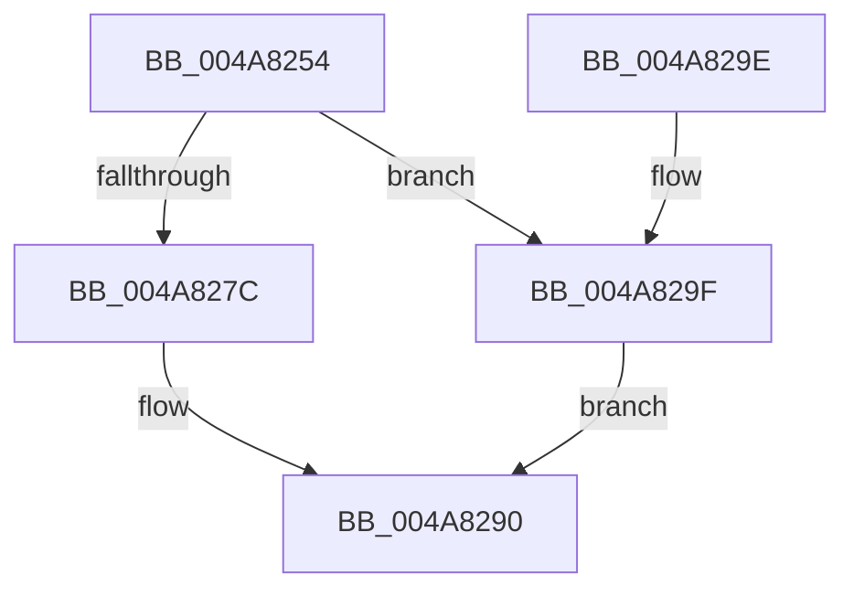

# KsepPoolAllocateNonPaged

- RVA: `0x004A8254`–`0x004A82A8` (길이 `84` bytes)
- VA: `0x00000001404A8254`
- 실행 섹션: `.text`
- PDB 이름 있음: `예`; PDB Function 태그: `아니요`
- unwind 정보 RVA: `0x00060BE4`
- 디코드: `24`개 명령, `84/84` bytes 표시
- 미해석 바이트: `0` (있으면 어셈블리에 `.byte`로 보존)

> 이 문서는 커널 이미지의 기계어와 PDB 기호를 분석해 생성했습니다. 4번과 5번은 함수 원형과 자료형을 바이너리 사용 방식에서 추정한 C 해석이며 원본 소스 복구 결과는 아닙니다.

## 1. Dependencies

- 직접 호출 지점: **2**; 고유 호출 대상: **2**
- 직접 호출자로 확인된 함수: **2**
- RIP 상대 이미지 참조: **2**

### Outgoing calls
- `0x004A826F` → [ExAllocatePool2](../../poolcode/B8/ExAllocatePool2_function_00B820F0.md) (function, `0x00B820F0`)
- `0x004A828B` → [memset](../6C/memset_function_006C6C40.md) (function, `0x006C6C40`)

### Direct callers
- [KseSetCompletionHook](KseSetCompletionHook_function_004A81C0.md) at `0x004A81E5`
- [KseShimDriverIoCallbacks](../../page/95/KseShimDriverIoCallbacks_function_00958BFC.md) at `0x00958D19`

### Static image references
- `0x004A827C` → RVA `0x00F10168` (`.data`; read/write)
- `0x004A829F` → RVA `0x00F10174` (`.data`; read/write)

## 2. Other-region calls and transfers

- 다른 실행 섹션으로 향하는 call: **1**
  - `0x004A826F` → [ExAllocatePool2](../../poolcode/B8/ExAllocatePool2_function_00B820F0.md) (`.text` → `POOLCODE`)
- 별도 외부 분기/꼬리 이동을 확인하지 못했습니다.

## 3. Assembly (complete function range)

```asm
004A8254  48 89 5C 24 08                  mov qword ptr [rsp + 8], rbx
004A8259  57                              push rdi
004A825A  48 83 EC 20                     sub rsp, 0x20
004A825E  48 8B F9                        mov rdi, rcx
004A8261  48 8B D1                        mov rdx, rcx
004A8264  B9 40 00 00 00                  mov ecx, 0x40
004A8269  41 B8 4B 53 45 62               mov r8d, 0x6245534b
004A826F  E8 7C 9E 6D 00                  call 0x140b820f0
004A8274  48 8B D8                        mov rbx, rax
004A8277  48 85 C0                        test rax, rax
004A827A  74 23                           je 0x1404a829f
004A827C  F0 FF 05 E5 7E A6 00            lock inc dword ptr [rip + 0xa67ee5]
004A8283  4C 8B C7                        mov r8, rdi
004A8286  33 D2                           xor edx, edx
004A8288  48 8B C8                        mov rcx, rax
004A828B  E8 B0 E9 21 00                  call 0x1406c6c40
004A8290  48 8B C3                        mov rax, rbx
004A8293  48 8B 5C 24 30                  mov rbx, qword ptr [rsp + 0x30]
004A8298  48 83 C4 20                     add rsp, 0x20
004A829C  5F                              pop rdi
004A829D  C3                              ret
004A829E  CC                              int3
004A829F  F0 FF 05 CE 7E A6 00            lock inc dword ptr [rip + 0xa67ece]
004A82A6  EB E8                           jmp 0x1404a8290
```

## 4. C-style interpretation (structured pseudocode)

```c
__int64 __fastcall KsepPoolAllocateNonPaged(__int64 a1)
{
    __int64 result;
    __int64 v_rsp;
    unsigned __int64 v_stack_p8;

    v_stack_p8 = v_rbx;
    v_rsp = (v_rsp) - (32);
    result = ExAllocatePool2(64, a1, (unsigned int)(0x6245534BULL), a4);
    if (result == 0) goto loc_004A829F;
    a2 = 0;
    result = memset(result, a2, a1, a4);
loc_004A8290:
    v_rsp = (v_rsp) + (32);
    return result;
loc_004A829F:
    goto loc_004A8290;
}
```

## 5. (Beta) C Style

```c
int64_t KsepPoolAllocateNonPaged(int64_t Arg1)
{
    int64_t result;
    int64_t local_rsp;
    uint64_t v_stack_p8;

    v_stack_p8 = local_rbx;
    local_rsp = (local_rsp) - (32);
    result = ExAllocatePool2(64, Arg1, (uint32_t)(0x6245534BULL), a4);
    if (result == 0) goto loc_004A829F;
    a2 = 0;
    result = memset(result, a2, Arg1, a4);
loc_004A8290:
    local_rsp = (local_rsp) + (32);
    return result;
loc_004A829F:
    goto loc_004A8290;
}
```

## 6. Execution-region graph

[열기: 2D/3D 그래프와 함수 탐색 컨트롤 패널](../../../control-panel.html?section=text&rva=0x004A8254&view=graph)

- 2D 그래프는 위에서 아래로 흐르고, 3D 그래프는 빈 공간을 드래그해 회전합니다. Shift+드래그는 이동, 휠은 확대·축소, 함수 노드 선택은 대상 보고서 이동입니다.

### Static fallback


