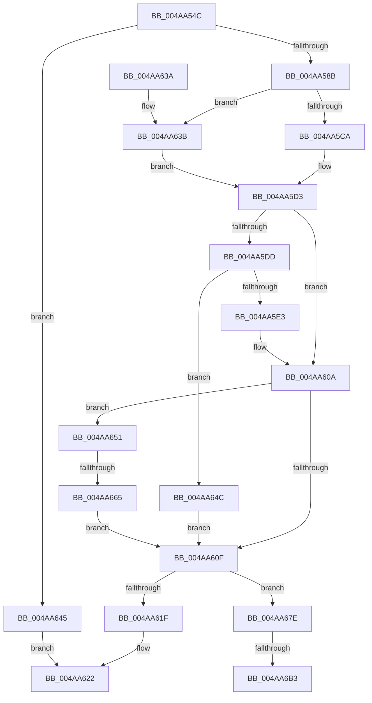

# MiAsyncSlabReplenish

- RVA: `0x004AA54C`–`0x004AA6BE` (길이 `370` bytes)
- VA: `0x00000001404AA54C`
- 실행 섹션: `.text`
- PDB 이름 있음: `예`; PDB Function 태그: `예`
- unwind 정보 RVA: `0x000B7C84`
- 디코드: `106`개 명령, `370/370` bytes 표시
- 미해석 바이트: `0` (있으면 어셈블리에 `.byte`로 보존)

> 이 문서는 커널 이미지의 기계어와 PDB 기호를 분석해 생성했습니다. 4번과 5번은 함수 원형과 자료형을 바이너리 사용 방식에서 추정한 C 해석이며 원본 소스 복구 결과는 아닙니다.

## 1. Dependencies

- 직접 호출 지점: **6**; 고유 호출 대상: **5**
- 직접 호출자로 확인된 함수: **5**
- RIP 상대 이미지 참조: **1**

### Outgoing calls
- `0x004AA5CE` → [ExAcquireSpinLockExclusiveAtDpcLevel](../24/ExAcquireSpinLockExclusiveAtDpcLevel_function_00248E80.md) (function, `0x00248E80`)
- `0x004AA605` → [ExQueueWorkItemToPartition](../35/ExQueueWorkItemToPartition_function_00356E2C.md) (function, `0x00356E2C`)
- `0x004AA615` → [MiReleaseSpinLockExclusive](../24/MiReleaseSpinLockExclusive_function_002482C0.md) (function, `0x002482C0`)
- `0x004AA63B` → [ExAcquireSpinLockExclusive](../24/ExAcquireSpinLockExclusive_function_00248690.md) (function, `0x00248690`)
- `0x004AA695` → [KeWaitForSingleObject](../20/KeWaitForSingleObject_function_0020E6B0.md) (function, `0x0020E6B0`)
- `0x004AA6B3` → [ExAcquireSpinLockExclusiveAtDpcLevel](../24/ExAcquireSpinLockExclusiveAtDpcLevel_function_00248E80.md) (function, `0x00248E80`)

### Direct callers
- [MiAllocateSlabPageForMdl](../37/MiAllocateSlabPageForMdl_function_00376EC8.md) at `0x00376F90`
- [MiGetPageFromSlabAllocator](../37/MiGetPageFromSlabAllocator_function_00377294.md) at `0x003774B7`
- [MiMakeZeroedPageTablesEx](../3B/MiMakeZeroedPageTablesEx_function_003B59FC.md) at `0x003B5D73`
- [MiFastReplenishWithAsync](MiFastReplenishWithAsync_function_004AA500.md) at `0x004AA52E`
- [MiDeleteSlabAllocator](../68/MiDeleteSlabAllocator_function_0068DDC0.md) at `0x0068DDD9`

### Static image references
- `0x004AA568` → RVA `0x00FC6A88` (`ALMOSTRO`; read)

## 2. Other-region calls and transfers

- 다른 실행 섹션으로 향하는 call: **0**
- call이 아닌 외부 분기/꼬리 이동: **3**
  - `0x004AA65F` → [sub_006FA052 + 0x3B](../6F/Unknown_function_006FA052.md) (`tail-transfer`)
  - `0x004AA6AD` → [sub_006FA052](../6F/Unknown_function_006FA052.md) (`tail-transfer`)
  - `0x004AA6B9` → [sub_006FA052 + 0x8](../6F/Unknown_function_006FA052.md) (`tail-transfer`)

## 3. Assembly (complete function range)

```asm
004AA54C  48 89 5C 24 08                  mov qword ptr [rsp + 8], rbx
004AA551  48 89 54 24 10                  mov qword ptr [rsp + 0x10], rdx
004AA556  55                              push rbp
004AA557  56                              push rsi
004AA558  57                              push rdi
004AA559  41 54                           push r12
004AA55B  41 55                           push r13
004AA55D  41 56                           push r14
004AA55F  41 57                           push r15
004AA561  48 8B EC                        mov rbp, rsp
004AA564  48 83 EC 60                     sub rsp, 0x60
004AA568  8A 05 1A C5 B1 00               mov al, byte ptr [rip + 0xb1c51a]
004AA56E  48 8B F1                        mov rsi, rcx
004AA571  33 C9                           xor ecx, ecx
004AA573  24 30                           and al, 0x30
004AA575  48 89 4D D8                     mov qword ptr [rbp - 0x28], rcx
004AA579  45 8B E0                        mov r12d, r8d
004AA57C  48 89 4D E0                     mov qword ptr [rbp - 0x20], rcx
004AA580  88 4D EB                        mov byte ptr [rbp - 0x15], cl
004AA583  3C 10                           cmp al, 0x10
004AA585  0F 82 BA 00 00 00               jb 0x1404aa645
004AA58B  8D 59 01                        lea ebx, [rcx + 1]
004AA58E  66 89 4D E8                     mov word ptr [rbp - 0x18], cx
004AA592  48 8D 45 F0                     lea rax, [rbp - 0x10]
004AA596  89 4D EC                        mov dword ptr [rbp - 0x14], ecx
004AA599  48 89 45 F8                     mov qword ptr [rbp - 8], rax
004AA59D  48 8D 7E 10                     lea rdi, [rsi + 0x10]
004AA5A1  48 8D 45 F0                     lea rax, [rbp - 0x10]
004AA5A5  C6 45 EA 06                     mov byte ptr [rbp - 0x16], 6
004AA5A9  48 89 45 F0                     mov qword ptr [rbp - 0x10], rax
004AA5AD  45 8B F8                        mov r15d, r8d
004AA5B0  44 23 FB                        and r15d, ebx
004AA5B3  41 8B C0                        mov eax, r8d
004AA5B6  45 8B F7                        mov r14d, r15d
004AA5B9  41 B5 11                        mov r13b, 0x11
004AA5BC  44 33 F3                        xor r14d, ebx
004AA5BF  48 8B CF                        mov rcx, rdi
004AA5C2  83 E0 04                        and eax, 4
004AA5C5  89 45 D0                        mov dword ptr [rbp - 0x30], eax
004AA5C8  74 71                           je 0x1404aa63b
004AA5CA  44 88 6D 58                     mov byte ptr [rbp + 0x58], r13b
004AA5CE  E8 AD E8 D9 FF                  call 0x140248e80
004AA5D3  48 83 BE D0 00 00 00 00         cmp qword ptr [rsi + 0xd0], 0
004AA5DB  75 2D                           jne 0x1404aa60a
004AA5DD  41 F6 C4 02                     test r12b, 2
004AA5E1  75 69                           jne 0x1404aa64c
004AA5E3  48 89 B6 D0 00 00 00            mov qword ptr [rsi + 0xd0], rsi
004AA5EA  48 8D 8E B8 00 00 00            lea rcx, [rsi + 0xb8]
004AA5F1  4C 8B 4E 18                     mov r9, qword ptr [rsi + 0x18]
004AA5F5  8B D3                           mov edx, ebx
004AA5F7  44 8B 86 84 00 00 00            mov r8d, dword ptr [rsi + 0x84]
004AA5FE  4D 8B 89 B8 00 00 00            mov r9, qword ptr [r9 + 0xb8]
004AA605  E8 22 C8 EA FF                  call 0x140356e2c
004AA60A  45 85 F6                        test r14d, r14d
004AA60D  75 42                           jne 0x1404aa651
004AA60F  8A 55 58                        mov dl, byte ptr [rbp + 0x58]
004AA612  48 8B CF                        mov rcx, rdi
004AA615  E8 A6 DC D9 FF                  call 0x1402482c0
004AA61A  45 85 F6                        test r14d, r14d
004AA61D  75 5F                           jne 0x1404aa67e
004AA61F  41 8B C7                        mov eax, r15d
004AA622  48 8B 9C 24 A0 00 00 00         mov rbx, qword ptr [rsp + 0xa0]
004AA62A  48 83 C4 60                     add rsp, 0x60
004AA62E  41 5F                           pop r15
004AA630  41 5E                           pop r14
004AA632  41 5D                           pop r13
004AA634  41 5C                           pop r12
004AA636  5F                              pop rdi
004AA637  5E                              pop rsi
004AA638  5D                              pop rbp
004AA639  C3                              ret
004AA63A  CC                              int3
004AA63B  E8 50 E0 D9 FF                  call 0x140248690
004AA640  88 45 58                        mov byte ptr [rbp + 0x58], al
004AA643  EB 8E                           jmp 0x1404aa5d3
004AA645  B8 01 00 00 00                  mov eax, 1
004AA64A  EB D6                           jmp 0x1404aa622
004AA64C  45 33 F6                        xor r14d, r14d
004AA64F  EB BE                           jmp 0x1404aa60f
004AA651  48 81 C6 D8 00 00 00            add rsi, 0xd8
004AA658  48 8B 46 08                     mov rax, qword ptr [rsi + 8]
004AA65C  48 39 30                        cmp qword ptr [rax], rsi
004AA65F  0F 85 28 FA 24 00               jne 0x1406fa08d
004AA665  48 89 45 E0                     mov qword ptr [rbp - 0x20], rax
004AA669  48 8D 4D D8                     lea rcx, [rbp - 0x28]
004AA66D  48 89 75 D8                     mov qword ptr [rbp - 0x28], rsi
004AA671  48 89 08                        mov qword ptr [rax], rcx
004AA674  48 8D 45 D8                     lea rax, [rbp - 0x28]
004AA678  48 89 46 08                     mov qword ptr [rsi + 8], rax
004AA67C  EB 91                           jmp 0x1404aa60f
004AA67E  48 8B 45 48                     mov rax, qword ptr [rbp + 0x48]
004AA682  48 8D 4D E8                     lea rcx, [rbp - 0x18]
004AA686  45 33 C9                        xor r9d, r9d
004AA689  48 89 44 24 20                  mov qword ptr [rsp + 0x20], rax
004AA68E  45 33 C0                        xor r8d, r8d
004AA691  41 8D 51 1A                     lea edx, [r9 + 0x1a]
004AA695  E8 16 40 D6 FF                  call 0x14020e6b0
004AA69A  3D 02 01 00 00                  cmp eax, 0x102
004AA69F  48 8B CF                        mov rcx, rdi
004AA6A2  41 0F 45 DF                     cmovne ebx, r15d
004AA6A6  83 7D D0 00                     cmp dword ptr [rbp - 0x30], 0
004AA6AA  44 8B FB                        mov r15d, ebx
004AA6AD  0F 84 9F F9 24 00               je 0x1406fa052
004AA6B3  E8 C8 E7 D9 FF                  call 0x140248e80
004AA6B8  90                              nop
004AA6B9  E9 9C F9 24 00                  jmp 0x1406fa05a
```

## 4. C-style interpretation (structured pseudocode)

```c
__int64 __fastcall MiAsyncSlabReplenish(__int64 a1, __int64 a2, int a3)
{
    __int64 result;
    __int64 v_r14;
    __int64 v_r15;
    __int64 v_rbx;
    __int64 v_rsi;
    __int64 v_rsp;
    unsigned __int64 v_stack_m40;
    unsigned __int64 v_stack_m48;
    unsigned int v_stack_m4C;
    unsigned __int8 v_stack_m4D;
    unsigned __int8 v_stack_m4E;
    unsigned __int16 v_stack_m50;
    unsigned __int64 v_stack_m58;
    unsigned __int64 v_stack_m60;
    unsigned int v_stack_m68;
    unsigned __int64 v_stack_p10;
    unsigned __int8 v_stack_p20;
    unsigned __int64 v_stack_p8;

    v_stack_p8 = v_rbx;
    v_stack_p10 = a2;
    v_rsp = (v_rsp) - (96);
    a1 = 0;
    result = (unsigned __int8)((*(unsigned __int8 *)(v_rip + 11650330)) & (48));
    v_stack_m60 = 0;
    v_stack_m58 = 0;
    v_stack_m4D = 0;
    if (((unsigned __int8)(result)) < 16) goto loc_004AA645;
    v_stack_m50 = 0;
    v_stack_m4C = 0;
    v_stack_m40 = v_stack_m48;
    v_stack_m4E = 6;
    v_stack_m48 = v_stack_m48;
    v_r15 = (unsigned int)(((unsigned int)(a3)) & ((unsigned int)(a1 + 1)));
    v_r14 = (unsigned int)(((unsigned int)((unsigned int)(v_r15))) ^ ((unsigned int)(a1 + 1)));
    result = (unsigned int)(((unsigned int)(a3)) & (4));
    v_stack_m68 = (unsigned int)(result);
    if (condition_is_equal) goto loc_004AA63B;
    v_stack_p20 = 17;
    result = ExAcquireSpinLockExclusiveAtDpcLevel(a1 + 16, a2, a3, a4);
loc_004AA5D3:
    if ((*(unsigned __int64 *)(a1 + 208)) != 0) goto loc_004AA60A;
    if ((((unsigned __int8)((unsigned int)(a3))) & (2)) != 0) goto loc_004AA64C;
    *(unsigned __int64 *)(a1 + 208) = 0;
    result = ExQueueWorkItemToPartition(a1 + 184, (unsigned int)((unsigned int)(a1 + 1)), (unsigned int)(*(unsigned int *)(a1 + 132)), *(unsigned __int64 *)(*(unsigned __int64 *)(a1 + 24) + 184));
loc_004AA60A:
    if ((unsigned int)(v_r14) != 0) goto loc_004AA651;
loc_004AA60F:
    result = MiReleaseSpinLockExclusive(a1 + 16, v_stack_p20, (unsigned int)(*(unsigned int *)(a1 + 132)), *(unsigned __int64 *)(*(unsigned __int64 *)(a1 + 24) + 184));
    if ((unsigned int)(v_r14) != 0) goto loc_004AA67E;
loc_004AA622:
    v_rsp = (v_rsp) + (96);
    return (unsigned int)((unsigned int)(v_r15));
loc_004AA63B:
    result = ExAcquireSpinLockExclusive(a1 + 16, v_stack_p20, (unsigned int)(*(unsigned int *)(a1 + 132)), *(unsigned __int64 *)(*(unsigned __int64 *)(a1 + 24) + 184));
    v_stack_p20 = (unsigned __int8)(result);
    goto loc_004AA5D3;
loc_004AA645:
    goto loc_004AA622;
loc_004AA64C:
    v_r14 = 0;
    goto loc_004AA60F;
loc_004AA651:
    v_rsi = (a1) + (216);
    v_stack_m58 = *(unsigned __int64 *)(v_rsi + 8);
    v_stack_m60 = v_rsi;
    *(unsigned __int64 *)(*(unsigned __int64 *)(v_rsi + 8)) = v_stack_m60;
    *(unsigned __int64 *)(v_rsi + 8) = v_stack_m60;
    goto loc_004AA60F;
loc_004AA67E:
    a4 = 0;
    v_stack_p20 = v_stack_p10;
    a3 = 0;
    result = KeWaitForSingleObject(v_stack_m50, a4 + 26, a3, a4);
    v_rbx = v_stack_p8;
    if (((unsigned int)(result)) != 258) { v_rbx = (unsigned int)(v_r15); }
    result = ExAcquireSpinLockExclusiveAtDpcLevel(a1 + 16, a4 + 26, a3, a4);
}
```

## 5. (Beta) C Style

```c
int64_t MiAsyncSlabReplenish(void *Arg1, int64_t Arg2, int32_t Arg3)
{
    uint8_t *arg1 = (uint8_t *)Arg1;

    int64_t result;
    int64_t local_r14;
    int64_t local_r15;
    int64_t local_rbx;
    int64_t local_rsi;
    int64_t local_rsp;
    uint64_t v_stack_m40;
    uint64_t v_stack_m48;
    uint32_t v_stack_m4C;
    uint8_t v_stack_m4D;
    uint8_t v_stack_m4E;
    uint16_t v_stack_m50;
    uint64_t v_stack_m58;
    uint64_t v_stack_m60;
    uint32_t v_stack_m68;
    uint64_t v_stack_p10;
    uint8_t v_stack_p20;
    uint64_t v_stack_p8;

    v_stack_p8 = local_rbx;
    v_stack_p10 = Arg2;
    local_rsp = (local_rsp) - (96);
    Arg1 = 0;
    result = (uint8_t)((*(uint8_t *)(v_rip + 0xB1C51A)) & (48));
    v_stack_m60 = 0;
    v_stack_m58 = 0;
    v_stack_m4D = 0;
    if (((uint8_t)(result)) < 16) goto loc_004AA645;
    v_stack_m50 = 0;
    v_stack_m4C = 0;
    v_stack_m40 = v_stack_m48;
    v_stack_m4E = 6;
    v_stack_m48 = v_stack_m48;
    local_r15 = (uint32_t)(((uint32_t)(Arg3)) & ((uint32_t)(Arg1 + 1)));
    local_r14 = (uint32_t)(((uint32_t)((uint32_t)(local_r15))) ^ ((uint32_t)(Arg1 + 1)));
    result = (uint32_t)(((uint32_t)(Arg3)) & (4));
    v_stack_m68 = (uint32_t)(result);
    if (condition_is_equal) goto loc_004AA63B;
    v_stack_p20 = 17;
    result = ExAcquireSpinLockExclusiveAtDpcLevel(Arg1 + 16, Arg2, Arg3, a4);
loc_004AA5D3:
    if ((*(uint64_t *)(arg1 + 0xD0)) != 0) goto loc_004AA60A;
    if ((((uint8_t)((uint32_t)(Arg3))) & (2)) != 0) goto loc_004AA64C;
    *(uint64_t *)(arg1 + 0xD0) = 0;
    result = ExQueueWorkItemToPartition(Arg1 + 184, (uint32_t)((uint32_t)(Arg1 + 1)), (uint32_t)(*(uint32_t *)(arg1 + 0x84)), *(uint64_t *)(*(uint64_t *)(arg1 + 0x18) + 0xB8));
loc_004AA60A:
    if ((uint32_t)(local_r14) != 0) goto loc_004AA651;
loc_004AA60F:
    result = MiReleaseSpinLockExclusive(Arg1 + 16, v_stack_p20, (uint32_t)(*(uint32_t *)(arg1 + 0x84)), *(uint64_t *)(*(uint64_t *)(arg1 + 0x18) + 0xB8));
    if ((uint32_t)(local_r14) != 0) goto loc_004AA67E;
loc_004AA622:
    local_rsp = (local_rsp) + (96);
    return (uint32_t)((uint32_t)(local_r15));
loc_004AA63B:
    result = ExAcquireSpinLockExclusive(Arg1 + 16, v_stack_p20, (uint32_t)(*(uint32_t *)(arg1 + 0x84)), *(uint64_t *)(*(uint64_t *)(arg1 + 0x18) + 0xB8));
    v_stack_p20 = (uint8_t)(result);
    goto loc_004AA5D3;
loc_004AA645:
    goto loc_004AA622;
loc_004AA64C:
    local_r14 = 0;
    goto loc_004AA60F;
loc_004AA651:
    local_rsi = (Arg1) + (216);
    v_stack_m58 = *(uint64_t *)(local_rsi + 0x8);
    v_stack_m60 = local_rsi;
    *(uint64_t *)(*(uint64_t *)(local_rsi + 0x8)) = v_stack_m60;
    *(uint64_t *)(local_rsi + 0x8) = v_stack_m60;
    goto loc_004AA60F;
loc_004AA67E:
    a4 = 0;
    v_stack_p20 = v_stack_p10;
    Arg3 = 0;
    result = KeWaitForSingleObject(v_stack_m50, a4 + 26, Arg3, a4);
    local_rbx = v_stack_p8;
    if (((uint32_t)(result)) != 258) { local_rbx = (uint32_t)(local_r15); }
    result = ExAcquireSpinLockExclusiveAtDpcLevel(Arg1 + 16, a4 + 26, Arg3, a4);
}
```

### 관측된 메모리 오프셋

구조체 형식이 확인되지 않은 접근은 인자 기준의 오프셋으로만 기록했습니다.

| 기준 인자 | 오프셋 표현 | 폭 (bit) | 접근 |
|---|---:|---:|---|
| `Arg1` | `+ 0x8` | `64` | `R` |
| `Arg1` | `+ 0x8` | `64` | `W` |
| `Arg1` | `+ 0x10` | `64` | `R` |
| `Arg1` | `+ 0x18` | `64` | `R` |
| `Arg1` | `+ 0x84` | `32` | `R` |
| `Arg1` | `+ 0xB8` | `64` | `R` |
| `Arg1` | `+ 0xD0` | `64` | `R` |
| `Arg1` | `+ 0xD0` | `64` | `W` |

## 6. Execution-region graph

[열기: 2D/3D 그래프와 함수 탐색 컨트롤 패널](../../../control-panel.html?section=text&rva=0x004AA54C&view=graph)

- 2D 그래프는 위에서 아래로 흐르고, 3D 그래프는 빈 공간을 드래그해 회전합니다. Shift+드래그는 이동, 휠은 확대·축소, 함수 노드 선택은 대상 보고서 이동입니다.

### Static fallback


