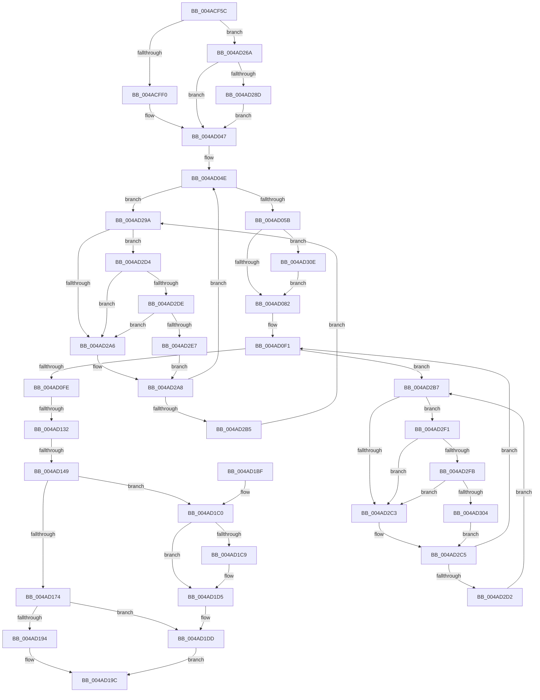

# MiBuildForkPageTable

- RVA: `0x004ACF5C`–`0x004AD321` (길이 `965` bytes)
- VA: `0x00000001404ACF5C`
- 실행 섹션: `.text`
- PDB 이름 있음: `예`; PDB Function 태그: `예`
- unwind 정보 RVA: `0x000B83DC`
- 디코드: `232`개 명령, `965/965` bytes 표시
- 미해석 바이트: `0` (있으면 어셈블리에 `.byte`로 보존)

> 이 문서는 커널 이미지의 기계어와 PDB 기호를 분석해 생성했습니다. 4번과 5번은 함수 원형과 자료형을 바이너리 사용 방식에서 추정한 C 해석이며 원본 소스 복구 결과는 아닙니다.

## 1. Dependencies

- 직접 호출 지점: **23**; 고유 호출 대상: **21**
- 직접 호출자로 확인된 함수: **1**
- RIP 상대 이미지 참조: **4**

### Outgoing calls
- `0x004ACFCE` → [MiMakeDemandZeroPte](../33/MiMakeDemandZeroPte_function_00337A00.md) (function, `0x00337A00`)
- `0x004ACFDD` → [MiSetPfnContainingFrame](../36/MiSetPfnContainingFrame_function_00363FC0.md) (function, `0x00363FC0`)
- `0x004AD02F` → [MiLockWorkingSetShared](../27/MiLockWorkingSetShared_function_0027CBF0.md) (function, `0x0027CBF0`)
- `0x004AD042` → [MiMakeSystemAddressValid](../27/MiMakeSystemAddressValid_function_0027FF70.md) (function, `0x0027FF70`)
- `0x004AD064` → [MiSetPfnModified](../36/MiSetPfnModified_function_00362960.md) (function, `0x00362960`)
- `0x004AD0DA` → [MiAddLockedPageCharge](../28/MiAddLockedPageCharge_function_0028B550.md) (function, `0x0028B550`)
- `0x004AD13A` → [MiIncreaseUsedPtesInPfn](../38/MiIncreaseUsedPtesInPfn_function_00382D90.md) (function, `0x00382D90`)
- `0x004AD152` → [MiMakeTransitionPte](../36/MiMakeTransitionPte_function_00363F70.md) (function, `0x00363F70`)
- `0x004AD17C` → [MiUnlockPageTable](../21/MiUnlockPageTable_function_00216EC0.md) (function, `0x00216EC0`)
- `0x004AD189` → [MiUnlockWorkingSetShared](../27/MiUnlockWorkingSetShared_function_0027D690.md) (function, `0x0027D690`)
- `0x004AD1A7` → [_security_check_cookie](../6A/_security_check_cookie_function_006AC640.md) (function, `0x006AC640`)
- `0x004AD1D0` → [KiLowerIrqlProcessIrqlFlags](../4F/KiLowerIrqlProcessIrqlFlags_function_004F5698.md) (function, `0x004F5698`)
- `0x004AD210` → [KiStackAttachProcess](../21/KiStackAttachProcess_function_00216820.md) (function, `0x00216820`)
- `0x004AD220` → [MiLockWorkingSetOptimal](../23/MiLockWorkingSetOptimal_function_00238FC0.md) (function, `0x00238FC0`)
- `0x004AD244` → [MiAllocateWsle](../33/MiAllocateWsle_function_003332C0.md) (function, `0x003332C0`)
- `0x004AD254` → [MiUnlockWorkingSetOptimal](../23/MiUnlockWorkingSetOptimal_function_00238DFC.md) (function, `0x00238DFC`)
- `0x004AD260` → [KiUnstackDetachProcess](../21/KiUnstackDetachProcess_function_00217D30.md) (function, `0x00217D30`)
- `0x004AD290` → [KiRaiseIrqlProcessIrqlFlags](../4F/KiRaiseIrqlProcessIrqlFlags_function_004F56FC.md) (function, `0x004F56FC`)
- `0x004AD2DE` → [KiCheckVpBackingLongSpinWaitHypercall](../30/KiCheckVpBackingLongSpinWaitHypercall_function_0030F490.md) (function, `0x0030F490`)
- `0x004AD2EA` → [HvlNotifyLongSpinWait](../30/HvlNotifyLongSpinWait_function_0030F460.md) (function, `0x0030F460`)
- `0x004AD2FB` → [KiCheckVpBackingLongSpinWaitHypercall](../30/KiCheckVpBackingLongSpinWaitHypercall_function_0030F490.md) (function, `0x0030F490`)
- `0x004AD307` → [HvlNotifyLongSpinWait](../30/HvlNotifyLongSpinWait_function_0030F460.md) (function, `0x0030F460`)
- `0x004AD317` → [MiChangePageAttribute](../33/MiChangePageAttribute_function_00332ECC.md) (function, `0x00332ECC`)

### Direct callers
- [MiUpdateForkMaps](../../page/A7/MiUpdateForkMaps_function_00A7DAF8.md) at `0x00A7DD16`

### Static image references
- `0x004ACF6F` → RVA `0x00E0A740` (`.data`; read)
- `0x004AD1C0` → RVA `0x00FC6D20` (`ALMOSTRO`; read)
- `0x004AD29D` → RVA `0x00FC52AC` (`ALMOSTRO`; reference)
- `0x004AD2D4` → RVA `0x00FC6AB8` (`ALMOSTRO`; read)

## 2. Other-region calls and transfers

- 다른 실행 섹션으로 향하는 call: **0**
- call이 아닌 외부 분기/꼬리 이동: **2**
  - `0x004AD12C` → [sub_006FA778](../6F/Unknown_function_006FA778.md) (`tail-transfer`)
  - `0x004AD143` → [sub_006FA778](../6F/Unknown_function_006FA778.md) (`tail-transfer`)

## 3. Assembly (complete function range)

```asm
004ACF5C  40 53                           push rbx
004ACF5E  56                              push rsi
004ACF5F  57                              push rdi
004ACF60  41 54                           push r12
004ACF62  41 55                           push r13
004ACF64  41 56                           push r14
004ACF66  41 57                           push r15
004ACF68  48 81 EC B0 00 00 00            sub rsp, 0xb0
004ACF6F  48 8B 05 CA D7 95 00            mov rax, qword ptr [rip + 0x95d7ca]
004ACF76  48 33 C4                        xor rax, rsp
004ACF79  48 89 84 24 A0 00 00 00         mov qword ptr [rsp + 0xa0], rax
004ACF81  48 8B C2                        mov rax, rdx
004ACF84  48 89 54 24 50                  mov qword ptr [rsp + 0x50], rdx
004ACF89  48 8B 94 24 10 01 00 00         mov rdx, qword ptr [rsp + 0x110]
004ACF91  4D 8B F8                        mov r15, r8
004ACF94  48 89 4C 24 68                  mov qword ptr [rsp + 0x68], rcx
004ACF99  4C 89 4C 24 60                  mov qword ptr [rsp + 0x60], r9
004ACF9E  4C 8D 34 40                     lea r14, [rax + rax*2]
004ACFA2  4C 89 44 24 48                  mov qword ptr [rsp + 0x48], r8
004ACFA7  49 C1 E6 04                     shl r14, 4
004ACFAB  48 B9 00 00 00 00 00 DE FF FF   movabs rcx, 0xffffde0000000000
004ACFB5  48 8B C1                        mov rax, rcx
004ACFB8  48 8D 3C 52                     lea rdi, [rdx + rdx*2]
004ACFBC  4C 03 F0                        add r14, rax
004ACFBF  48 C1 E7 04                     shl rdi, 4
004ACFC3  48 8B C1                        mov rax, rcx
004ACFC6  B9 04 00 00 00                  mov ecx, 4
004ACFCB  48 03 F8                        add rdi, rax
004ACFCE  E8 2D AA E8 FF                  call 0x140337a00
004ACFD3  49 8B CE                        mov rcx, r14
004ACFD6  49 89 46 10                     mov qword ptr [r14 + 0x10], rax
004ACFDA  48 8B D8                        mov rbx, rax
004ACFDD  E8 DE 6F EB FF                  call 0x140363fc0
004ACFE2  83 BC 24 18 01 00 00 03         cmp dword ptr [rsp + 0x118], 3
004ACFEA  0F 84 7A 02 00 00               je 0x1404ad26a
004ACFF0  65 48 8B 04 25 88 01 00 00      mov rax, qword ptr gs:[0x188]
004ACFF9  4D 8B E7                        mov r12, r15
004ACFFC  49 C1 EC 09                     shr r12, 9
004AD000  48 B9 F8 FF FF FF 7F 00 00 00   movabs rcx, 0x7ffffffff8
004AD00A  4C 23 E1                        and r12, rcx
004AD00D  48 8B 80 B8 00 00 00            mov rax, qword ptr [rax + 0xb8]
004AD014  48 05 00 04 00 00               add rax, 0x400
004AD01A  48 89 44 24 58                  mov qword ptr [rsp + 0x58], rax
004AD01F  48 B9 00 00 00 00 80 F6 FF FF   movabs rcx, 0xfffff68000000000
004AD029  4C 03 E1                        add r12, rcx
004AD02C  48 8B C8                        mov rcx, rax
004AD02F  E8 BC FB DC FF                  call 0x14027cbf0
004AD034  45 33 C9                        xor r9d, r9d
004AD037  44 8A C0                        mov r8b, al
004AD03A  33 D2                           xor edx, edx
004AD03C  49 8B CF                        mov rcx, r15
004AD03F  40 8A F0                        mov sil, al
004AD042  E8 29 2F DD FF                  call 0x14027ff70
004AD047  45 33 FF                        xor r15d, r15d
004AD04A  45 8D 6F 01                     lea r13d, [r15 + 1]
004AD04E  F0 49 0F BA 6E 18 3F            lock bts qword ptr [r14 + 0x18], 0x3f
004AD055  0F 82 3F 02 00 00               jb 0x1404ad29a
004AD05B  4D 8B FD                        mov r15, r13
004AD05E  49 8B CE                        mov rcx, r14
004AD061  41 8B D7                        mov edx, r15d
004AD064  E8 F7 58 EB FF                  call 0x140362960
004AD069  41 8B 46 20                     mov eax, dword ptr [r14 + 0x20]
004AD06D  44 8B AC 24 18 01 00 00         mov r13d, dword ptr [rsp + 0x118]
004AD075  C1 E8 10                        shr eax, 0x10
004AD078  24 C0                           and al, 0xc0
004AD07A  3C 40                           cmp al, 0x40
004AD07C  0F 85 8C 02 00 00               jne 0x1404ad30e
004AD082  49 8B 46 18                     mov rax, qword ptr [r14 + 0x18]
004AD086  48 B9 01 00 00 00 00 00 00 C0   movabs rcx, 0xc000000000000001
004AD090  48 23 C1                        and rax, rcx
004AD093  41 8B D7                        mov edx, r15d
004AD096  49 0B C7                        or rax, r15
004AD099  49 8B CE                        mov rcx, r14
004AD09C  49 89 46 18                     mov qword ptr [r14 + 0x18], rax
004AD0A0  41 8B 46 20                     mov eax, dword ptr [r14 + 0x20]
004AD0A4  89 44 24 44                     mov dword ptr [rsp + 0x44], eax
004AD0A8  66 44 89 7C 24 44               mov word ptr [rsp + 0x44], r15w
004AD0AE  8B 44 24 44                     mov eax, dword ptr [rsp + 0x44]
004AD0B2  41 89 46 20                     mov dword ptr [r14 + 0x20], eax
004AD0B6  48 8B 44 24 48                  mov rax, qword ptr [rsp + 0x48]
004AD0BB  49 89 46 08                     mov qword ptr [r14 + 8], rax
004AD0BF  41 8B 46 20                     mov eax, dword ptr [r14 + 0x20]
004AD0C3  89 44 24 44                     mov dword ptr [rsp + 0x44], eax
004AD0C7  C1 E8 10                        shr eax, 0x10
004AD0CA  24 FE                           and al, 0xfe
004AD0CC  0C 06                           or al, 6
004AD0CE  88 44 24 46                     mov byte ptr [rsp + 0x46], al
004AD0D2  8B 44 24 44                     mov eax, dword ptr [rsp + 0x44]
004AD0D6  41 89 46 20                     mov dword ptr [r14 + 0x20], eax
004AD0DA  E8 71 E4 DD FF                  call 0x14028b550
004AD0DF  48 B8 FF FF FF FF FF FF FF 7F   movabs rax, 0x7fffffffffffffff
004AD0E9  F0 49 21 46 18                  lock and qword ptr [r14 + 0x18], rax
004AD0EE  45 33 FF                        xor r15d, r15d
004AD0F1  F0 48 0F BA 6F 18 3F            lock bts qword ptr [rdi + 0x18], 0x3f
004AD0F8  0F 82 B9 01 00 00               jb 0x1404ad2b7
004AD0FE  48 8B 47 18                     mov rax, qword ptr [rdi + 0x18]
004AD102  48 8D 48 01                     lea rcx, [rax + 1]
004AD106  48 8B D1                        mov rdx, rcx
004AD109  48 33 D0                        xor rdx, rax
004AD10C  48 B8 00 00 00 00 00 00 00 C0   movabs rax, 0xc000000000000000
004AD116  48 23 D0                        and rdx, rax
004AD119  48 8B 44 24 60                  mov rax, qword ptr [rsp + 0x60]
004AD11E  48 33 D1                        xor rdx, rcx
004AD121  48 89 57 18                     mov qword ptr [rdi + 0x18], rdx
004AD125  48 89 18                        mov qword ptr [rax], rbx
004AD128  41 83 FD 03                     cmp r13d, 3
004AD12C  0F 84 46 D6 24 00               je 0x1406fa778
004AD132  BA 01 00 00 00                  mov edx, 1
004AD137  48 8B CF                        mov rcx, rdi
004AD13A  E8 51 5C ED FF                  call 0x140382d90
004AD13F  41 83 FD 01                     cmp r13d, 1
004AD143  0F 85 2F D6 24 00               jne 0x1406fa778
004AD149  48 8B 4C 24 50                  mov rcx, qword ptr [rsp + 0x50]
004AD14E  41 8D 55 03                     lea edx, [r13 + 3]
004AD152  E8 19 6E EB FF                  call 0x140363f70
004AD157  4C 8B 7C 24 48                  mov r15, qword ptr [rsp + 0x48]
004AD15C  48 8B D8                        mov rbx, rax
004AD15F  48 B8 FF FF FF FF FF FF FF 7F   movabs rax, 0x7fffffffffffffff
004AD169  F0 48 21 47 18                  lock and qword ptr [rdi + 0x18], rax
004AD16E  41 83 FD 03                     cmp r13d, 3
004AD172  74 4C                           je 0x1404ad1c0
004AD174  48 8B 4C 24 58                  mov rcx, qword ptr [rsp + 0x58]
004AD179  49 8B D4                        mov rdx, r12
004AD17C  E8 3F 9D D6 FF                  call 0x140216ec0
004AD181  48 8B 4C 24 58                  mov rcx, qword ptr [rsp + 0x58]
004AD186  40 8A D6                        mov dl, sil
004AD189  E8 02 05 DD FF                  call 0x14027d690
004AD18E  41 83 FD 01                     cmp r13d, 1
004AD192  75 49                           jne 0x1404ad1dd
004AD194  48 8B 44 24 60                  mov rax, qword ptr [rsp + 0x60]
004AD199  48 89 18                        mov qword ptr [rax], rbx
004AD19C  48 8B 8C 24 A0 00 00 00         mov rcx, qword ptr [rsp + 0xa0]
004AD1A4  48 33 CC                        xor rcx, rsp
004AD1A7  E8 94 F4 1F 00                  call 0x1406ac640
004AD1AC  48 81 C4 B0 00 00 00            add rsp, 0xb0
004AD1B3  41 5F                           pop r15
004AD1B5  41 5E                           pop r14
004AD1B7  41 5D                           pop r13
004AD1B9  41 5C                           pop r12
004AD1BB  5F                              pop rdi
004AD1BC  5E                              pop rsi
004AD1BD  5B                              pop rbx
004AD1BE  C3                              ret
004AD1BF  CC                              int3
004AD1C0  83 3D 59 9B B1 00 00            cmp dword ptr [rip + 0xb19b59], 0
004AD1C7  74 0C                           je 0x1404ad1d5
004AD1C9  44 0F 20 C1                     mov rcx, cr8
004AD1CD  40 8A D6                        mov dl, sil
004AD1D0  E8 C3 84 04 00                  call 0x1404f5698
004AD1D5  40 0F B6 C6                     movzx eax, sil
004AD1D9  44 0F 22 C0                     mov cr8, rax
004AD1DD  48 8B 44 24 68                  mov rax, qword ptr [rsp + 0x68]
004AD1E2  4C 8D 44 24 70                  lea r8, [rsp + 0x70]
004AD1E7  0F 57 C0                        xorps xmm0, xmm0
004AD1EA  C6 44 24 40 00                  mov byte ptr [rsp + 0x40], 0
004AD1EF  33 D2                           xor edx, edx
004AD1F1  48 8B C8                        mov rcx, rax
004AD1F4  0F 11 44 24 70                  movups xmmword ptr [rsp + 0x70], xmm0
004AD1F9  48 8D B0 00 04 00 00            lea rsi, [rax + 0x400]
004AD200  0F 11 84 24 80 00 00 00         movups xmmword ptr [rsp + 0x80], xmm0
004AD208  0F 11 84 24 90 00 00 00         movups xmmword ptr [rsp + 0x90], xmm0
004AD210  E8 0B 96 D6 FF                  call 0x140216820
004AD215  4C 8D 44 24 40                  lea r8, [rsp + 0x40]
004AD21A  49 8B D7                        mov rdx, r15
004AD21D  48 8B CE                        mov rcx, rsi
004AD220  E8 9B BD D8 FF                  call 0x140238fc0
004AD225  48 83 64 24 30 00               and qword ptr [rsp + 0x30], 0
004AD22B  45 33 C9                        xor r9d, r9d
004AD22E  83 64 24 28 00                  and dword ptr [rsp + 0x28], 0
004AD233  4D 8B C6                        mov r8, r14
004AD236  49 8B D7                        mov rdx, r15
004AD239  48 89 5C 24 20                  mov qword ptr [rsp + 0x20], rbx
004AD23E  48 8B CE                        mov rcx, rsi
004AD241  48 8B F8                        mov rdi, rax
004AD244  E8 77 60 E8 FF                  call 0x1403332c0
004AD249  44 8A 44 24 40                  mov r8b, byte ptr [rsp + 0x40]
004AD24E  48 8B D7                        mov rdx, rdi
004AD251  48 8B CE                        mov rcx, rsi
004AD254  E8 A3 BB D8 FF                  call 0x140238dfc
004AD259  33 D2                           xor edx, edx
004AD25B  48 8D 4C 24 70                  lea rcx, [rsp + 0x70]
004AD260  E8 CB AA D6 FF                  call 0x140217d30
004AD265  E9 32 FF FF FF                  jmp 0x1404ad19c
004AD26A  48 83 64 24 58 00               and qword ptr [rsp + 0x58], 0
004AD270  45 33 E4                        xor r12d, r12d
004AD273  44 0F 20 C6                     mov rsi, cr8
004AD277  41 8D 54 24 02                  lea edx, [r12 + 2]
004AD27C  44 0F 22 C2                     mov cr8, rdx
004AD280  44 39 25 99 9A B1 00            cmp dword ptr [rip + 0xb19a99], r12d
004AD287  0F 84 BA FD FF FF               je 0x1404ad047
004AD28D  40 8A CE                        mov cl, sil
004AD290  E8 67 84 04 00                  call 0x1404f56fc
004AD295  E9 AD FD FF FF                  jmp 0x1404ad047
004AD29A  45 03 FD                        add r15d, r13d
004AD29D  44 85 3D 08 80 B1 00            test dword ptr [rip + 0xb18008], r15d
004AD2A4  74 2E                           je 0x1404ad2d4
004AD2A6  F3 90                           pause
004AD2A8  49 8B 46 18                     mov rax, qword ptr [r14 + 0x18]
004AD2AC  48 85 C0                        test rax, rax
004AD2AF  0F 89 99 FD FF FF               jns 0x1404ad04e
004AD2B5  EB E3                           jmp 0x1404ad29a
004AD2B7  41 FF C7                        inc r15d
004AD2BA  44 85 3D EB 7F B1 00            test dword ptr [rip + 0xb17feb], r15d
004AD2C1  74 2E                           je 0x1404ad2f1
004AD2C3  F3 90                           pause
004AD2C5  48 8B 47 18                     mov rax, qword ptr [rdi + 0x18]
004AD2C9  48 85 C0                        test rax, rax
004AD2CC  0F 89 1F FE FF FF               jns 0x1404ad0f1
004AD2D2  EB E3                           jmp 0x1404ad2b7
004AD2D4  8B 05 DE 97 B1 00               mov eax, dword ptr [rip + 0xb197de]
004AD2DA  A8 40                           test al, 0x40
004AD2DC  74 C8                           je 0x1404ad2a6
004AD2DE  E8 AD 21 E6 FF                  call 0x14030f490
004AD2E3  84 C0                           test al, al
004AD2E5  74 BF                           je 0x1404ad2a6
004AD2E7  41 8B CF                        mov ecx, r15d
004AD2EA  E8 71 21 E6 FF                  call 0x14030f460
004AD2EF  EB B7                           jmp 0x1404ad2a8
004AD2F1  8B 05 C1 97 B1 00               mov eax, dword ptr [rip + 0xb197c1]
004AD2F7  A8 40                           test al, 0x40
004AD2F9  74 C8                           je 0x1404ad2c3
004AD2FB  E8 90 21 E6 FF                  call 0x14030f490
004AD300  84 C0                           test al, al
004AD302  74 BF                           je 0x1404ad2c3
004AD304  41 8B CF                        mov ecx, r15d
004AD307  E8 54 21 E6 FF                  call 0x14030f460
004AD30C  EB B7                           jmp 0x1404ad2c5
004AD30E  45 8B C7                        mov r8d, r15d
004AD311  41 8B D7                        mov edx, r15d
004AD314  49 8B CE                        mov rcx, r14
004AD317  E8 B0 5B E8 FF                  call 0x140332ecc
004AD31C  E9 61 FD FF FF                  jmp 0x1404ad082
```

## 4. C-style interpretation (structured pseudocode)

```c
__int64 __fastcall MiBuildForkPageTable(__int64 a1, __int64 a2, __int64 a3, __int64 a4, __int64 a5, unsigned int a6)
{
    __int64 result;
    __int64 v_r12;
    __int64 v_r14;
    __int64 v_r15;
    __int64 v_rdi;
    __int64 v_rsp;
    unsigned __int64 v_stack_m48;
    unsigned __int64 v_stack_m80;
    unsigned __int64 v_stack_m88;
    unsigned __int64 v_stack_m90;
    unsigned __int64 v_stack_m98;
    unsigned __int64 v_stack_mA0;
    unsigned __int8 v_stack_mA2;
    unsigned int v_stack_mA4;
    unsigned __int64 v_stack_p20;
    unsigned int v_stack_p28;
    unsigned __int64 v_stack_p30;
    unsigned __int8 v_stack_p40;
    unsigned __int64 v_stack_p58;
    unsigned __int64 v_stack_p68;
    unsigned __int64 v_stack_p70;
    unsigned __int64 v_stack_p80;
    unsigned __int64 v_stack_p90;

    v_rsp = (v_rsp) - (176);
    result = (*(unsigned __int64 *)(v_rip + 9820106)) ^ (v_rsp);
    v_stack_m48 = result;
    v_stack_m98 = a2;
    v_stack_m80 = a1;
    v_stack_m88 = a4;
    v_stack_mA0 = a3;
    v_r14 = (a2 + a2 * 2) << (4);
    v_r14 = (v_r14) + (a1);
    v_rdi = (a5 + a5 * 2) << (4);
    v_rdi = (v_rdi) + (a1);
    result = MiMakeDemandZeroPte(4, a5, a3, a4);
    *(unsigned __int64 *)(v_r14 + 16) = result;
    result = MiSetPfnContainingFrame(v_r14, a5, a3, a4);
    if (a6 == 3) goto loc_004AD26A;
    v_r12 = (a3) >> (9);
    v_r12 = (v_r12) & (v_r14);
    result = (*(unsigned __int64 *)(*(unsigned __int64 *)(gs_base + (0 + 392)) + 184)) + (0x400ULL);
    v_stack_m90 = result;
    v_r12 = (v_r12) + (v_r14);
    result = MiLockWorkingSetShared(result, a5, a3, a4);
    a4 = 0;
    a2 = 0;
    result = MiMakeSystemAddressValid(a3, a2, (unsigned __int8)(result), a4);
loc_004AD047:
    v_r15 = 0;
loc_004AD04E:
    if (condition_is_below) goto loc_004AD29A;
    result = MiSetPfnModified(v_r14, (unsigned int)((unsigned int)(v_r15 + 1)), (unsigned __int8)(result), a4);
    result = (unsigned int)(((unsigned int)(*(unsigned int *)(v_r14 + 32))) >> (16));
    result = (unsigned __int8)((result) & (192));
    if (((unsigned __int8)(result)) != 64) goto loc_004AD30E;
loc_004AD082:
    result = (*(unsigned __int64 *)(v_r14 + 24)) & (v_r14);
    result = (result) | (v_r15 + 1);
    *(unsigned __int64 *)(v_r14 + 24) = result;
    v_stack_mA4 = (unsigned int)((unsigned int)(*(unsigned int *)(v_r14 + 32)));
    v_stack_mA4 = (unsigned __int16)(v_r15 + 1);
    *(unsigned int *)(v_r14 + 32) = (unsigned int)((unsigned int)(v_stack_mA4));
    *(unsigned __int64 *)(v_r14 + 8) = v_stack_mA0;
    v_stack_mA4 = (unsigned int)((unsigned int)(*(unsigned int *)(v_r14 + 32)));
    result = (unsigned int)(((unsigned int)(*(unsigned int *)(v_r14 + 32))) >> (16));
    result = (unsigned __int8)((result) & (254));
    result = (unsigned __int8)((result) | (6));
    v_stack_mA2 = (unsigned __int8)(result);
    *(unsigned int *)(v_r14 + 32) = (unsigned int)((unsigned int)(v_stack_mA4));
    result = MiAddLockedPageCharge(v_r14, (unsigned int)((unsigned int)(v_r15 + 1)), (unsigned __int8)(result), a4);
    v_r15 = 0;
loc_004AD0F1:
    if (condition_is_below) goto loc_004AD2B7;
    a2 = (*(unsigned __int64 *)(v_rdi + 24) + 1) ^ (*(unsigned __int64 *)(v_rdi + 24));
    a2 = (a2) & (*(unsigned __int64 *)(v_rdi + 24));
    a2 = (a2) ^ (*(unsigned __int64 *)(v_rdi + 24) + 1);
    *(unsigned __int64 *)(v_rdi + 24) = a2;
    *(unsigned __int64 *)(v_stack_m88) = result;
    result = MiIncreaseUsedPtesInPfn(v_rdi, 1, (unsigned __int8)(result), a4);
    result = MiMakeTransitionPte(v_stack_m98, (unsigned int)(a6) + 3, (unsigned __int8)(result), a4);
    if (((unsigned int)((unsigned int)(a6))) == 3) goto loc_004AD1C0;
    result = MiUnlockPageTable(v_stack_m90, v_r12, (unsigned __int8)(result), a4);
    result = MiUnlockWorkingSetShared(v_stack_m90, (unsigned __int8)((unsigned __int8)(result)), (unsigned __int8)(result), a4);
    if (((unsigned int)((unsigned int)(a6))) != 1) goto loc_004AD1DD;
    *(unsigned __int64 *)(v_stack_m88) = result;
loc_004AD19C:
    a1 = (v_stack_m48) ^ (v_rsp);
    result = _security_check_cookie(a1, (unsigned __int8)((unsigned __int8)(result)), (unsigned __int8)(result), a4);
    v_rsp = (v_rsp) + (176);
    return result;
loc_004AD1C0:
    if ((*(unsigned int *)(v_rip + 11639641)) != 0) {
        a1 = v_cr8;
        a2 = (unsigned __int8)((unsigned __int8)(result));
        result = KiLowerIrqlProcessIrqlFlags(a1, a2, (unsigned __int8)(result), a4);
    }
loc_004AD1DD:
    v_stack_p40 = 0;
    a2 = 0;
    v_stack_p70 = v_xmm0;
    v_stack_p80 = v_xmm0;
    v_stack_p90 = v_xmm0;
    result = KiStackAttachProcess(v_stack_p68, a2, v_stack_p70, a4);
    result = MiLockWorkingSetOptimal(v_stack_p68 + 1024, v_stack_mA0, v_stack_p40, a4);
    a4 = 0;
    v_stack_p20 = result;
    result = MiAllocateWsle(v_stack_p68 + 1024, v_stack_mA0, v_r14, a4);
    result = MiUnlockWorkingSetOptimal(v_stack_p68 + 1024, result, v_stack_p40, a4);
    a2 = 0;
    result = KiUnstackDetachProcess(v_stack_p70, a2, v_stack_p40, a4);
    goto loc_004AD19C;
loc_004AD26A:
    v_r12 = 0;
    if ((*(unsigned int *)(v_rip + 11639449)) == 0) goto loc_004AD047;
    result = KiRaiseIrqlProcessIrqlFlags((unsigned __int8)((unsigned __int8)((unsigned __int8)(result))), v_r12 + 2, v_stack_p40, a4);
    goto loc_004AD047;
loc_004AD29A:
    v_r15 = (unsigned int)((v_stack_mA0) + ((unsigned int)((unsigned int)(a6))));
    if (((*(unsigned int *)(v_rip + 11632648)) & ((unsigned int)(v_r15))) == 0) goto loc_004AD2D4;
loc_004AD2A6:
loc_004AD2A8:
    if (!sign_flag) goto loc_004AD04E;
    goto loc_004AD29A;
loc_004AD2B7:
    v_r15 = (unsigned int)((v_r15) + 1);
    if (((*(unsigned int *)(v_rip + 11632619)) & ((unsigned int)(v_r15))) == 0) goto loc_004AD2F1;
loc_004AD2C3:
loc_004AD2C5:
    if (!sign_flag) goto loc_004AD0F1;
    goto loc_004AD2B7;
loc_004AD2D4:
    if ((((unsigned __int8)((unsigned int)(*(unsigned int *)(v_rip + 11638750)))) & (64)) == 0) goto loc_004AD2A6;
    result = KiCheckVpBackingLongSpinWaitHypercall((unsigned __int8)((unsigned __int8)((unsigned __int8)(result))), v_r12 + 2, v_stack_p40, a4);
    if ((unsigned __int8)(result) == 0) goto loc_004AD2A6;
    result = HvlNotifyLongSpinWait((unsigned int)((unsigned int)(v_r15)), v_r12 + 2, v_stack_p40, a4);
    goto loc_004AD2A8;
loc_004AD2F1:
    if ((((unsigned __int8)((unsigned int)(*(unsigned int *)(v_rip + 11638721)))) & (64)) == 0) goto loc_004AD2C3;
    result = KiCheckVpBackingLongSpinWaitHypercall((unsigned int)((unsigned int)(v_r15)), v_r12 + 2, v_stack_p40, a4);
    if ((unsigned __int8)(result) == 0) goto loc_004AD2C3;
    result = HvlNotifyLongSpinWait((unsigned int)((unsigned int)(v_r15)), v_r12 + 2, v_stack_p40, a4);
    goto loc_004AD2C5;
loc_004AD30E:
    result = MiChangePageAttribute(v_r14, (unsigned int)((unsigned int)(v_r15)), (unsigned int)((unsigned int)(v_r15)), a4);
    goto loc_004AD082;
}
```

## 5. (Beta) C Style

```c
int64_t MiBuildForkPageTable(int64_t Arg1, void *Arg2, int64_t Arg3, int64_t Arg4, void *Arg5, uint32_t Arg6)
{
    uint8_t *arg2 = (uint8_t *)Arg2;
    uint8_t *arg5 = (uint8_t *)Arg5;

    int64_t result;
    int64_t local_r12;
    int64_t local_r14;
    int64_t local_r15;
    int64_t local_rdi;
    int64_t local_rsp;
    uint64_t v_stack_m48;
    uint64_t v_stack_m80;
    uint64_t v_stack_m88;
    uint64_t v_stack_m90;
    uint64_t v_stack_m98;
    uint64_t v_stack_mA0;
    uint8_t v_stack_mA2;
    uint32_t v_stack_mA4;
    uint64_t v_stack_p20;
    uint32_t v_stack_p28;
    uint64_t v_stack_p30;
    uint8_t v_stack_p40;
    uint64_t v_stack_p58;
    uint64_t v_stack_p68;
    uint64_t v_stack_p70;
    uint64_t v_stack_p80;
    uint64_t v_stack_p90;

    local_rsp = (local_rsp) - (176);
    result = (*(uint64_t *)(v_rip + 0x95D7CA)) ^ (local_rsp);
    v_stack_m48 = result;
    v_stack_m98 = Arg2;
    v_stack_m80 = Arg1;
    v_stack_m88 = Arg4;
    v_stack_mA0 = Arg3;
    local_r14 = (Arg2 + Arg2 * 2) << (4);
    local_r14 = (local_r14) + (Arg1);
    local_rdi = (Arg5 + Arg5 * 2) << (4);
    local_rdi = (local_rdi) + (Arg1);
    result = MiMakeDemandZeroPte(4, Arg5, Arg3, Arg4);
    *(uint64_t *)(local_r14 + 0x10) = result;
    result = MiSetPfnContainingFrame(local_r14, Arg5, Arg3, Arg4);
    if (Arg6 == 3) goto loc_004AD26A;
    local_r12 = (Arg3) >> (9);
    local_r12 = (local_r12) & (local_r14);
    result = (*(uint64_t *)(*(uint64_t *)(gs_base + (0 + 0x188)) + 0xB8)) + (0x400ULL);
    v_stack_m90 = result;
    local_r12 = (local_r12) + (local_r14);
    result = MiLockWorkingSetShared(result, Arg5, Arg3, Arg4);
    Arg4 = 0;
    Arg2 = 0;
    result = MiMakeSystemAddressValid(Arg3, Arg2, (uint8_t)(result), Arg4);
loc_004AD047:
    local_r15 = 0;
loc_004AD04E:
    if (condition_is_below) goto loc_004AD29A;
    result = MiSetPfnModified(local_r14, (uint32_t)((uint32_t)(local_r15 + 1)), (uint8_t)(result), Arg4);
    result = (uint32_t)(((uint32_t)(*(uint32_t *)(local_r14 + 0x20))) >> (16));
    result = (uint8_t)((result) & (192));
    if (((uint8_t)(result)) != 64) goto loc_004AD30E;
loc_004AD082:
    result = (*(uint64_t *)(local_r14 + 0x18)) & (local_r14);
    result = (result) | (local_r15 + 1);
    *(uint64_t *)(local_r14 + 0x18) = result;
    v_stack_mA4 = (uint32_t)((uint32_t)(*(uint32_t *)(local_r14 + 0x20)));
    v_stack_mA4 = (uint16_t)(local_r15 + 1);
    *(uint32_t *)(local_r14 + 0x20) = (uint32_t)((uint32_t)(v_stack_mA4));
    *(uint64_t *)(local_r14 + 0x8) = v_stack_mA0;
    v_stack_mA4 = (uint32_t)((uint32_t)(*(uint32_t *)(local_r14 + 0x20)));
    result = (uint32_t)(((uint32_t)(*(uint32_t *)(local_r14 + 0x20))) >> (16));
    result = (uint8_t)((result) & (254));
    result = (uint8_t)((result) | (6));
    v_stack_mA2 = (uint8_t)(result);
    *(uint32_t *)(local_r14 + 0x20) = (uint32_t)((uint32_t)(v_stack_mA4));
    result = MiAddLockedPageCharge(local_r14, (uint32_t)((uint32_t)(local_r15 + 1)), (uint8_t)(result), Arg4);
    local_r15 = 0;
loc_004AD0F1:
    if (condition_is_below) goto loc_004AD2B7;
    Arg2 = (*(uint64_t *)(local_rdi + 0x18) + 1) ^ (*(uint64_t *)(local_rdi + 0x18));
    Arg2 = (Arg2) & (*(uint64_t *)(local_rdi + 0x18));
    Arg2 = (Arg2) ^ (*(uint64_t *)(local_rdi + 0x18) + 1);
    *(void **)(local_rdi + 0x18) = Arg2;
    *(uint64_t *)(v_stack_m88) = result;
    result = MiIncreaseUsedPtesInPfn(local_rdi, 1, (uint8_t)(result), Arg4);
    result = MiMakeTransitionPte(v_stack_m98, (uint32_t)(Arg6) + 3, (uint8_t)(result), Arg4);
    if (((uint32_t)((uint32_t)(Arg6))) == 3) goto loc_004AD1C0;
    result = MiUnlockPageTable(v_stack_m90, local_r12, (uint8_t)(result), Arg4);
    result = MiUnlockWorkingSetShared(v_stack_m90, (uint8_t)((uint8_t)(result)), (uint8_t)(result), Arg4);
    if (((uint32_t)((uint32_t)(Arg6))) != 1) goto loc_004AD1DD;
    *(uint64_t *)(v_stack_m88) = result;
loc_004AD19C:
    Arg1 = (v_stack_m48) ^ (local_rsp);
    result = _security_check_cookie(Arg1, (uint8_t)((uint8_t)(result)), (uint8_t)(result), Arg4);
    local_rsp = (local_rsp) + (176);
    return result;
loc_004AD1C0:
    if ((*(uint32_t *)(v_rip + 0xB19B59)) != 0) {
        Arg1 = v_cr8;
        Arg2 = (uint8_t)((uint8_t)(result));
        result = KiLowerIrqlProcessIrqlFlags(Arg1, Arg2, (uint8_t)(result), Arg4);
    }
loc_004AD1DD:
    v_stack_p40 = 0;
    Arg2 = 0;
    v_stack_p70 = v_xmm0;
    v_stack_p80 = v_xmm0;
    v_stack_p90 = v_xmm0;
    result = KiStackAttachProcess(v_stack_p68, Arg2, v_stack_p70, Arg4);
    result = MiLockWorkingSetOptimal(v_stack_p68 + 1024, v_stack_mA0, v_stack_p40, Arg4);
    Arg4 = 0;
    v_stack_p20 = result;
    result = MiAllocateWsle(v_stack_p68 + 1024, v_stack_mA0, local_r14, Arg4);
    result = MiUnlockWorkingSetOptimal(v_stack_p68 + 1024, result, v_stack_p40, Arg4);
    Arg2 = 0;
    result = KiUnstackDetachProcess(v_stack_p70, Arg2, v_stack_p40, Arg4);
    goto loc_004AD19C;
loc_004AD26A:
    local_r12 = 0;
    if ((*(uint32_t *)(v_rip + 0xB19A99)) == 0) goto loc_004AD047;
    result = KiRaiseIrqlProcessIrqlFlags((uint8_t)((uint8_t)((uint8_t)(result))), local_r12 + 2, v_stack_p40, Arg4);
    goto loc_004AD047;
loc_004AD29A:
    local_r15 = (uint32_t)((v_stack_mA0) + ((uint32_t)((uint32_t)(Arg6))));
    if (((*(uint32_t *)(v_rip + 0xB18008)) & ((uint32_t)(local_r15))) == 0) goto loc_004AD2D4;
loc_004AD2A6:
loc_004AD2A8:
    if (!sign_flag) goto loc_004AD04E;
    goto loc_004AD29A;
loc_004AD2B7:
    local_r15 = (uint32_t)((local_r15) + 1);
    if (((*(uint32_t *)(v_rip + 0xB17FEB)) & ((uint32_t)(local_r15))) == 0) goto loc_004AD2F1;
loc_004AD2C3:
loc_004AD2C5:
    if (!sign_flag) goto loc_004AD0F1;
    goto loc_004AD2B7;
loc_004AD2D4:
    if ((((uint8_t)((uint32_t)(*(uint32_t *)(v_rip + 0xB197DE)))) & (64)) == 0) goto loc_004AD2A6;
    result = KiCheckVpBackingLongSpinWaitHypercall((uint8_t)((uint8_t)((uint8_t)(result))), local_r12 + 2, v_stack_p40, Arg4);
    if ((uint8_t)(result) == 0) goto loc_004AD2A6;
    result = HvlNotifyLongSpinWait((uint32_t)((uint32_t)(local_r15)), local_r12 + 2, v_stack_p40, Arg4);
    goto loc_004AD2A8;
loc_004AD2F1:
    if ((((uint8_t)((uint32_t)(*(uint32_t *)(v_rip + 0xB197C1)))) & (64)) == 0) goto loc_004AD2C3;
    result = KiCheckVpBackingLongSpinWaitHypercall((uint32_t)((uint32_t)(local_r15)), local_r12 + 2, v_stack_p40, Arg4);
    if ((uint8_t)(result) == 0) goto loc_004AD2C3;
    result = HvlNotifyLongSpinWait((uint32_t)((uint32_t)(local_r15)), local_r12 + 2, v_stack_p40, Arg4);
    goto loc_004AD2C5;
loc_004AD30E:
    result = MiChangePageAttribute(local_r14, (uint32_t)((uint32_t)(local_r15)), (uint32_t)((uint32_t)(local_r15)), Arg4);
    goto loc_004AD082;
}
```

### 관측된 메모리 오프셋

구조체 형식이 확인되지 않은 접근은 인자 기준의 오프셋으로만 기록했습니다.

| 기준 인자 | 오프셋 표현 | 폭 (bit) | 접근 |
|---|---:|---:|---|
| `Arg2` | `+ 0x0 + rax*2` | `64` | `R` |
| `Arg5` | `+ 0x0 + rdx*2` | `64` | `R` |

## 6. Execution-region graph

[열기: 2D/3D 그래프와 함수 탐색 컨트롤 패널](../../../control-panel.html?section=text&rva=0x004ACF5C&view=graph)

- 2D 그래프는 위에서 아래로 흐르고, 3D 그래프는 빈 공간을 드래그해 회전합니다. Shift+드래그는 이동, 휠은 확대·축소, 함수 노드 선택은 대상 보고서 이동입니다.

### Static fallback


