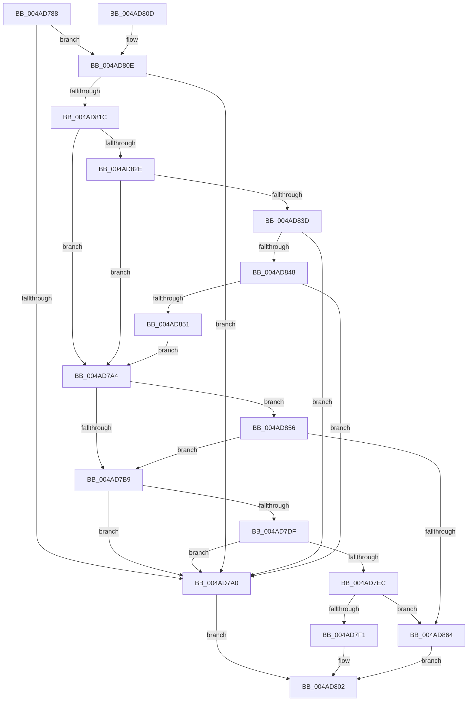

# MiCanGrantExecute

- RVA: `0x004AD788`–`0x004AD86B` (길이 `227` bytes)
- VA: `0x00000001404AD788`
- 실행 섹션: `.text`
- PDB 이름 있음: `예`; PDB Function 태그: `아니요`
- unwind 정보 RVA: `0x000B8470`
- 디코드: `58`개 명령, `227/227` bytes 표시
- 미해석 바이트: `0` (있으면 어셈블리에 `.byte`로 보존)

> 이 문서는 커널 이미지의 기계어와 PDB 기호를 분석해 생성했습니다. 4번과 5번은 함수 원형과 자료형을 바이너리 사용 방식에서 추정한 C 해석이며 원본 소스 복구 결과는 아닙니다.

## 1. Dependencies

- 직접 호출 지점: **3**; 고유 호출 대상: **3**
- 직접 호출자로 확인된 함수: **2**
- RIP 상대 이미지 참조: **1**

### Outgoing calls
- `0x004AD7BE` → [MiLockVadTree](../27/MiLockVadTree_function_0027C0F0.md) (function, `0x0027C0F0`)
- `0x004AD7C6` → [MiLocateAddress](../31/MiLocateAddress_function_003168D0.md) (function, `0x003168D0`)
- `0x004AD7D5` → [MiUnlockVadTree](../29/MiUnlockVadTree_function_00297020.md) (function, `0x00297020`)

### Direct callers
- [MiLargePageFault](../3F/MiLargePageFault_function_003F01C4.md) at `0x003F032C`
- [sub_006E1C8E](../6E/Unknown_function_006E1C8E.md) at `0x006E1D3F`

### Static image references
- `0x004AD81C` → RVA `0x00FC6B30` (`ALMOSTRO`; read)

## 2. Other-region calls and transfers

- 다른 실행 섹션으로 향하는 call: **0**
- 별도 외부 분기/꼬리 이동을 확인하지 못했습니다.

## 3. Assembly (complete function range)

```asm
004AD788  48 89 5C 24 08                  mov qword ptr [rsp + 8], rbx
004AD78D  57                              push rdi
004AD78E  48 83 EC 20                     sub rsp, 0x20
004AD792  33 DB                           xor ebx, ebx
004AD794  48 8B FA                        mov rdi, rdx
004AD797  48 39 99 10 03 00 00            cmp qword ptr [rcx + 0x310], rbx
004AD79E  75 6E                           jne 0x1404ad80e
004AD7A0  33 C0                           xor eax, eax
004AD7A2  EB 5E                           jmp 0x1404ad802
004AD7A4  48 8B C7                        mov rax, rdi
004AD7A7  48 25 00 F0 FF FF               and rax, 0xfffffffffffff000
004AD7AD  48 3D 00 00 FE 7F               cmp rax, 0x7ffe0000
004AD7B3  0F 84 9D 00 00 00               je 0x1404ad856
004AD7B9  B9 01 00 00 00                  mov ecx, 1
004AD7BE  E8 2D E9 DC FF                  call 0x14027c0f0
004AD7C3  48 8B CF                        mov rcx, rdi
004AD7C6  E8 05 91 E6 FF                  call 0x1403168d0
004AD7CB  B2 11                           mov dl, 0x11
004AD7CD  B9 01 00 00 00                  mov ecx, 1
004AD7D2  48 8B F8                        mov rdi, rax
004AD7D5  E8 46 98 DE FF                  call 0x140297020
004AD7DA  48 85 FF                        test rdi, rdi
004AD7DD  74 C1                           je 0x1404ad7a0
004AD7DF  8B 4F 30                        mov ecx, dword ptr [rdi + 0x30]
004AD7E2  8B D1                           mov edx, ecx
004AD7E4  83 E2 70                        and edx, 0x70
004AD7E7  83 FA 30                        cmp edx, 0x30
004AD7EA  74 B4                           je 0x1404ad7a0
004AD7EC  83 FA 20                        cmp edx, 0x20
004AD7EF  75 73                           jne 0x1404ad864
004AD7F1  81 E1 80 0F 00 00               and ecx, 0xf80
004AD7F7  81 F9 80 00 00 00               cmp ecx, 0x80
004AD7FD  0F 95 C3                        setne bl
004AD800  8B C3                           mov eax, ebx
004AD802  48 8B 5C 24 30                  mov rbx, qword ptr [rsp + 0x30]
004AD807  48 83 C4 20                     add rsp, 0x20
004AD80B  5F                              pop rdi
004AD80C  C3                              ret
004AD80D  CC                              int3
004AD80E  BA 4C 01 00 00                  mov edx, 0x14c
004AD813  66 39 91 EC 06 00 00            cmp word ptr [rcx + 0x6ec], dx
004AD81A  75 84                           jne 0x1404ad7a0
004AD81C  48 8B 05 0D 93 B1 00            mov rax, qword ptr [rip + 0xb1930d]
004AD823  48 0F BA E0 1E                  bt rax, 0x1e
004AD828  0F 82 76 FF FF FF               jb 0x1404ad7a4
004AD82E  8A 91 93 00 00 00               mov dl, byte ptr [rcx + 0x93]
004AD834  F6 C2 02                        test dl, 2
004AD837  0F 85 67 FF FF FF               jne 0x1404ad7a4
004AD83D  48 0F BA E0 1F                  bt rax, 0x1f
004AD842  0F 82 58 FF FF FF               jb 0x1404ad7a0
004AD848  F6 C2 01                        test dl, 1
004AD84B  0F 85 4F FF FF FF               jne 0x1404ad7a0
004AD851  E9 4E FF FF FF                  jmp 0x1404ad7a4
004AD856  8B 81 FC 05 00 00               mov eax, dword ptr [rcx + 0x5fc]
004AD85C  A8 01                           test al, 1
004AD85E  0F 85 55 FF FF FF               jne 0x1404ad7b9
004AD864  B8 01 00 00 00                  mov eax, 1
004AD869  EB 97                           jmp 0x1404ad802
```

## 4. C-style interpretation (structured pseudocode)

```c
__int64 __fastcall MiCanGrantExecute(__int64 a1, __int64 a2)
{
    __int64 result;
    __int64 v_rbx;
    __int64 v_rsp;
    unsigned __int64 v_stack_p8;

    v_stack_p8 = v_rbx;
    v_rsp = (v_rsp) - (32);
    v_rbx = 0;
    if ((*(unsigned __int64 *)(a1 + 784)) != 0) goto loc_004AD80E;
loc_004AD7A0:
    result = 0;
    goto loc_004AD802;
loc_004AD7A4:
    result = (a2) & (0xFFFFFFFFFFFFF000ULL);
    if (result == 0x7FFE0000ULL) goto loc_004AD856;
loc_004AD7B9:
    result = MiLockVadTree(1, a2, a3, a4);
    result = MiLocateAddress(a2, a2, a3, a4);
    result = MiUnlockVadTree(1, 17, a3, a4);
    if (result == 0) goto loc_004AD7A0;
    a2 = (unsigned int)(((unsigned int)((unsigned int)((unsigned int)(*(unsigned int *)(result + 48))))) & (112));
    if (((unsigned int)(a2)) == 48) goto loc_004AD7A0;
    if (((unsigned int)(a2)) != 32) goto loc_004AD864;
    a1 = (unsigned int)(((unsigned int)(*(unsigned int *)(result + 48))) & (0xF80ULL));
    v_rbx = (((unsigned int)(a1)) != 128) ? 1 : 0;
loc_004AD802:
    v_rsp = (v_rsp) + (32);
    return (unsigned int)((unsigned int)(v_rbx));
loc_004AD80E:
    if ((*(unsigned __int16 *)(a1 + 1772)) != 332) goto loc_004AD7A0;
    if ((*(unsigned __int16 *)(a1 + 1772)) < 332) goto loc_004AD7A4;
    if ((((unsigned __int8)(*(unsigned __int8 *)(a1 + 147))) & (2)) != 0) goto loc_004AD7A4;
    if (condition_is_below) goto loc_004AD7A0;
    if ((((unsigned __int8)(*(unsigned __int8 *)(a1 + 147))) & (1)) != 0) goto loc_004AD7A0;
    goto loc_004AD7A4;
loc_004AD856:
    if ((((unsigned __int8)((unsigned int)(*(unsigned int *)(a1 + 1532)))) & (1)) != 0) goto loc_004AD7B9;
loc_004AD864:
    goto loc_004AD802;
}
```

## 5. (Beta) C Style

```c
int64_t MiCanGrantExecute(void *Arg1, int64_t Arg2)
{
    uint8_t *arg1 = (uint8_t *)Arg1;

    int64_t result;
    int64_t local_rbx;
    int64_t local_rsp;
    uint64_t v_stack_p8;

    v_stack_p8 = local_rbx;
    local_rsp = (local_rsp) - (32);
    local_rbx = 0;
    if ((*(uint64_t *)(arg1 + 0x310)) != 0) goto loc_004AD80E;
loc_004AD7A0:
    result = 0;
    goto loc_004AD802;
loc_004AD7A4:
    result = (Arg2) & (0xFFFFFFFFFFFFF000ULL);
    if (result == 0x7FFE0000ULL) goto loc_004AD856;
loc_004AD7B9:
    result = MiLockVadTree(1, Arg2, a3, a4);
    result = MiLocateAddress(Arg2, Arg2, a3, a4);
    result = MiUnlockVadTree(1, 17, a3, a4);
    if (result == 0) goto loc_004AD7A0;
    Arg2 = (uint32_t)(((uint32_t)((uint32_t)((uint32_t)(*(uint32_t *)(result + 0x30))))) & (112));
    if (((uint32_t)(Arg2)) == 48) goto loc_004AD7A0;
    if (((uint32_t)(Arg2)) != 32) goto loc_004AD864;
    Arg1 = (uint32_t)(((uint32_t)(*(uint32_t *)(result + 0x30))) & (0xF80ULL));
    local_rbx = (((uint32_t)(Arg1)) != 128) ? 1 : 0;
loc_004AD802:
    local_rsp = (local_rsp) + (32);
    return (uint32_t)((uint32_t)(local_rbx));
loc_004AD80E:
    if ((*(uint16_t *)(arg1 + 0x6EC)) != 332) goto loc_004AD7A0;
    if ((*(uint16_t *)(arg1 + 0x6EC)) < 332) goto loc_004AD7A4;
    if ((((uint8_t)(*(uint8_t *)(arg1 + 0x93))) & (2)) != 0) goto loc_004AD7A4;
    if (condition_is_below) goto loc_004AD7A0;
    if ((((uint8_t)(*(uint8_t *)(arg1 + 0x93))) & (1)) != 0) goto loc_004AD7A0;
    goto loc_004AD7A4;
loc_004AD856:
    if ((((uint8_t)((uint32_t)(*(uint32_t *)(arg1 + 0x5FC)))) & (1)) != 0) goto loc_004AD7B9;
loc_004AD864:
    goto loc_004AD802;
}
```

### 관측된 메모리 오프셋

구조체 형식이 확인되지 않은 접근은 인자 기준의 오프셋으로만 기록했습니다.

| 기준 인자 | 오프셋 표현 | 폭 (bit) | 접근 |
|---|---:|---:|---|
| `Arg1` | `+ 0x93` | `8` | `R` |
| `Arg1` | `+ 0x310` | `64` | `R` |
| `Arg1` | `+ 0x5FC` | `32` | `R` |
| `Arg1` | `+ 0x6EC` | `16` | `R` |

## 6. Execution-region graph

[열기: 2D/3D 그래프와 함수 탐색 컨트롤 패널](../../../control-panel.html?section=text&rva=0x004AD788&view=graph)

- 2D 그래프는 위에서 아래로 흐르고, 3D 그래프는 빈 공간을 드래그해 회전합니다. Shift+드래그는 이동, 휠은 확대·축소, 함수 노드 선택은 대상 보고서 이동입니다.

### Static fallback


