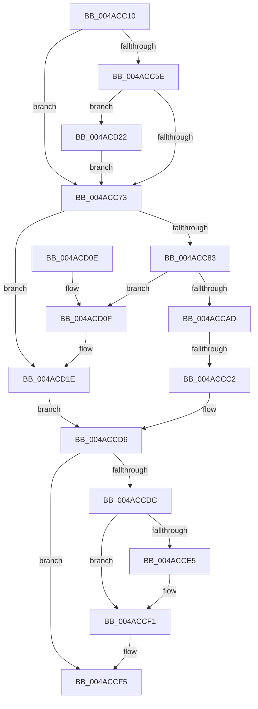

# MiChangePageAttributeLargeFreeZeroPage

- RVA: `0x004ACC10`–`0x004ACD2E` (길이 `286` bytes)
- VA: `0x00000001404ACC10`
- 실행 섹션: `.text`
- PDB 이름 있음: `예`; PDB Function 태그: `예`
- unwind 정보 RVA: `0x000B830C`
- 디코드: `75`개 명령, `286/286` bytes 표시
- 미해석 바이트: `0` (있으면 어셈블리에 `.byte`로 보존)

> 이 문서는 커널 이미지의 기계어와 PDB 기호를 분석해 생성했습니다. 4번과 5번은 함수 원형과 자료형을 바이너리 사용 방식에서 추정한 C 해석이며 원본 소스 복구 결과는 아닙니다.

## 1. Dependencies

- 직접 호출 지점: **4**; 고유 호출 대상: **4**
- 직접 호출자로 확인된 함수: **1**
- RIP 상대 이미지 참조: **2**

### Outgoing calls
- `0x004ACC76` → [MiSafeLockPageAtDpc](../31/MiSafeLockPageAtDpc_function_0031C67C.md) (function, `0x0031C67C`)
- `0x004ACCA4` → [MiLargePfnPromoteCandidate](../37/MiLargePfnPromoteCandidate_function_0037AB4C.md) (function, `0x0037AB4C`)
- `0x004ACCEC` → [KiLowerIrqlProcessIrqlFlags](../4F/KiLowerIrqlProcessIrqlFlags_function_004F5698.md) (function, `0x004F5698`)
- `0x004ACD24` → [KiRaiseIrqlProcessIrqlFlags](../4F/KiRaiseIrqlProcessIrqlFlags_function_004F56FC.md) (function, `0x004F56FC`)

### Direct callers
- [MiCoalesceFreeLargePages](../37/MiCoalesceFreeLargePages_function_0037A7B4.md) at `0x0037AA9D`

### Static image references
- `0x004ACC66` → RVA `0x00FC6D20` (`ALMOSTRO`; read)
- `0x004ACC8A` → RVA `0x00E30088` (`.data`; read)

## 2. Other-region calls and transfers

- 다른 실행 섹션으로 향하는 call: **0**
- call이 아닌 외부 분기/꼬리 이동: **1**
  - `0x004ACCBC` → [sub_006FA666](../6F/Unknown_function_006FA666.md) (`tail-transfer`)

## 3. Assembly (complete function range)

```asm
004ACC10  48 89 5C 24 08                  mov qword ptr [rsp + 8], rbx
004ACC15  48 89 6C 24 10                  mov qword ptr [rsp + 0x10], rbp
004ACC1A  56                              push rsi
004ACC1B  57                              push rdi
004ACC1C  41 54                           push r12
004ACC1E  41 56                           push r14
004ACC20  41 57                           push r15
004ACC22  48 83 EC 20                     sub rsp, 0x20
004ACC26  45 0F B6 F1                     movzx r14d, r9b
004ACC2A  45 8B F8                        mov r15d, r8d
004ACC2D  8B F2                           mov esi, edx
004ACC2F  48 8B D9                        mov rbx, rcx
004ACC32  48 B8 00 00 00 00 00 DE FF FF   movabs rax, 0xffffde0000000000
004ACC3C  48 8B F9                        mov rdi, rcx
004ACC3F  48 2B F8                        sub rdi, rax
004ACC42  48 B8 AB AA AA AA AA AA AA AA   movabs rax, 0xaaaaaaaaaaaaaaab
004ACC4C  48 C1 FF 04                     sar rdi, 4
004ACC50  48 0F AF F8                     imul rdi, rax
004ACC54  B8 02 00 00 00                  mov eax, 2
004ACC59  44 3A F0                        cmp r14b, al
004ACC5C  73 15                           jae 0x1404acc73
004ACC5E  44 0F 20 C1                     mov rcx, cr8
004ACC62  44 0F 22 C0                     mov cr8, rax
004ACC66  83 3D B3 A0 B1 00 00            cmp dword ptr [rip + 0xb1a0b3], 0
004ACC6D  0F 85 AF 00 00 00               jne 0x1404acd22
004ACC73  48 8B CF                        mov rcx, rdi
004ACC76  E8 01 FA E6 FF                  call 0x14031c67c
004ACC7B  3C 11                           cmp al, 0x11
004ACC7D  0F 84 9B 00 00 00               je 0x1404acd1e
004ACC83  48 8B 43 28                     mov rax, qword ptr [rbx + 0x28]
004ACC87  44 8B C6                        mov r8d, esi
004ACC8A  48 8B 0D F7 33 98 00            mov rcx, qword ptr [rip + 0x9833f7]
004ACC91  48 8B D3                        mov rdx, rbx
004ACC94  48 C1 E8 2B                     shr rax, 0x2b
004ACC98  25 FF 03 00 00                  and eax, 0x3ff
004ACC9D  48 8B 2C C1                     mov rbp, qword ptr [rcx + rax*8]
004ACCA1  48 8B CD                        mov rcx, rbp
004ACCA4  E8 A3 DE EC FF                  call 0x14037ab4c
004ACCA9  85 C0                           test eax, eax
004ACCAB  74 62                           je 0x1404acd0f
004ACCAD  8B 43 20                        mov eax, dword ptr [rbx + 0x20]
004ACCB0  C1 E8 10                        shr eax, 0x10
004ACCB3  0F B6 C8                        movzx ecx, al
004ACCB6  C1 E9 06                        shr ecx, 6
004ACCB9  41 3B CF                        cmp ecx, r15d
004ACCBC  0F 85 A4 D9 24 00               jne 0x1406fa666
004ACCC2  48 BD FF FF FF FF FF FF FF 7F   movabs rbp, 0x7fffffffffffffff
004ACCCC  F0 48 21 6B 18                  lock and qword ptr [rbx + 0x18], rbp
004ACCD1  BE 01 00 00 00                  mov esi, 1
004ACCD6  41 80 FE 02                     cmp r14b, 2
004ACCDA  73 19                           jae 0x1404accf5
004ACCDC  83 3D 3D A0 B1 00 00            cmp dword ptr [rip + 0xb1a03d], 0
004ACCE3  74 0C                           je 0x1404accf1
004ACCE5  44 0F 20 C1                     mov rcx, cr8
004ACCE9  41 8A D6                        mov dl, r14b
004ACCEC  E8 A7 89 04 00                  call 0x1404f5698
004ACCF1  45 0F 22 C6                     mov cr8, r14
004ACCF5  48 8B 5C 24 50                  mov rbx, qword ptr [rsp + 0x50]
004ACCFA  8B C6                           mov eax, esi
004ACCFC  48 8B 6C 24 58                  mov rbp, qword ptr [rsp + 0x58]
004ACD01  48 83 C4 20                     add rsp, 0x20
004ACD05  41 5F                           pop r15
004ACD07  41 5E                           pop r14
004ACD09  41 5C                           pop r12
004ACD0B  5F                              pop rdi
004ACD0C  5E                              pop rsi
004ACD0D  C3                              ret
004ACD0E  CC                              int3
004ACD0F  48 BD FF FF FF FF FF FF FF 7F   movabs rbp, 0x7fffffffffffffff
004ACD19  F0 48 21 6B 18                  lock and qword ptr [rbx + 0x18], rbp
004ACD1E  33 F6                           xor esi, esi
004ACD20  EB B4                           jmp 0x1404accd6
004ACD22  8A D0                           mov dl, al
004ACD24  E8 D3 89 04 00                  call 0x1404f56fc
004ACD29  E9 45 FF FF FF                  jmp 0x1404acc73
```

## 4. C-style interpretation (structured pseudocode)

```c
__int64 __fastcall MiChangePageAttributeLargeFreeZeroPage(__int64 a1, int a2, int a3, unsigned __int8 a4)
{
    __int64 result;
    __int64 v_rdi;
    __int64 v_rsi;
    __int64 v_rsp;
    unsigned __int64 v_stack_p10;
    unsigned __int64 v_stack_p8;

    v_stack_p8 = v_rbx;
    v_stack_p10 = v_rbp;
    v_rsp = (v_rsp) - (32);
    v_rdi = (a1) - (result);
    v_rdi = (v_rdi) >> (4);
    v_rdi = (v_rdi) * (result);
    if (a4 >= 2) goto loc_004ACC73;
    if ((*(unsigned int *)(v_rip + 11641011)) != 0) goto loc_004ACD22;
loc_004ACC73:
    result = MiSafeLockPageAtDpc(v_rdi, a2, a3, a4);
    if (((unsigned __int8)(result)) == 17) goto loc_004ACD1E;
    result = (*(unsigned __int64 *)(a1 + 40)) >> (43);
    result = (unsigned int)((result) & (0x3FFULL));
    result = MiLargePfnPromoteCandidate(*(unsigned __int64 *)(*(unsigned __int64 *)(v_rip + 9974775) + result * 8), a1, (unsigned int)((unsigned int)((unsigned int)(a2))), a4);
    if ((unsigned int)(result) == 0) goto loc_004ACD0F;
    result = (unsigned int)(((unsigned int)(*(unsigned int *)(a1 + 32))) >> (16));
    a1 = (unsigned int)(((unsigned __int8)(result)) >> (6));
loc_004ACCD6:
    if (a4 >= 2) goto loc_004ACCF5;
    if ((*(unsigned int *)(v_rip + 11640893)) != 0) {
        a1 = 2;
        a2 = a4;
        result = KiLowerIrqlProcessIrqlFlags(a1, a2, (unsigned int)((unsigned int)((unsigned int)(a2))), a4);
    }
loc_004ACCF5:
    v_rsp = (v_rsp) + (32);
    return 1;
loc_004ACD0F:
loc_004ACD1E:
    v_rsi = 0;
    goto loc_004ACCD6;
loc_004ACD22:
    result = KiRaiseIrqlProcessIrqlFlags(a1, 1, (unsigned int)((unsigned int)((unsigned int)(a2))), a4);
    goto loc_004ACC73;
}
```

## 5. (Beta) C Style

```c
int64_t MiChangePageAttributeLargeFreeZeroPage(void *Arg1, int32_t Arg2, int32_t Arg3, uint8_t Arg4)
{
    uint8_t *arg1 = (uint8_t *)Arg1;

    int64_t result;
    int64_t local_rdi;
    int64_t local_rsi;
    int64_t local_rsp;
    uint64_t v_stack_p10;
    uint64_t v_stack_p8;

    v_stack_p8 = local_rbx;
    v_stack_p10 = local_rbp;
    local_rsp = (local_rsp) - (32);
    local_rdi = (Arg1) - (result);
    local_rdi = (local_rdi) >> (4);
    local_rdi = (local_rdi) * (result);
    if (Arg4 >= 2) goto loc_004ACC73;
    if ((*(uint32_t *)(v_rip + 0xB1A0B3)) != 0) goto loc_004ACD22;
loc_004ACC73:
    result = MiSafeLockPageAtDpc(local_rdi, Arg2, Arg3, Arg4);
    if (((uint8_t)(result)) == 17) goto loc_004ACD1E;
    result = (*(uint64_t *)(arg1 + 0x28)) >> (43);
    result = (uint32_t)((result) & (0x3FFULL));
    result = MiLargePfnPromoteCandidate(*(uint64_t *)(*(uint64_t *)(v_rip + 0x9833F7) + result * 8), Arg1, (uint32_t)((uint32_t)((uint32_t)(Arg2))), Arg4);
    if ((uint32_t)(result) == 0) goto loc_004ACD0F;
    result = (uint32_t)(((uint32_t)(*(uint32_t *)(arg1 + 0x20))) >> (16));
    Arg1 = (uint32_t)(((uint8_t)(result)) >> (6));
loc_004ACCD6:
    if (Arg4 >= 2) goto loc_004ACCF5;
    if ((*(uint32_t *)(v_rip + 0xB1A03D)) != 0) {
        Arg1 = 2;
        Arg2 = Arg4;
        result = KiLowerIrqlProcessIrqlFlags(Arg1, Arg2, (uint32_t)((uint32_t)((uint32_t)(Arg2))), Arg4);
    }
loc_004ACCF5:
    local_rsp = (local_rsp) + (32);
    return 1;
loc_004ACD0F:
loc_004ACD1E:
    local_rsi = 0;
    goto loc_004ACCD6;
loc_004ACD22:
    result = KiRaiseIrqlProcessIrqlFlags(Arg1, 1, (uint32_t)((uint32_t)((uint32_t)(Arg2))), Arg4);
    goto loc_004ACC73;
}
```

### 관측된 메모리 오프셋

구조체 형식이 확인되지 않은 접근은 인자 기준의 오프셋으로만 기록했습니다.

| 기준 인자 | 오프셋 표현 | 폭 (bit) | 접근 |
|---|---:|---:|---|
| `Arg1` | `+ 0x18` | `64` | `R/W` |
| `Arg1` | `+ 0x20` | `32` | `R` |
| `Arg1` | `+ 0x28` | `64` | `R` |

## 6. Execution-region graph

[열기: 2D/3D 그래프와 함수 탐색 컨트롤 패널](../../../control-panel.html?section=text&rva=0x004ACC10&view=graph)

- 2D 그래프는 위에서 아래로 흐르고, 3D 그래프는 빈 공간을 드래그해 회전합니다. Shift+드래그는 이동, 휠은 확대·축소, 함수 노드 선택은 대상 보고서 이동입니다.

### Static fallback


