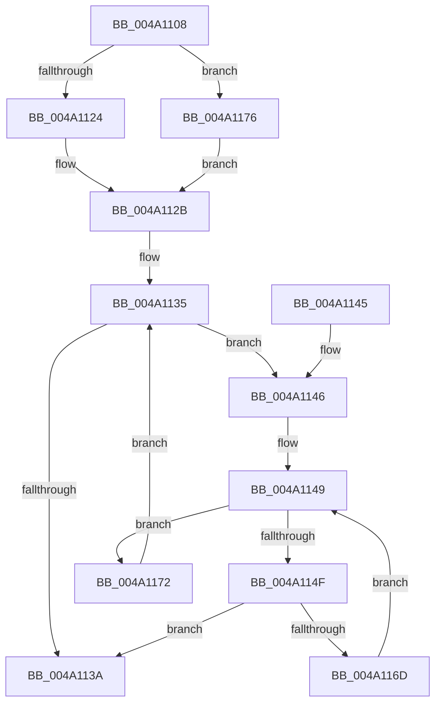

# MiCheckNodeChannelStandbyCount

- RVA: `0x004A1108`–`0x004A117C` (길이 `116` bytes)
- VA: `0x00000001404A1108`
- 실행 섹션: `.text`
- PDB 이름 있음: `예`; PDB Function 태그: `아니요`
- unwind 정보 RVA: `0x000DB714`
- 디코드: `36`개 명령, `116/116` bytes 표시
- 미해석 바이트: `0` (있으면 어셈블리에 `.byte`로 보존)

> 이 문서는 커널 이미지의 기계어와 PDB 기호를 분석해 생성했습니다. 4번과 5번은 함수 원형과 자료형을 바이너리 사용 방식에서 추정한 C 해석이며 원본 소스 복구 결과는 아닙니다.

## 1. Dependencies

- 직접 호출 지점: **0**; 고유 호출 대상: **0**
- 직접 호출자로 확인된 함수: **1**
- RIP 상대 이미지 참조: **1**

### Outgoing calls
- 직접 디코드된 call 명령이 없습니다.

### Direct callers
- [MiGetPage](../28/MiGetPage_function_002884C0.md) at `0x002897AD`

### Static image references
- `0x004A1124` → RVA `0x00FC5002` (`ALMOSTRO`; read)

## 2. Other-region calls and transfers

- 다른 실행 섹션으로 향하는 call: **0**
- 별도 외부 분기/꼬리 이동을 확인하지 못했습니다.

## 3. Assembly (complete function range)

```asm
004A1108  8B C2                           mov eax, edx
004A110A  45 8A C8                        mov r9b, r8b
004A110D  4C 69 D8 80 DF 00 00            imul r11, rax, 0xdf80
004A1114  4C 03 59 10                     add r11, qword ptr [rcx + 0x10]
004A1118  41 8B 83 50 3B 00 00            mov eax, dword ptr [r11 + 0x3b50]
004A111F  83 E0 01                        and eax, 1
004A1122  75 52                           jne 0x1404a1176
004A1124  44 8A 05 D7 3E B2 00            mov r8b, byte ptr [rip + 0xb23ed7]
004A112B  F7 D8                           neg eax
004A112D  1A D2                           sbb dl, dl
004A112F  41 22 D1                        and dl, r9b
004A1132  45 33 D2                        xor r10d, r10d
004A1135  41 3A D0                        cmp dl, r8b
004A1138  75 0C                           jne 0x1404a1146
004A113A  41 3A D0                        cmp dl, r8b
004A113D  41 0F 95 C2                     setne r10b
004A1141  41 8B C2                        mov eax, r10d
004A1144  C3                              ret
004A1145  CC                              int3
004A1146  45 8B CA                        mov r9d, r10d
004A1149  41 83 F9 08                     cmp r9d, 8
004A114D  73 23                           jae 0x1404a1172
004A114F  41 8B C1                        mov eax, r9d
004A1152  0F B6 CA                        movzx ecx, dl
004A1155  48 8D 0C CD 3B 00 00 00         lea rcx, [rcx*8 + 0x3b]
004A115D  48 03 C8                        add rcx, rax
004A1160  48 6B C1 58                     imul rax, rcx, 0x58
004A1164  4A 8B 04 18                     mov rax, qword ptr [rax + r11]
004A1168  48 85 C0                        test rax, rax
004A116B  75 CD                           jne 0x1404a113a
004A116D  41 FF C1                        inc r9d
004A1170  EB D7                           jmp 0x1404a1149
004A1172  FE C2                           inc dl
004A1174  EB BF                           jmp 0x1404a1135
004A1176  45 8D 41 01                     lea r8d, [r9 + 1]
004A117A  EB AF                           jmp 0x1404a112b
```

## 4. C-style interpretation (structured pseudocode)

```c
__int64 __fastcall MiCheckNodeChannelStandbyCount(__int64 a1, int a2, unsigned __int8 a3)
{
    __int64 result;
    __int64 v_r10;
    __int64 v_r11;

    v_r11 = (v_r11) * ((unsigned int)(a2));
    v_r11 = (v_r11) + (*(unsigned __int64 *)(a1 + 16));
    result = (unsigned int)(((unsigned int)(*(unsigned int *)(v_r11 + 15184))) & (1));
    if (condition_is_not_equal) goto loc_004A1176;
loc_004A112B:
    result = (unsigned int)(-(result));
    a2 = (unsigned __int8)((a2) & (a3));
    v_r10 = 0;
loc_004A1135:
    if (((unsigned __int8)(a2)) != ((unsigned __int8)(*(unsigned __int8 *)(v_rip + 11681495)))) goto loc_004A1146;
loc_004A113A:
    v_r10 = (((unsigned __int8)(a2)) != ((unsigned __int8)(*(unsigned __int8 *)(v_rip + 11681495)))) ? 1 : 0;
    return (unsigned int)((unsigned int)(v_r10));
loc_004A1146:
loc_004A1149:
    if (((unsigned int)((unsigned int)((unsigned int)(v_r10)))) >= 8) goto loc_004A1172;
    a1 = ((unsigned __int8)(a2) * 8 + 59) + ((unsigned int)((unsigned int)((unsigned int)((unsigned int)(v_r10)))));
    result = ((unsigned int)((unsigned int)((unsigned int)((unsigned int)(v_r10))))) * (a1);
    if (*(unsigned __int64 *)(result + v_r11 * 1) != 0) goto loc_004A113A;
    a4 = (unsigned int)(((unsigned int)((unsigned int)(v_r10))) + 1);
    goto loc_004A1149;
loc_004A1172:
    a2 = (unsigned __int8)((a2) + 1);
    goto loc_004A1135;
loc_004A1176:
    goto loc_004A112B;
}
```

## 5. (Beta) C Style

```c
int64_t MiCheckNodeChannelStandbyCount(void *Arg1, int32_t Arg2, void *Arg3)
{
    uint8_t *arg1 = (uint8_t *)Arg1;
    uint8_t *arg3 = (uint8_t *)Arg3;

    int64_t result;
    int64_t local_r10;
    int64_t local_r11;

    local_r11 = (local_r11) * ((uint32_t)(Arg2));
    local_r11 = (local_r11) + (*(uint64_t *)(arg1 + 0x10));
    result = (uint32_t)(((uint32_t)(*(uint32_t *)(local_r11 + 0x3B50))) & (1));
    if (condition_is_not_equal) goto loc_004A1176;
loc_004A112B:
    result = (uint32_t)(-(result));
    Arg2 = (uint8_t)((Arg2) & (Arg3));
    local_r10 = 0;
loc_004A1135:
    if (((uint8_t)(Arg2)) != ((uint8_t)(*(uint8_t *)(v_rip + 0xB23ED7)))) goto loc_004A1146;
loc_004A113A:
    local_r10 = (((uint8_t)(Arg2)) != ((uint8_t)(*(uint8_t *)(v_rip + 0xB23ED7)))) ? 1 : 0;
    return (uint32_t)((uint32_t)(local_r10));
loc_004A1146:
loc_004A1149:
    if (((uint32_t)((uint32_t)((uint32_t)(local_r10)))) >= 8) goto loc_004A1172;
    Arg1 = ((uint8_t)(Arg2) * 8 + 59) + ((uint32_t)((uint32_t)((uint32_t)((uint32_t)(local_r10)))));
    result = ((uint32_t)((uint32_t)((uint32_t)((uint32_t)(local_r10))))) * (Arg1);
    if (*(uint64_t *)(result + local_r11 * 1) != 0) goto loc_004A113A;
    a4 = (uint32_t)(((uint32_t)((uint32_t)(local_r10))) + 1);
    goto loc_004A1149;
loc_004A1172:
    Arg2 = (uint8_t)((Arg2) + 1);
    goto loc_004A1135;
loc_004A1176:
    goto loc_004A112B;
}
```

### 관측된 메모리 오프셋

구조체 형식이 확인되지 않은 접근은 인자 기준의 오프셋으로만 기록했습니다.

| 기준 인자 | 오프셋 표현 | 폭 (bit) | 접근 |
|---|---:|---:|---|
| `Arg1` | `+ 0x10` | `64` | `R` |
| `Arg3` | `+ 0x1` | `32` | `R` |

## 6. Execution-region graph

[열기: 2D/3D 그래프와 함수 탐색 컨트롤 패널](../../../control-panel.html?section=text&rva=0x004A1108&view=graph)

- 2D 그래프는 위에서 아래로 흐르고, 3D 그래프는 빈 공간을 드래그해 회전합니다. Shift+드래그는 이동, 휠은 확대·축소, 함수 노드 선택은 대상 보고서 이동입니다.

### Static fallback


