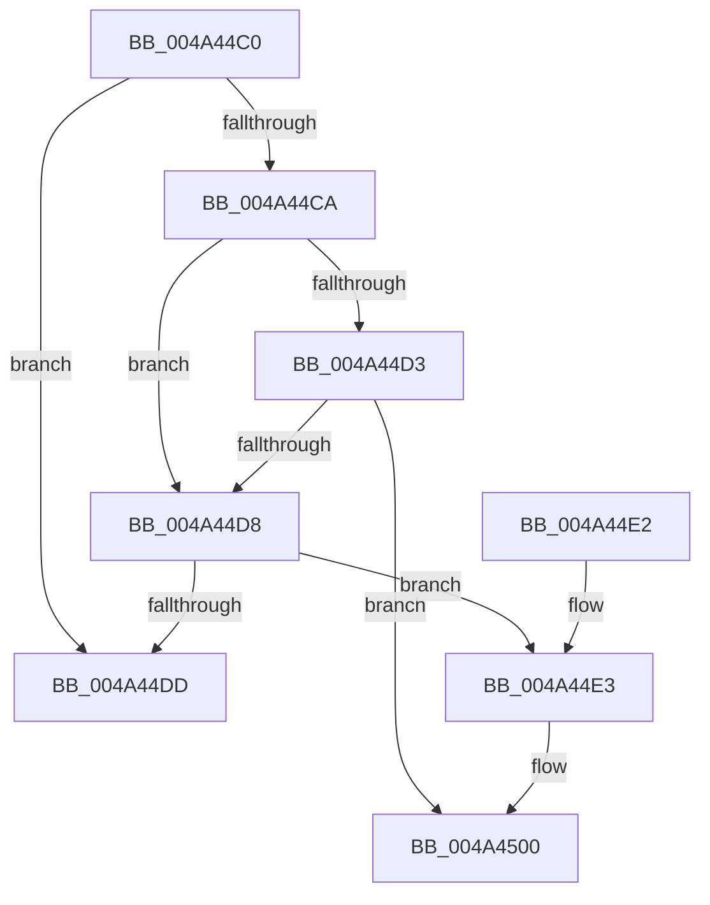

# MiCheckSystemNxFault

- RVA: `0x004A44C0`–`0x004A4526` (길이 `102` bytes)
- VA: `0x00000001404A44C0`
- 실행 섹션: `.text`
- PDB 이름 있음: `예`; PDB Function 태그: `아니요`
- unwind 정보 RVA: `0x000B66AC`
- 디코드: `30`개 명령, `102/102` bytes 표시
- 미해석 바이트: `0` (있으면 어셈블리에 `.byte`로 보존)

> 이 문서는 커널 이미지의 기계어와 PDB 기호를 분석해 생성했습니다. 4번과 5번은 함수 원형과 자료형을 바이너리 사용 방식에서 추정한 C 해석이며 원본 소스 복구 결과는 아닙니다.

## 1. Dependencies

- 직접 호출 지점: **2**; 고유 호출 대상: **1**
- 직접 호출자로 확인된 함수: **6**
- RIP 상대 이미지 참조: **1**

### Outgoing calls
- `0x004A44FA` → [KeBugCheckEx](../4F/KeBugCheckEx_function_004FD660.md) (function, `0x004FD660`)
- `0x004A4520` → [KeBugCheckEx](../4F/KeBugCheckEx_function_004FD660.md) (function, `0x004FD660`)

### Direct callers
- [MiValidFault](../32/MiValidFault_function_003280B4.md) at `0x00328328`
- [MiRaisedIrqlFault](../34/MiRaisedIrqlFault_function_0034A6C8.md) at `0x0034A912`
- [MiSystemFault](../34/MiSystemFault_function_0034AA64.md) at `0x0034AEF1`
- [sub_0034B2F9](../34/Unknown_function_0034B2F9.md) at `0x0034B3A3`
- [MiLargePageFault](../3F/MiLargePageFault_function_003F01C4.md) at `0x003F03DC`
- [sub_006E2130](../6E/Unknown_function_006E2130.md) at `0x006E2136`

### Static image references
- `0x004A44CA` → RVA `0x00FC6B30` (`ALMOSTRO`; read)

## 2. Other-region calls and transfers

- 다른 실행 섹션으로 향하는 call: **0**
- 별도 외부 분기/꼬리 이동을 확인하지 못했습니다.

## 3. Assembly (complete function range)

```asm
004A44C0  48 83 EC 38                     sub rsp, 0x38
004A44C4  F6 41 08 10                     test byte ptr [rcx + 8], 0x10
004A44C8  74 13                           je 0x1404a44dd
004A44CA  F6 05 5F 26 B2 00 01            test byte ptr [rip + 0xb2265f], 1
004A44D1  74 05                           je 0x1404a44d8
004A44D3  F6 C2 04                        test dl, 4
004A44D6  75 28                           jne 0x1404a4500
004A44D8  48 85 D2                        test rdx, rdx
004A44DB  78 06                           js 0x1404a44e3
004A44DD  48 83 C4 38                     add rsp, 0x38
004A44E1  C3                              ret
004A44E2  CC                              int3
004A44E3  4C 8B 49 10                     mov r9, qword ptr [rcx + 0x10]
004A44E7  41 8B C0                        mov eax, r8d
004A44EA  4C 8B C2                        mov r8, rdx
004A44ED  48 8B 11                        mov rdx, qword ptr [rcx]
004A44F0  B9 FC 00 00 00                  mov ecx, 0xfc
004A44F5  48 89 44 24 20                  mov qword ptr [rsp + 0x20], rax
004A44FA  E8 61 91 05 00                  call 0x1404fd660
004A44FF  CC                              int3
004A4500  4C 8B 49 10                     mov r9, qword ptr [rcx + 0x10]
004A4504  41 8B C0                        mov eax, r8d
004A4507  41 B8 00 00 00 80               mov r8d, 0x80000000
004A450D  49 0B C0                        or rax, r8
004A4510  4C 8B C2                        mov r8, rdx
004A4513  48 8B 11                        mov rdx, qword ptr [rcx]
004A4516  B9 FC 00 00 00                  mov ecx, 0xfc
004A451B  48 89 44 24 20                  mov qword ptr [rsp + 0x20], rax
004A4520  E8 3B 91 05 00                  call 0x1404fd660
004A4525  CC                              int3
```

## 4. C-style interpretation (structured pseudocode)

```c
__int64 __fastcall MiCheckSystemNxFault(__int64 a1, __int64 a2, int a3)
{
    __int64 result;
    __int64 v_rsp;
    unsigned __int64 v_stack_p20;

    v_rsp = (v_rsp) - (56);
    if (((*(unsigned __int8 *)(a1 + 8)) & (16)) == 0) goto loc_004A44DD;
    if (((*(unsigned __int8 *)(v_rip + 11675231)) & (1)) == 0) goto loc_004A44D8;
    if ((((unsigned __int8)(a2)) & (4)) != 0) goto loc_004A4500;
loc_004A44D8:
    if (sign_flag) goto loc_004A44E3;
loc_004A44DD:
    v_rsp = (v_rsp) + (56);
    return result;
loc_004A44E3:
    v_stack_p20 = (unsigned int)(a3);
    result = KeBugCheckEx(252, *(unsigned __int64 *)(a1), a2, *(unsigned __int64 *)(a1 + 16));
loc_004A4500:
    result = ((unsigned int)((unsigned int)(a2))) | ((unsigned int)(0x80000000ULL));
    v_stack_p20 = result;
    result = KeBugCheckEx(252, *(unsigned __int64 *)(252), *(unsigned __int64 *)(a1), *(unsigned __int64 *)(252 + 16));
    return result;
}
```

## 5. (Beta) C Style

```c
int64_t MiCheckSystemNxFault(void *Arg1, int64_t Arg2, int32_t Arg3)
{
    uint8_t *arg1 = (uint8_t *)Arg1;

    int64_t result;
    int64_t local_rsp;
    uint64_t v_stack_p20;

    local_rsp = (local_rsp) - (56);
    if (((*(uint8_t *)(arg1 + 0x8)) & (16)) == 0) goto loc_004A44DD;
    if (((*(uint8_t *)(v_rip + 0xB2265F)) & (1)) == 0) goto loc_004A44D8;
    if ((((uint8_t)(Arg2)) & (4)) != 0) goto loc_004A4500;
loc_004A44D8:
    if (sign_flag) goto loc_004A44E3;
loc_004A44DD:
    local_rsp = (local_rsp) + (56);
    return result;
loc_004A44E3:
    v_stack_p20 = (uint32_t)(Arg3);
    result = KeBugCheckEx(252, *(uint64_t *)(arg1), Arg2, *(uint64_t *)(arg1 + 0x10));
loc_004A4500:
    result = ((uint32_t)((uint32_t)(Arg2))) | ((uint32_t)(0x80000000ULL));
    v_stack_p20 = result;
    result = KeBugCheckEx(252, *(uint64_t *)(252), *(uint64_t *)(arg1), *(uint64_t *)(252 + 0x10));
    return result;
}
```

### 관측된 메모리 오프셋

구조체 형식이 확인되지 않은 접근은 인자 기준의 오프셋으로만 기록했습니다.

| 기준 인자 | 오프셋 표현 | 폭 (bit) | 접근 |
|---|---:|---:|---|
| `Arg1` | `+ 0x0` | `64` | `R` |
| `Arg1` | `+ 0x8` | `8` | `R` |
| `Arg1` | `+ 0x10` | `64` | `R` |

## 6. Execution-region graph

[열기: 2D/3D 그래프와 함수 탐색 컨트롤 패널](../../../control-panel.html?section=text&rva=0x004A44C0&view=graph)

- 2D 그래프는 위에서 아래로 흐르고, 3D 그래프는 빈 공간을 드래그해 회전합니다. Shift+드래그는 이동, 휠은 확대·축소, 함수 노드 선택은 대상 보고서 이동입니다.

### Static fallback


