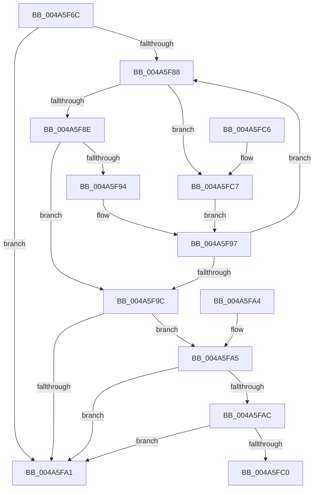

# MiClonePteReadonly

- RVA: `0x004A5F6C`–`0x004A5FCD` (길이 `97` bytes)
- VA: `0x00000001404A5F6C`
- 실행 섹션: `.text`
- PDB 이름 있음: `예`; PDB Function 태그: `아니요`
- unwind 정보 RVA: `0x000DB714`
- 디코드: `28`개 명령, `97/97` bytes 표시
- 미해석 바이트: `0` (있으면 어셈블리에 `.byte`로 보존)

> 이 문서는 커널 이미지의 기계어와 PDB 기호를 분석해 생성했습니다. 4번과 5번은 함수 원형과 자료형을 바이너리 사용 방식에서 추정한 C 해석이며 원본 소스 복구 결과는 아닙니다.

## 1. Dependencies

- 직접 호출 지점: **0**; 고유 호출 대상: **0**
- 직접 호출자로 확인된 함수: **1**
- RIP 상대 이미지 참조: **0**

### Outgoing calls
- 직접 디코드된 call 명령이 없습니다.

### Direct callers
- [MiPteForTrimmedProto](../29/MiPteForTrimmedProto_function_0029496C.md) at `0x00294A69`

### Static image references
- 디코드된 RIP-relative 메모리 참조가 없습니다.

## 2. Other-region calls and transfers

- 다른 실행 섹션으로 향하는 call: **0**
- 별도 외부 분기/꼬리 이동을 확인하지 못했습니다.

## 3. Assembly (complete function range)

```asm
004A5F6C  65 48 8B 04 25 88 01 00 00      mov rax, qword ptr gs:[0x188]
004A5F75  48 8B 90 B8 00 00 00            mov rdx, qword ptr [rax + 0xb8]
004A5F7C  48 8B 82 80 02 00 00            mov rax, qword ptr [rdx + 0x280]
004A5F83  48 85 C0                        test rax, rax
004A5F86  74 19                           je 0x1404a5fa1
004A5F88  48 3B 48 20                     cmp rcx, qword ptr [rax + 0x20]
004A5F8C  77 39                           ja 0x1404a5fc7
004A5F8E  48 3B 48 18                     cmp rcx, qword ptr [rax + 0x18]
004A5F92  73 08                           jae 0x1404a5f9c
004A5F94  48 8B 00                        mov rax, qword ptr [rax]
004A5F97  48 85 C0                        test rax, rax
004A5F9A  75 EC                           jne 0x1404a5f88
004A5F9C  48 85 C0                        test rax, rax
004A5F9F  75 04                           jne 0x1404a5fa5
004A5FA1  33 C0                           xor eax, eax
004A5FA3  C3                              ret
004A5FA4  CC                              int3
004A5FA5  48 83 78 30 00                  cmp qword ptr [rax + 0x30], 0
004A5FAA  74 F5                           je 0x1404a5fa1
004A5FAC  48 8B 8A 10 04 00 00            mov rcx, qword ptr [rdx + 0x410]
004A5FB3  48 8B 40 60                     mov rax, qword ptr [rax + 0x60]
004A5FB7  48 39 81 28 04 00 00            cmp qword ptr [rcx + 0x428], rax
004A5FBE  76 E1                           jbe 0x1404a5fa1
004A5FC0  B8 01 00 00 00                  mov eax, 1
004A5FC5  C3                              ret
004A5FC6  CC                              int3
004A5FC7  48 8B 40 08                     mov rax, qword ptr [rax + 8]
004A5FCB  EB CA                           jmp 0x1404a5f97
```

## 4. C-style interpretation (structured pseudocode)

```c
__int64 __fastcall MiClonePteReadonly(__int64 a1)
{
    __int64 result;

    if (*(unsigned __int64 *)(*(unsigned __int64 *)(*(unsigned __int64 *)(gs_base + (0 + 392)) + 184) + 640) == 0) goto loc_004A5FA1;
loc_004A5F88:
    if (a1 > (*(unsigned __int64 *)(*(unsigned __int64 *)(*(unsigned __int64 *)(*(unsigned __int64 *)(gs_base + (0 + 392)) + 184) + 640) + 32))) goto loc_004A5FC7;
    if (a1 >= (*(unsigned __int64 *)(*(unsigned __int64 *)(*(unsigned __int64 *)(*(unsigned __int64 *)(gs_base + (0 + 392)) + 184) + 640) + 24))) goto loc_004A5F9C;
loc_004A5F97:
    if (*(unsigned __int64 *)(*(unsigned __int64 *)(*(unsigned __int64 *)(*(unsigned __int64 *)(gs_base + (0 + 392)) + 184) + 640)) != 0) goto loc_004A5F88;
loc_004A5F9C:
    if (*(unsigned __int64 *)(*(unsigned __int64 *)(*(unsigned __int64 *)(*(unsigned __int64 *)(gs_base + (0 + 392)) + 184) + 640)) != 0) goto loc_004A5FA5;
loc_004A5FA1:
    result = 0;
    return result;
loc_004A5FA5:
    if ((*(unsigned __int64 *)(result + 48)) == 0) goto loc_004A5FA1;
    if ((*(unsigned __int64 *)(*(unsigned __int64 *)(*(unsigned __int64 *)(*(unsigned __int64 *)(gs_base + (0 + 392)) + 184) + 1040) + 1064)) <= (*(unsigned __int64 *)(result + 96))) goto loc_004A5FA1;
    return 1;
loc_004A5FC7:
    goto loc_004A5F97;
}
```

## 5. (Beta) C Style

```c
int64_t MiClonePteReadonly(int64_t Arg1)
{
    int64_t result;

    if (*(uint64_t *)(*(uint64_t *)(*(uint64_t *)(gs_base + (0 + 0x188)) + 0xB8) + 0x280) == 0) goto loc_004A5FA1;
loc_004A5F88:
    if (Arg1 > (*(uint64_t *)(*(uint64_t *)(*(uint64_t *)(*(uint64_t *)(gs_base + (0 + 0x188)) + 0xB8) + 0x280) + 0x20))) goto loc_004A5FC7;
    if (Arg1 >= (*(uint64_t *)(*(uint64_t *)(*(uint64_t *)(*(uint64_t *)(gs_base + (0 + 0x188)) + 0xB8) + 0x280) + 0x18))) goto loc_004A5F9C;
loc_004A5F97:
    if (*(uint64_t *)(*(uint64_t *)(*(uint64_t *)(*(uint64_t *)(gs_base + (0 + 0x188)) + 0xB8) + 0x280)) != 0) goto loc_004A5F88;
loc_004A5F9C:
    if (*(uint64_t *)(*(uint64_t *)(*(uint64_t *)(*(uint64_t *)(gs_base + (0 + 0x188)) + 0xB8) + 0x280)) != 0) goto loc_004A5FA5;
loc_004A5FA1:
    result = 0;
    return result;
loc_004A5FA5:
    if ((*(uint64_t *)(result + 0x30)) == 0) goto loc_004A5FA1;
    if ((*(uint64_t *)(*(uint64_t *)(*(uint64_t *)(*(uint64_t *)(gs_base + (0 + 0x188)) + 0xB8) + 0x410) + 0x428)) <= (*(uint64_t *)(result + 0x60))) goto loc_004A5FA1;
    return 1;
loc_004A5FC7:
    goto loc_004A5F97;
}
```

## 6. Execution-region graph

[열기: 2D/3D 그래프와 함수 탐색 컨트롤 패널](../../../control-panel.html?section=text&rva=0x004A5F6C&view=graph)

- 2D 그래프는 위에서 아래로 흐르고, 3D 그래프는 빈 공간을 드래그해 회전합니다. Shift+드래그는 이동, 휠은 확대·축소, 함수 노드 선택은 대상 보고서 이동입니다.

### Static fallback


