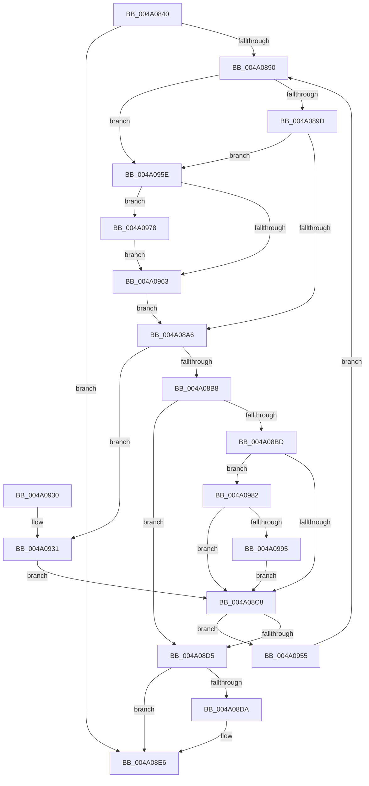

# MiDeletePerSessionProtos

- RVA: `0x004A0840`–`0x004A09A8` (길이 `360` bytes)
- VA: `0x00000001404A0840`
- 실행 섹션: `.text`
- PDB 이름 있음: `예`; PDB Function 태그: `아니요`
- unwind 정보 RVA: `0x000B5840`
- 디코드: `97`개 명령, `360/360` bytes 표시
- 미해석 바이트: `0` (있으면 어셈블리에 `.byte`로 보존)

> 이 문서는 커널 이미지의 기계어와 PDB 기호를 분석해 생성했습니다. 4번과 5번은 함수 원형과 자료형을 바이너리 사용 방식에서 추정한 C 해석이며 원본 소스 복구 결과는 아닙니다.

## 1. Dependencies

- 직접 호출 지점: **11**; 고유 호출 대상: **9**
- 직접 호출자로 확인된 함수: **2**
- RIP 상대 이미지 참조: **1**

### Outgoing calls
- `0x004A08AB` → [MiLockLeafPage](../36/MiLockLeafPage_function_003658C0.md) (function, `0x003658C0`)
- `0x004A08E1` → [MiUnlockProtoPoolPage](../24/MiUnlockProtoPoolPage_function_00246090.md) (function, `0x00246090`)
- `0x004A08EF` → [MiReturnCommit](../24/MiReturnCommit_function_00248410.md) (function, `0x00248410`)
- `0x004A08FA` → [MiUpdateSystemProtoPtesTree](../29/MiUpdateSystemProtoPtesTree_function_00295F0C.md) (function, `0x00295F0C`)
- `0x004A0905` → [ExFreePoolWithTag](../../poolcode/B8/ExFreePoolWithTag_function_00B82870.md) (function, `0x00B82870`)
- `0x004A090F` → [ExFreePoolWithTag](../../poolcode/B8/ExFreePoolWithTag_function_00B82870.md) (function, `0x00B82870`)
- `0x004A093D` → [MiDeleteTransitionPte](../37/MiDeleteTransitionPte_function_00371B70.md) (function, `0x00371B70`)
- `0x004A096B` → [MiLockProtoPoolPageForce](../32/MiLockProtoPoolPageForce_function_00320E10.md) (function, `0x00320E10`)
- `0x004A097B` → [MiUnlockProtoPoolPage](../24/MiUnlockProtoPoolPage_function_00246090.md) (function, `0x00246090`)
- `0x004A0987` → [MiMakeDemandZeroPte](../33/MiMakeDemandZeroPte_function_00337A00.md) (function, `0x00337A00`)
- `0x004A099E` → [MiReleasePageFileSpace](../28/MiReleasePageFileSpace_function_00285980.md) (function, `0x00285980`)

### Direct callers
- [MiDereferencePerSessionProtos](../../page/A2/MiDereferencePerSessionProtos_function_00A2EDE8.md) at `0x00A2EECA`
- [MiFreeSubsectionProtos](../../page/AA/MiFreeSubsectionProtos_function_00AA18F8.md) at `0x00AA190F`

### Static image references
- `0x004A0870` → RVA `0x00E30088` (`.data`; read)

## 2. Other-region calls and transfers

- 다른 실행 섹션으로 향하는 call: **2**
  - `0x004A0905` → [ExFreePoolWithTag](../../poolcode/B8/ExFreePoolWithTag_function_00B82870.md) (`.text` → `POOLCODE`)
  - `0x004A090F` → [ExFreePoolWithTag](../../poolcode/B8/ExFreePoolWithTag_function_00B82870.md) (`.text` → `POOLCODE`)
- 별도 외부 분기/꼬리 이동을 확인하지 못했습니다.

## 3. Assembly (complete function range)

```asm
004A0840  48 89 5C 24 10                  mov qword ptr [rsp + 0x10], rbx
004A0845  48 89 6C 24 18                  mov qword ptr [rsp + 0x18], rbp
004A084A  48 89 74 24 20                  mov qword ptr [rsp + 0x20], rsi
004A084F  57                              push rdi
004A0850  41 56                           push r14
004A0852  41 57                           push r15
004A0854  48 83 EC 20                     sub rsp, 0x20
004A0858  4C 8B 41 40                     mov r8, qword ptr [rcx + 0x40]
004A085C  33 FF                           xor edi, edi
004A085E  48 8B 59 48                     mov rbx, qword ptr [rcx + 0x48]
004A0862  48 8B F1                        mov rsi, rcx
004A0865  49 8B 00                        mov rax, qword ptr [r8]
004A0868  41 8B 68 2C                     mov ebp, dword ptr [r8 + 0x2c]
004A086C  0F B7 50 3C                     movzx edx, word ptr [rax + 0x3c]
004A0870  48 8B 05 11 F8 98 00            mov rax, qword ptr [rip + 0x98f811]
004A0877  4C 8D 34 EB                     lea r14, [rbx + rbp*8]
004A087B  81 E2 FF 03 00 00               and edx, 0x3ff
004A0881  4C 8B 3C D0                     mov r15, qword ptr [rax + rdx*8]
004A0885  B2 11                           mov dl, 0x11
004A0887  88 54 24 40                     mov byte ptr [rsp + 0x40], dl
004A088B  49 3B DE                        cmp rbx, r14
004A088E  73 56                           jae 0x1404a08e6
004A0890  48 F7 C3 FF 0F 00 00            test rbx, 0xfff
004A0897  0F 84 C1 00 00 00               je 0x1404a095e
004A089D  48 85 FF                        test rdi, rdi
004A08A0  0F 84 B8 00 00 00               je 0x1404a095e
004A08A6  33 D2                           xor edx, edx
004A08A8  48 8B CB                        mov rcx, rbx
004A08AB  E8 10 50 EC FF                  call 0x1403658c0
004A08B0  48 8B 13                        mov rdx, qword ptr [rbx]
004A08B3  48 85 C0                        test rax, rax
004A08B6  75 79                           jne 0x1404a0931
004A08B8  48 85 D2                        test rdx, rdx
004A08BB  74 18                           je 0x1404a08d5
004A08BD  48 0F BA E2 0A                  bt rdx, 0xa
004A08C2  0F 83 BA 00 00 00               jae 0x1404a0982
004A08C8  48 83 C3 08                     add rbx, 8
004A08CC  49 3B DE                        cmp rbx, r14
004A08CF  0F 82 80 00 00 00               jb 0x1404a0955
004A08D5  48 85 FF                        test rdi, rdi
004A08D8  74 0C                           je 0x1404a08e6
004A08DA  8A 54 24 40                     mov dl, byte ptr [rsp + 0x40]
004A08DE  48 8B CF                        mov rcx, rdi
004A08E1  E8 AA 57 DA FF                  call 0x140246090
004A08E6  45 33 C0                        xor r8d, r8d
004A08E9  48 8B D5                        mov rdx, rbp
004A08EC  49 8B CF                        mov rcx, r15
004A08EF  E8 1C 7B DA FF                  call 0x140248410
004A08F4  48 8D 4E 18                     lea rcx, [rsi + 0x18]
004A08F8  33 D2                           xor edx, edx
004A08FA  E8 0D 56 DF FF                  call 0x140295f0c
004A08FF  48 8B 4E 48                     mov rcx, qword ptr [rsi + 0x48]
004A0903  33 D2                           xor edx, edx
004A0905  E8 66 1F 6E 00                  call 0x140b82870
004A090A  33 D2                           xor edx, edx
004A090C  48 8B CE                        mov rcx, rsi
004A090F  E8 5C 1F 6E 00                  call 0x140b82870
004A0914  48 8B 5C 24 48                  mov rbx, qword ptr [rsp + 0x48]
004A0919  48 8B C5                        mov rax, rbp
004A091C  48 8B 6C 24 50                  mov rbp, qword ptr [rsp + 0x50]
004A0921  48 8B 74 24 58                  mov rsi, qword ptr [rsp + 0x58]
004A0926  48 83 C4 20                     add rsp, 0x20
004A092A  41 5F                           pop r15
004A092C  41 5E                           pop r14
004A092E  5F                              pop rdi
004A092F  C3                              ret
004A0930  CC                              int3
004A0931  45 33 C9                        xor r9d, r9d
004A0934  41 B0 11                        mov r8b, 0x11
004A0937  48 8B D0                        mov rdx, rax
004A093A  48 8B CB                        mov rcx, rbx
004A093D  E8 2E 12 ED FF                  call 0x140371b70
004A0942  48 8D 4D FF                     lea rcx, [rbp - 1]
004A0946  83 F8 03                        cmp eax, 3
004A0949  48 0F 45 CD                     cmovne rcx, rbp
004A094D  48 8B E9                        mov rbp, rcx
004A0950  E9 73 FF FF FF                  jmp 0x1404a08c8
004A0955  8A 54 24 40                     mov dl, byte ptr [rsp + 0x40]
004A0959  E9 32 FF FF FF                  jmp 0x1404a0890
004A095E  48 85 FF                        test rdi, rdi
004A0961  75 15                           jne 0x1404a0978
004A0963  48 8D 54 24 40                  lea rdx, [rsp + 0x40]
004A0968  48 8B CB                        mov rcx, rbx
004A096B  E8 A0 04 E8 FF                  call 0x140320e10
004A0970  48 8B F8                        mov rdi, rax
004A0973  E9 2E FF FF FF                  jmp 0x1404a08a6
004A0978  48 8B CF                        mov rcx, rdi
004A097B  E8 10 57 DA FF                  call 0x140246090
004A0980  EB E1                           jmp 0x1404a0963
004A0982  B9 18 00 00 00                  mov ecx, 0x18
004A0987  E8 74 70 E9 FF                  call 0x140337a00
004A098C  48 3B D0                        cmp rdx, rax
004A098F  0F 84 33 FF FF FF               je 0x1404a08c8
004A0995  41 B8 01 00 00 00               mov r8d, 1
004A099B  49 8B CF                        mov rcx, r15
004A099E  E8 DD 4F DE FF                  call 0x140285980
004A09A3  E9 20 FF FF FF                  jmp 0x1404a08c8
```

## 4. C-style interpretation (structured pseudocode)

```c
__int64 __fastcall MiDeletePerSessionProtos(__int64 a1, __int64 a2, __int64 a3, int a4)
{
    __int64 result;
    __int64 v_rbx;
    __int64 v_rdi;
    __int64 v_rsp;
    unsigned __int64 v_stack_p10;
    unsigned __int64 v_stack_p18;
    unsigned __int64 v_stack_p20;
    unsigned __int8 v_stack_p40;
    unsigned __int8 v_stack_p8;

    v_stack_p10 = v_rbx;
    v_stack_p18 = v_rbp;
    v_stack_p20 = v_rsi;
    v_rsp = (v_rsp) - (32);
    v_rdi = 0;
    a2 = (unsigned int)((*(unsigned __int16 *)(*(unsigned __int64 *)(*(unsigned __int64 *)(a1 + 64)) + 60)) & (0x3FFULL));
    v_stack_p8 = 17;
    if ((*(unsigned __int64 *)(a1 + 72)) >= (*(unsigned __int64 *)(a1 + 72) + (unsigned int)(*(unsigned int *)(*(unsigned __int64 *)(a1 + 64) + 44)) * 8)) goto loc_004A08E6;
loc_004A0890:
    if (((*(unsigned __int64 *)(a1 + 72)) & (0xFFFULL)) == 0) goto loc_004A095E;
    if (0 == 0) goto loc_004A095E;
loc_004A08A6:
    a2 = 0;
    result = MiLockLeafPage(*(unsigned __int64 *)(a1 + 72), a2, *(unsigned __int64 *)(a1 + 64), a4);
    if (result != 0) goto loc_004A0931;
    if (*(unsigned __int64 *)(*(unsigned __int64 *)(a1 + 72)) == 0) goto loc_004A08D5;
    if (condition_is_above_or_equal) goto loc_004A0982;
loc_004A08C8:
    v_rbx = (*(unsigned __int64 *)(a1 + 72)) + (8);
    if (v_rbx < (*(unsigned __int64 *)(a1 + 72) + (unsigned int)(*(unsigned int *)(*(unsigned __int64 *)(a1 + 64) + 44)) * 8)) goto loc_004A0955;
loc_004A08D5:
    if (0 != 0) {
        a2 = v_stack_p8;
        a1 = 0;
        result = MiUnlockProtoPoolPage(a1, a2, *(unsigned __int64 *)(a1 + 64), a4);
    }
    a3 = 0;
    result = MiReturnCommit(*(unsigned __int64 *)(*(unsigned __int64 *)(v_rip + 10024977) + a2 * 8), (unsigned int)(*(unsigned int *)(*(unsigned __int64 *)(a1 + 64) + 44)), a3, a4);
    a2 = 0;
    result = MiUpdateSystemProtoPtesTree(a1 + 24, a2, a3, a4);
    a2 = 0;
    result = ExFreePoolWithTag(*(unsigned __int64 *)(a1 + 72), a2, a3, a4);
    a2 = 0;
    result = ExFreePoolWithTag(a1, a2, a3, a4);
    v_rsp = (v_rsp) + (32);
    return (unsigned int)(*(unsigned int *)(*(unsigned __int64 *)(a1 + 64) + 44));
loc_004A0931:
    a4 = 0;
    result = MiDeleteTransitionPte(v_stack_p10, (unsigned int)(*(unsigned int *)(*(unsigned __int64 *)(a1 + 64) + 44)), 17, a4);
    a1 = v_stack_p18 - 1;
    if (((unsigned int)(result)) != 3) { a1 = v_stack_p18; }
    goto loc_004A08C8;
loc_004A0955:
    goto loc_004A0890;
loc_004A095E:
    if (0 != 0) goto loc_004A0978;
loc_004A0963:
    result = MiLockProtoPoolPageForce(v_stack_p10, v_stack_p40, 17, a4);
    goto loc_004A08A6;
loc_004A0978:
    result = MiUnlockProtoPoolPage(result, v_stack_p40, 17, a4);
    goto loc_004A0963;
loc_004A0982:
    result = MiMakeDemandZeroPte(24, v_stack_p40, 17, a4);
    if (v_stack_p40 == result) goto loc_004A08C8;
    result = MiReleasePageFileSpace(*(unsigned __int64 *)(*(unsigned __int64 *)(v_rip + 10024977) + a2 * 8), v_stack_p40, 1, a4);
    goto loc_004A08C8;
}
```

## 5. (Beta) C Style

```c
int64_t MiDeletePerSessionProtos(void *Arg1, int64_t Arg2, int64_t Arg3, int32_t Arg4)
{
    uint8_t *arg1 = (uint8_t *)Arg1;

    int64_t result;
    int64_t local_rbx;
    int64_t local_rdi;
    int64_t local_rsp;
    uint64_t v_stack_p10;
    uint64_t v_stack_p18;
    uint64_t v_stack_p20;
    uint8_t v_stack_p40;
    uint8_t v_stack_p8;

    v_stack_p10 = local_rbx;
    v_stack_p18 = local_rbp;
    v_stack_p20 = local_rsi;
    local_rsp = (local_rsp) - (32);
    local_rdi = 0;
    Arg2 = (uint32_t)((*(uint16_t *)(*(uint64_t *)(*(uint64_t *)(arg1 + 0x40)) + 0x3C)) & (0x3FFULL));
    v_stack_p8 = 17;
    if ((*(uint64_t *)(arg1 + 0x48)) >= (*(uint64_t *)(arg1 + 0x48) + (uint32_t)(*(uint32_t *)(*(uint64_t *)(arg1 + 0x40) + 0x2C)) * 8)) goto loc_004A08E6;
loc_004A0890:
    if (((*(uint64_t *)(arg1 + 0x48)) & (0xFFFULL)) == 0) goto loc_004A095E;
    if (0 == 0) goto loc_004A095E;
loc_004A08A6:
    Arg2 = 0;
    result = MiLockLeafPage(*(uint64_t *)(arg1 + 0x48), Arg2, *(uint64_t *)(arg1 + 0x40), Arg4);
    if (result != 0) goto loc_004A0931;
    if (*(uint64_t *)(*(uint64_t *)(arg1 + 0x48)) == 0) goto loc_004A08D5;
    if (condition_is_above_or_equal) goto loc_004A0982;
loc_004A08C8:
    local_rbx = (*(uint64_t *)(arg1 + 0x48)) + (8);
    if (local_rbx < (*(uint64_t *)(arg1 + 0x48) + (uint32_t)(*(uint32_t *)(*(uint64_t *)(arg1 + 0x40) + 0x2C)) * 8)) goto loc_004A0955;
loc_004A08D5:
    if (0 != 0) {
        Arg2 = v_stack_p8;
        Arg1 = 0;
        result = MiUnlockProtoPoolPage(Arg1, Arg2, *(uint64_t *)(arg1 + 0x40), Arg4);
    }
    Arg3 = 0;
    result = MiReturnCommit(*(uint64_t *)(*(uint64_t *)(v_rip + 0x98F811) + Arg2 * 8), (uint32_t)(*(uint32_t *)(*(uint64_t *)(arg1 + 0x40) + 0x2C)), Arg3, Arg4);
    Arg2 = 0;
    result = MiUpdateSystemProtoPtesTree(Arg1 + 24, Arg2, Arg3, Arg4);
    Arg2 = 0;
    result = ExFreePoolWithTag(*(uint64_t *)(arg1 + 0x48), Arg2, Arg3, Arg4);
    Arg2 = 0;
    result = ExFreePoolWithTag(Arg1, Arg2, Arg3, Arg4);
    local_rsp = (local_rsp) + (32);
    return (uint32_t)(*(uint32_t *)(*(uint64_t *)(arg1 + 0x40) + 0x2C));
loc_004A0931:
    Arg4 = 0;
    result = MiDeleteTransitionPte(v_stack_p10, (uint32_t)(*(uint32_t *)(*(uint64_t *)(arg1 + 0x40) + 0x2C)), 17, Arg4);
    Arg1 = v_stack_p18 - 1;
    if (((uint32_t)(result)) != 3) { Arg1 = v_stack_p18; }
    goto loc_004A08C8;
loc_004A0955:
    goto loc_004A0890;
loc_004A095E:
    if (0 != 0) goto loc_004A0978;
loc_004A0963:
    result = MiLockProtoPoolPageForce(v_stack_p10, v_stack_p40, 17, Arg4);
    goto loc_004A08A6;
loc_004A0978:
    result = MiUnlockProtoPoolPage(result, v_stack_p40, 17, Arg4);
    goto loc_004A0963;
loc_004A0982:
    result = MiMakeDemandZeroPte(24, v_stack_p40, 17, Arg4);
    if (v_stack_p40 == result) goto loc_004A08C8;
    result = MiReleasePageFileSpace(*(uint64_t *)(*(uint64_t *)(v_rip + 0x98F811) + Arg2 * 8), v_stack_p40, 1, Arg4);
    goto loc_004A08C8;
}
```

### 관측된 메모리 오프셋

구조체 형식이 확인되지 않은 접근은 인자 기준의 오프셋으로만 기록했습니다.

| 기준 인자 | 오프셋 표현 | 폭 (bit) | 접근 |
|---|---:|---:|---|
| `Arg1` | `+ 0x18` | `64` | `R` |
| `Arg1` | `+ 0x40` | `64` | `R` |
| `Arg1` | `+ 0x48` | `64` | `R` |

## 6. Execution-region graph

[열기: 2D/3D 그래프와 함수 탐색 컨트롤 패널](../../../control-panel.html?section=text&rva=0x004A0840&view=graph)

- 2D 그래프는 위에서 아래로 흐르고, 3D 그래프는 빈 공간을 드래그해 회전합니다. Shift+드래그는 이동, 휠은 확대·축소, 함수 노드 선택은 대상 보고서 이동입니다.

### Static fallback


