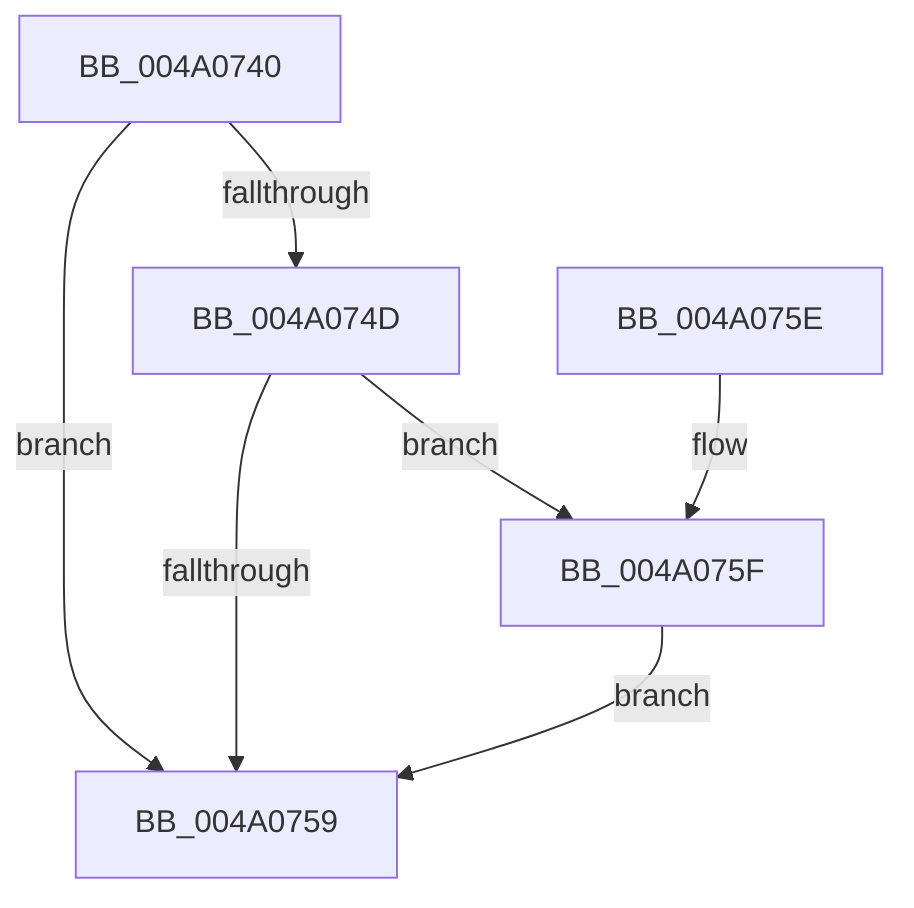

# MiDeletePxeSharedLocks

- RVA: `0x004A0740`–`0x004A0768` (길이 `40` bytes)
- VA: `0x00000001404A0740`
- 실행 섹션: `.text`
- PDB 이름 있음: `예`; PDB Function 태그: `아니요`
- unwind 정보 RVA: `0x0006EDE0`
- 디코드: `13`개 명령, `40/40` bytes 표시
- 미해석 바이트: `0` (있으면 어셈블리에 `.byte`로 보존)

> 이 문서는 커널 이미지의 기계어와 PDB 기호를 분석해 생성했습니다. 4번과 5번은 함수 원형과 자료형을 바이너리 사용 방식에서 추정한 C 해석이며 원본 소스 복구 결과는 아닙니다.

## 1. Dependencies

- 직접 호출 지점: **1**; 고유 호출 대상: **1**
- 직접 호출자로 확인된 함수: **1**
- RIP 상대 이미지 참조: **0**

### Outgoing calls
- `0x004A0761` → [ExFreePoolWithTag](../../poolcode/B8/ExFreePoolWithTag_function_00B82870.md) (function, `0x00B82870`)

### Direct callers
- [MmDeleteProcessAddressSpace](../../page/AC/MmDeleteProcessAddressSpace_function_00AC804C.md) at `0x00AC8203`

### Static image references
- 디코드된 RIP-relative 메모리 참조가 없습니다.

## 2. Other-region calls and transfers

- 다른 실행 섹션으로 향하는 call: **1**
  - `0x004A0761` → [ExFreePoolWithTag](../../poolcode/B8/ExFreePoolWithTag_function_00B82870.md) (`.text` → `POOLCODE`)
- 별도 외부 분기/꼬리 이동을 확인하지 못했습니다.

## 3. Assembly (complete function range)

```asm
004A0740  48 83 EC 28                     sub rsp, 0x28
004A0744  48 8B 49 10                     mov rcx, qword ptr [rcx + 0x10]
004A0748  48 85 C9                        test rcx, rcx
004A074B  74 0C                           je 0x1404a0759
004A074D  48 8B 89 68 05 00 00            mov rcx, qword ptr [rcx + 0x568]
004A0754  48 85 C9                        test rcx, rcx
004A0757  75 06                           jne 0x1404a075f
004A0759  48 83 C4 28                     add rsp, 0x28
004A075D  C3                              ret
004A075E  CC                              int3
004A075F  33 D2                           xor edx, edx
004A0761  E8 0A 21 6E 00                  call 0x140b82870
004A0766  EB F1                           jmp 0x1404a0759
```

## 4. C-style interpretation (structured pseudocode)

```c
__int64 __fastcall MiDeletePxeSharedLocks(__int64 a1, int a2)
{
    __int64 result;
    __int64 v_rsp;

    v_rsp = (v_rsp) - (40);
    if (*(unsigned __int64 *)(a1 + 16) == 0) goto loc_004A0759;
    if (*(unsigned __int64 *)(*(unsigned __int64 *)(a1 + 16) + 1384) != 0) goto loc_004A075F;
loc_004A0759:
    v_rsp = (v_rsp) + (40);
    return result;
loc_004A075F:
    a2 = 0;
    result = ExFreePoolWithTag(*(unsigned __int64 *)(*(unsigned __int64 *)(a1 + 16) + 1384), a2, a3, a4);
    goto loc_004A0759;
}
```

## 5. (Beta) C Style

```c
int64_t MiDeletePxeSharedLocks(void *Arg1, int32_t Arg2)
{
    uint8_t *arg1 = (uint8_t *)Arg1;

    int64_t result;
    int64_t local_rsp;

    local_rsp = (local_rsp) - (40);
    if (*(uint64_t *)(arg1 + 0x10) == 0) goto loc_004A0759;
    if (*(uint64_t *)(*(uint64_t *)(arg1 + 0x10) + 0x568) != 0) goto loc_004A075F;
loc_004A0759:
    local_rsp = (local_rsp) + (40);
    return result;
loc_004A075F:
    Arg2 = 0;
    result = ExFreePoolWithTag(*(uint64_t *)(*(uint64_t *)(arg1 + 0x10) + 0x568), Arg2, a3, a4);
    goto loc_004A0759;
}
```

### 관측된 메모리 오프셋

구조체 형식이 확인되지 않은 접근은 인자 기준의 오프셋으로만 기록했습니다.

| 기준 인자 | 오프셋 표현 | 폭 (bit) | 접근 |
|---|---:|---:|---|
| `Arg1` | `+ 0x10` | `64` | `R` |

## 6. Execution-region graph

[열기: 2D/3D 그래프와 함수 탐색 컨트롤 패널](../../../control-panel.html?section=text&rva=0x004A0740&view=graph)

- 2D 그래프는 위에서 아래로 흐르고, 3D 그래프는 빈 공간을 드래그해 회전합니다. Shift+드래그는 이동, 휠은 확대·축소, 함수 노드 선택은 대상 보고서 이동입니다.

### Static fallback


