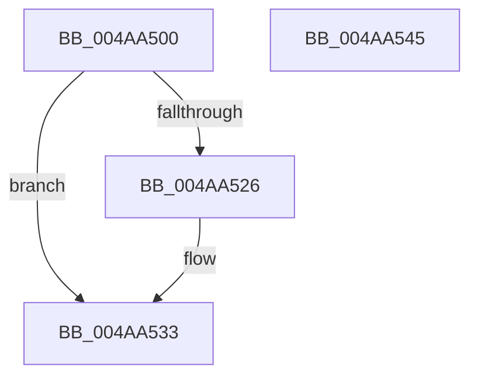

# MiFastReplenishWithAsync

- RVA: `0x004AA500`–`0x004AA546` (길이 `70` bytes)
- VA: `0x00000001404AA500`
- 실행 섹션: `.text`
- PDB 이름 있음: `예`; PDB Function 태그: `아니요`
- unwind 정보 RVA: `0x00060BC4`
- 디코드: `22`개 명령, `70/70` bytes 표시
- 미해석 바이트: `0` (있으면 어셈블리에 `.byte`로 보존)

> 이 문서는 커널 이미지의 기계어와 PDB 기호를 분석해 생성했습니다. 4번과 5번은 함수 원형과 자료형을 바이너리 사용 방식에서 추정한 C 해석이며 원본 소스 복구 결과는 아닙니다.

## 1. Dependencies

- 직접 호출 지점: **2**; 고유 호출 대상: **2**
- 직접 호출자로 확인된 함수: **2**
- RIP 상대 이미지 참조: **0**

### Outgoing calls
- `0x004AA51B` → [MiReplenishSlabAllocator](../37/MiReplenishSlabAllocator_function_003788E4.md) (function, `0x003788E4`)
- `0x004AA52E` → [MiAsyncSlabReplenish](MiAsyncSlabReplenish_function_004AA54C.md) (function, `0x004AA54C`)

### Direct callers
- [MiMakeZeroedPageTablesEx](../3B/MiMakeZeroedPageTablesEx_function_003B59FC.md) at `0x003B5D8A`
- [sub_006E73DC](../6E/Unknown_function_006E73DC.md) at `0x006E7421`

### Static image references
- 디코드된 RIP-relative 메모리 참조가 없습니다.

## 2. Other-region calls and transfers

- 다른 실행 섹션으로 향하는 call: **0**
- 별도 외부 분기/꼬리 이동을 확인하지 못했습니다.

## 3. Assembly (complete function range)

```asm
004AA500  48 89 5C 24 08                  mov qword ptr [rsp + 8], rbx
004AA505  48 89 74 24 10                  mov qword ptr [rsp + 0x10], rsi
004AA50A  57                              push rdi
004AA50B  48 83 EC 20                     sub rsp, 0x20
004AA50F  41 8B F0                        mov esi, r8d
004AA512  48 8B F9                        mov rdi, rcx
004AA515  41 B8 40 00 00 00               mov r8d, 0x40
004AA51B  E8 C4 E3 EC FF                  call 0x1403788e4
004AA520  8B D8                           mov ebx, eax
004AA522  85 C0                           test eax, eax
004AA524  75 0D                           jne 0x1404aa533
004AA526  44 8B C6                        mov r8d, esi
004AA529  33 D2                           xor edx, edx
004AA52B  48 8B CF                        mov rcx, rdi
004AA52E  E8 19 00 00 00                  call 0x1404aa54c
004AA533  48 8B 74 24 38                  mov rsi, qword ptr [rsp + 0x38]
004AA538  8B C3                           mov eax, ebx
004AA53A  48 8B 5C 24 30                  mov rbx, qword ptr [rsp + 0x30]
004AA53F  48 83 C4 20                     add rsp, 0x20
004AA543  5F                              pop rdi
004AA544  C3                              ret
004AA545  CC                              int3
```

## 4. C-style interpretation (structured pseudocode)

```c
__int64 __fastcall MiFastReplenishWithAsync(__int64 a1, int a2, int a3)
{
    __int64 result;
    __int64 v_rsp;
    unsigned __int64 v_stack_p10;
    unsigned __int64 v_stack_p8;

    v_stack_p8 = v_rbx;
    v_stack_p10 = v_rsi;
    v_rsp = (v_rsp) - (32);
    result = MiReplenishSlabAllocator(a1, a2, 64, a4);
    if ((unsigned int)(result) == 0) {
        a3 = (unsigned int)((unsigned int)(a3));
        a2 = 0;
        a1 = a1;
        result = MiAsyncSlabReplenish(a1, a2, a3, a4);
    }
    v_rsp = (v_rsp) + (32);
    return (unsigned int)((unsigned int)((unsigned int)((unsigned int)(result))));
}
```

## 5. (Beta) C Style

```c
int64_t MiFastReplenishWithAsync(int64_t Arg1, int32_t Arg2, int32_t Arg3)
{
    int64_t result;
    int64_t local_rsp;
    uint64_t v_stack_p10;
    uint64_t v_stack_p8;

    v_stack_p8 = local_rbx;
    v_stack_p10 = local_rsi;
    local_rsp = (local_rsp) - (32);
    result = MiReplenishSlabAllocator(Arg1, Arg2, 64, a4);
    if ((uint32_t)(result) == 0) {
        Arg3 = (uint32_t)((uint32_t)(Arg3));
        Arg2 = 0;
        Arg1 = Arg1;
        result = MiAsyncSlabReplenish(Arg1, Arg2, Arg3, a4);
    }
    local_rsp = (local_rsp) + (32);
    return (uint32_t)((uint32_t)((uint32_t)((uint32_t)(result))));
}
```

## 6. Execution-region graph

[열기: 2D/3D 그래프와 함수 탐색 컨트롤 패널](../../../control-panel.html?section=text&rva=0x004AA500&view=graph)

- 2D 그래프는 위에서 아래로 흐르고, 3D 그래프는 빈 공간을 드래그해 회전합니다. Shift+드래그는 이동, 휠은 확대·축소, 함수 노드 선택은 대상 보고서 이동입니다.

### Static fallback


