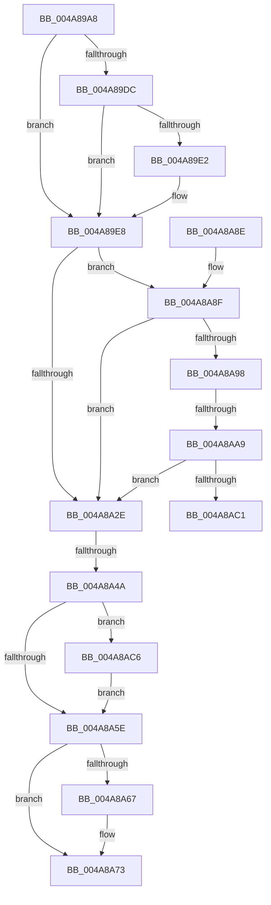

# MiFinalizeImageHeaderPage

- RVA: `0x004A89A8`–`0x004A8AD0` (길이 `296` bytes)
- VA: `0x00000001404A89A8`
- 실행 섹션: `.text`
- PDB 이름 있음: `예`; PDB Function 태그: `예`
- unwind 정보 RVA: `0x000B7864`
- 디코드: `82`개 명령, `296/296` bytes 표시
- 미해석 바이트: `0` (있으면 어셈블리에 `.byte`로 보존)

> 이 문서는 커널 이미지의 기계어와 PDB 기호를 분석해 생성했습니다. 4번과 5번은 함수 원형과 자료형을 바이너리 사용 방식에서 추정한 C 해석이며 원본 소스 복구 결과는 아닙니다.

## 1. Dependencies

- 직접 호출 지점: **8**; 고유 호출 대상: **8**
- 직접 호출자로 확인된 함수: **1**
- RIP 상대 이미지 참조: **3**

### Outgoing calls
- `0x004A8A0A` → [MI_NODE_FROM_PFN](../2B/MI_NODE_FROM_PFN_function_002B0F30.md) (function, `0x002B0F30`)
- `0x004A8A25` → [MiUseSlabAllocator](../36/MiUseSlabAllocator_function_00365C68.md) (function, `0x00365C68`)
- `0x004A8A31` → [MiLockPageInline](../31/MiLockPageInline_function_0031A340.md) (function, `0x0031A340`)
- `0x004A8A3C` → [MiRemoveLockedPageChargeAndDecRef](../24/MiRemoveLockedPageChargeAndDecRef_function_002459D0.md) (function, `0x002459D0`)
- `0x004A8A6E` → [KiLowerIrqlProcessIrqlFlags](../4F/KiLowerIrqlProcessIrqlFlags_function_004F5698.md) (function, `0x004F5698`)
- `0x004A8A9B` → [MiGetPfnSlabType](../28/MiGetPfnSlabType_function_0028E2D0.md) (function, `0x0028E2D0`)
- `0x004A8AB4` → [MiCheckSlabPage](../34/MiCheckSlabPage_function_00348AC8.md) (function, `0x00348AC8`)
- `0x004A8AC9` → [MiReleaseFreshPageAtDpc](../33/MiReleaseFreshPageAtDpc_function_00334B50.md) (function, `0x00334B50`)

### Direct callers
- [MiCreateNewSection](../../page/98/MiCreateNewSection_function_00985DB0.md) at `0x00986492`

### Static image references
- `0x004A89BE` → RVA `0x00E2DC80` (`.data`; read)
- `0x004A89F6` → RVA `0x00E30088` (`.data`; read)
- `0x004A8A5E` → RVA `0x00FC6D20` (`ALMOSTRO`; read)

## 2. Other-region calls and transfers

- 다른 실행 섹션으로 향하는 call: **0**
- call이 아닌 외부 분기/꼬리 이동: **3**
  - `0x004A8A44` → [sub_006F9D5A + 0x65](../6F/Unknown_function_006F9D5A.md) (`tail-transfer`)
  - `0x004A8AA3` → [sub_006F9D5A](../6F/Unknown_function_006F9D5A.md) (`tail-transfer`)
  - `0x004A8AC1` → [sub_006F9D5A](../6F/Unknown_function_006F9D5A.md) (`tail-transfer`)

## 3. Assembly (complete function range)

```asm
004A89A8  48 89 5C 24 10                  mov qword ptr [rsp + 0x10], rbx
004A89AD  48 89 6C 24 18                  mov qword ptr [rsp + 0x18], rbp
004A89B2  56                              push rsi
004A89B3  57                              push rdi
004A89B4  41 54                           push r12
004A89B6  41 56                           push r14
004A89B8  41 57                           push r15
004A89BA  48 83 EC 30                     sub rsp, 0x30
004A89BE  48 8B 05 BB 52 98 00            mov rax, qword ptr [rip + 0x9852bb]
004A89C5  4C 8D 71 10                     lea r14, [rcx + 0x10]
004A89C9  49 8B 36                        mov rsi, qword ptr [r14]
004A89CC  45 33 FF                        xor r15d, r15d
004A89CF  44 89 7C 24 60                  mov dword ptr [rsp + 0x60], r15d
004A89D4  48 8B D9                        mov rbx, rcx
004A89D7  48 85 C0                        test rax, rax
004A89DA  74 0C                           je 0x1404a89e8
004A89DC  40 F6 C6 10                     test sil, 0x10
004A89E0  75 06                           jne 0x1404a89e8
004A89E2  48 F7 D0                        not rax
004A89E5  48 23 F0                        and rsi, rax
004A89E8  48 C1 FE 10                     sar rsi, 0x10
004A89EC  49 8B FF                        mov rdi, r15
004A89EF  48 8B 06                        mov rax, qword ptr [rsi]
004A89F2  0F B7 48 3C                     movzx ecx, word ptr [rax + 0x3c]
004A89F6  48 8B 05 8B 76 98 00            mov rax, qword ptr [rip + 0x98768b]
004A89FD  81 E1 FF 03 00 00               and ecx, 0x3ff
004A8A03  48 8B 2C C8                     mov rbp, qword ptr [rax + rcx*8]
004A8A07  48 8B CB                        mov rcx, rbx
004A8A0A  E8 21 85 E0 FF                  call 0x1402b0f30
004A8A0F  4D 8B 06                        mov r8, qword ptr [r14]
004A8A12  44 8B C8                        mov r9d, eax
004A8A15  48 8D 44 24 60                  lea rax, [rsp + 0x60]
004A8A1A  48 8B D6                        mov rdx, rsi
004A8A1D  48 8B CD                        mov rcx, rbp
004A8A20  48 89 44 24 20                  mov qword ptr [rsp + 0x20], rax
004A8A25  E8 3E D2 EB FF                  call 0x140365c68
004A8A2A  85 C0                           test eax, eax
004A8A2C  75 61                           jne 0x1404a8a8f
004A8A2E  48 8B CB                        mov rcx, rbx
004A8A31  E8 0A 19 E7 FF                  call 0x14031a340
004A8A36  48 8B CB                        mov rcx, rbx
004A8A39  0F B6 F0                        movzx esi, al
004A8A3C  E8 8F CF D9 FF                  call 0x1402459d0
004A8A41  48 85 FF                        test rdi, rdi
004A8A44  0F 85 75 13 25 00               jne 0x1406f9dbf
004A8A4A  48 B8 FF FF FF FF FF FF FF 7F   movabs rax, 0x7fffffffffffffff
004A8A54  F0 48 21 43 18                  lock and qword ptr [rbx + 0x18], rax
004A8A59  48 85 FF                        test rdi, rdi
004A8A5C  75 68                           jne 0x1404a8ac6
004A8A5E  44 39 3D BB E2 B1 00            cmp dword ptr [rip + 0xb1e2bb], r15d
004A8A65  74 0C                           je 0x1404a8a73
004A8A67  44 0F 20 C1                     mov rcx, cr8
004A8A6B  40 8A D6                        mov dl, sil
004A8A6E  E8 25 CC 04 00                  call 0x1404f5698
004A8A73  44 0F 22 C6                     mov cr8, rsi
004A8A77  48 8B 5C 24 68                  mov rbx, qword ptr [rsp + 0x68]
004A8A7C  48 8B 6C 24 70                  mov rbp, qword ptr [rsp + 0x70]
004A8A81  48 83 C4 30                     add rsp, 0x30
004A8A85  41 5F                           pop r15
004A8A87  41 5E                           pop r14
004A8A89  41 5C                           pop r12
004A8A8B  5F                              pop rdi
004A8A8C  5E                              pop rsi
004A8A8D  C3                              ret
004A8A8E  CC                              int3
004A8A8F  8B 74 24 60                     mov esi, dword ptr [rsp + 0x60]
004A8A93  83 FE 04                        cmp esi, 4
004A8A96  77 96                           ja 0x1404a8a2e
004A8A98  48 8B CB                        mov rcx, rbx
004A8A9B  E8 30 58 DE FF                  call 0x14028e2d0
004A8AA0  83 F8 09                        cmp eax, 9
004A8AA3  0F 84 B1 12 25 00               je 0x1406f9d5a
004A8AA9  41 B8 01 00 00 00               mov r8d, 1
004A8AAF  8B D6                           mov edx, esi
004A8AB1  48 8B CB                        mov rcx, rbx
004A8AB4  E8 0F 00 EA FF                  call 0x140348ac8
004A8AB9  85 C0                           test eax, eax
004A8ABB  0F 85 6D FF FF FF               jne 0x1404a8a2e
004A8AC1  E9 94 12 25 00                  jmp 0x1406f9d5a
004A8AC6  48 8B CF                        mov rcx, rdi
004A8AC9  E8 82 C0 E8 FF                  call 0x140334b50
004A8ACE  EB 8E                           jmp 0x1404a8a5e
```

## 4. C-style interpretation (structured pseudocode)

```c
__int64 __fastcall MiFinalizeImageHeaderPage(__int64 a1)
{
    __int64 result;
    __int64 v_r15;
    __int64 v_rsi;
    __int64 v_rsp;
    unsigned __int64 v_stack_m38;
    unsigned __int64 v_stack_p10;
    unsigned __int64 v_stack_p18;
    unsigned int v_stack_p60;
    unsigned int v_stack_p8;

    v_stack_p10 = v_rbx;
    v_stack_p18 = v_rbp;
    v_rsp = (v_rsp) - (48);
    v_r15 = 0;
    v_stack_p8 = 0;
    if (*(unsigned __int64 *)(v_rip + 9982651) == 0) goto loc_004A89E8;
    result = *(unsigned __int64 *)(v_rip + 9982651);
    v_rsi = *(unsigned __int64 *)(a1 + 16);
    if ((((unsigned __int8)(*(unsigned __int64 *)(a1 + 16))) & (16)) == 0) {
        result = ~(*(unsigned __int64 *)(v_rip + 9982651));
        v_rsi = (*(unsigned __int64 *)(a1 + 16)) & (result);
    }
    v_rsi = (v_rsi) >> (16);
    a1 = (unsigned int)((*(unsigned __int16 *)(*(unsigned __int64 *)(v_rsi) + 60)) & (0x3FFULL));
    result = MI_NODE_FROM_PFN(a1, a2, a3, a4);
    v_stack_m38 = v_stack_p8;
    result = MiUseSlabAllocator(*(unsigned __int64 *)(*(unsigned __int64 *)(v_rip + 9991819) + a1 * 8), v_rsi, *(unsigned __int64 *)(a1 + 16), (unsigned int)((unsigned int)(result)));
    if ((unsigned int)(result) != 0) goto loc_004A8A8F;
loc_004A8A2E:
    result = MiLockPageInline(a1, v_rsi, *(unsigned __int64 *)(a1 + 16), (unsigned int)((unsigned int)(result)));
    result = MiRemoveLockedPageChargeAndDecRef(a1, v_rsi, *(unsigned __int64 *)(a1 + 16), (unsigned int)((unsigned int)(result)));
    if (0 != 0) goto loc_004A8AC6;
loc_004A8A5E:
    if ((*(unsigned int *)(v_rip + 11657915)) != 0) {
        a1 = v_cr8;
        a2 = (unsigned __int8)((unsigned __int8)(result));
        result = KiLowerIrqlProcessIrqlFlags(a1, a2, *(unsigned __int64 *)(a1 + 16), (unsigned int)((unsigned int)(result)));
    }
    v_rsp = (v_rsp) + (48);
    return result;
loc_004A8A8F:
    if (((unsigned int)((unsigned int)(v_stack_p60))) > 4) goto loc_004A8A2E;
    result = MiGetPfnSlabType(v_stack_p10, a2, *(unsigned __int64 *)(a1 + 16), (unsigned int)((unsigned int)(result)));
    result = MiCheckSlabPage(v_stack_p10, (unsigned int)((unsigned int)((unsigned int)(v_stack_p60))), 1, (unsigned int)((unsigned int)(result)));
    if ((unsigned int)(result) != 0) goto loc_004A8A2E;
loc_004A8AC6:
    result = MiReleaseFreshPageAtDpc(0, (unsigned int)((unsigned int)((unsigned int)(v_stack_p60))), 1, (unsigned int)((unsigned int)(result)));
    goto loc_004A8A5E;
}
```

## 5. (Beta) C Style

```c
int64_t MiFinalizeImageHeaderPage(void *Arg1)
{
    uint8_t *arg1 = (uint8_t *)Arg1;

    int64_t result;
    int64_t local_r15;
    int64_t local_rsi;
    int64_t local_rsp;
    uint64_t v_stack_m38;
    uint64_t v_stack_p10;
    uint64_t v_stack_p18;
    uint32_t v_stack_p60;
    uint32_t v_stack_p8;

    v_stack_p10 = local_rbx;
    v_stack_p18 = local_rbp;
    local_rsp = (local_rsp) - (48);
    local_r15 = 0;
    v_stack_p8 = 0;
    if (*(uint64_t *)(v_rip + 0x9852BB) == 0) goto loc_004A89E8;
    result = *(uint64_t *)(v_rip + 0x9852BB);
    local_rsi = *(uint64_t *)(arg1 + 0x10);
    if ((((uint8_t)(*(uint64_t *)(arg1 + 0x10))) & (16)) == 0) {
        result = ~(*(uint64_t *)(v_rip + 0x9852BB));
        local_rsi = (*(uint64_t *)(arg1 + 0x10)) & (result);
    }
    local_rsi = (local_rsi) >> (16);
    Arg1 = (uint32_t)((*(uint16_t *)(*(uint64_t *)(local_rsi) + 0x3C)) & (0x3FFULL));
    result = MI_NODE_FROM_PFN(Arg1, a2, a3, a4);
    v_stack_m38 = v_stack_p8;
    result = MiUseSlabAllocator(*(uint64_t *)(*(uint64_t *)(v_rip + 0x98768B) + arg1 * 8), local_rsi, *(uint64_t *)(arg1 + 0x10), (uint32_t)((uint32_t)(result)));
    if ((uint32_t)(result) != 0) goto loc_004A8A8F;
loc_004A8A2E:
    result = MiLockPageInline(Arg1, local_rsi, *(uint64_t *)(arg1 + 0x10), (uint32_t)((uint32_t)(result)));
    result = MiRemoveLockedPageChargeAndDecRef(Arg1, local_rsi, *(uint64_t *)(arg1 + 0x10), (uint32_t)((uint32_t)(result)));
    if (0 != 0) goto loc_004A8AC6;
loc_004A8A5E:
    if ((*(uint32_t *)(v_rip + 0xB1E2BB)) != 0) {
        Arg1 = v_cr8;
        a2 = (uint8_t)((uint8_t)(result));
        result = KiLowerIrqlProcessIrqlFlags(Arg1, a2, *(uint64_t *)(arg1 + 0x10), (uint32_t)((uint32_t)(result)));
    }
    local_rsp = (local_rsp) + (48);
    return result;
loc_004A8A8F:
    if (((uint32_t)((uint32_t)(v_stack_p60))) > 4) goto loc_004A8A2E;
    result = MiGetPfnSlabType(v_stack_p10, a2, *(uint64_t *)(arg1 + 0x10), (uint32_t)((uint32_t)(result)));
    result = MiCheckSlabPage(v_stack_p10, (uint32_t)((uint32_t)((uint32_t)(v_stack_p60))), 1, (uint32_t)((uint32_t)(result)));
    if ((uint32_t)(result) != 0) goto loc_004A8A2E;
loc_004A8AC6:
    result = MiReleaseFreshPageAtDpc(0, (uint32_t)((uint32_t)((uint32_t)(v_stack_p60))), 1, (uint32_t)((uint32_t)(result)));
    goto loc_004A8A5E;
}
```

### 관측된 메모리 오프셋

구조체 형식이 확인되지 않은 접근은 인자 기준의 오프셋으로만 기록했습니다.

| 기준 인자 | 오프셋 표현 | 폭 (bit) | 접근 |
|---|---:|---:|---|
| `Arg1` | `+ 0x0` | `64` | `R` |
| `Arg1` | `+ 0x10` | `64` | `R` |
| `Arg1` | `+ 0x18` | `64` | `R/W` |

## 6. Execution-region graph

[열기: 2D/3D 그래프와 함수 탐색 컨트롤 패널](../../../control-panel.html?section=text&rva=0x004A89A8&view=graph)

- 2D 그래프는 위에서 아래로 흐르고, 3D 그래프는 빈 공간을 드래그해 회전합니다. Shift+드래그는 이동, 휠은 확대·축소, 함수 노드 선택은 대상 보고서 이동입니다.

### Static fallback


