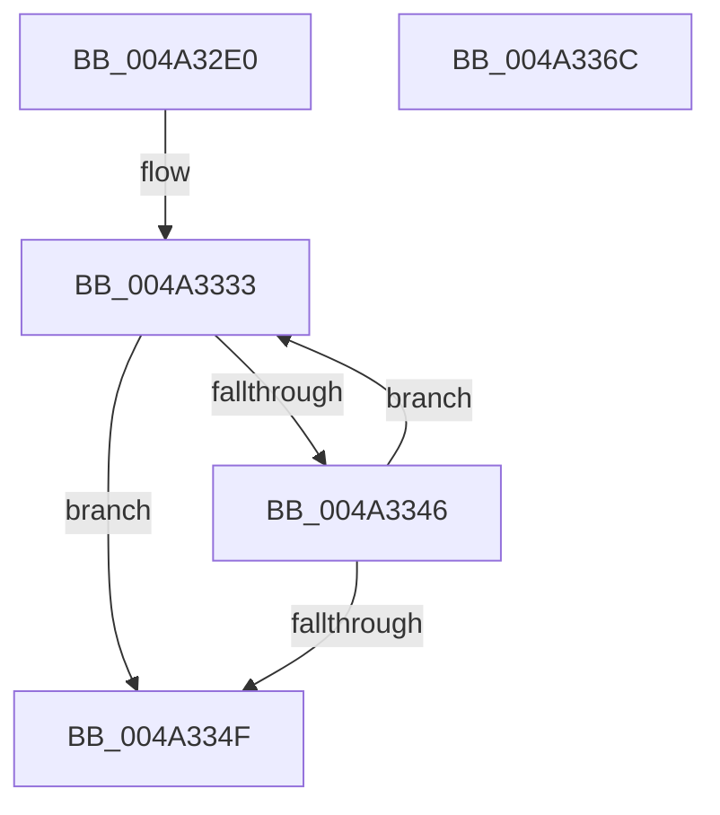

# MiFreeUltraMdlContext

- RVA: `0x004A32E0`–`0x004A336D` (길이 `141` bytes)
- VA: `0x00000001404A32E0`
- 실행 섹션: `.text`
- PDB 이름 있음: `예`; PDB Function 태그: `아니요`
- unwind 정보 RVA: `0x0005C788`
- 디코드: `39`개 명령, `141/141` bytes 표시
- 미해석 바이트: `0` (있으면 어셈블리에 `.byte`로 보존)

> 이 문서는 커널 이미지의 기계어와 PDB 기호를 분석해 생성했습니다. 4번과 5번은 함수 원형과 자료형을 바이너리 사용 방식에서 추정한 C 해석이며 원본 소스 복구 결과는 아닙니다.

## 1. Dependencies

- 직접 호출 지점: **1**; 고유 호출 대상: **1**
- 직접 호출자로 확인된 함수: **1**
- RIP 상대 이미지 참조: **3**

### Outgoing calls
- `0x004A3362` → [ExpInterlockedPushEntrySList](../6B/ExpInterlockedPushEntrySList_function_006BA5B0.md) (function, `0x006BA5B0`)

### Direct callers
- [MmMapMdl](../67/MmMapMdl_function_0067CBA0.md) at `0x0067CD86`

### Static image references
- `0x004A32E4` → RVA `0x00FC5000` (`ALMOSTRO`; read)
- `0x004A32EE` → RVA `0x00E36020` (`.data`; read)
- `0x004A332A` → RVA `0x00E36028` (`.data`; read)

## 2. Other-region calls and transfers

- 다른 실행 섹션으로 향하는 call: **0**
- 별도 외부 분기/꼬리 이동을 확인하지 못했습니다.

## 3. Assembly (complete function range)

```asm
004A32E0  48 83 EC 28                     sub rsp, 0x28
004A32E4  44 0F B7 05 14 1D B2 00         movzx r8d, word ptr [rip + 0xb21d14]
004A32EC  33 D2                           xor edx, edx
004A32EE  8B 05 2C 2D 99 00               mov eax, dword ptr [rip + 0x992d2c]
004A32F4  4C 8B D1                        mov r10, rcx
004A32F7  65 48 8B 0C 25 20 00 00 00      mov rcx, qword ptr gs:[0x20]
004A3300  41 F7 F0                        div r8d
004A3303  44 8B C8                        mov r9d, eax
004A3306  41 C1 E9 03                     shr r9d, 3
004A330A  0F 31                           rdtsc
004A330C  48 8B 89 C0 00 00 00            mov rcx, qword ptr [rcx + 0xc0]
004A3313  48 C1 E2 20                     shl rdx, 0x20
004A3317  48 0B D0                        or rdx, rax
004A331A  48 C1 EA 04                     shr rdx, 4
004A331E  44 0F B7 81 8A 00 00 00         movzx r8d, word ptr [rcx + 0x8a]
004A3326  49 C1 E0 09                     shl r8, 9
004A332A  4C 03 05 F7 2C 99 00            add r8, qword ptr [rip + 0x992cf7]
004A3331  33 C9                           xor ecx, ecx
004A3333  83 E2 07                        and edx, 7
004A3336  8B C2                           mov eax, edx
004A3338  48 C1 E0 06                     shl rax, 6
004A333C  42 0F B7 04 00                  movzx eax, word ptr [rax + r8]
004A3341  41 3B C1                        cmp eax, r9d
004A3344  76 09                           jbe 0x1404a334f
004A3346  FF C2                           inc edx
004A3348  FF C1                           inc ecx
004A334A  83 F9 10                        cmp ecx, 0x10
004A334D  72 E4                           jb 0x1404a3333
004A334F  83 FA 08                        cmp edx, 8
004A3352  1B C0                           sbb eax, eax
004A3354  23 C2                           and eax, edx
004A3356  49 8B D2                        mov rdx, r10
004A3359  8B C8                           mov ecx, eax
004A335B  48 C1 E1 06                     shl rcx, 6
004A335F  49 03 C8                        add rcx, r8
004A3362  E8 49 72 21 00                  call 0x1406ba5b0
004A3367  48 83 C4 28                     add rsp, 0x28
004A336B  C3                              ret
004A336C  CC                              int3
```

## 4. C-style interpretation (structured pseudocode)

```c
__int64 __fastcall MiFreeUltraMdlContext(__int64 a1, int a2)
{
    __int64 result;
    __int64 v_rsp;

    v_rsp = (v_rsp) - (40);
    a2 = 0;
    a4 = (unsigned int)(((unsigned int)((unsigned int)((unsigned int)(*(unsigned int *)(v_rip + 10038572))))) >> (3));
    a2 = (a2) << (32);
    a2 = (a2) | ((unsigned int)(*(unsigned int *)(v_rip + 10038572)));
    a2 = (a2) >> (4);
    a3 = (*(unsigned __int16 *)(*(unsigned __int64 *)(*(unsigned __int64 *)(gs_base + (0 + 32)) + 192) + 138)) << (9);
    a3 = (a3) + (*(unsigned __int64 *)(v_rip + 10038519));
    a1 = 0;
loc_004A3333:
    a2 = (unsigned int)((a2) & (7));
    result = ((unsigned int)(a2)) << (6);
    if (((unsigned int)(*(unsigned __int16 *)(result + a3 * 1))) <= ((unsigned int)(a4))) goto loc_004A334F;
    a2 = (unsigned int)((a2) + 1);
    a1 = (unsigned int)((a1) + 1);
    if (((unsigned int)(a1)) < 16) goto loc_004A3333;
loc_004A334F:
    result = (unsigned int)((*(unsigned __int16 *)(result + a3 * 1)) & (a2));
    a1 = ((unsigned int)((unsigned int)(result))) << (6);
    a1 = (a1) + (a3);
    result = ExpInterlockedPushEntrySList(a1, a1, a3, a4);
    v_rsp = (v_rsp) + (40);
    return result;
}
```

## 5. (Beta) C Style

```c
int64_t MiFreeUltraMdlContext(int64_t Arg1, int32_t Arg2)
{
    int64_t result;
    int64_t local_rsp;

    local_rsp = (local_rsp) - (40);
    Arg2 = 0;
    a4 = (uint32_t)(((uint32_t)((uint32_t)((uint32_t)(*(uint32_t *)(v_rip + 0x992D2C))))) >> (3));
    Arg2 = (Arg2) << (32);
    Arg2 = (Arg2) | ((uint32_t)(*(uint32_t *)(v_rip + 0x992D2C)));
    Arg2 = (Arg2) >> (4);
    a3 = (*(uint16_t *)(*(uint64_t *)(*(uint64_t *)(gs_base + (0 + 0x20)) + 0xC0) + 0x8A)) << (9);
    a3 = (a3) + (*(uint64_t *)(v_rip + 0x992CF7));
    Arg1 = 0;
loc_004A3333:
    Arg2 = (uint32_t)((Arg2) & (7));
    result = ((uint32_t)(Arg2)) << (6);
    if (((uint32_t)(*(uint16_t *)(result + a3 * 1))) <= ((uint32_t)(a4))) goto loc_004A334F;
    Arg2 = (uint32_t)((Arg2) + 1);
    Arg1 = (uint32_t)((Arg1) + 1);
    if (((uint32_t)(Arg1)) < 16) goto loc_004A3333;
loc_004A334F:
    result = (uint32_t)((*(uint16_t *)(result + a3 * 1)) & (Arg2));
    Arg1 = ((uint32_t)((uint32_t)(result))) << (6);
    Arg1 = (Arg1) + (a3);
    result = ExpInterlockedPushEntrySList(Arg1, Arg1, a3, a4);
    local_rsp = (local_rsp) + (40);
    return result;
}
```

## 6. Execution-region graph

[열기: 2D/3D 그래프와 함수 탐색 컨트롤 패널](../../../control-panel.html?section=text&rva=0x004A32E0&view=graph)

- 2D 그래프는 위에서 아래로 흐르고, 3D 그래프는 빈 공간을 드래그해 회전합니다. Shift+드래그는 이동, 휠은 확대·축소, 함수 노드 선택은 대상 보고서 이동입니다.

### Static fallback


