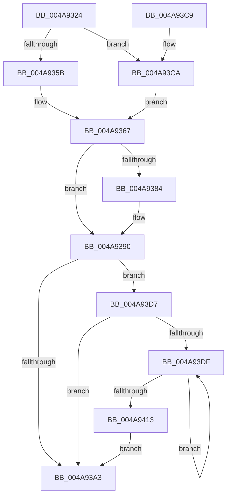

# MiGetCachedPoolPages

- RVA: `0x004A9324`–`0x004A9419` (길이 `245` bytes)
- VA: `0x00000001404A9324`
- 실행 섹션: `.text`
- PDB 이름 있음: `예`; PDB Function 태그: `아니요`
- unwind 정보 RVA: `0x000B7A64`
- 디코드: `69`개 명령, `245/245` bytes 표시
- 미해석 바이트: `0` (있으면 어셈블리에 `.byte`로 보존)

> 이 문서는 커널 이미지의 기계어와 PDB 기호를 분석해 생성했습니다. 4번과 5번은 함수 원형과 자료형을 바이너리 사용 방식에서 추정한 C 해석이며 원본 소스 복구 결과는 아닙니다.

## 1. Dependencies

- 직접 호출 지점: **5**; 고유 호출 대상: **5**
- 직접 호출자로 확인된 함수: **1**
- RIP 상대 이미지 참조: **1**

### Outgoing calls
- `0x004A9362` → [ExAcquireSpinLockExclusiveAtDpcLevel](../24/ExAcquireSpinLockExclusiveAtDpcLevel_function_00248E80.md) (function, `0x00248E80`)
- `0x004A938B` → [MiSplitPageChain](MiSplitPageChain_function_004A9420.md) (function, `0x004A9420`)
- `0x004A9396` → [MiReleaseSpinLockExclusive](../24/MiReleaseSpinLockExclusive_function_002482C0.md) (function, `0x002482C0`)
- `0x004A93CD` → [ExAcquireSpinLockExclusive](../24/ExAcquireSpinLockExclusive_function_00248690.md) (function, `0x00248690`)
- `0x004A9406` → [MiFillPhysicalPages](../33/MiFillPhysicalPages_function_00332910.md) (function, `0x00332910`)

### Direct callers
- [MiGetPoolPages](../32/MiGetPoolPages_function_00327D3C.md) at `0x00327DA1`

### Static image references
- `0x004A934A` → RVA `0x00E2DBF8` (`.data`; read)

## 2. Other-region calls and transfers

- 다른 실행 섹션으로 향하는 call: **0**
- 별도 외부 분기/꼬리 이동을 확인하지 못했습니다.

## 3. Assembly (complete function range)

```asm
004A9324  48 89 5C 24 08                  mov qword ptr [rsp + 8], rbx
004A9329  48 89 6C 24 10                  mov qword ptr [rsp + 0x10], rbp
004A932E  48 89 74 24 18                  mov qword ptr [rsp + 0x18], rsi
004A9333  57                              push rdi
004A9334  41 56                           push r14
004A9336  41 57                           push r15
004A9338  48 83 EC 20                     sub rsp, 0x20
004A933C  8B 41 60                        mov eax, dword ptr [rcx + 0x60]
004A933F  48 8B D9                        mov rbx, rcx
004A9342  48 8D 34 40                     lea rsi, [rax + rax*2]
004A9346  48 C1 E6 07                     shl rsi, 7
004A934A  48 03 35 A7 48 98 00            add rsi, qword ptr [rip + 0x9848a7]
004A9351  80 79 66 02                     cmp byte ptr [rcx + 0x66], 2
004A9355  4C 8D 7E 48                     lea r15, [rsi + 0x48]
004A9359  75 6F                           jne 0x1404a93ca
004A935B  C6 41 67 11                     mov byte ptr [rcx + 0x67], 0x11
004A935F  49 8B CF                        mov rcx, r15
004A9362  E8 19 FB D9 FF                  call 0x140248e80
004A9367  48 8B 46 60                     mov rax, qword ptr [rsi + 0x60]
004A936B  48 8D 7B 08                     lea rdi, [rbx + 8]
004A936F  48 8B 17                        mov rdx, qword ptr [rdi]
004A9372  4C 8D 73 10                     lea r14, [rbx + 0x10]
004A9376  48 3B C2                        cmp rax, rdx
004A9379  48 0F 46 D0                     cmovbe rdx, rax
004A937D  33 ED                           xor ebp, ebp
004A937F  48 85 D2                        test rdx, rdx
004A9382  74 0C                           je 0x1404a9390
004A9384  48 8D 4E 50                     lea rcx, [rsi + 0x50]
004A9388  4D 8B C6                        mov r8, r14
004A938B  E8 90 00 00 00                  call 0x1404a9420
004A9390  8A 53 67                        mov dl, byte ptr [rbx + 0x67]
004A9393  49 8B CF                        mov rcx, r15
004A9396  E8 25 EF D9 FF                  call 0x1402482c0
004A939B  66 0F BA 63 64 09               bt word ptr [rbx + 0x64], 9
004A93A1  72 34                           jb 0x1404a93d7
004A93A3  48 8B 0F                        mov rcx, qword ptr [rdi]
004A93A6  48 39 4B 20                     cmp qword ptr [rbx + 0x20], rcx
004A93AA  48 8B 5C 24 40                  mov rbx, qword ptr [rsp + 0x40]
004A93AF  48 8B 74 24 50                  mov rsi, qword ptr [rsp + 0x50]
004A93B4  40 0F 94 C5                     sete bpl
004A93B8  8B C5                           mov eax, ebp
004A93BA  48 8B 6C 24 48                  mov rbp, qword ptr [rsp + 0x48]
004A93BF  48 83 C4 20                     add rsp, 0x20
004A93C3  41 5F                           pop r15
004A93C5  41 5E                           pop r14
004A93C7  5F                              pop rdi
004A93C8  C3                              ret
004A93C9  CC                              int3
004A93CA  49 8B CF                        mov rcx, r15
004A93CD  E8 BE F2 D9 FF                  call 0x140248690
004A93D2  88 43 67                        mov byte ptr [rbx + 0x67], al
004A93D5  EB 90                           jmp 0x1404a9367
004A93D7  49 8B 36                        mov rsi, qword ptr [r14]
004A93DA  48 85 F6                        test rsi, rsi
004A93DD  74 C4                           je 0x1404a93a3
004A93DF  48 B8 00 00 00 00 00 DE FF FF   movabs rax, 0xffffde0000000000
004A93E9  48 8B D6                        mov rdx, rsi
004A93EC  45 33 C9                        xor r9d, r9d
004A93EF  48 2B D0                        sub rdx, rax
004A93F2  33 C9                           xor ecx, ecx
004A93F4  48 C1 FA 04                     sar rdx, 4
004A93F8  48 B8 AB AA AA AA AA AA AA AA   movabs rax, 0xaaaaaaaaaaaaaaab
004A9402  48 0F AF D0                     imul rdx, rax
004A9406  E8 05 95 E8 FF                  call 0x140332910
004A940B  48 8B 36                        mov rsi, qword ptr [rsi]
004A940E  48 85 F6                        test rsi, rsi
004A9411  75 CC                           jne 0x1404a93df
004A9413  48 8D 7B 08                     lea rdi, [rbx + 8]
004A9417  EB 8A                           jmp 0x1404a93a3
```

## 4. C-style interpretation (structured pseudocode)

```c
__int64 __fastcall MiGetCachedPoolPages(__int64 a1, __int64 a2, __int64 a3, int a4)
{
    __int64 result;
    __int64 v_rbp;
    __int64 v_rsi;
    __int64 v_rsp;
    unsigned __int64 v_stack_p10;
    unsigned __int64 v_stack_p18;
    unsigned __int64 v_stack_p8;

    v_stack_p8 = v_rbx;
    v_stack_p10 = v_rbp;
    v_stack_p18 = v_rsi;
    v_rsp = (v_rsp) - (32);
    v_rsi = ((unsigned int)(*(unsigned int *)(a1 + 96)) + (unsigned int)(*(unsigned int *)(a1 + 96)) * 2) << (7);
    v_rsi = (v_rsi) + (*(unsigned __int64 *)(v_rip + 9980071));
    if ((*(unsigned __int8 *)(a1 + 102)) != 2) goto loc_004A93CA;
    *(unsigned __int8 *)(a1 + 103) = 17;
    result = ExAcquireSpinLockExclusiveAtDpcLevel(v_rsi + 72, a2, a3, a4);
loc_004A9367:
    a2 = *(unsigned __int64 *)(a1 + 8);
    if ((*(unsigned __int64 *)(v_rsi + 96)) <= (*(unsigned __int64 *)(a1 + 8))) { a2 = *(unsigned __int64 *)(v_rsi + 96); }
    v_rbp = 0;
    result = *(unsigned __int64 *)(v_rsi + 96);
    if (a2 != 0) {
        a1 = v_rsi + 80;
        a3 = a1 + 16;
        result = MiSplitPageChain(a1, a2, a3, a4);
    }
    result = MiReleaseSpinLockExclusive(v_rsi + 72, *(unsigned __int8 *)(a1 + 103), a3, a4);
    if (condition_is_below) goto loc_004A93D7;
loc_004A93A3:
    v_rbp = ((*(unsigned __int64 *)(a1 + 32)) == (*(unsigned __int64 *)(a1 + 8))) ? 1 : 0;
    v_rsp = (v_rsp) + (32);
    return (unsigned int)((unsigned int)(v_rbp));
loc_004A93CA:
    result = ExAcquireSpinLockExclusive(v_rsi + 72, *(unsigned __int8 *)(a1 + 103), a3, a4);
    *(unsigned __int8 *)(v_stack_p8 + 103) = (unsigned __int8)(result);
    goto loc_004A9367;
loc_004A93D7:
    if (*(unsigned __int64 *)(a1 + 16) == 0) goto loc_004A93A3;
loc_004A93DF:
    a4 = 0;
    a2 = (*(unsigned __int64 *)(a1 + 16)) - (result);
    a1 = 0;
    a2 = (a2) >> (4);
    a2 = (a2) * (result);
    result = MiFillPhysicalPages(a1, a2, a3, a4);
    if (*(unsigned __int64 *)(*(unsigned __int64 *)(a1 + 16)) != 0) goto loc_004A93DF;
    goto loc_004A93A3;
}
```

## 5. (Beta) C Style

```c
int64_t MiGetCachedPoolPages(void *Arg1, int64_t Arg2, int64_t Arg3, int32_t Arg4)
{
    uint8_t *arg1 = (uint8_t *)Arg1;

    int64_t result;
    int64_t local_rbp;
    int64_t local_rsi;
    int64_t local_rsp;
    uint64_t v_stack_p10;
    uint64_t v_stack_p18;
    uint64_t v_stack_p8;

    v_stack_p8 = local_rbx;
    v_stack_p10 = local_rbp;
    v_stack_p18 = local_rsi;
    local_rsp = (local_rsp) - (32);
    local_rsi = ((uint32_t)(*(uint32_t *)(arg1 + 0x60)) + (uint32_t)(*(uint32_t *)(arg1 + 0x60)) * 2) << (7);
    local_rsi = (local_rsi) + (*(uint64_t *)(v_rip + 0x9848A7));
    if ((*(uint8_t *)(arg1 + 0x66)) != 2) goto loc_004A93CA;
    *(uint8_t *)(arg1 + 0x67) = 17;
    result = ExAcquireSpinLockExclusiveAtDpcLevel(local_rsi + 72, Arg2, Arg3, Arg4);
loc_004A9367:
    Arg2 = *(uint64_t *)(arg1 + 0x8);
    if ((*(uint64_t *)(local_rsi + 0x60)) <= (*(uint64_t *)(arg1 + 0x8))) { Arg2 = *(uint64_t *)(local_rsi + 0x60); }
    local_rbp = 0;
    result = *(uint64_t *)(local_rsi + 0x60);
    if (Arg2 != 0) {
        Arg1 = local_rsi + 80;
        Arg3 = Arg1 + 16;
        result = MiSplitPageChain(Arg1, Arg2, Arg3, Arg4);
    }
    result = MiReleaseSpinLockExclusive(local_rsi + 72, *(uint8_t *)(arg1 + 0x67), Arg3, Arg4);
    if (condition_is_below) goto loc_004A93D7;
loc_004A93A3:
    local_rbp = ((*(uint64_t *)(arg1 + 0x20)) == (*(uint64_t *)(arg1 + 0x8))) ? 1 : 0;
    local_rsp = (local_rsp) + (32);
    return (uint32_t)((uint32_t)(local_rbp));
loc_004A93CA:
    result = ExAcquireSpinLockExclusive(local_rsi + 72, *(uint8_t *)(arg1 + 0x67), Arg3, Arg4);
    *(uint8_t *)(v_stack_p8 + 0x67) = (uint8_t)(result);
    goto loc_004A9367;
loc_004A93D7:
    if (*(uint64_t *)(arg1 + 0x10) == 0) goto loc_004A93A3;
loc_004A93DF:
    Arg4 = 0;
    Arg2 = (*(uint64_t *)(arg1 + 0x10)) - (result);
    Arg1 = 0;
    Arg2 = (Arg2) >> (4);
    Arg2 = (Arg2) * (result);
    result = MiFillPhysicalPages(Arg1, Arg2, Arg3, Arg4);
    if (*(uint64_t *)(*(uint64_t *)(arg1 + 0x10)) != 0) goto loc_004A93DF;
    goto loc_004A93A3;
}
```

### 관측된 메모리 오프셋

구조체 형식이 확인되지 않은 접근은 인자 기준의 오프셋으로만 기록했습니다.

| 기준 인자 | 오프셋 표현 | 폭 (bit) | 접근 |
|---|---:|---:|---|
| `Arg1` | `+ 0x0` | `64` | `R` |
| `Arg1` | `+ 0x8` | `64` | `R` |
| `Arg1` | `+ 0x10` | `64` | `R` |
| `Arg1` | `+ 0x20` | `64` | `R` |
| `Arg1` | `+ 0x60` | `32` | `R` |
| `Arg1` | `+ 0x64` | `16` | `R` |
| `Arg1` | `+ 0x66` | `8` | `R` |
| `Arg1` | `+ 0x67` | `8` | `R` |
| `Arg1` | `+ 0x67` | `8` | `W` |

## 6. Execution-region graph

[열기: 2D/3D 그래프와 함수 탐색 컨트롤 패널](../../../control-panel.html?section=text&rva=0x004A9324&view=graph)

- 2D 그래프는 위에서 아래로 흐르고, 3D 그래프는 빈 공간을 드래그해 회전합니다. Shift+드래그는 이동, 휠은 확대·축소, 함수 노드 선택은 대상 보고서 이동입니다.

### Static fallback


