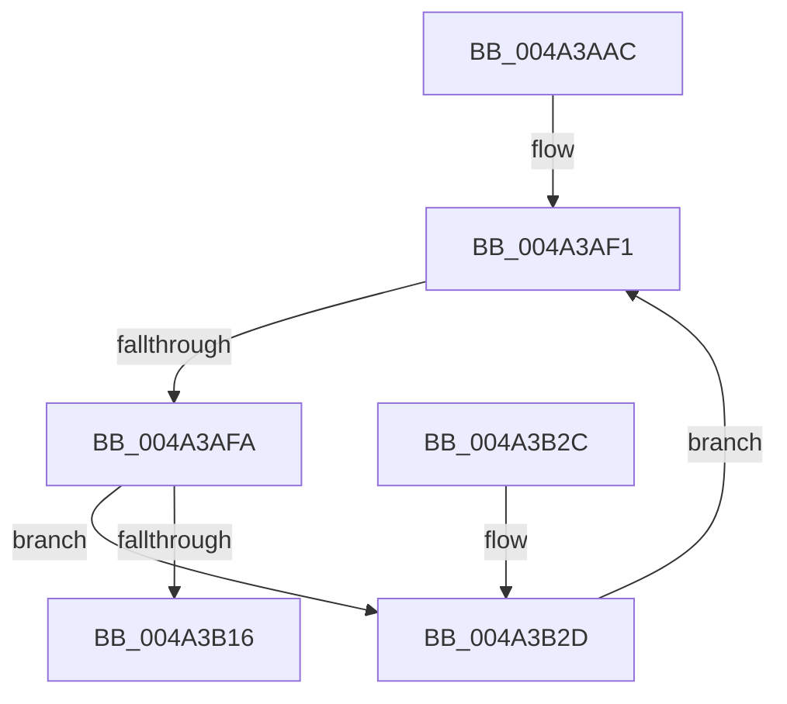

# MiGetUltraMdlContext

- RVA: `0x004A3AAC`–`0x004A3B33` (길이 `135` bytes)
- VA: `0x00000001404A3AAC`
- 실행 섹션: `.text`
- PDB 이름 있음: `예`; PDB Function 태그: `예`
- unwind 정보 RVA: `0x000B643C`
- 디코드: `36`개 명령, `135/135` bytes 표시
- 미해석 바이트: `0` (있으면 어셈블리에 `.byte`로 보존)

> 이 문서는 커널 이미지의 기계어와 PDB 기호를 분석해 생성했습니다. 4번과 5번은 함수 원형과 자료형을 바이너리 사용 방식에서 추정한 C 해석이며 원본 소스 복구 결과는 아닙니다.

## 1. Dependencies

- 직접 호출 지점: **1**; 고유 호출 대상: **1**
- 직접 호출자로 확인된 함수: **1**
- RIP 상대 이미지 참조: **1**

### Outgoing calls
- `0x004A3B0C` → [ExpInterlockedPopEntrySList](../6B/ExpInterlockedPopEntrySList_function_006BA570.md) (function, `0x006BA570`)

### Direct callers
- [MmMapMdl](../67/MmMapMdl_function_0067CBA0.md) at `0x0067CC5F`

### Static image references
- `0x004A3B05` → RVA `0x00E36028` (`.data`; read)

## 2. Other-region calls and transfers

- 다른 실행 섹션으로 향하는 call: **0**
- call이 아닌 외부 분기/꼬리 이동: **1**
  - `0x004A3AF4` → [sub_006F9120](../6F/Unknown_function_006F9120.md) (`tail-transfer`)

## 3. Assembly (complete function range)

```asm
004A3AAC  48 8B C4                        mov rax, rsp
004A3AAF  48 89 58 08                     mov qword ptr [rax + 8], rbx
004A3AB3  48 89 70 10                     mov qword ptr [rax + 0x10], rsi
004A3AB7  48 89 78 18                     mov qword ptr [rax + 0x18], rdi
004A3ABB  41 56                           push r14
004A3ABD  48 83 EC 30                     sub rsp, 0x30
004A3AC1  0F 57 C0                        xorps xmm0, xmm0
004A3AC4  0F 11 40 E8                     movups xmmword ptr [rax - 0x18], xmm0
004A3AC8  65 48 8B 04 25 20 00 00 00      mov rax, qword ptr gs:[0x20]
004A3AD1  48 8B 88 C0 00 00 00            mov rcx, qword ptr [rax + 0xc0]
004A3AD8  0F B7 99 8A 00 00 00            movzx ebx, word ptr [rcx + 0x8a]
004A3ADF  0F 31                           rdtsc
004A3AE1  48 C1 E2 20                     shl rdx, 0x20
004A3AE5  48 0B C2                        or rax, rdx
004A3AE8  48 8B F8                        mov rdi, rax
004A3AEB  48 C1 EF 04                     shr rdi, 4
004A3AEF  33 F6                           xor esi, esi
004A3AF1  83 FE 08                        cmp esi, 8
004A3AF4  0F 83 26 56 25 00               jae 0x1406f9120
004A3AFA  83 E7 07                        and edi, 7
004A3AFD  48 8D 0C DF                     lea rcx, [rdi + rbx*8]
004A3B01  48 C1 E1 06                     shl rcx, 6
004A3B05  48 03 0D 1C 25 99 00            add rcx, qword ptr [rip + 0x99251c]
004A3B0C  E8 5F 6A 21 00                  call 0x1406ba570
004A3B11  48 85 C0                        test rax, rax
004A3B14  74 17                           je 0x1404a3b2d
004A3B16  48 8B 5C 24 40                  mov rbx, qword ptr [rsp + 0x40]
004A3B1B  48 8B 74 24 48                  mov rsi, qword ptr [rsp + 0x48]
004A3B20  48 8B 7C 24 50                  mov rdi, qword ptr [rsp + 0x50]
004A3B25  48 83 C4 30                     add rsp, 0x30
004A3B29  41 5E                           pop r14
004A3B2B  C3                              ret
004A3B2C  CC                              int3
004A3B2D  FF C7                           inc edi
004A3B2F  FF C6                           inc esi
004A3B31  EB BE                           jmp 0x1404a3af1
```

## 4. C-style interpretation (structured pseudocode)

```c
__int64 __fastcall MiGetUltraMdlContext(__int64 a1, __int64 a2)
{
    __int64 result;
    __int64 v_rdi;
    __int64 v_rsi;
    __int64 v_rsp;
    unsigned __int64 v_stack_p10;
    unsigned __int64 v_stack_p18;
    unsigned __int64 v_stack_p8;

    *(unsigned __int64 *)(v_rsp + 8) = v_rbx;
    *(unsigned __int64 *)(v_rsp + 16) = v_rsi;
    *(unsigned __int64 *)(v_rsp + 24) = v_rdi;
    v_rsp = (v_rsp) - (48);
    *(unsigned __int64 *)(v_rsp - 24) = v_xmm0;
    a2 = (a2) << (32);
    result = (*(unsigned __int64 *)(gs_base + (0 + 32))) | (a2);
    v_rdi = (result) >> (4);
    v_rsi = 0;
loc_004A3AF1:
    v_rdi = (unsigned int)((v_rdi) & (7));
    a1 = (v_rdi + *(unsigned __int16 *)(*(unsigned __int64 *)(*(unsigned __int64 *)(gs_base + (0 + 32)) + 192) + 138) * 8) << (6);
    a1 = (a1) + (*(unsigned __int64 *)(v_rip + 10036508));
    result = ExpInterlockedPopEntrySList(a1, a2, a3, a4);
    if (result == 0) goto loc_004A3B2D;
    v_rsp = (v_rsp) + (48);
    return result;
loc_004A3B2D:
    v_rdi = (unsigned int)((v_stack_p18) + 1);
    v_rsi = (unsigned int)((v_stack_p10) + 1);
    goto loc_004A3AF1;
}
```

## 5. (Beta) C Style

```c
int64_t MiGetUltraMdlContext(int64_t Arg1, int64_t Arg2)
{
    int64_t result;
    int64_t local_rdi;
    int64_t local_rsi;
    int64_t local_rsp;
    uint64_t v_stack_p10;
    uint64_t v_stack_p18;
    uint64_t v_stack_p8;

    *(uint64_t *)(local_rsp + 0x8) = local_rbx;
    *(uint64_t *)(local_rsp + 0x10) = local_rsi;
    *(uint64_t *)(local_rsp + 0x18) = local_rdi;
    local_rsp = (local_rsp) - (48);
    *(uint64_t *)(local_rsp - 0x18) = v_xmm0;
    Arg2 = (Arg2) << (32);
    result = (*(uint64_t *)(gs_base + (0 + 0x20))) | (Arg2);
    local_rdi = (result) >> (4);
    local_rsi = 0;
loc_004A3AF1:
    local_rdi = (uint32_t)((local_rdi) & (7));
    Arg1 = (local_rdi + *(uint16_t *)(*(uint64_t *)(*(uint64_t *)(gs_base + (0 + 0x20)) + 0xC0) + 0x8A) * 8) << (6);
    Arg1 = (Arg1) + (*(uint64_t *)(v_rip + 0x99251C));
    result = ExpInterlockedPopEntrySList(Arg1, Arg2, a3, a4);
    if (result == 0) goto loc_004A3B2D;
    local_rsp = (local_rsp) + (48);
    return result;
loc_004A3B2D:
    local_rdi = (uint32_t)((v_stack_p18) + 1);
    local_rsi = (uint32_t)((v_stack_p10) + 1);
    goto loc_004A3AF1;
}
```

## 6. Execution-region graph

[열기: 2D/3D 그래프와 함수 탐색 컨트롤 패널](../../../control-panel.html?section=text&rva=0x004A3AAC&view=graph)

- 2D 그래프는 위에서 아래로 흐르고, 3D 그래프는 빈 공간을 드래그해 회전합니다. Shift+드래그는 이동, 휠은 확대·축소, 함수 노드 선택은 대상 보고서 이동입니다.

### Static fallback


