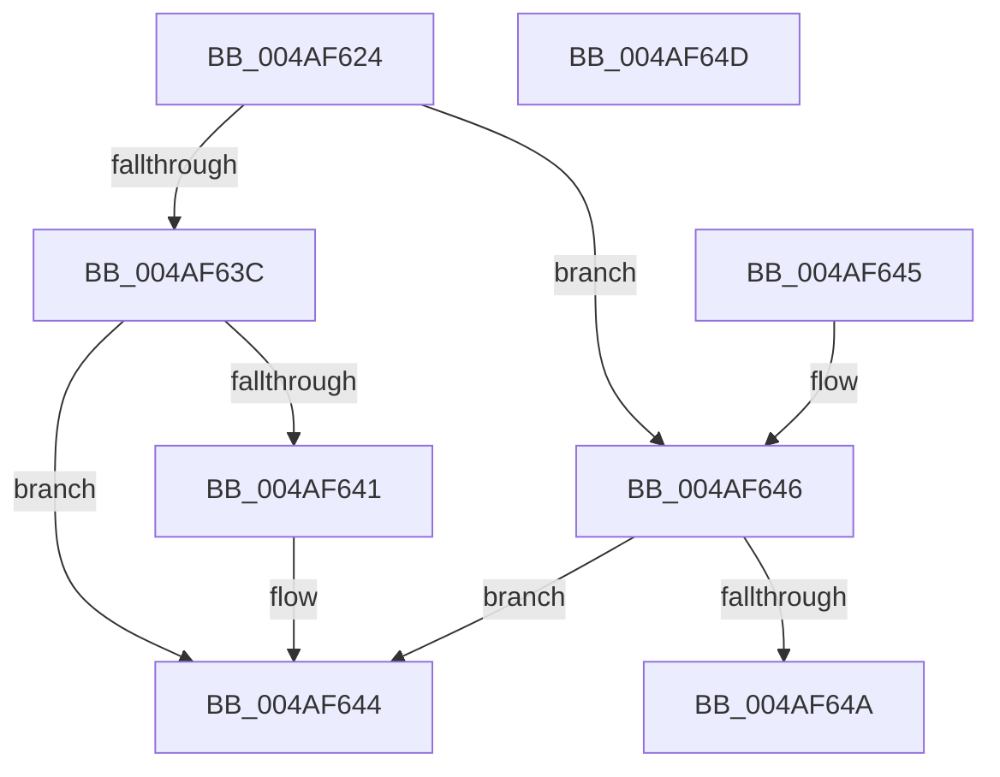

# MiGetVadCacheAttribute

- RVA: `0x004AF624`–`0x004AF64E` (길이 `42` bytes)
- VA: `0x00000001404AF624`
- 실행 섹션: `.text`
- PDB 이름 있음: `예`; PDB Function 태그: `아니요`
- unwind 정보 RVA: `0x000DB714`
- 디코드: `18`개 명령, `42/42` bytes 표시
- 미해석 바이트: `0` (있으면 어셈블리에 `.byte`로 보존)

> 이 문서는 커널 이미지의 기계어와 PDB 기호를 분석해 생성했습니다. 4번과 5번은 함수 원형과 자료형을 바이너리 사용 방식에서 추정한 C 해석이며 원본 소스 복구 결과는 아닙니다.

## 1. Dependencies

- 직접 호출 지점: **0**; 고유 호출 대상: **0**
- 직접 호출자로 확인된 함수: **8**
- RIP 상대 이미지 참조: **0**

### Outgoing calls
- 직접 디코드된 call 명령이 없습니다.

### Direct callers
- [MiProtectAweRegion](../4C/MiProtectAweRegion_function_004CE62C.md) at `0x004CE719`
- [MiReferenceIncomingPhysicalPages](../68/MiReferenceIncomingPhysicalPages_function_006892C0.md) at `0x00689311`
- [MiReferenceIncomingPhysicalPages](../68/MiReferenceIncomingPhysicalPages_function_006892C0.md) at `0x00689521`
- [MiProcessVaContiguityInformation](../69/MiProcessVaContiguityInformation_function_006939C0.md) at `0x00693B8D`
- [MiAllocateLargeProcessPagesFromCache](../69/MiAllocateLargeProcessPagesFromCache_function_0069818C.md) at `0x006981F9`
- [MmRotatePhysicalView](../../page/A3/MmRotatePhysicalView_function_00A37FE0.md) at `0x00A380A4`
- [MiRotateToFrameBuffer](../../page/A3/MiRotateToFrameBuffer_function_00A38214.md) at `0x00A38267`
- [MiRotateToFrameBufferNoCopy](../../page/A3/MiRotateToFrameBufferNoCopy_function_00A38530.md) at `0x00A3859C`
- [MiReplaceRotateWithDemandZero](../../page/A7/MiReplaceRotateWithDemandZero_function_00A7C010.md) at `0x00A7C171`

### Static image references
- 디코드된 RIP-relative 메모리 참조가 없습니다.

## 2. Other-region calls and transfers

- 다른 실행 섹션으로 향하는 call: **0**
- 별도 외부 분기/꼬리 이동을 확인하지 못했습니다.

## 3. Assembly (complete function range)

```asm
004AF624  8B 51 30                        mov edx, dword ptr [rcx + 0x30]
004AF627  B8 01 00 00 00                  mov eax, 1
004AF62C  C1 EA 07                        shr edx, 7
004AF62F  83 E2 1F                        and edx, 0x1f
004AF632  8B CA                           mov ecx, edx
004AF634  C1 E9 03                        shr ecx, 3
004AF637  83 F9 03                        cmp ecx, 3
004AF63A  75 0A                           jne 0x1404af646
004AF63C  F6 C2 07                        test dl, 7
004AF63F  74 03                           je 0x1404af644
004AF641  8D 41 FF                        lea eax, [rcx - 1]
004AF644  C3                              ret
004AF645  CC                              int3
004AF646  3B C8                           cmp ecx, eax
004AF648  75 FA                           jne 0x1404af644
004AF64A  33 C0                           xor eax, eax
004AF64C  C3                              ret
004AF64D  CC                              int3
```

## 4. C-style interpretation (structured pseudocode)

```c
__int64 __fastcall MiGetVadCacheAttribute(__int64 a1)
{
    __int64 result;

    a2 = (unsigned int)(((unsigned int)(*(unsigned int *)(a1 + 48))) >> (7));
    a2 = (unsigned int)((a2) & (31));
    a1 = (unsigned int)(((unsigned int)((unsigned int)(a2))) >> (3));
    if (((unsigned int)(a1)) != 3) goto loc_004AF646;
    result = 1;
    if ((((unsigned __int8)(a2)) & (7)) != 0) {
        result = a1 - 1;
    }
    return result;
loc_004AF646:
    if (((unsigned int)(a1)) != ((unsigned int)(result))) goto loc_004AF644;
    result = 0;
    return result;
}
```

## 5. (Beta) C Style

```c
int64_t MiGetVadCacheAttribute(void *Arg1)
{
    uint8_t *arg1 = (uint8_t *)Arg1;

    int64_t result;

    a2 = (uint32_t)(((uint32_t)(*(uint32_t *)(arg1 + 0x30))) >> (7));
    a2 = (uint32_t)((a2) & (31));
    Arg1 = (uint32_t)(((uint32_t)((uint32_t)(a2))) >> (3));
    if (((uint32_t)(Arg1)) != 3) goto loc_004AF646;
    result = 1;
    if ((((uint8_t)(a2)) & (7)) != 0) {
        result = Arg1 - 1;
    }
    return result;
loc_004AF646:
    if (((uint32_t)(Arg1)) != ((uint32_t)(result))) goto loc_004AF644;
    result = 0;
    return result;
}
```

### 관측된 메모리 오프셋

구조체 형식이 확인되지 않은 접근은 인자 기준의 오프셋으로만 기록했습니다.

| 기준 인자 | 오프셋 표현 | 폭 (bit) | 접근 |
|---|---:|---:|---|
| `Arg1` | `+ 0x30` | `32` | `R` |

## 6. Execution-region graph

[열기: 2D/3D 그래프와 함수 탐색 컨트롤 패널](../../../control-panel.html?section=text&rva=0x004AF624&view=graph)

- 2D 그래프는 위에서 아래로 흐르고, 3D 그래프는 빈 공간을 드래그해 회전합니다. Shift+드래그는 이동, 휠은 확대·축소, 함수 노드 선택은 대상 보고서 이동입니다.

### Static fallback


