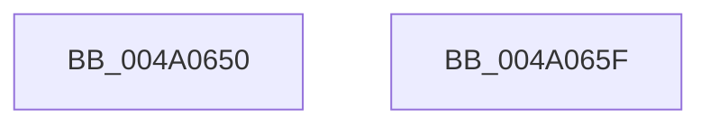

# MiHugePagesSupported

- RVA: `0x004A0650`–`0x004A0660` (길이 `16` bytes)
- VA: `0x00000001404A0650`
- 실행 섹션: `.text`
- PDB 이름 있음: `예`; PDB Function 태그: `아니요`
- unwind 정보 RVA: `0x000DB714`
- 디코드: `5`개 명령, `16/16` bytes 표시
- 미해석 바이트: `0` (있으면 어셈블리에 `.byte`로 보존)

> 이 문서는 커널 이미지의 기계어와 PDB 기호를 분석해 생성했습니다. 4번과 5번은 함수 원형과 자료형을 바이너리 사용 방식에서 추정한 C 해석이며 원본 소스 복구 결과는 아닙니다.

## 1. Dependencies

- 직접 호출 지점: **0**; 고유 호출 대상: **0**
- 직접 호출자로 확인된 함수: **4**
- RIP 상대 이미지 참조: **1**

### Outgoing calls
- 직접 디코드된 call 명령이 없습니다.

### Direct callers
- [MiAllocateUserPhysicalPages](../../page/80/MiAllocateUserPhysicalPages_function_00809828.md) at `0x00809971`
- [MmManagePartitionMoveMemory](../../page/80/MmManagePartitionMoveMemory_function_0080E1F4.md) at `0x0080E312`
- [MiInitializeCreateSectionPacket](../../page/98/MiInitializeCreateSectionPacket_function_00984130.md) at `0x009844DE`
- [sub_00B18DFE](../../page/B1/Unknown_function_00B18DFE.md) at `0x00B18E4E`

### Static image references
- `0x004A0650` → RVA `0x00FC6B30` (`ALMOSTRO`; read)

## 2. Other-region calls and transfers

- 다른 실행 섹션으로 향하는 call: **0**
- 별도 외부 분기/꼬리 이동을 확인하지 못했습니다.

## 3. Assembly (complete function range)

```asm
004A0650  48 8B 05 D9 64 B2 00            mov rax, qword ptr [rip + 0xb264d9]
004A0657  48 C1 E8 25                     shr rax, 0x25
004A065B  83 E0 01                        and eax, 1
004A065E  C3                              ret
004A065F  CC                              int3
```

## 4. C-style interpretation (structured pseudocode)

```c
__int64 __fastcall MiHugePagesSupported(void)
{
    __int64 result;

    result = (*(unsigned __int64 *)(v_rip + 11691225)) >> (37);
    result = (unsigned int)((result) & (1));
    return result;
}
```

## 5. (Beta) C Style

```c
void MiHugePagesSupported(void)
{
    int64_t result;

    result = (*(uint64_t *)(v_rip + 0xB264D9)) >> (37);
    result = (uint32_t)((result) & (1));
    return result;
}
```

## 6. Execution-region graph

[열기: 2D/3D 그래프와 함수 탐색 컨트롤 패널](../../../control-panel.html?section=text&rva=0x004A0650&view=graph)

- 2D 그래프는 위에서 아래로 흐르고, 3D 그래프는 빈 공간을 드래그해 회전합니다. Shift+드래그는 이동, 휠은 확대·축소, 함수 노드 선택은 대상 보고서 이동입니다.

### Static fallback


