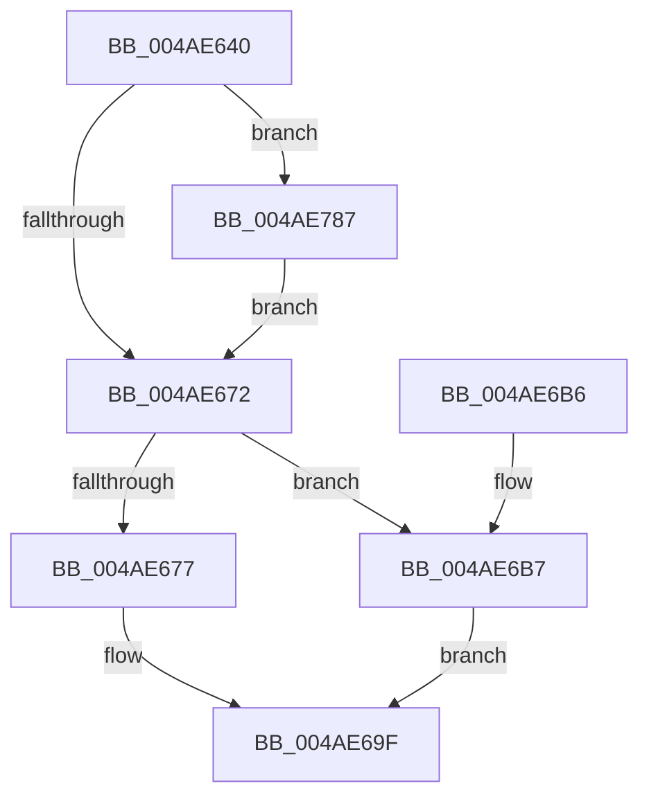

# MiInitializeWorkingSetList

- RVA: `0x004AE640`–`0x004AE7A6` (길이 `358` bytes)
- VA: `0x00000001404AE640`
- 실행 섹션: `.text`
- PDB 이름 있음: `예`; PDB Function 태그: `아니요`
- unwind 정보 RVA: `0x000B8620`
- 디코드: `81`개 명령, `358/358` bytes 표시
- 미해석 바이트: `0` (있으면 어셈블리에 `.byte`로 보존)

> 이 문서는 커널 이미지의 기계어와 PDB 기호를 분석해 생성했습니다. 4번과 5번은 함수 원형과 자료형을 바이너리 사용 방식에서 추정한 C 해석이며 원본 소스 복구 결과는 아닙니다.

## 1. Dependencies

- 직접 호출 지점: **5**; 고유 호출 대상: **5**
- 직접 호출자로 확인된 함수: **2**
- RIP 상대 이미지 참조: **1**

### Outgoing calls
- `0x004AE70A` → [MiLockWorkingSetShared](../27/MiLockWorkingSetShared_function_0027CBF0.md) (function, `0x0027CBF0`)
- `0x004AE717` → [MiLockNestedPageTable](../23/MiLockNestedPageTable_function_0023E890.md) (function, `0x0023E890`)
- `0x004AE768` → [MiAllocateWsle](../33/MiAllocateWsle_function_003332C0.md) (function, `0x003332C0`)
- `0x004AE773` → [MiUnlockPageTable](../21/MiUnlockPageTable_function_00216EC0.md) (function, `0x00216EC0`)
- `0x004AE77D` → [MiUnlockWorkingSetShared](../27/MiUnlockWorkingSetShared_function_0027D690.md) (function, `0x0027D690`)

### Direct callers
- [MiInitializeSystemWorkingSetList](../../page/7F/MiInitializeSystemWorkingSetList_function_007FB7D4.md) at `0x007FB8FD`
- [MmInitializeProcessAddressSpace](../../page/8C/MmInitializeProcessAddressSpace_function_008CF6B0.md) at `0x008CF798`

### Static image references
- `0x004AE74B` → RVA `0x00010880` (`.rdata`; read)

## 2. Other-region calls and transfers

- 다른 실행 섹션으로 향하는 call: **0**
- 별도 외부 분기/꼬리 이동을 확인하지 못했습니다.

## 3. Assembly (complete function range)

```asm
004AE640  48 89 5C 24 08                  mov qword ptr [rsp + 8], rbx
004AE645  48 89 6C 24 10                  mov qword ptr [rsp + 0x10], rbp
004AE64A  48 89 74 24 20                  mov qword ptr [rsp + 0x20], rsi
004AE64F  57                              push rdi
004AE650  48 83 EC 40                     sub rsp, 0x40
004AE654  8B 81 B8 00 00 00               mov eax, dword ptr [rcx + 0xb8]
004AE65A  48 8B E9                        mov rbp, rcx
004AE65D  0F B6 C8                        movzx ecx, al
004AE660  89 44 24 60                     mov dword ptr [rsp + 0x60], eax
004AE664  8B C1                           mov eax, ecx
004AE666  83 E0 0F                        and eax, 0xf
004AE669  41 3B C0                        cmp eax, r8d
004AE66C  0F 85 15 01 00 00               jne 0x1404ae787
004AE672  45 85 C0                        test r8d, r8d
004AE675  74 40                           je 0x1404ae6b7
004AE677  48 83 A5 80 00 00 00 00         and qword ptr [rbp + 0x80], 0
004AE67F  48 83 A5 88 00 00 00 00         and qword ptr [rbp + 0x88], 0
004AE687  48 83 A5 90 00 00 00 00         and qword ptr [rbp + 0x90], 0
004AE68F  48 83 A5 98 00 00 00 00         and qword ptr [rbp + 0x98], 0
004AE697  4C 89 4D 78                     mov qword ptr [rbp + 0x78], r9
004AE69B  48 89 55 10                     mov qword ptr [rbp + 0x10], rdx
004AE69F  48 8B 5C 24 50                  mov rbx, qword ptr [rsp + 0x50]
004AE6A4  33 C0                           xor eax, eax
004AE6A6  48 8B 6C 24 58                  mov rbp, qword ptr [rsp + 0x58]
004AE6AB  48 8B 74 24 68                  mov rsi, qword ptr [rsp + 0x68]
004AE6B0  48 83 C4 40                     add rsp, 0x40
004AE6B4  5F                              pop rdi
004AE6B5  C3                              ret
004AE6B6  CC                              int3
004AE6B7  48 C7 85 88 FE FF FF 01 00 00 00  mov qword ptr [rbp - 0x178], 1
004AE6C2  8B 85 B8 00 00 00               mov eax, dword ptr [rbp + 0xb8]
004AE6C8  48 89 55 10                     mov qword ptr [rbp + 0x10], rdx
004AE6CC  48 BE 68 DF BE 7D FB F6 FF FF   movabs rsi, 0xfffff6fb7dbedf68
004AE6D6  48 C1 EE 09                     shr rsi, 9
004AE6DA  48 BA F8 FF FF FF 7F 00 00 00   movabs rdx, 0x7ffffffff8
004AE6E4  48 23 F2                        and rsi, rdx
004AE6E7  48 B9 00 00 00 00 80 F6 FF FF   movabs rcx, 0xfffff68000000000
004AE6F1  48 8B C1                        mov rax, rcx
004AE6F4  48 03 F0                        add rsi, rax
004AE6F7  48 8B FE                        mov rdi, rsi
004AE6FA  48 C1 EF 09                     shr rdi, 9
004AE6FE  48 23 FA                        and rdi, rdx
004AE701  48 8B C1                        mov rax, rcx
004AE704  48 8B CD                        mov rcx, rbp
004AE707  48 03 F8                        add rdi, rax
004AE70A  E8 E1 E4 DC FF                  call 0x14027cbf0
004AE70F  48 8B D7                        mov rdx, rdi
004AE712  48 8B CD                        mov rcx, rbp
004AE715  8A D8                           mov bl, al
004AE717  E8 74 01 D9 FF                  call 0x14023e890
004AE71C  48 8B 0E                        mov rcx, qword ptr [rsi]
004AE71F  48 B8 FF FF FF FF FF 00 00 00   movabs rax, 0xffffffffff
004AE729  48 C1 E9 0C                     shr rcx, 0xc
004AE72D  48 23 C8                        and rcx, rax
004AE730  4C 8D 04 49                     lea r8, [rcx + rcx*2]
004AE734  49 C1 E0 04                     shl r8, 4
004AE738  48 B8 00 00 00 00 00 DE FF FF   movabs rax, 0xffffde0000000000
004AE742  48 83 64 24 30 00               and qword ptr [rsp + 0x30], 0
004AE748  4C 03 C0                        add r8, rax
004AE74B  48 8B 05 2E 21 B6 FF            mov rax, qword ptr [rip - 0x49ded2]
004AE752  45 33 C9                        xor r9d, r9d
004AE755  C7 44 24 28 20 00 00 00         mov dword ptr [rsp + 0x28], 0x20
004AE75D  48 8B D6                        mov rdx, rsi
004AE760  48 8B CD                        mov rcx, rbp
004AE763  48 89 44 24 20                  mov qword ptr [rsp + 0x20], rax
004AE768  E8 53 4B E8 FF                  call 0x1403332c0
004AE76D  48 8B D7                        mov rdx, rdi
004AE770  48 8B CD                        mov rcx, rbp
004AE773  E8 48 87 D6 FF                  call 0x140216ec0
004AE778  8A D3                           mov dl, bl
004AE77A  48 8B CD                        mov rcx, rbp
004AE77D  E8 0E EF DC FF                  call 0x14027d690
004AE782  E9 18 FF FF FF                  jmp 0x1404ae69f
004AE787  41 8A C0                        mov al, r8b
004AE78A  80 E1 F0                        and cl, 0xf0
004AE78D  24 0F                           and al, 0xf
004AE78F  0A C8                           or cl, al
004AE791  88 4C 24 60                     mov byte ptr [rsp + 0x60], cl
004AE795  0F B7 44 24 60                  movzx eax, word ptr [rsp + 0x60]
004AE79A  66 89 85 B8 00 00 00            mov word ptr [rbp + 0xb8], ax
004AE7A1  E9 CC FE FF FF                  jmp 0x1404ae672
```

## 4. C-style interpretation (structured pseudocode)

```c
__int64 __fastcall MiInitializeWorkingSetList(__int64 a1, __int64 a2, int a3, __int64 a4)
{
    __int64 result;
    __int64 v_rdi;
    __int64 v_rsi;
    __int64 v_rsp;
    unsigned __int64 v_stack_p10;
    unsigned int v_stack_p18;
    unsigned __int64 v_stack_p20;
    unsigned int v_stack_p28;
    unsigned __int64 v_stack_p30;
    unsigned __int8 v_stack_p60;
    unsigned __int64 v_stack_p8;

    v_stack_p8 = v_rbx;
    v_stack_p10 = v_rbp;
    v_stack_p20 = v_rsi;
    v_rsp = (v_rsp) - (64);
    v_stack_p18 = (unsigned int)((unsigned int)(*(unsigned int *)(a1 + 184)));
    result = (unsigned int)(((unsigned int)((unsigned int)((unsigned __int8)((unsigned int)(*(unsigned int *)(a1 + 184)))))) & (15));
    if (((unsigned int)(result)) != a3) goto loc_004AE787;
loc_004AE672:
    if (a3 == 0) goto loc_004AE6B7;
    *(unsigned __int64 *)(a1 + 120) = a4;
    *(unsigned __int64 *)(a1 + 16) = a2;
loc_004AE69F:
    result = 0;
    v_rsp = (v_rsp) + (64);
    return result;
loc_004AE6B7:
    *(unsigned __int64 *)(v_stack_p10 - 376) = 1;
    *(unsigned __int64 *)(v_stack_p10 + 16) = a2;
    v_rsi = (v_stack_p20) >> (9);
    v_rsi = (v_rsi) & (a2);
    v_rsi = (v_rsi) + ((unsigned __int8)((unsigned int)(*(unsigned int *)(a1 + 184))));
    v_rdi = (v_rsi) >> (9);
    v_rdi = (v_rdi) & (a2);
    v_rdi = (v_rdi) + ((unsigned __int8)((unsigned int)(*(unsigned int *)(a1 + 184))));
    result = MiLockWorkingSetShared(v_stack_p10, a2, a3, a4);
    result = MiLockNestedPageTable(v_stack_p10, v_rdi, a3, a4);
    a1 = (*(unsigned __int64 *)(v_rsi)) >> (12);
    a1 = (a1) & (result);
    a3 = (a1 + a1 * 2) << (4);
    a3 = (a3) + (result);
    a4 = 0;
    v_stack_p28 = 32;
    v_stack_p20 = *(unsigned __int64 *)(v_rip - 4841170);
    result = MiAllocateWsle(v_stack_p10, v_rsi, a3, a4);
    result = MiUnlockPageTable(v_stack_p10, v_rdi, a3, a4);
    result = MiUnlockWorkingSetShared(v_stack_p10, (unsigned __int8)((unsigned __int8)(result)), a3, a4);
    goto loc_004AE69F;
loc_004AE787:
    a1 = (unsigned __int8)((v_stack_p10) & (240));
    result = (unsigned __int8)(((unsigned __int8)(a3)) & (15));
    a1 = (unsigned __int8)((a1) | ((unsigned __int8)(result)));
    v_stack_p60 = (unsigned __int8)(a1);
    *(unsigned __int16 *)(v_stack_p10 + 184) = (unsigned __int16)(v_stack_p60);
    goto loc_004AE672;
}
```

## 5. (Beta) C Style

```c
int64_t MiInitializeWorkingSetList(void *Arg1, int64_t Arg2, int32_t Arg3, int64_t Arg4)
{
    uint8_t *arg1 = (uint8_t *)Arg1;

    int64_t result;
    int64_t local_rdi;
    int64_t local_rsi;
    int64_t local_rsp;
    uint64_t v_stack_p10;
    uint32_t v_stack_p18;
    uint64_t v_stack_p20;
    uint32_t v_stack_p28;
    uint64_t v_stack_p30;
    uint8_t v_stack_p60;
    uint64_t v_stack_p8;

    v_stack_p8 = local_rbx;
    v_stack_p10 = local_rbp;
    v_stack_p20 = local_rsi;
    local_rsp = (local_rsp) - (64);
    v_stack_p18 = (uint32_t)((uint32_t)(*(uint32_t *)(arg1 + 0xB8)));
    result = (uint32_t)(((uint32_t)((uint32_t)((uint8_t)((uint32_t)(*(uint32_t *)(arg1 + 0xB8)))))) & (15));
    if (((uint32_t)(result)) != Arg3) goto loc_004AE787;
loc_004AE672:
    if (Arg3 == 0) goto loc_004AE6B7;
    *(uint64_t *)(arg1 + 0x78) = Arg4;
    *(uint64_t *)(arg1 + 0x10) = Arg2;
loc_004AE69F:
    result = 0;
    local_rsp = (local_rsp) + (64);
    return result;
loc_004AE6B7:
    *(uint64_t *)(v_stack_p10 - 0x178) = 1;
    *(uint64_t *)(v_stack_p10 + 0x10) = Arg2;
    local_rsi = (v_stack_p20) >> (9);
    local_rsi = (local_rsi) & (Arg2);
    local_rsi = (local_rsi) + ((uint8_t)((uint32_t)(*(uint32_t *)(arg1 + 0xB8))));
    local_rdi = (local_rsi) >> (9);
    local_rdi = (local_rdi) & (Arg2);
    local_rdi = (local_rdi) + ((uint8_t)((uint32_t)(*(uint32_t *)(arg1 + 0xB8))));
    result = MiLockWorkingSetShared(v_stack_p10, Arg2, Arg3, Arg4);
    result = MiLockNestedPageTable(v_stack_p10, local_rdi, Arg3, Arg4);
    Arg1 = (*(uint64_t *)(local_rsi)) >> (12);
    Arg1 = (Arg1) & (result);
    Arg3 = (Arg1 + Arg1 * 2) << (4);
    Arg3 = (Arg3) + (result);
    Arg4 = 0;
    v_stack_p28 = 32;
    v_stack_p20 = *(uint64_t *)(v_rip - 0x49DED2);
    result = MiAllocateWsle(v_stack_p10, local_rsi, Arg3, Arg4);
    result = MiUnlockPageTable(v_stack_p10, local_rdi, Arg3, Arg4);
    result = MiUnlockWorkingSetShared(v_stack_p10, (uint8_t)((uint8_t)(result)), Arg3, Arg4);
    goto loc_004AE69F;
loc_004AE787:
    Arg1 = (uint8_t)((v_stack_p10) & (240));
    result = (uint8_t)(((uint8_t)(Arg3)) & (15));
    Arg1 = (uint8_t)((Arg1) | ((uint8_t)(result)));
    v_stack_p60 = (uint8_t)(Arg1);
    *(uint16_t *)(v_stack_p10 + 0xB8) = (uint16_t)(v_stack_p60);
    goto loc_004AE672;
}
```

### 관측된 메모리 오프셋

구조체 형식이 확인되지 않은 접근은 인자 기준의 오프셋으로만 기록했습니다.

| 기준 인자 | 오프셋 표현 | 폭 (bit) | 접근 |
|---|---:|---:|---|
| `Arg1` | `- 0x178` | `64` | `W` |
| `Arg1` | `+ 0x10` | `64` | `W` |
| `Arg1` | `+ 0x78` | `64` | `W` |
| `Arg1` | `+ 0x80` | `64` | `R/W` |
| `Arg1` | `+ 0x88` | `64` | `R/W` |
| `Arg1` | `+ 0x90` | `64` | `R/W` |
| `Arg1` | `+ 0x98` | `64` | `R/W` |
| `Arg1` | `+ 0xB8` | `16` | `W` |
| `Arg1` | `+ 0xB8` | `32` | `R` |

## 6. Execution-region graph

[열기: 2D/3D 그래프와 함수 탐색 컨트롤 패널](../../../control-panel.html?section=text&rva=0x004AE640&view=graph)

- 2D 그래프는 위에서 아래로 흐르고, 3D 그래프는 빈 공간을 드래그해 회전합니다. Shift+드래그는 이동, 휠은 확대·축소, 함수 노드 선택은 대상 보고서 이동입니다.

### Static fallback


