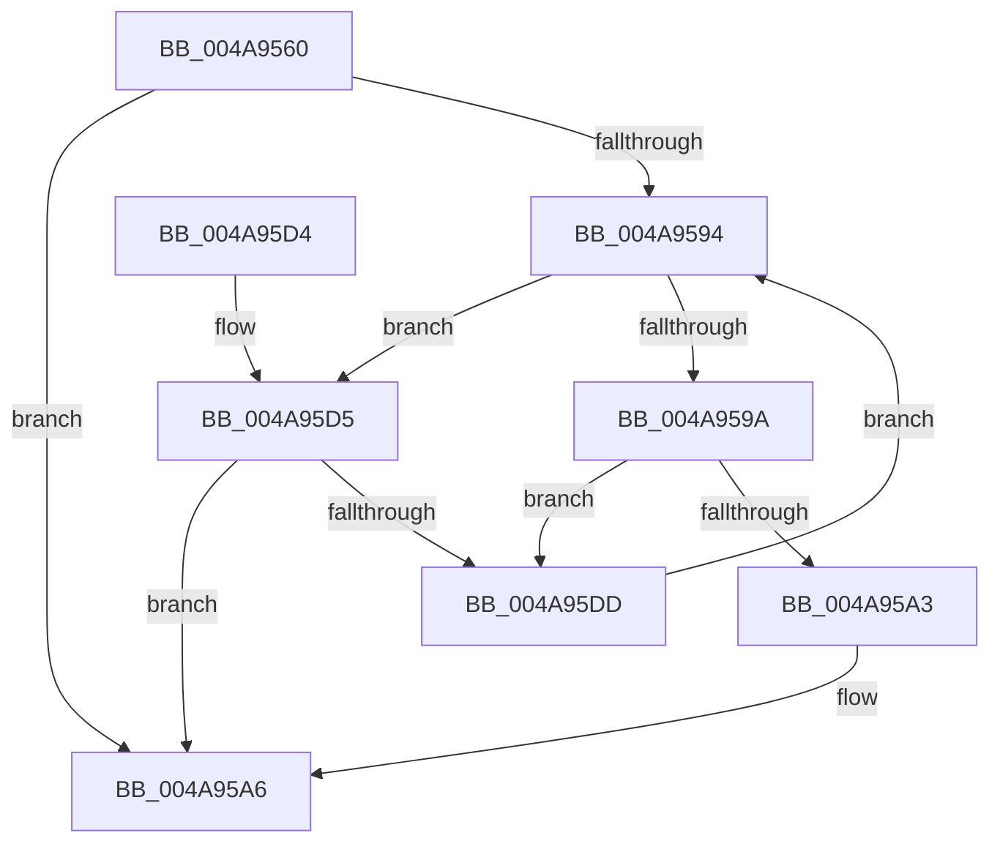

# MiInsertMappingNode

- RVA: `0x004A9560`–`0x004A95E2` (길이 `130` bytes)
- VA: `0x00000001404A9560`
- 실행 섹션: `.text`
- PDB 이름 있음: `예`; PDB Function 태그: `아니요`
- unwind 정보 RVA: `0x00069B08`
- 디코드: `36`개 명령, `130/130` bytes 표시
- 미해석 바이트: `0` (있으면 어셈블리에 `.byte`로 보존)

> 이 문서는 커널 이미지의 기계어와 PDB 기호를 분석해 생성했습니다. 4번과 5번은 함수 원형과 자료형을 바이너리 사용 방식에서 추정한 C 해석이며 원본 소스 복구 결과는 아닙니다.

## 1. Dependencies

- 직접 호출 지점: **3**; 고유 호출 대상: **3**
- 직접 호출자로 확인된 함수: **1**
- RIP 상대 이미지 참조: **2**

### Outgoing calls
- `0x004A957D` → [ExAcquireSpinLockExclusive](../24/ExAcquireSpinLockExclusive_function_00248690.md) (function, `0x00248690`)
- `0x004A95B0` → [RtlAvlInsertNodeEx](../26/RtlAvlInsertNodeEx_function_00265790.md) (function, `0x00265790`)
- `0x004A95BF` → [MiReleaseSpinLockExclusive](../24/MiReleaseSpinLockExclusive_function_002482C0.md) (function, `0x002482C0`)

### Direct callers
- [MmAllocateMappingAddressEx](../../page/A7/MmAllocateMappingAddressEx_function_00A726B0.md) at `0x00A727AD`

### Static image references
- `0x004A9576` → RVA `0x00E35FA8` (`.data`; read)
- `0x004A9582` → RVA `0x00E35FB0` (`.data`; read)

## 2. Other-region calls and transfers

- 다른 실행 섹션으로 향하는 call: **0**
- 별도 외부 분기/꼬리 이동을 확인하지 못했습니다.

## 3. Assembly (complete function range)

```asm
004A9560  48 89 5C 24 08                  mov qword ptr [rsp + 8], rbx
004A9565  48 89 74 24 10                  mov qword ptr [rsp + 0x10], rsi
004A956A  57                              push rdi
004A956B  48 83 EC 20                     sub rsp, 0x20
004A956F  48 8B 59 18                     mov rbx, qword ptr [rcx + 0x18]
004A9573  48 8B F9                        mov rdi, rcx
004A9576  48 8D 0D 2B CA 98 00            lea rcx, [rip + 0x98ca2b]
004A957D  E8 0E F1 D9 FF                  call 0x140248690
004A9582  48 8B 15 27 CA 98 00            mov rdx, qword ptr [rip + 0x98ca27]
004A9589  45 33 C0                        xor r8d, r8d
004A958C  40 8A F0                        mov sil, al
004A958F  48 85 D2                        test rdx, rdx
004A9592  74 12                           je 0x1404a95a6
004A9594  48 3B 5A 18                     cmp rbx, qword ptr [rdx + 0x18]
004A9598  72 3B                           jb 0x1404a95d5
004A959A  48 8B 4A 08                     mov rcx, qword ptr [rdx + 8]
004A959E  48 85 C9                        test rcx, rcx
004A95A1  75 3A                           jne 0x1404a95dd
004A95A3  41 B0 01                        mov r8b, 1
004A95A6  4C 8B CF                        mov r9, rdi
004A95A9  48 8D 0D 00 CA 98 00            lea rcx, [rip + 0x98ca00]
004A95B0  E8 DB C1 DB FF                  call 0x140265790
004A95B5  40 8A D6                        mov dl, sil
004A95B8  48 8D 0D E9 C9 98 00            lea rcx, [rip + 0x98c9e9]
004A95BF  E8 FC EC D9 FF                  call 0x1402482c0
004A95C4  48 8B 5C 24 30                  mov rbx, qword ptr [rsp + 0x30]
004A95C9  48 8B 74 24 38                  mov rsi, qword ptr [rsp + 0x38]
004A95CE  48 83 C4 20                     add rsp, 0x20
004A95D2  5F                              pop rdi
004A95D3  C3                              ret
004A95D4  CC                              int3
004A95D5  48 8B 0A                        mov rcx, qword ptr [rdx]
004A95D8  48 85 C9                        test rcx, rcx
004A95DB  74 C9                           je 0x1404a95a6
004A95DD  48 8B D1                        mov rdx, rcx
004A95E0  EB B2                           jmp 0x1404a9594
```

## 4. C-style interpretation (structured pseudocode)

```c
__int64 __fastcall MiInsertMappingNode(__int64 a1, __int64 a2, int a3)
{
    __int64 result;
    __int64 v_rsp;
    unsigned __int64 v_stack_p10;
    unsigned __int64 v_stack_p8;

    v_stack_p8 = v_rbx;
    v_stack_p10 = v_rsi;
    v_rsp = (v_rsp) - (32);
    result = ExAcquireSpinLockExclusive(v_rip + 10013227, a2, a3, a4);
    a3 = 0;
    if (*(unsigned __int64 *)(v_rip + 10013223) == 0) goto loc_004A95A6;
loc_004A9594:
    if ((*(unsigned __int64 *)(a1 + 24)) < (*(unsigned __int64 *)(*(unsigned __int64 *)(v_rip + 10013223) + 24))) goto loc_004A95D5;
    if (*(unsigned __int64 *)(*(unsigned __int64 *)(v_rip + 10013223) + 8) != 0) goto loc_004A95DD;
loc_004A95A6:
    result = RtlAvlInsertNodeEx(v_rip + 10013184, *(unsigned __int64 *)(v_rip + 10013223), 1, a1);
    result = MiReleaseSpinLockExclusive(v_rip + 10013161, (unsigned __int8)((unsigned __int8)(result)), 1, a1);
    v_rsp = (v_rsp) + (32);
    return result;
loc_004A95D5:
    if (*(unsigned __int64 *)((unsigned __int8)((unsigned __int8)(result))) == 0) goto loc_004A95A6;
loc_004A95DD:
    goto loc_004A9594;
}
```

## 5. (Beta) C Style

```c
int64_t MiInsertMappingNode(void *Arg1, int64_t Arg2, int32_t Arg3)
{
    uint8_t *arg1 = (uint8_t *)Arg1;

    int64_t result;
    int64_t local_rsp;
    uint64_t v_stack_p10;
    uint64_t v_stack_p8;

    v_stack_p8 = local_rbx;
    v_stack_p10 = local_rsi;
    local_rsp = (local_rsp) - (32);
    result = ExAcquireSpinLockExclusive(v_rip + 10013227, Arg2, Arg3, a4);
    Arg3 = 0;
    if (*(uint64_t *)(v_rip + 0x98CA27) == 0) goto loc_004A95A6;
loc_004A9594:
    if ((*(uint64_t *)(arg1 + 0x18)) < (*(uint64_t *)(*(uint64_t *)(v_rip + 0x98CA27) + 0x18))) goto loc_004A95D5;
    if (*(uint64_t *)(*(uint64_t *)(v_rip + 0x98CA27) + 0x8) != 0) goto loc_004A95DD;
loc_004A95A6:
    result = RtlAvlInsertNodeEx(v_rip + 10013184, *(uint64_t *)(v_rip + 0x98CA27), 1, Arg1);
    result = MiReleaseSpinLockExclusive(v_rip + 10013161, (uint8_t)((uint8_t)(result)), 1, Arg1);
    local_rsp = (local_rsp) + (32);
    return result;
loc_004A95D5:
    if (*(uint64_t *)((uint8_t)((uint8_t)(result))) == 0) goto loc_004A95A6;
loc_004A95DD:
    goto loc_004A9594;
}
```

### 관측된 메모리 오프셋

구조체 형식이 확인되지 않은 접근은 인자 기준의 오프셋으로만 기록했습니다.

| 기준 인자 | 오프셋 표현 | 폭 (bit) | 접근 |
|---|---:|---:|---|
| `Arg1` | `+ 0x18` | `64` | `R` |

## 6. Execution-region graph

[열기: 2D/3D 그래프와 함수 탐색 컨트롤 패널](../../../control-panel.html?section=text&rva=0x004A9560&view=graph)

- 2D 그래프는 위에서 아래로 흐르고, 3D 그래프는 빈 공간을 드래그해 회전합니다. Shift+드래그는 이동, 휠은 확대·축소, 함수 노드 선택은 대상 보고서 이동입니다.

### Static fallback


