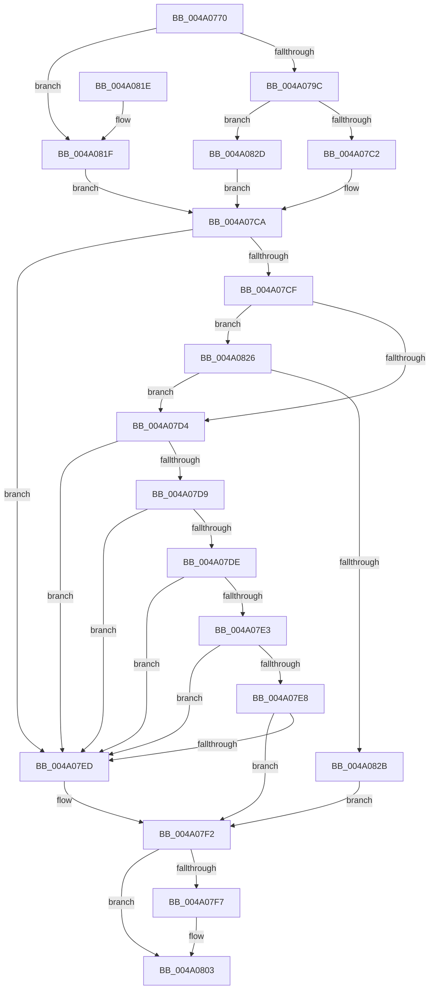

# MiIsCalibrationWorthwhile

- RVA: `0x004A0770`–`0x004A0837` (길이 `199` bytes)
- VA: `0x00000001404A0770`
- 실행 섹션: `.text`
- PDB 이름 있음: `예`; PDB Function 태그: `아니요`
- unwind 정보 RVA: `0x0006CBDC`
- 디코드: `63`개 명령, `199/199` bytes 표시
- 미해석 바이트: `0` (있으면 어셈블리에 `.byte`로 보존)

> 이 문서는 커널 이미지의 기계어와 PDB 기호를 분석해 생성했습니다. 4번과 5번은 함수 원형과 자료형을 바이너리 사용 방식에서 추정한 C 해석이며 원본 소스 복구 결과는 아닙니다.

## 1. Dependencies

- 직접 호출 지점: **3**; 고유 호출 대상: **3**
- 직접 호출자로 확인된 함수: **3**
- RIP 상대 이미지 참조: **1**

### Outgoing calls
- `0x004A07C5` → [ExAcquireSpinLockSharedAtDpcLevel](../24/ExAcquireSpinLockSharedAtDpcLevel_function_00248E30.md) (function, `0x00248E30`)
- `0x004A07FE` → [MiReleaseSpinLockShared](../34/MiReleaseSpinLockShared_function_00348BF0.md) (function, `0x00348BF0`)
- `0x004A082D` → [ExAcquireSpinLockShared](../24/ExAcquireSpinLockShared_function_0024DCE0.md) (function, `0x0024DCE0`)

### Direct callers
- [MiScheduleZeroPageThreads](../2D/MiScheduleZeroPageThreads_function_002DB1DC.md) at `0x002DB311`
- [MiMergeCalibrationResults](../69/MiMergeCalibrationResults_function_0069A104.md) at `0x0069A157`
- [MiZeroPageCalibrate](../69/MiZeroPageCalibrate_function_0069A69C.md) at `0x0069A76F`
- [MiZeroPageCalibrate](../69/MiZeroPageCalibrate_function_0069A69C.md) at `0x0069A835`

### Static image references
- `0x004A07A3` → RVA `0x00E2DBF8` (`.data`; read)

## 2. Other-region calls and transfers

- 다른 실행 섹션으로 향하는 call: **0**
- 별도 외부 분기/꼬리 이동을 확인하지 못했습니다.

## 3. Assembly (complete function range)

```asm
004A0770  48 89 5C 24 08                  mov qword ptr [rsp + 8], rbx
004A0775  48 89 6C 24 10                  mov qword ptr [rsp + 0x10], rbp
004A077A  48 89 74 24 18                  mov qword ptr [rsp + 0x18], rsi
004A077F  57                              push rdi
004A0780  41 56                           push r14
004A0782  41 57                           push r15
004A0784  48 83 EC 20                     sub rsp, 0x20
004A0788  33 DB                           xor ebx, ebx
004A078A  45 8B F1                        mov r14d, r9d
004A078D  44 8B FA                        mov r15d, edx
004A0790  48 8B F9                        mov rdi, rcx
004A0793  45 85 C9                        test r9d, r9d
004A0796  0F 85 83 00 00 00               jne 0x1404a081f
004A079C  41 8B C0                        mov eax, r8d
004A079F  48 8D 0C 40                     lea rcx, [rax + rax*2]
004A07A3  48 8B 05 4E D4 98 00            mov rax, qword ptr [rip + 0x98d44e]
004A07AA  48 C1 E1 07                     shl rcx, 7
004A07AE  48 8B AC 01 78 01 00 00         mov rbp, qword ptr [rcx + rax + 0x178]
004A07B6  44 0F 20 C0                     mov rax, cr8
004A07BA  48 8D 4D 40                     lea rcx, [rbp + 0x40]
004A07BE  3C 02                           cmp al, 2
004A07C0  75 6B                           jne 0x1404a082d
004A07C2  40 B6 11                        mov sil, 0x11
004A07C5  E8 66 86 DA FF                  call 0x140248e30
004A07CA  38 5F 05                        cmp byte ptr [rdi + 5], bl
004A07CD  74 1E                           je 0x1404a07ed
004A07CF  38 5F 06                        cmp byte ptr [rdi + 6], bl
004A07D2  75 52                           jne 0x1404a0826
004A07D4  39 5F 20                        cmp dword ptr [rdi + 0x20], ebx
004A07D7  74 14                           je 0x1404a07ed
004A07D9  39 5F 24                        cmp dword ptr [rdi + 0x24], ebx
004A07DC  74 0F                           je 0x1404a07ed
004A07DE  39 5F 28                        cmp dword ptr [rdi + 0x28], ebx
004A07E1  74 0A                           je 0x1404a07ed
004A07E3  39 5F 2C                        cmp dword ptr [rdi + 0x2c], ebx
004A07E6  74 05                           je 0x1404a07ed
004A07E8  44 3B 3F                        cmp r15d, dword ptr [rdi]
004A07EB  76 05                           jbe 0x1404a07f2
004A07ED  BB 01 00 00 00                  mov ebx, 1
004A07F2  45 85 F6                        test r14d, r14d
004A07F5  75 0C                           jne 0x1404a0803
004A07F7  48 8D 4D 40                     lea rcx, [rbp + 0x40]
004A07FB  40 8A D6                        mov dl, sil
004A07FE  E8 ED 83 EA FF                  call 0x140348bf0
004A0803  48 8B 6C 24 48                  mov rbp, qword ptr [rsp + 0x48]
004A0808  8B C3                           mov eax, ebx
004A080A  48 8B 5C 24 40                  mov rbx, qword ptr [rsp + 0x40]
004A080F  48 8B 74 24 50                  mov rsi, qword ptr [rsp + 0x50]
004A0814  48 83 C4 20                     add rsp, 0x20
004A0818  41 5F                           pop r15
004A081A  41 5E                           pop r14
004A081C  5F                              pop rdi
004A081D  C3                              ret
004A081E  CC                              int3
004A081F  40 B6 11                        mov sil, 0x11
004A0822  33 ED                           xor ebp, ebp
004A0824  EB A4                           jmp 0x1404a07ca
004A0826  38 5F 07                        cmp byte ptr [rdi + 7], bl
004A0829  74 A9                           je 0x1404a07d4
004A082B  EB C5                           jmp 0x1404a07f2
004A082D  E8 AE D4 DA FF                  call 0x14024dce0
004A0832  40 8A F0                        mov sil, al
004A0835  EB 93                           jmp 0x1404a07ca
```

## 4. C-style interpretation (structured pseudocode)

```c
__int64 __fastcall MiIsCalibrationWorthwhile(__int64 a1, int a2, int a3, int a4)
{
    __int64 result;
    __int64 v_rbp;
    __int64 v_rbx;
    __int64 v_rsp;
    unsigned __int64 v_stack_p10;
    unsigned __int64 v_stack_p18;
    unsigned __int64 v_stack_p8;

    v_stack_p8 = v_rbx;
    v_stack_p10 = v_rbp;
    v_stack_p18 = v_rsi;
    v_rsp = (v_rsp) - (32);
    v_rbx = 0;
    if (a4 != 0) goto loc_004A081F;
    a1 = ((unsigned int)(a3) + (unsigned int)(a3) * 2) << (7);
    if (((unsigned __int8)(v_cr8)) != 2) goto loc_004A082D;
    result = ExAcquireSpinLockSharedAtDpcLevel(*(unsigned __int64 *)(a1 + *(unsigned __int64 *)(v_rip + 10015822) * 1 + 376) + 64, a2, a3, a4);
loc_004A07CA:
    if ((*(unsigned __int8 *)(a1 + 5)) == 0) goto loc_004A07ED;
    if ((*(unsigned __int8 *)(a1 + 6)) != 0) goto loc_004A0826;
loc_004A07D4:
    if ((*(unsigned int *)(a1 + 32)) == 0) goto loc_004A07ED;
    if ((*(unsigned int *)(a1 + 36)) == 0) goto loc_004A07ED;
    if ((*(unsigned int *)(a1 + 40)) == 0) goto loc_004A07ED;
    if ((*(unsigned int *)(a1 + 44)) == 0) goto loc_004A07ED;
    if (((unsigned int)((unsigned int)(a2))) >= = (*(unsigned int *)(a1))) {
        v_rbx = 1;
    }
    if ((unsigned int)((unsigned int)(a4)) == 0) {
        a1 = *(unsigned __int64 *)(a1 + *(unsigned __int64 *)(v_rip + 10015822) * 1 + 376) + 64;
        a2 = 17;
        result = MiReleaseSpinLockShared(a1, a2, a3, a4);
    }
    v_rsp = (v_rsp) + (32);
    return (unsigned int)((unsigned int)(v_rbx));
loc_004A081F:
    v_rbp = 0;
    goto loc_004A07CA;
loc_004A0826:
    if ((*(unsigned __int8 *)(a1 + 7)) == ((unsigned __int8)(v_stack_p8))) goto loc_004A07D4;
    goto loc_004A07F2;
loc_004A082D:
    result = ExAcquireSpinLockShared(a1, a2, a3, a4);
    goto loc_004A07CA;
}
```

## 5. (Beta) C Style

```c
int64_t MiIsCalibrationWorthwhile(void *Arg1, int32_t Arg2, void *Arg3, int32_t Arg4)
{
    uint8_t *arg1 = (uint8_t *)Arg1;
    uint8_t *arg3 = (uint8_t *)Arg3;

    int64_t result;
    int64_t local_rbp;
    int64_t local_rbx;
    int64_t local_rsp;
    uint64_t v_stack_p10;
    uint64_t v_stack_p18;
    uint64_t v_stack_p8;

    v_stack_p8 = local_rbx;
    v_stack_p10 = local_rbp;
    v_stack_p18 = local_rsi;
    local_rsp = (local_rsp) - (32);
    local_rbx = 0;
    if (Arg4 != 0) goto loc_004A081F;
    Arg1 = ((uint32_t)(Arg3) + (uint32_t)(Arg3) * 2) << (7);
    if (((uint8_t)(v_cr8)) != 2) goto loc_004A082D;
    result = ExAcquireSpinLockSharedAtDpcLevel(*(uint64_t *)(arg1 + *(uint64_t *)(v_rip + 0x98D44E) * 1 + 0x178) + 64, Arg2, Arg3, Arg4);
loc_004A07CA:
    if ((*(uint8_t *)(arg1 + 0x5)) == 0) goto loc_004A07ED;
    if ((*(uint8_t *)(arg1 + 0x6)) != 0) goto loc_004A0826;
loc_004A07D4:
    if ((*(uint32_t *)(arg1 + 0x20)) == 0) goto loc_004A07ED;
    if ((*(uint32_t *)(arg1 + 0x24)) == 0) goto loc_004A07ED;
    if ((*(uint32_t *)(arg1 + 0x28)) == 0) goto loc_004A07ED;
    if ((*(uint32_t *)(arg1 + 0x2C)) == 0) goto loc_004A07ED;
    if (((uint32_t)((uint32_t)(Arg2))) >= = (*(uint32_t *)(arg1))) {
        local_rbx = 1;
    }
    if ((uint32_t)((uint32_t)(Arg4)) == 0) {
        Arg1 = *(uint64_t *)(arg1 + *(uint64_t *)(v_rip + 0x98D44E) * 1 + 0x178) + 64;
        Arg2 = 17;
        result = MiReleaseSpinLockShared(Arg1, Arg2, Arg3, Arg4);
    }
    local_rsp = (local_rsp) + (32);
    return (uint32_t)((uint32_t)(local_rbx));
loc_004A081F:
    local_rbp = 0;
    goto loc_004A07CA;
loc_004A0826:
    if ((*(uint8_t *)(arg1 + 0x7)) == ((uint8_t)(v_stack_p8))) goto loc_004A07D4;
    goto loc_004A07F2;
loc_004A082D:
    result = ExAcquireSpinLockShared(Arg1, Arg2, Arg3, Arg4);
    goto loc_004A07CA;
}
```

### 관측된 메모리 오프셋

구조체 형식이 확인되지 않은 접근은 인자 기준의 오프셋으로만 기록했습니다.

| 기준 인자 | 오프셋 표현 | 폭 (bit) | 접근 |
|---|---:|---:|---|
| `Arg1` | `+ 0x0` | `32` | `R` |
| `Arg1` | `+ 0x5` | `8` | `R` |
| `Arg1` | `+ 0x6` | `8` | `R` |
| `Arg1` | `+ 0x7` | `8` | `R` |
| `Arg1` | `+ 0x20` | `32` | `R` |
| `Arg1` | `+ 0x24` | `32` | `R` |
| `Arg1` | `+ 0x28` | `32` | `R` |
| `Arg1` | `+ 0x2C` | `32` | `R` |
| `Arg3` | `+ 0x0 + rax*2` | `64` | `R` |

## 6. Execution-region graph

[열기: 2D/3D 그래프와 함수 탐색 컨트롤 패널](../../../control-panel.html?section=text&rva=0x004A0770&view=graph)

- 2D 그래프는 위에서 아래로 흐르고, 3D 그래프는 빈 공간을 드래그해 회전합니다. Shift+드래그는 이동, 휠은 확대·축소, 함수 노드 선택은 대상 보고서 이동입니다.

### Static fallback


