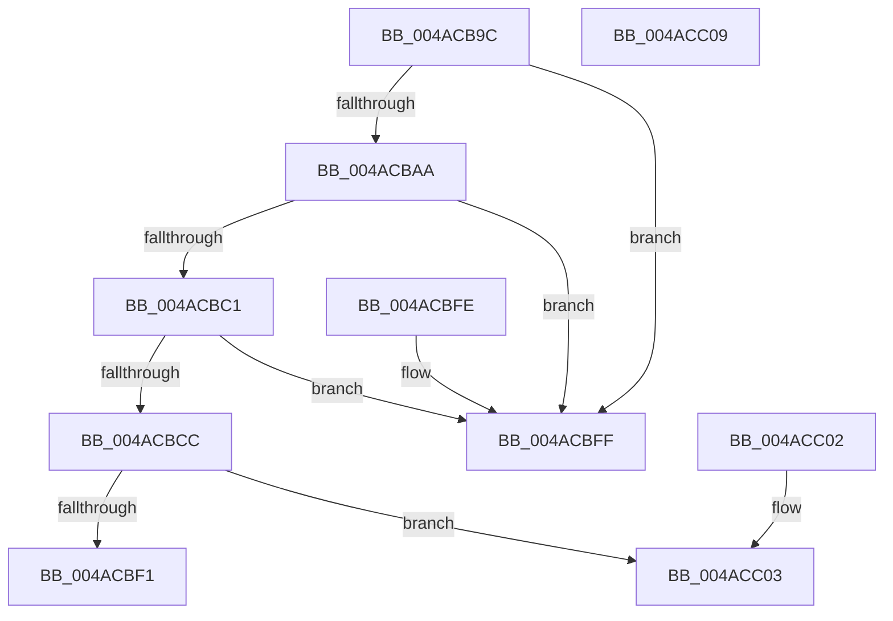

# MiIsStoreVirtualPagefileFull

- RVA: `0x004ACB9C`–`0x004ACC0A` (길이 `110` bytes)
- VA: `0x00000001404ACB9C`
- 실행 섹션: `.text`
- PDB 이름 있음: `예`; PDB Function 태그: `아니요`
- unwind 정보 RVA: `0x000DB714`
- 디코드: `33`개 명령, `110/110` bytes 표시
- 미해석 바이트: `0` (있으면 어셈블리에 `.byte`로 보존)

> 이 문서는 커널 이미지의 기계어와 PDB 기호를 분석해 생성했습니다. 4번과 5번은 함수 원형과 자료형을 바이너리 사용 방식에서 추정한 C 해석이며 원본 소스 복구 결과는 아닙니다.

## 1. Dependencies

- 직접 호출 지점: **0**; 고유 호출 대상: **0**
- 직접 호출자로 확인된 함수: **5**
- RIP 상대 이미지 참조: **0**

### Outgoing calls
- 직접 디코드된 call 명령이 없습니다.

### Direct callers
- [MiStoreWriteModifiedPages](../2B/MiStoreWriteModifiedPages_function_002B46C4.md) at `0x002B5461`
- [MiGatherPagefilePages](../37/MiGatherPagefilePages_function_00372B08.md) at `0x0037323E`
- [MiCanFlushMakeProgress](../3B/MiCanFlushMakeProgress_function_003BC9D0.md) at `0x003BCA60`
- [MiFillNoReservationCluster](../40/MiFillNoReservationCluster_function_00405B40.md) at `0x00405D4C`
- [MiStoreExtendVirtualPagefile](../4F/MiStoreExtendVirtualPagefile_function_004F73AC.md) at `0x004F7475`

### Static image references
- 디코드된 RIP-relative 메모리 참조가 없습니다.

## 2. Other-region calls and transfers

- 다른 실행 섹션으로 향하는 call: **0**
- 별도 외부 분기/꼬리 이동을 확인하지 못했습니다.

## 3. Assembly (complete function range)

```asm
004ACB9C  8B 81 B4 04 00 00               mov eax, dword ptr [rcx + 0x4b4]
004ACBA2  4C 8B C1                        mov r8, rcx
004ACBA5  83 F8 FF                        cmp eax, -1
004ACBA8  74 55                           je 0x1404acbff
004ACBAA  8B 81 B4 04 00 00               mov eax, dword ptr [rcx + 0x4b4]
004ACBB0  33 D2                           xor edx, edx
004ACBB2  48 8B 8C C1 60 48 00 00         mov rcx, qword ptr [rcx + rax*8 + 0x4860]
004ACBBA  8B 41 0C                        mov eax, dword ptr [rcx + 0xc]
004ACBBD  85 C0                           test eax, eax
004ACBBF  75 3E                           jne 0x1404acbff
004ACBC1  44 8B 49 04                     mov r9d, dword ptr [rcx + 4]
004ACBC5  8B 01                           mov eax, dword ptr [rcx]
004ACBC7  41 3B C1                        cmp eax, r9d
004ACBCA  72 33                           jb 0x1404acbff
004ACBCC  49 8B 80 C8 41 00 00            mov rax, qword ptr [r8 + 0x41c8]
004ACBD3  41 8B 88 BC 04 00 00            mov ecx, dword ptr [r8 + 0x4bc]
004ACBDA  48 05 FF FF 03 00               add rax, 0x3ffff
004ACBE0  48 25 00 00 FC FF               and rax, 0xfffffffffffc0000
004ACBE6  48 3B C1                        cmp rax, rcx
004ACBE9  0F 46 C8                        cmovbe ecx, eax
004ACBEC  41 3B C9                        cmp ecx, r9d
004ACBEF  76 12                           jbe 0x1404acc03
004ACBF1  41 39 90 D0 04 00 00            cmp dword ptr [r8 + 0x4d0], edx
004ACBF8  0F 95 C2                        setne dl
004ACBFB  8B C2                           mov eax, edx
004ACBFD  C3                              ret
004ACBFE  CC                              int3
004ACBFF  33 C0                           xor eax, eax
004ACC01  C3                              ret
004ACC02  CC                              int3
004ACC03  B8 01 00 00 00                  mov eax, 1
004ACC08  C3                              ret
004ACC09  CC                              int3
```

## 4. C-style interpretation (structured pseudocode)

```c
__int64 __fastcall MiIsStoreVirtualPagefileFull(__int64 a1, int a2)
{
    __int64 result;

    if (((unsigned int)((unsigned int)(*(unsigned int *)(a1 + 1204)))) == -1) goto loc_004ACBFF;
    a2 = 0;
    if ((unsigned int)((unsigned int)(*(unsigned int *)(*(unsigned __int64 *)(a1 + (unsigned int)(*(unsigned int *)(a1 + 1204)) * 8 + 18528) + 12))) != 0) goto loc_004ACBFF;
    if (((unsigned int)((unsigned int)(*(unsigned int *)(*(unsigned __int64 *)(a1 + (unsigned int)(*(unsigned int *)(a1 + 1204)) * 8 + 18528))))) < ((unsigned int)((unsigned int)(*(unsigned int *)(*(unsigned __int64 *)(a1 + (unsigned int)(*(unsigned int *)(a1 + 1204)) * 8 + 18528) + 4))))) goto loc_004ACBFF;
    result = (*(unsigned __int64 *)(a1 + 16840)) + (0x3FFFFULL);
    result = (result) & (0xFFFFFFFFFFFC0000ULL);
    a1 = (unsigned int)(*(unsigned int *)(a1 + 1212));
    if (result <= ((unsigned int)(*(unsigned int *)(a1 + 1212)))) { a1 = (unsigned int)(result); }
    if (((unsigned int)(a1)) <= ((unsigned int)((unsigned int)(*(unsigned int *)(*(unsigned __int64 *)(a1 + (unsigned int)(*(unsigned int *)(a1 + 1204)) * 8 + 18528) + 4))))) goto loc_004ACC03;
    a2 = ((*(unsigned int *)(a1 + 1232)) != 0) ? 1 : 0;
    return (unsigned int)(a2);
loc_004ACBFF:
    result = 0;
    return result;
loc_004ACC03:
    return 1;
}
```

## 5. (Beta) C Style

```c
int64_t MiIsStoreVirtualPagefileFull(void *Arg1, int32_t Arg2)
{
    uint8_t *arg1 = (uint8_t *)Arg1;

    int64_t result;

    if (((uint32_t)((uint32_t)(*(uint32_t *)(arg1 + 0x4B4)))) == -1) goto loc_004ACBFF;
    Arg2 = 0;
    if ((uint32_t)((uint32_t)(*(uint32_t *)(*(uint64_t *)(arg1 + (uint32_t)(*(uint32_t *)(arg1 + 0x4B4)) * 8 + 0x4860) + 0xC))) != 0) goto loc_004ACBFF;
    if (((uint32_t)((uint32_t)(*(uint32_t *)(*(uint64_t *)(arg1 + (uint32_t)(*(uint32_t *)(arg1 + 0x4B4)) * 8 + 0x4860))))) < ((uint32_t)((uint32_t)(*(uint32_t *)(*(uint64_t *)(arg1 + (uint32_t)(*(uint32_t *)(arg1 + 0x4B4)) * 8 + 0x4860) + 0x4))))) goto loc_004ACBFF;
    result = (*(uint64_t *)(arg1 + 0x41C8)) + (0x3FFFFULL);
    result = (result) & (0xFFFFFFFFFFFC0000ULL);
    Arg1 = (uint32_t)(*(uint32_t *)(arg1 + 0x4BC));
    if (result <= ((uint32_t)(*(uint32_t *)(arg1 + 0x4BC)))) { Arg1 = (uint32_t)(result); }
    if (((uint32_t)(Arg1)) <= ((uint32_t)((uint32_t)(*(uint32_t *)(*(uint64_t *)(arg1 + (uint32_t)(*(uint32_t *)(arg1 + 0x4B4)) * 8 + 0x4860) + 0x4))))) goto loc_004ACC03;
    Arg2 = ((*(uint32_t *)(arg1 + 0x4D0)) != 0) ? 1 : 0;
    return (uint32_t)(Arg2);
loc_004ACBFF:
    result = 0;
    return result;
loc_004ACC03:
    return 1;
}
```

### 관측된 메모리 오프셋

구조체 형식이 확인되지 않은 접근은 인자 기준의 오프셋으로만 기록했습니다.

| 기준 인자 | 오프셋 표현 | 폭 (bit) | 접근 |
|---|---:|---:|---|
| `Arg1` | `+ 0x4B4` | `32` | `R` |
| `Arg1` | `+ 0x4BC` | `32` | `R` |
| `Arg1` | `+ 0x4D0` | `32` | `R` |
| `Arg1` | `+ 0x41C8` | `64` | `R` |
| `Arg1` | `+ 0x4860 + rax*8` | `64` | `R` |

## 6. Execution-region graph

[열기: 2D/3D 그래프와 함수 탐색 컨트롤 패널](../../../control-panel.html?section=text&rva=0x004ACB9C&view=graph)

- 2D 그래프는 위에서 아래로 흐르고, 3D 그래프는 빈 공간을 드래그해 회전합니다. Shift+드래그는 이동, 휠은 확대·축소, 함수 노드 선택은 대상 보고서 이동입니다.

### Static fallback


