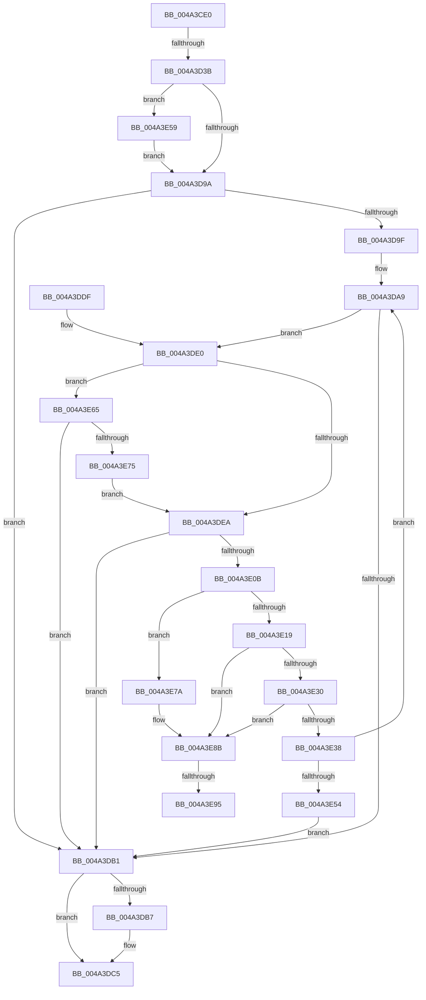

# MiMakeVaRangeNoAccess

- RVA: `0x004A3CE0`–`0x004A3EA9` (길이 `457` bytes)
- VA: `0x00000001404A3CE0`
- 실행 섹션: `.text`
- PDB 이름 있음: `예`; PDB Function 태그: `예`
- unwind 정보 RVA: `0x000B64C0`
- 디코드: `122`개 명령, `457/457` bytes 표시
- 미해석 바이트: `0` (있으면 어셈블리에 `.byte`로 보존)

> 이 문서는 커널 이미지의 기계어와 PDB 기호를 분석해 생성했습니다. 4번과 5번은 함수 원형과 자료형을 바이너리 사용 방식에서 추정한 C 해석이며 원본 소스 복구 결과는 아닙니다.

## 1. Dependencies

- 직접 호출 지점: **6**; 고유 호출 대상: **5**
- 직접 호출자로 확인된 함수: **1**
- RIP 상대 이미지 참조: **0**

### Outgoing calls
- `0x004A3D5A` → [MiInitializeTbFlushList](../29/MiInitializeTbFlushList_function_00294F00.md) (function, `0x00294F00`)
- `0x004A3DC0` → [MiFreeWsleList](../24/MiFreeWsleList_function_00241168.md) (function, `0x00241168`)
- `0x004A3E0E` → [MiGetWsleContents](../31/MiGetWsleContents_function_00316540.md) (function, `0x00316540`)
- `0x004A3E26` → [MiInsertTbFlushEntry](../29/MiInsertTbFlushEntry_function_00293670.md) (function, `0x00293670`)
- `0x004A3E68` → [MiRotatedToFrameBuffer](../2C/MiRotatedToFrameBuffer_function_002C5FE4.md) (function, `0x002C5FE4`)
- `0x004A3E9E` → [MiFreeWsleList](../24/MiFreeWsleList_function_00241168.md) (function, `0x00241168`)

### Direct callers
- [MiProtectPrivateMemory](../2C/MiProtectPrivateMemory_function_002C45B0.md) at `0x002C4DAD`

### Static image references
- 디코드된 RIP-relative 메모리 참조가 없습니다.

## 2. Other-region calls and transfers

- 다른 실행 섹션으로 향하는 call: **0**
- call이 아닌 외부 분기/꼬리 이동: **3**
  - `0x004A3D35` → [sub_006F91FE](../6F/Unknown_function_006F91FE.md) (`tail-transfer`)
  - `0x004A3E8F` → [sub_006F91FE + 0x164](../6F/Unknown_function_006F91FE.md) (`tail-transfer`)
  - `0x004A3EA4` → [sub_006F91FE + 0x164](../6F/Unknown_function_006F91FE.md) (`tail-transfer`)

## 3. Assembly (complete function range)

```asm
004A3CE0  48 89 5C 24 10                  mov qword ptr [rsp + 0x10], rbx
004A3CE5  4C 89 4C 24 20                  mov qword ptr [rsp + 0x20], r9
004A3CEA  48 89 4C 24 08                  mov qword ptr [rsp + 8], rcx
004A3CEF  55                              push rbp
004A3CF0  56                              push rsi
004A3CF1  57                              push rdi
004A3CF2  41 54                           push r12
004A3CF4  41 55                           push r13
004A3CF6  41 56                           push r14
004A3CF8  41 57                           push r15
004A3CFA  48 83 EC 40                     sub rsp, 0x40
004A3CFE  65 48 8B 04 25 88 01 00 00      mov rax, qword ptr gs:[0x188]
004A3D07  48 8B FA                        mov rdi, rdx
004A3D0A  8B 51 30                        mov edx, dword ptr [rcx + 0x30]
004A3D0D  4C 8B D9                        mov r11, rcx
004A3D10  B9 00 00 A0 00                  mov ecx, 0xa00000
004A3D15  49 8B E9                        mov rbp, r9
004A3D18  4D 8B F8                        mov r15, r8
004A3D1B  41 BA 01 00 00 00               mov r10d, 1
004A3D21  4C 8B B0 B8 00 00 00            mov r14, qword ptr [rax + 0xb8]
004A3D28  8B C2                           mov eax, edx
004A3D2A  23 C1                           and eax, ecx
004A3D2C  49 81 C6 00 04 00 00            add r14, 0x400
004A3D33  3B C1                           cmp eax, ecx
004A3D35  0F 84 C3 54 25 00               je 0x1406f91fe
004A3D3B  49 8D B1 28 10 00 00            lea rsi, [r9 + 0x1028]
004A3D42  44 89 54 24 20                  mov dword ptr [rsp + 0x20], r10d
004A3D47  44 8B 46 0C                     mov r8d, dword ptr [rsi + 0xc]
004A3D4B  48 8B CE                        mov rcx, rsi
004A3D4E  41 B9 02 00 00 00               mov r9d, 2
004A3D54  49 8B D6                        mov rdx, r14
004A3D57  45 32 E4                        xor r12b, r12b
004A3D5A  E8 A1 11 DF FF                  call 0x140294f00
004A3D5F  48 8B EF                        mov rbp, rdi
004A3D62  48 B8 00 00 00 00 80 F6 FF FF   movabs rax, 0xfffff68000000000
004A3D6C  48 C1 E5 19                     shl rbp, 0x19
004A3D70  48 8B C0                        mov rax, rax
004A3D73  48 C1 E0 19                     shl rax, 0x19
004A3D77  48 C7 C2 00 F0 FF FF            mov rdx, 0xfffffffffffff000
004A3D7E  48 2B E8                        sub rbp, rax
004A3D81  48 8B CF                        mov rcx, rdi
004A3D84  49 8B C7                        mov rax, r15
004A3D87  48 C1 FD 10                     sar rbp, 0x10
004A3D8B  48 23 C2                        and rax, rdx
004A3D8E  48 23 CA                        and rcx, rdx
004A3D91  48 3B C8                        cmp rcx, rax
004A3D94  0F 85 BF 00 00 00               jne 0x1404a3e59
004A3D9A  49 3B FF                        cmp rdi, r15
004A3D9D  77 12                           ja 0x1404a3db1
004A3D9F  49 BD FF FF FF FF FF 00 00 00   movabs r13, 0xffffffffff
004A3DA9  48 8B 1F                        mov rbx, qword ptr [rdi]
004A3DAC  F6 C3 01                        test bl, 1
004A3DAF  75 2F                           jne 0x1404a3de0
004A3DB1  83 7E 1C 00                     cmp dword ptr [rsi + 0x1c], 0
004A3DB5  74 0E                           je 0x1404a3dc5
004A3DB7  45 33 C0                        xor r8d, r8d
004A3DBA  48 8B D6                        mov rdx, rsi
004A3DBD  49 8B CE                        mov rcx, r14
004A3DC0  E8 A3 D3 D9 FF                  call 0x140241168
004A3DC5  33 C0                           xor eax, eax
004A3DC7  48 8B 9C 24 88 00 00 00         mov rbx, qword ptr [rsp + 0x88]
004A3DCF  48 83 C4 40                     add rsp, 0x40
004A3DD3  41 5F                           pop r15
004A3DD5  41 5E                           pop r14
004A3DD7  41 5D                           pop r13
004A3DD9  41 5C                           pop r12
004A3DDB  5F                              pop rdi
004A3DDC  5E                              pop rsi
004A3DDD  5D                              pop rbp
004A3DDE  C3                              ret
004A3DDF  CC                              int3
004A3DE0  41 8B 43 30                     mov eax, dword ptr [r11 + 0x30]
004A3DE4  24 70                           and al, 0x70
004A3DE6  3C 40                           cmp al, 0x40
004A3DE8  74 7B                           je 0x1404a3e65
004A3DEA  48 C1 EB 0C                     shr rbx, 0xc
004A3DEE  49 23 DD                        and rbx, r13
004A3DF1  48 8D 04 5B                     lea rax, [rbx + rbx*2]
004A3DF5  48 03 C0                        add rax, rax
004A3DF8  48 B9 28 00 00 00 00 DE FF FF   movabs rcx, 0xffffde0000000028
004A3E02  48 8B 04 C1                     mov rax, qword ptr [rcx + rax*8]
004A3E06  48 85 C0                        test rax, rax
004A3E09  78 A6                           js 0x1404a3db1
004A3E0B  48 8B D5                        mov rdx, rbp
004A3E0E  E8 2D 27 E7 FF                  call 0x140316540
004A3E13  24 0F                           and al, 0xf
004A3E15  3C 08                           cmp al, 8
004A3E17  74 61                           je 0x1404a3e7a
004A3E19  45 33 C9                        xor r9d, r9d
004A3E1C  48 8B D5                        mov rdx, rbp
004A3E1F  48 8B CE                        mov rcx, rsi
004A3E22  45 8D 41 01                     lea r8d, [r9 + 1]
004A3E26  E8 45 F8 DE FF                  call 0x140293670
004A3E2B  45 84 E4                        test r12b, r12b
004A3E2E  75 5B                           jne 0x1404a3e8b
004A3E30  8B 46 0C                        mov eax, dword ptr [rsi + 0xc]
004A3E33  39 46 1C                        cmp dword ptr [rsi + 0x1c], eax
004A3E36  74 53                           je 0x1404a3e8b
004A3E38  4C 8B 9C 24 80 00 00 00         mov r11, qword ptr [rsp + 0x80]
004A3E40  48 81 C5 00 10 00 00            add rbp, 0x1000
004A3E47  48 83 C7 08                     add rdi, 8
004A3E4B  49 3B FF                        cmp rdi, r15
004A3E4E  0F 86 55 FF FF FF               jbe 0x1404a3da9
004A3E54  E9 58 FF FF FF                  jmp 0x1404a3db1
004A3E59  4C 8D B9 F8 0F 00 00            lea r15, [rcx + 0xff8]
004A3E60  E9 35 FF FF FF                  jmp 0x1404a3d9a
004A3E65  48 8B CF                        mov rcx, rdi
004A3E68  E8 77 21 E2 FF                  call 0x1402c5fe4
004A3E6D  85 C0                           test eax, eax
004A3E6F  0F 85 3C FF FF FF               jne 0x1404a3db1
004A3E75  E9 70 FF FF FF                  jmp 0x1404a3dea
004A3E7A  48 8B 84 24 A0 00 00 00         mov rax, qword ptr [rsp + 0xa0]
004A3E82  41 B4 01                        mov r12b, 1
004A3E85  C7 00 01 00 00 00               mov dword ptr [rax], 1
004A3E8B  83 7E 1C 00                     cmp dword ptr [rsi + 0x1c], 0
004A3E8F  0F 84 CD 54 25 00               je 0x1406f9362
004A3E95  45 33 C0                        xor r8d, r8d
004A3E98  48 8B D6                        mov rdx, rsi
004A3E9B  49 8B CE                        mov rcx, r14
004A3E9E  E8 C5 D2 D9 FF                  call 0x140241168
004A3EA3  90                              nop
004A3EA4  E9 B9 54 25 00                  jmp 0x1406f9362
```

## 4. C-style interpretation (structured pseudocode)

```c
__int64 __fastcall MiMakeVaRangeNoAccess(__int64 a1, __int64 a2, __int64 a3, __int64 a4, __int64 a5)
{
    __int64 result;
    __int64 v_r12;
    __int64 v_r14;
    __int64 v_rbp;
    __int64 v_rbx;
    __int64 v_rdi;
    __int64 v_rsp;
    unsigned int v_stack_m58;
    unsigned __int64 v_stack_p10;
    unsigned __int64 v_stack_p20;
    unsigned __int64 v_stack_p8;
    unsigned __int64 v_stack_p80;

    v_stack_p10 = v_rbx;
    v_stack_p20 = a4;
    v_stack_p8 = a1;
    v_rsp = (v_rsp) - (64);
    result = (unsigned int)(((unsigned int)((unsigned int)((unsigned int)(*(unsigned int *)(a1 + 48))))) & ((unsigned int)((unsigned int)(0xA00000ULL))));
    v_r14 = (*(unsigned __int64 *)(*(unsigned __int64 *)(gs_base + (0 + 392)) + 184)) + (0x400ULL);
    v_stack_m58 = 1;
    v_r12 = 0;
    result = MiInitializeTbFlushList(a4 + 4136, v_r14, (unsigned int)(*(unsigned int *)(a4 + 4136 + 12)), 2);
    v_rbp = (a2) << (25);
    result = (result) << (25);
    v_rbp = (v_rbp) - (result);
    v_rbp = (v_rbp) >> (16);
    result = (a3) & (0xFFFFFFFFFFFFF000ULL);
    a1 = (a2) & (0xFFFFFFFFFFFFF000ULL);
    if (a1 != result) goto loc_004A3E59;
loc_004A3D9A:
    if (a2 > a3) goto loc_004A3DB1;
loc_004A3DA9:
    if ((((unsigned __int8)(*(unsigned __int64 *)(a2))) & (1)) != 0) goto loc_004A3DE0;
loc_004A3DB1:
    if ((*(unsigned int *)(a4 + 4136 + 28)) != 0) {
        a3 = 0;
        a2 = a4 + 4136;
        a1 = v_r14;
        result = MiFreeWsleList(a1, a2, a3, 2);
    }
    result = 0;
    v_rsp = (v_rsp) + (64);
    return result;
loc_004A3DE0:
    result = (unsigned __int8)(((unsigned int)(*(unsigned int *)(a1 + 48))) & (112));
    if (((unsigned __int8)(result)) == 64) goto loc_004A3E65;
loc_004A3DEA:
    v_rbx = (v_stack_p10) >> (12);
    v_rbx = (v_rbx) & (v_r13);
    result = (v_rbx + v_rbx * 2) + (v_rbx + v_rbx * 2);
    if (sign_flag) goto loc_004A3DB1;
    result = MiGetWsleContents(a1, v_rbp, a3, 2);
    result = (unsigned __int8)((result) & (15));
    if (((unsigned __int8)(result)) == 8) goto loc_004A3E7A;
    a4 = 0;
    result = MiInsertTbFlushEntry(a4 + 4136, v_rbp, a4 + 1, a4);
    if (0 != 0) goto loc_004A3E8B;
    if ((*(unsigned int *)(a4 + 4136 + 28)) == ((unsigned int)((unsigned int)(*(unsigned int *)(a4 + 4136 + 12))))) goto loc_004A3E8B;
    v_rbp = (v_rbp) + (0x1000ULL);
    v_rdi = (a2) + (8);
    if (v_rdi <= 0) goto loc_004A3DA9;
    goto loc_004A3DB1;
loc_004A3E59:
    goto loc_004A3D9A;
loc_004A3E65:
    result = MiRotatedToFrameBuffer(v_rdi, v_rbp, a4 + 1, a4);
    if ((unsigned int)(result) != 0) goto loc_004A3DB1;
    goto loc_004A3DEA;
loc_004A3E7A:
    *(unsigned int *)(a5) = 1;
loc_004A3E8B:
    a3 = 0;
    result = MiFreeWsleList(v_r14, a4 + 4136, a3, a4);
}
```

## 5. (Beta) C Style

```c
int64_t MiMakeVaRangeNoAccess(void *Arg1, int64_t Arg2, int64_t Arg3, void *Arg4, void *Arg5)
{
    uint8_t *arg1 = (uint8_t *)Arg1;
    uint8_t *arg4 = (uint8_t *)Arg4;
    uint8_t *arg5 = (uint8_t *)Arg5;

    int64_t result;
    int64_t local_r12;
    int64_t local_r14;
    int64_t local_rbp;
    int64_t local_rbx;
    int64_t local_rdi;
    int64_t local_rsp;
    uint32_t v_stack_m58;
    uint64_t v_stack_p10;
    uint64_t v_stack_p20;
    uint64_t v_stack_p8;
    uint64_t v_stack_p80;

    v_stack_p10 = local_rbx;
    v_stack_p20 = Arg4;
    v_stack_p8 = Arg1;
    local_rsp = (local_rsp) - (64);
    result = (uint32_t)(((uint32_t)((uint32_t)((uint32_t)(*(uint32_t *)(arg1 + 0x30))))) & ((uint32_t)((uint32_t)(0xA00000ULL))));
    local_r14 = (*(uint64_t *)(*(uint64_t *)(gs_base + (0 + 0x188)) + 0xB8)) + (0x400ULL);
    v_stack_m58 = 1;
    local_r12 = 0;
    result = MiInitializeTbFlushList(Arg4 + 4136, local_r14, (uint32_t)(*(uint32_t *)(arg4 + 0x1028 + 0xC)), 2);
    local_rbp = (Arg2) << (25);
    result = (result) << (25);
    local_rbp = (local_rbp) - (result);
    local_rbp = (local_rbp) >> (16);
    result = (Arg3) & (0xFFFFFFFFFFFFF000ULL);
    Arg1 = (Arg2) & (0xFFFFFFFFFFFFF000ULL);
    if (Arg1 != result) goto loc_004A3E59;
loc_004A3D9A:
    if (Arg2 > Arg3) goto loc_004A3DB1;
loc_004A3DA9:
    if ((((uint8_t)(*(uint64_t *)(Arg2))) & (1)) != 0) goto loc_004A3DE0;
loc_004A3DB1:
    if ((*(uint32_t *)(arg4 + 0x1028 + 0x1C)) != 0) {
        Arg3 = 0;
        Arg2 = Arg4 + 4136;
        Arg1 = local_r14;
        result = MiFreeWsleList(Arg1, Arg2, Arg3, 2);
    }
    result = 0;
    local_rsp = (local_rsp) + (64);
    return result;
loc_004A3DE0:
    result = (uint8_t)(((uint32_t)(*(uint32_t *)(arg1 + 0x30))) & (112));
    if (((uint8_t)(result)) == 64) goto loc_004A3E65;
loc_004A3DEA:
    local_rbx = (v_stack_p10) >> (12);
    local_rbx = (local_rbx) & (local_r13);
    result = (local_rbx + local_rbx * 2) + (local_rbx + local_rbx * 2);
    if (sign_flag) goto loc_004A3DB1;
    result = MiGetWsleContents(Arg1, local_rbp, Arg3, 2);
    result = (uint8_t)((result) & (15));
    if (((uint8_t)(result)) == 8) goto loc_004A3E7A;
    Arg4 = 0;
    result = MiInsertTbFlushEntry(Arg4 + 4136, local_rbp, Arg4 + 1, Arg4);
    if (0 != 0) goto loc_004A3E8B;
    if ((*(uint32_t *)(arg4 + 0x1028 + 0x1C)) == ((uint32_t)((uint32_t)(*(uint32_t *)(arg4 + 0x1028 + 0xC))))) goto loc_004A3E8B;
    local_rbp = (local_rbp) + (0x1000ULL);
    local_rdi = (Arg2) + (8);
    if (local_rdi <= 0) goto loc_004A3DA9;
    goto loc_004A3DB1;
loc_004A3E59:
    goto loc_004A3D9A;
loc_004A3E65:
    result = MiRotatedToFrameBuffer(local_rdi, local_rbp, Arg4 + 1, Arg4);
    if ((uint32_t)(result) != 0) goto loc_004A3DB1;
    goto loc_004A3DEA;
loc_004A3E7A:
    *(uint32_t *)(arg5) = 1;
loc_004A3E8B:
    Arg3 = 0;
    result = MiFreeWsleList(local_r14, Arg4 + 4136, Arg3, Arg4);
}
```

### 관측된 메모리 오프셋

구조체 형식이 확인되지 않은 접근은 인자 기준의 오프셋으로만 기록했습니다.

| 기준 인자 | 오프셋 표현 | 폭 (bit) | 접근 |
|---|---:|---:|---|
| `Arg1` | `+ 0x30` | `32` | `R` |
| `Arg4` | `+ 0xC` | `32` | `R` |
| `Arg4` | `+ 0x1C` | `32` | `R` |
| `Arg4` | `+ 0x1028` | `64` | `R` |
| `Arg5` | `+ 0x0` | `32` | `W` |

## 6. Execution-region graph

[열기: 2D/3D 그래프와 함수 탐색 컨트롤 패널](../../../control-panel.html?section=text&rva=0x004A3CE0&view=graph)

- 2D 그래프는 위에서 아래로 흐르고, 3D 그래프는 빈 공간을 드래그해 회전합니다. Shift+드래그는 이동, 휠은 확대·축소, 함수 노드 선택은 대상 보고서 이동입니다.

### Static fallback


