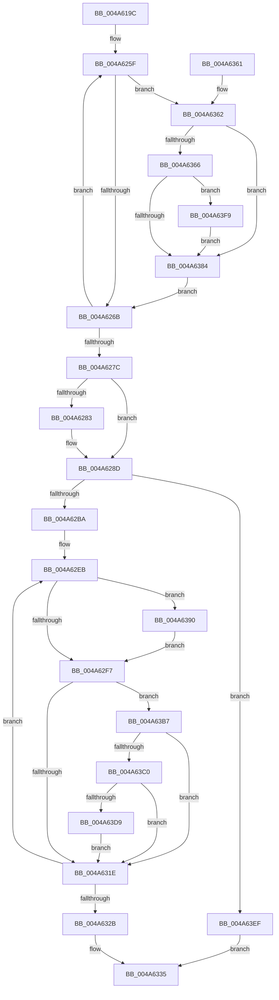

# MiMapMemoryDumpMdl

- RVA: `0x004A619C`–`0x004A6408` (길이 `620` bytes)
- VA: `0x00000001404A619C`
- 실행 섹션: `.text`
- PDB 이름 있음: `예`; PDB Function 태그: `아니요`
- unwind 정보 RVA: `0x000B6CAC`
- 디코드: `146`개 명령, `620/620` bytes 표시
- 미해석 바이트: `0` (있으면 어셈블리에 `.byte`로 보존)

> 이 문서는 커널 이미지의 기계어와 PDB 기호를 분석해 생성했습니다. 4번과 5번은 함수 원형과 자료형을 바이너리 사용 방식에서 추정한 C 해석이며 원본 소스 복구 결과는 아닙니다.

## 1. Dependencies

- 직접 호출 지점: **9**; 고유 호출 대상: **8**
- 직접 호출자로 확인된 함수: **3**
- RIP 상대 이미지 참조: **3**

### Outgoing calls
- `0x004A61E2` → [memset](../6C/memset_function_006C6C40.md) (function, `0x006C6C40`)
- `0x004A625A` → [MiInitializeTbFlushList](../29/MiInitializeTbFlushList_function_00294F00.md) (function, `0x00294F00`)
- `0x004A6288` → [MiFlushTbList](../31/MiFlushTbList_function_00311FC0.md) (function, `0x00311FC0`)
- `0x004A6307` → [MiMakeValidPte](../2C/MiMakeValidPte_function_002C5590.md) (function, `0x002C5590`)
- `0x004A6340` → [_security_check_cookie](../6A/_security_check_cookie_function_006AC640.md) (function, `0x006AC640`)
- `0x004A6375` → [MiInsertTbFlushEntry](../29/MiInsertTbFlushEntry_function_00293670.md) (function, `0x00293670`)
- `0x004A63AD` → [MiMakeProtectionPfnCompatible](../22/MiMakeProtectionPfnCompatible_function_00229CD0.md) (function, `0x00229CD0`)
- `0x004A63E5` → [MiCheckLinearProtectedPteAccessedBit](../29/MiCheckLinearProtectedPteAccessedBit_function_00292D80.md) (function, `0x00292D80`)
- `0x004A63FE` → [MiFlushTbList](../31/MiFlushTbList_function_00311FC0.md) (function, `0x00311FC0`)

### Direct callers
- [MmMapMemoryDumpMdl](MmMapMemoryDumpMdl_function_004A6160.md) at `0x004A618A`
- [MmMapMemoryDumpMdlEx2](../4F/MmMapMemoryDumpMdlEx2_function_004F98D4.md) at `0x004F98EB`
- [MmMapMemoryDumpMdlEx](../67/MmMapMemoryDumpMdlEx_function_0067DD30.md) at `0x0067DD44`

### Static image references
- `0x004A61B5` → RVA `0x00E0A740` (`.data`; read)
- `0x004A623D` → RVA `0x00E38200` (`.data`; read)
- `0x004A630C` → RVA `0x00FC6A88` (`ALMOSTRO`; read)

## 2. Other-region calls and transfers

- 다른 실행 섹션으로 향하는 call: **0**
- 별도 외부 분기/꼬리 이동을 확인하지 못했습니다.

## 3. Assembly (complete function range)

```asm
004A619C  48 89 5C 24 10                  mov qword ptr [rsp + 0x10], rbx
004A61A1  48 89 6C 24 20                  mov qword ptr [rsp + 0x20], rbp
004A61A6  56                              push rsi
004A61A7  57                              push rdi
004A61A8  41 54                           push r12
004A61AA  41 56                           push r14
004A61AC  41 57                           push r15
004A61AE  48 81 EC 20 01 00 00            sub rsp, 0x120
004A61B5  48 8B 05 84 45 96 00            mov rax, qword ptr [rip + 0x964584]
004A61BC  48 33 C4                        xor rax, rsp
004A61BF  48 89 84 24 10 01 00 00         mov qword ptr [rsp + 0x110], rax
004A61C7  49 8B F8                        mov rdi, r8
004A61CA  4C 89 44 24 30                  mov qword ptr [rsp + 0x30], r8
004A61CF  48 8B D9                        mov rbx, rcx
004A61D2  41 B8 C8 00 00 00               mov r8d, 0xc8
004A61D8  48 8D 4C 24 40                  lea rcx, [rsp + 0x40]
004A61DD  33 D2                           xor edx, edx
004A61DF  45 8B F9                        mov r15d, r9d
004A61E2  E8 59 0A 22 00                  call 0x1406c6c40
004A61E7  8B 4F 28                        mov ecx, dword ptr [rdi + 0x28]
004A61EA  B8 00 00 00 00                  mov eax, 0
004A61EF  8B 57 2C                        mov edx, dword ptr [rdi + 0x2c]
004A61F2  48 8B F3                        mov rsi, rbx
004A61F5  03 CA                           add ecx, edx
004A61F7  F7 C1 FF 0F 00 00               test ecx, 0xfff
004A61FD  0F 95 C0                        setne al
004A6200  C1 E9 0C                        shr ecx, 0xc
004A6203  48 C1 EE 09                     shr rsi, 9
004A6207  44 8D 24 01                     lea r12d, [rcx + rax]
004A620B  48 B8 F8 FF FF FF 7F 00 00 00   movabs rax, 0x7ffffffff8
004A6215  48 23 F0                        and rsi, rax
004A6218  48 B8 00 00 00 00 80 F6 FF FF   movabs rax, 0xfffff68000000000
004A6222  48 8B C0                        mov rax, rax
004A6225  48 03 D3                        add rdx, rbx
004A6228  C7 44 24 20 01 00 00 00         mov dword ptr [rsp + 0x20], 1
004A6230  41 B9 09 00 00 00               mov r9d, 9
004A6236  48 89 57 18                     mov qword ptr [rdi + 0x18], rdx
004A623A  48 03 F0                        add rsi, rax
004A623D  48 8D 15 BC 1F 99 00            lea rdx, [rip + 0x991fbc]
004A6244  48 8B EB                        mov rbp, rbx
004A6247  48 8D 4C 24 40                  lea rcx, [rsp + 0x40]
004A624C  48 81 E5 00 F0 FF FF            and rbp, 0xfffffffffffff000
004A6253  4C 8B F6                        mov r14, rsi
004A6256  45 8D 41 0B                     lea r8d, [r9 + 0xb]
004A625A  E8 A1 EC DE FF                  call 0x140294f00
004A625F  49 8B 06                        mov rax, qword ptr [r14]
004A6262  48 85 C0                        test rax, rax
004A6265  0F 85 F7 00 00 00               jne 0x1404a6362
004A626B  49 83 C6 08                     add r14, 8
004A626F  48 81 C5 00 10 00 00            add rbp, 0x1000
004A6276  49 83 EC 01                     sub r12, 1
004A627A  75 E3                           jne 0x1404a625f
004A627C  44 39 64 24 5C                  cmp dword ptr [rsp + 0x5c], r12d
004A6281  74 0A                           je 0x1404a628d
004A6283  48 8D 4C 24 40                  lea rcx, [rsp + 0x40]
004A6288  E8 33 BD E6 FF                  call 0x140311fc0
004A628D  8B 57 2C                        mov edx, dword ptr [rdi + 0x2c]
004A6290  B8 00 00 00 00                  mov eax, 0
004A6295  8B 4F 28                        mov ecx, dword ptr [rdi + 0x28]
004A6298  03 CA                           add ecx, edx
004A629A  F7 C1 FF 0F 00 00               test ecx, 0xfff
004A62A0  0F 95 C0                        setne al
004A62A3  C1 E9 0C                        shr ecx, 0xc
004A62A6  48 03 D3                        add rdx, rbx
004A62A9  48 89 57 18                     mov qword ptr [rdi + 0x18], rdx
004A62AD  8D 2C 01                        lea ebp, [rcx + rax]
004A62B0  41 F6 C7 02                     test r15b, 2
004A62B4  0F 85 35 01 00 00               jne 0x1404a63ef
004A62BA  4C 8B F7                        mov r14, rdi
004A62BD  48 C1 EB 09                     shr rbx, 9
004A62C1  48 B8 F8 FF FF FF 7F 00 00 00   movabs rax, 0x7ffffffff8
004A62CB  48 BF 00 00 00 00 80 F6 FF FF   movabs rdi, 0xfffff68000000000
004A62D5  48 23 D8                        and rbx, rax
004A62D8  41 83 E7 01                     and r15d, 1
004A62DC  4C 2B F3                        sub r14, rbx
004A62DF  48 8B C7                        mov rax, rdi
004A62E2  4C 2B F0                        sub r14, rax
004A62E5  41 BC 04 00 00 00               mov r12d, 4
004A62EB  41 8B C4                        mov eax, r12d
004A62EE  45 85 FF                        test r15d, r15d
004A62F1  0F 84 99 00 00 00               je 0x1404a6390
004A62F7  49 8B 54 36 30                  mov rdx, qword ptr [r14 + rsi + 0x30]
004A62FC  0D 00 00 00 A0                  or eax, 0xa0000000
004A6301  44 8B C0                        mov r8d, eax
004A6304  48 8B CE                        mov rcx, rsi
004A6307  E8 84 F2 E1 FF                  call 0x1402c5590
004A630C  48 0F BA 25 73 07 B2 00 24      bt qword ptr [rip + 0xb20773], 0x24
004A6315  48 8B D8                        mov rbx, rax
004A6318  0F 82 99 00 00 00               jb 0x1404a63b7
004A631E  48 89 1E                        mov qword ptr [rsi], rbx
004A6321  48 83 C6 08                     add rsi, 8
004A6325  48 83 ED 01                     sub rbp, 1
004A6329  75 C0                           jne 0x1404a62eb
004A632B  48 8B 7C 24 30                  mov rdi, qword ptr [rsp + 0x30]
004A6330  66 83 4F 0A 11                  or word ptr [rdi + 0xa], 0x11
004A6335  48 8B 8C 24 10 01 00 00         mov rcx, qword ptr [rsp + 0x110]
004A633D  48 33 CC                        xor rcx, rsp
004A6340  E8 FB 62 20 00                  call 0x1406ac640
004A6345  4C 8D 9C 24 20 01 00 00         lea r11, [rsp + 0x120]
004A634D  49 8B 5B 38                     mov rbx, qword ptr [r11 + 0x38]
004A6351  49 8B 6B 48                     mov rbp, qword ptr [r11 + 0x48]
004A6355  49 8B E3                        mov rsp, r11
004A6358  41 5F                           pop r15
004A635A  41 5E                           pop r14
004A635C  41 5C                           pop r12
004A635E  5F                              pop rdi
004A635F  5E                              pop rsi
004A6360  C3                              ret
004A6361  CC                              int3
004A6362  A8 01                           test al, 1
004A6364  74 1E                           je 0x1404a6384
004A6366  45 33 C9                        xor r9d, r9d
004A6369  48 8D 4C 24 40                  lea rcx, [rsp + 0x40]
004A636E  48 8B D5                        mov rdx, rbp
004A6371  45 8D 41 01                     lea r8d, [r9 + 1]
004A6375  E8 F6 D2 DE FF                  call 0x140293670
004A637A  8B 44 24 4C                     mov eax, dword ptr [rsp + 0x4c]
004A637E  39 44 24 5C                     cmp dword ptr [rsp + 0x5c], eax
004A6382  74 75                           je 0x1404a63f9
004A6384  49 C7 06 00 00 00 00            mov qword ptr [r14], 0
004A638B  E9 DB FE FF FF                  jmp 0x1404a626b
004A6390  49 8B 44 36 30                  mov rax, qword ptr [r14 + rsi + 0x30]
004A6395  48 8D 14 40                     lea rdx, [rax + rax*2]
004A6399  48 C1 E2 04                     shl rdx, 4
004A639D  48 B8 00 00 00 00 00 DE FF FF   movabs rax, 0xffffde0000000000
004A63A7  48 03 D0                        add rdx, rax
004A63AA  41 8B CC                        mov ecx, r12d
004A63AD  E8 1E 39 D8 FF                  call 0x140229cd0
004A63B2  E9 40 FF FF FF                  jmp 0x1404a62f7
004A63B7  F6 C3 20                        test bl, 0x20
004A63BA  0F 85 5E FF FF FF               jne 0x1404a631e
004A63C0  48 8B C7                        mov rax, rdi
004A63C3  48 B9 00 00 00 00 40 00 00 00   movabs rcx, 0x4000000000
004A63CD  48 03 C1                        add rax, rcx
004A63D0  48 3B F0                        cmp rsi, rax
004A63D3  0F 82 45 FF FF FF               jb 0x1404a631e
004A63D9  41 B8 80 00 00 00               mov r8d, 0x80
004A63DF  48 8B D3                        mov rdx, rbx
004A63E2  48 8B CE                        mov rcx, rsi
004A63E5  E8 96 C9 DE FF                  call 0x140292d80
004A63EA  E9 2F FF FF FF                  jmp 0x1404a631e
004A63EF  66 83 67 0A DE                  and word ptr [rdi + 0xa], 0xffde
004A63F4  E9 3C FF FF FF                  jmp 0x1404a6335
004A63F9  48 8D 4C 24 40                  lea rcx, [rsp + 0x40]
004A63FE  E8 BD BB E6 FF                  call 0x140311fc0
004A6403  E9 7C FF FF FF                  jmp 0x1404a6384
```

## 4. C-style interpretation (structured pseudocode)

```c
__int64 __fastcall MiMapMemoryDumpMdl(__int64 a1, int a2, __int64 a3, int a4)
{
    __int64 result;
    __int64 v_r12;
    __int64 v_r14;
    __int64 v_r15;
    __int64 v_rbp;
    __int64 v_rbx;
    __int64 v_rsi;
    __int64 v_rsp;
    unsigned __int64 v_stack_m108;
    unsigned __int64 v_stack_m118;
    unsigned int v_stack_m128;
    unsigned __int64 v_stack_m28;
    unsigned __int64 v_stack_m38;
    unsigned int v_stack_mC4;
    unsigned int v_stack_mD4;
    unsigned __int64 v_stack_mE0;
    unsigned int v_stack_mEC;
    unsigned __int64 v_stack_p10;
    unsigned __int64 v_stack_p20;

    v_stack_p10 = v_rbx;
    v_stack_p20 = v_rbp;
    v_rsp = (v_rsp) - (288);
    result = (*(unsigned __int64 *)(v_rip + 9848196)) ^ (v_rsp);
    v_stack_m38 = result;
    v_stack_m118 = a3;
    a2 = 0;
    result = memset(v_stack_m108, a2, 200, a4);
    a1 = (unsigned int)(((unsigned int)(*(unsigned int *)(a3 + 40))) + ((unsigned int)((unsigned int)(*(unsigned int *)(a3 + 44)))));
    result = ((((unsigned int)(a1)) & (0xFFFULL)) != 0) ? 1 : 0;
    a1 = (unsigned int)((a1) >> (12));
    v_rsi = (a1) >> (9);
    v_rsi = (v_rsi) & (result);
    a2 = ((unsigned int)(*(unsigned int *)(a3 + 44))) + (a1);
    v_stack_m128 = 1;
    *(unsigned __int64 *)(a3 + 24) = a2;
    v_rsi = (v_rsi) + (result);
    v_rbp = (a1) & (0xFFFFFFFFFFFFF000ULL);
    result = MiInitializeTbFlushList(v_stack_m108, v_rip + 10035132, 9 + 11, 9);
loc_004A625F:
    if (*(unsigned __int64 *)(v_rsi) != 0) goto loc_004A6362;
loc_004A626B:
    v_r14 = (v_rsi) + (8);
    v_rbp = (v_rbp) + (0x1000ULL);
    v_r12 = (a1 + result * 1) - (1);
    if (condition_is_not_equal) goto loc_004A625F;
    result = *(unsigned __int64 *)(v_rsi);
    if (v_stack_mEC != ((unsigned int)(v_r12))) {
        a1 = v_stack_m108;
        result = MiFlushTbList(a1, v_rip + 10035132, 9 + 11, 9);
    }
    a1 = (unsigned int)(((unsigned int)(*(unsigned int *)(a3 + 40))) + ((unsigned int)((unsigned int)(*(unsigned int *)(a3 + 44)))));
    result = ((((unsigned int)(a1)) & (0xFFFULL)) != 0) ? 1 : 0;
    a1 = (unsigned int)((a1) >> (12));
    a2 = ((unsigned int)(*(unsigned int *)(a3 + 44))) + (a1);
    *(unsigned __int64 *)(a3 + 24) = a2;
    if ((((unsigned __int8)((unsigned int)(a4))) & (2)) != 0) goto loc_004A63EF;
    v_rbx = (a1) >> (9);
    v_rbx = (v_rbx) & (result);
    v_r15 = (unsigned int)(((unsigned int)(a4)) & (1));
    v_r14 = (a3) - (v_rbx);
    v_r14 = (v_r14) - (a3);
loc_004A62EB:
    if ((unsigned int)(v_r15) == 0) goto loc_004A6390;
loc_004A62F7:
    result = (unsigned int)((4) | (0xA0000000ULL));
    result = MiMakeValidPte(v_rsi, *(unsigned __int64 *)(v_r14 + v_rsi * 1 + 48), (unsigned int)((unsigned int)(result)), 9);
    if (condition_is_below) goto loc_004A63B7;
loc_004A631E:
    *(unsigned __int64 *)(v_rsi) = result;
    v_rsi = (v_rsi) + (8);
    v_rbp = (a1 + result * 1) - (1);
    if (condition_is_not_equal) goto loc_004A62EB;
loc_004A6335:
    a1 = (v_stack_m38) ^ (v_rsp);
    result = _security_check_cookie(a1, *(unsigned __int64 *)(v_r14 + v_rsi * 1 + 48), (unsigned int)((unsigned int)(result)), 9);
    return result;
loc_004A6362:
    if ((((unsigned __int8)(result)) & (1)) == 0) goto loc_004A6384;
    a4 = 0;
    result = MiInsertTbFlushEntry(v_stack_mE0, *(unsigned __int64 *)(v_stack_m28 + 72), a4 + 1, a4);
    if (v_stack_mC4 == ((unsigned int)((unsigned int)(v_stack_mD4)))) goto loc_004A63F9;
loc_004A6384:
    *(unsigned __int64 *)(v_r14) = 0;
    goto loc_004A626B;
loc_004A6390:
    a2 = (*(unsigned __int64 *)(v_r14 + v_rsi * 1 + 48) + *(unsigned __int64 *)(v_r14 + v_rsi * 1 + 48) * 2) << (4);
    a2 = (a2) + (*(unsigned __int64 *)(v_r14 + v_rsi * 1 + 48));
    result = MiMakeProtectionPfnCompatible(4, a2, a4 + 1, a4);
    goto loc_004A62F7;
loc_004A63B7:
    if ((((unsigned __int8)(*(unsigned __int64 *)(v_stack_m28 + 56))) & (32)) != 0) goto loc_004A631E;
    result = (v_stack_m118) + (4);
    if (v_rsi < result) goto loc_004A631E;
    result = MiCheckLinearProtectedPteAccessedBit(v_rsi, *(unsigned __int64 *)(v_stack_m28 + 56), 128, a4);
    goto loc_004A631E;
loc_004A63EF:
    goto loc_004A6335;
loc_004A63F9:
    result = MiFlushTbList(v_stack_mE0, *(unsigned __int64 *)(v_stack_m28 + 56), 128, a4);
    goto loc_004A6384;
}
```

## 5. (Beta) C Style

```c
int64_t MiMapMemoryDumpMdl(int64_t Arg1, int32_t Arg2, void *Arg3, int32_t Arg4)
{
    uint8_t *arg3 = (uint8_t *)Arg3;

    int64_t result;
    int64_t local_r12;
    int64_t local_r14;
    int64_t local_r15;
    int64_t local_rbp;
    int64_t local_rbx;
    int64_t local_rsi;
    int64_t local_rsp;
    uint64_t v_stack_m108;
    uint64_t v_stack_m118;
    uint32_t v_stack_m128;
    uint64_t v_stack_m28;
    uint64_t v_stack_m38;
    uint32_t v_stack_mC4;
    uint32_t v_stack_mD4;
    uint64_t v_stack_mE0;
    uint32_t v_stack_mEC;
    uint64_t v_stack_p10;
    uint64_t v_stack_p20;

    v_stack_p10 = local_rbx;
    v_stack_p20 = local_rbp;
    local_rsp = (local_rsp) - (288);
    result = (*(uint64_t *)(v_rip + 0x964584)) ^ (local_rsp);
    v_stack_m38 = result;
    v_stack_m118 = Arg3;
    Arg2 = 0;
    result = memset(v_stack_m108, Arg2, 200, Arg4);
    Arg1 = (uint32_t)(((uint32_t)(*(uint32_t *)(arg3 + 0x28))) + ((uint32_t)((uint32_t)(*(uint32_t *)(arg3 + 0x2C)))));
    result = ((((uint32_t)(Arg1)) & (0xFFFULL)) != 0) ? 1 : 0;
    Arg1 = (uint32_t)((Arg1) >> (12));
    local_rsi = (Arg1) >> (9);
    local_rsi = (local_rsi) & (result);
    Arg2 = ((uint32_t)(*(uint32_t *)(arg3 + 0x2C))) + (Arg1);
    v_stack_m128 = 1;
    *(uint64_t *)(arg3 + 0x18) = Arg2;
    local_rsi = (local_rsi) + (result);
    local_rbp = (Arg1) & (0xFFFFFFFFFFFFF000ULL);
    result = MiInitializeTbFlushList(v_stack_m108, v_rip + 10035132, 9 + 11, 9);
loc_004A625F:
    if (*(uint64_t *)(local_rsi) != 0) goto loc_004A6362;
loc_004A626B:
    local_r14 = (local_rsi) + (8);
    local_rbp = (local_rbp) + (0x1000ULL);
    local_r12 = (Arg1 + result * 1) - (1);
    if (condition_is_not_equal) goto loc_004A625F;
    result = *(uint64_t *)(local_rsi);
    if (v_stack_mEC != ((uint32_t)(local_r12))) {
        Arg1 = v_stack_m108;
        result = MiFlushTbList(Arg1, v_rip + 10035132, 9 + 11, 9);
    }
    Arg1 = (uint32_t)(((uint32_t)(*(uint32_t *)(arg3 + 0x28))) + ((uint32_t)((uint32_t)(*(uint32_t *)(arg3 + 0x2C)))));
    result = ((((uint32_t)(Arg1)) & (0xFFFULL)) != 0) ? 1 : 0;
    Arg1 = (uint32_t)((Arg1) >> (12));
    Arg2 = ((uint32_t)(*(uint32_t *)(arg3 + 0x2C))) + (Arg1);
    *(uint64_t *)(arg3 + 0x18) = Arg2;
    if ((((uint8_t)((uint32_t)(Arg4))) & (2)) != 0) goto loc_004A63EF;
    local_rbx = (Arg1) >> (9);
    local_rbx = (local_rbx) & (result);
    local_r15 = (uint32_t)(((uint32_t)(Arg4)) & (1));
    local_r14 = (Arg3) - (local_rbx);
    local_r14 = (local_r14) - (Arg3);
loc_004A62EB:
    if ((uint32_t)(local_r15) == 0) goto loc_004A6390;
loc_004A62F7:
    result = (uint32_t)((4) | (0xA0000000ULL));
    result = MiMakeValidPte(local_rsi, *(uint64_t *)(local_r14 + local_rsi * 1 + 0x30), (uint32_t)((uint32_t)(result)), 9);
    if (condition_is_below) goto loc_004A63B7;
loc_004A631E:
    *(uint64_t *)(local_rsi) = result;
    local_rsi = (local_rsi) + (8);
    local_rbp = (Arg1 + result * 1) - (1);
    if (condition_is_not_equal) goto loc_004A62EB;
loc_004A6335:
    Arg1 = (v_stack_m38) ^ (local_rsp);
    result = _security_check_cookie(Arg1, *(uint64_t *)(local_r14 + local_rsi * 1 + 0x30), (uint32_t)((uint32_t)(result)), 9);
    return result;
loc_004A6362:
    if ((((uint8_t)(result)) & (1)) == 0) goto loc_004A6384;
    Arg4 = 0;
    result = MiInsertTbFlushEntry(v_stack_mE0, *(uint64_t *)(v_stack_m28 + 0x48), Arg4 + 1, Arg4);
    if (v_stack_mC4 == ((uint32_t)((uint32_t)(v_stack_mD4)))) goto loc_004A63F9;
loc_004A6384:
    *(uint64_t *)(local_r14) = 0;
    goto loc_004A626B;
loc_004A6390:
    Arg2 = (*(uint64_t *)(local_r14 + local_rsi * 1 + 0x30) + *(uint64_t *)(local_r14 + local_rsi * 1 + 0x30) * 2) << (4);
    Arg2 = (Arg2) + (*(uint64_t *)(local_r14 + local_rsi * 1 + 0x30));
    result = MiMakeProtectionPfnCompatible(4, Arg2, Arg4 + 1, Arg4);
    goto loc_004A62F7;
loc_004A63B7:
    if ((((uint8_t)(*(uint64_t *)(v_stack_m28 + 0x38))) & (32)) != 0) goto loc_004A631E;
    result = (v_stack_m118) + (4);
    if (local_rsi < result) goto loc_004A631E;
    result = MiCheckLinearProtectedPteAccessedBit(local_rsi, *(uint64_t *)(v_stack_m28 + 0x38), 128, Arg4);
    goto loc_004A631E;
loc_004A63EF:
    goto loc_004A6335;
loc_004A63F9:
    result = MiFlushTbList(v_stack_mE0, *(uint64_t *)(v_stack_m28 + 0x38), 128, Arg4);
    goto loc_004A6384;
}
```

### 관측된 메모리 오프셋

구조체 형식이 확인되지 않은 접근은 인자 기준의 오프셋으로만 기록했습니다.

| 기준 인자 | 오프셋 표현 | 폭 (bit) | 접근 |
|---|---:|---:|---|
| `Arg3` | `+ 0xA` | `16` | `R/W` |
| `Arg3` | `+ 0x18` | `64` | `W` |
| `Arg3` | `+ 0x28` | `32` | `R` |
| `Arg3` | `+ 0x2C` | `32` | `R` |
| `Arg3` | `+ 0x30 + rsi*1` | `64` | `R` |

## 6. Execution-region graph

[열기: 2D/3D 그래프와 함수 탐색 컨트롤 패널](../../../control-panel.html?section=text&rva=0x004A619C&view=graph)

- 2D 그래프는 위에서 아래로 흐르고, 3D 그래프는 빈 공간을 드래그해 회전합니다. Shift+드래그는 이동, 휠은 확대·축소, 함수 노드 선택은 대상 보고서 이동입니다.

### Static fallback


