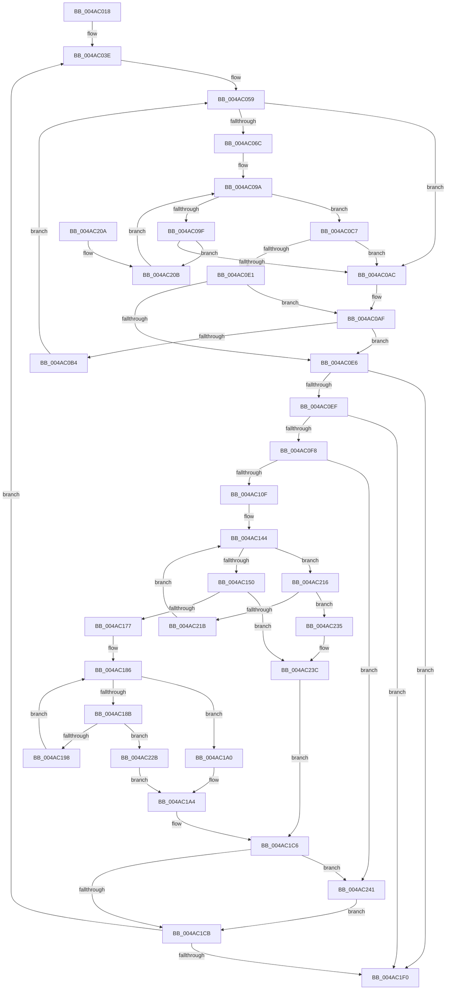

# MiMirrorReduceBlackToActiveAndPrivatePages

- RVA: `0x004AC018`–`0x004AC246` (길이 `558` bytes)
- VA: `0x00000001404AC018`
- 실행 섹션: `.text`
- PDB 이름 있음: `예`; PDB Function 태그: `아니요`
- unwind 정보 RVA: `0x000B81E8`
- 디코드: `157`개 명령, `558/558` bytes 표시
- 미해석 바이트: `0` (있으면 어셈블리에 `.byte`로 보존)

> 이 문서는 커널 이미지의 기계어와 PDB 기호를 분석해 생성했습니다. 4번과 5번은 함수 원형과 자료형을 바이너리 사용 방식에서 추정한 C 해석이며 원본 소스 복구 결과는 아닙니다.

## 1. Dependencies

- 직접 호출 지점: **1**; 고유 호출 대상: **1**
- 직접 호출자로 확인된 함수: **1**
- RIP 상대 이미지 참조: **2**

### Outgoing calls
- `0x004AC1D7` → [MiMirrorRemoveInactivePages](MiMirrorRemoveInactivePages_function_004AC24C.md) (function, `0x004AC24C`)

### Direct callers
- [MiMirrorBlackPhase](../67/MiMirrorBlackPhase_function_00678B4C.md) at `0x00678BA7`

### Static image references
- `0x004AC03E` → RVA `0x00E301A0` (`.data`; read)
- `0x004AC045` → RVA `0x00E301A8` (`.data`; read)

## 2. Other-region calls and transfers

- 다른 실행 섹션으로 향하는 call: **0**
- 별도 외부 분기/꼬리 이동을 확인하지 못했습니다.

## 3. Assembly (complete function range)

```asm
004AC018  48 89 5C 24 10                  mov qword ptr [rsp + 0x10], rbx
004AC01D  48 89 74 24 18                  mov qword ptr [rsp + 0x18], rsi
004AC022  48 89 7C 24 20                  mov qword ptr [rsp + 0x20], rdi
004AC027  41 54                           push r12
004AC029  41 56                           push r14
004AC02B  41 57                           push r15
004AC02D  48 83 EC 20                     sub rsp, 0x20
004AC031  33 D2                           xor edx, edx
004AC033  4C 8B F1                        mov r14, rcx
004AC036  49 83 CF FF                     or r15, 0xffffffffffffffff
004AC03A  44 8D 62 01                     lea r12d, [rdx + 1]
004AC03E  4C 8B 1D 5B 41 98 00            mov r11, qword ptr [rip + 0x98415b]
004AC045  48 8B 35 5C 41 98 00            mov rsi, qword ptr [rip + 0x98415c]
004AC04C  49 3B D3                        cmp rdx, r11
004AC04F  4D 1B D2                        sbb r10, r10
004AC052  4C 23 D2                        and r10, rdx
004AC055  4D 8D 43 FF                     lea r8, [r11 - 1]
004AC059  83 64 24 40 00                  and dword ptr [rsp + 0x40], 0
004AC05E  49 8B C0                        mov rax, r8
004AC061  49 2B C2                        sub rax, r10
004AC064  49 03 C4                        add rax, r12
004AC067  49 3B C4                        cmp rax, r12
004AC06A  72 40                           jb 0x1404ac0ac
004AC06C  49 8B C0                        mov rax, r8
004AC06F  41 8A CA                        mov cl, r10b
004AC072  48 C1 E8 06                     shr rax, 6
004AC076  80 E1 3F                        and cl, 0x3f
004AC079  4D 8B CC                        mov r9, r12
004AC07C  49 D3 E1                        shl r9, cl
004AC07F  4D 2B CC                        sub r9, r12
004AC082  48 8D 3C C6                     lea rdi, [rsi + rax*8]
004AC086  49 8B C2                        mov rax, r10
004AC089  48 C1 E8 06                     shr rax, 6
004AC08D  48 8D 1C C6                     lea rbx, [rsi + rax*8]
004AC091  48 8B 03                        mov rax, qword ptr [rbx]
004AC094  48 F7 D0                        not rax
004AC097  4C 0B C8                        or r9, rax
004AC09A  4D 3B CF                        cmp r9, r15
004AC09D  75 28                           jne 0x1404ac0c7
004AC09F  48 83 C3 08                     add rbx, 8
004AC0A3  48 3B DF                        cmp rbx, rdi
004AC0A6  0F 86 5F 01 00 00               jbe 0x1404ac20b
004AC0AC  49 8B DF                        mov rbx, r15
004AC0AF  4D 85 D2                        test r10, r10
004AC0B2  74 32                           je 0x1404ac0e6
004AC0B4  4C 8D 42 01                     lea r8, [rdx + 1]
004AC0B8  4D 3B C3                        cmp r8, r11
004AC0BB  4D 0F 47 C3                     cmova r8, r11
004AC0BF  4D 2B C4                        sub r8, r12
004AC0C2  45 33 D2                        xor r10d, r10d
004AC0C5  EB 92                           jmp 0x1404ac059
004AC0C7  48 2B DE                        sub rbx, rsi
004AC0CA  49 F7 D1                        not r9
004AC0CD  48 C1 FB 03                     sar rbx, 3
004AC0D1  49 0F BC C1                     bsf rax, r9
004AC0D5  48 C1 E3 06                     shl rbx, 6
004AC0D9  48 03 D8                        add rbx, rax
004AC0DC  49 3B D8                        cmp rbx, r8
004AC0DF  77 CB                           ja 0x1404ac0ac
004AC0E1  49 3B DF                        cmp rbx, r15
004AC0E4  74 C9                           je 0x1404ac0af
004AC0E6  48 3B DA                        cmp rbx, rdx
004AC0E9  0F 82 01 01 00 00               jb 0x1404ac1f0
004AC0EF  49 3B DF                        cmp rbx, r15
004AC0F2  0F 84 F8 00 00 00               je 0x1404ac1f0
004AC0F8  83 64 24 40 00                  and dword ptr [rsp + 0x40], 0
004AC0FD  33 F6                           xor esi, esi
004AC0FF  48 8B 05 9A 40 98 00            mov rax, qword ptr [rip + 0x98409a]
004AC106  48 3B C3                        cmp rax, rbx
004AC109  0F 86 32 01 00 00               jbe 0x1404ac241
004AC10F  4C 8B 15 92 40 98 00            mov r10, qword ptr [rip + 0x984092]
004AC116  48 FF C8                        dec rax
004AC119  48 C1 E8 06                     shr rax, 6
004AC11D  8A CB                           mov cl, bl
004AC11F  80 E1 3F                        and cl, 0x3f
004AC122  4D 8D 0C C2                     lea r9, [r10 + rax*8]
004AC126  48 8B C3                        mov rax, rbx
004AC129  48 C1 E8 06                     shr rax, 6
004AC12D  49 8D 14 C2                     lea rdx, [r10 + rax*8]
004AC131  49 8B C4                        mov rax, r12
004AC134  4C 8B 02                        mov r8, qword ptr [rdx]
004AC137  48 D3 E0                        shl rax, cl
004AC13A  49 2B C4                        sub rax, r12
004AC13D  4C 0B C0                        or r8, rax
004AC140  48 8D 42 08                     lea rax, [rdx + 8]
004AC144  49 F7 D0                        not r8
004AC147  4D 85 C0                        test r8, r8
004AC14A  0F 84 C6 00 00 00               je 0x1404ac216
004AC150  49 0F BC C8                     bsf rcx, r8
004AC154  48 8B FA                        mov rdi, rdx
004AC157  49 2B FA                        sub rdi, r10
004AC15A  8B C1                           mov eax, ecx
004AC15C  48 C1 FF 03                     sar rdi, 3
004AC160  48 C1 E7 06                     shl rdi, 6
004AC164  48 03 F8                        add rdi, rax
004AC167  48 8B 05 32 40 98 00            mov rax, qword ptr [rip + 0x984032]
004AC16E  48 3B F8                        cmp rdi, rax
004AC171  0F 87 C5 00 00 00               ja 0x1404ac23c
004AC177  49 8B C4                        mov rax, r12
004AC17A  48 D3 E0                        shl rax, cl
004AC17D  49 2B C4                        sub rax, r12
004AC180  49 0B C0                        or rax, r8
004AC183  48 F7 D0                        not rax
004AC186  48 85 C0                        test rax, rax
004AC189  75 15                           jne 0x1404ac1a0
004AC18B  48 8D 42 08                     lea rax, [rdx + 8]
004AC18F  49 3B C1                        cmp rax, r9
004AC192  0F 87 93 00 00 00               ja 0x1404ac22b
004AC198  48 8B D0                        mov rdx, rax
004AC19B  48 8B 00                        mov rax, qword ptr [rax]
004AC19E  EB E6                           jmp 0x1404ac186
004AC1A0  48 0F BC C0                     bsf rax, rax
004AC1A4  48 8B F2                        mov rsi, rdx
004AC1A7  49 2B F2                        sub rsi, r10
004AC1AA  48 C1 FE 03                     sar rsi, 3
004AC1AE  48 C1 E6 06                     shl rsi, 6
004AC1B2  48 03 F0                        add rsi, rax
004AC1B5  48 8B 05 E4 3F 98 00            mov rax, qword ptr [rip + 0x983fe4]
004AC1BC  48 3B F0                        cmp rsi, rax
004AC1BF  48 0F 47 F0                     cmova rsi, rax
004AC1C3  48 2B F7                        sub rsi, rdi
004AC1C6  48 85 F6                        test rsi, rsi
004AC1C9  74 76                           je 0x1404ac241
004AC1CB  48 2B FB                        sub rdi, rbx
004AC1CE  48 8B D3                        mov rdx, rbx
004AC1D1  4C 8B C7                        mov r8, rdi
004AC1D4  49 8B CE                        mov rcx, r14
004AC1D7  E8 70 00 00 00                  call 0x1404ac24c
004AC1DC  48 8D 14 1E                     lea rdx, [rsi + rbx]
004AC1E0  48 03 D7                        add rdx, rdi
004AC1E3  48 3B 15 B6 3F 98 00            cmp rdx, qword ptr [rip + 0x983fb6]
004AC1EA  0F 82 4E FE FF FF               jb 0x1404ac03e
004AC1F0  48 8B 5C 24 48                  mov rbx, qword ptr [rsp + 0x48]
004AC1F5  48 8B 74 24 50                  mov rsi, qword ptr [rsp + 0x50]
004AC1FA  48 8B 7C 24 58                  mov rdi, qword ptr [rsp + 0x58]
004AC1FF  48 83 C4 20                     add rsp, 0x20
004AC203  41 5F                           pop r15
004AC205  41 5E                           pop r14
004AC207  41 5C                           pop r12
004AC209  C3                              ret
004AC20A  CC                              int3
004AC20B  4C 8B 0B                        mov r9, qword ptr [rbx]
004AC20E  49 F7 D1                        not r9
004AC211  E9 84 FE FF FF                  jmp 0x1404ac09a
004AC216  49 3B C1                        cmp rax, r9
004AC219  77 1A                           ja 0x1404ac235
004AC21B  48 83 C2 08                     add rdx, 8
004AC21F  48 83 C0 08                     add rax, 8
004AC223  4C 8B 02                        mov r8, qword ptr [rdx]
004AC226  E9 19 FF FF FF                  jmp 0x1404ac144
004AC22B  B8 40 00 00 00                  mov eax, 0x40
004AC230  E9 6F FF FF FF                  jmp 0x1404ac1a4
004AC235  48 8B 05 64 3F 98 00            mov rax, qword ptr [rip + 0x983f64]
004AC23C  48 8B F8                        mov rdi, rax
004AC23F  EB 85                           jmp 0x1404ac1c6
004AC241  48 8B F8                        mov rdi, rax
004AC244  EB 85                           jmp 0x1404ac1cb
```

## 4. C-style interpretation (structured pseudocode)

```c
__int64 __fastcall MiMirrorReduceBlackToActiveAndPrivatePages(__int64 a1, int a2)
{
    __int64 result;
    __int64 v_r10;
    __int64 v_r15;
    __int64 v_rbx;
    __int64 v_rdi;
    __int64 v_rsi;
    __int64 v_rsp;
    unsigned __int64 v_stack_p10;
    unsigned __int64 v_stack_p18;
    unsigned __int64 v_stack_p20;
    unsigned int v_stack_p8;

    v_stack_p10 = v_rbx;
    v_stack_p18 = v_rsi;
    v_stack_p20 = v_rdi;
    v_rsp = (v_rsp) - (32);
    a2 = 0;
    v_r15 = (v_r15) | (-1);
loc_004AC03E:
    v_r10 = (v_r10) & (0);
loc_004AC059:
    result = (*(unsigned __int64 *)(v_rip + 9978203) - 1) - (v_r10);
    result = (result) + (a2 + 1);
    if (result < (a2 + 1)) goto loc_004AC0AC;
    result = (*(unsigned __int64 *)(v_rip + 9978203) - 1) >> (6);
    a1 = (unsigned __int8)(((unsigned __int8)(v_r10)) & (63));
    a4 = (a2 + 1) << ((unsigned __int8)(a1));
    a4 = (a4) - (a2 + 1);
    result = (v_r10) >> (6);
    result = ~(*(unsigned __int64 *)(*(unsigned __int64 *)(v_rip + 9978204) + result * 8));
    a4 = (a4) | (result);
loc_004AC09A:
    if (a4 != v_r15) goto loc_004AC0C7;
    v_rbx = (*(unsigned __int64 *)(v_rip + 9978204) + result * 8) + (8);
    if (v_rbx <= (*(unsigned __int64 *)(v_rip + 9978204) + result * 8)) goto loc_004AC20B;
loc_004AC0AC:
loc_004AC0AF:
    if (v_r10 == 0) goto loc_004AC0E6;
    a3 = a2 + 1;
    if ((a2 + 1) > (*(unsigned __int64 *)(v_rip + 9978203))) { a3 = *(unsigned __int64 *)(v_rip + 9978203); }
    a3 = (a3) - (a2 + 1);
    v_r10 = 0;
    goto loc_004AC059;
loc_004AC0C7:
    v_rbx = (v_r15) - (*(unsigned __int64 *)(v_rip + 9978204));
    a4 = ~(a4);
    v_rbx = (v_rbx) >> (3);
    v_rbx = (v_rbx) << (6);
    v_rbx = (v_rbx) + (result);
    if (v_rbx > a3) goto loc_004AC0AC;
    if (v_rbx == v_r15) goto loc_004AC0AF;
loc_004AC0E6:
    if (v_rbx < 0) goto loc_004AC1F0;
    if (v_rbx == v_r15) goto loc_004AC1F0;
    v_rsi = 0;
    if ((*(unsigned __int64 *)(v_rip + 9978010)) <= v_rbx) goto loc_004AC241;
    result = (*(unsigned __int64 *)(v_rip + 9978010)) - 1;
    result = (result) >> (6);
    a1 = (unsigned __int8)(((unsigned __int8)(v_rbx)) & (63));
    result = (v_rbx) >> (6);
    result = (a2 + 1) << ((unsigned __int8)(a1));
    result = (result) - (a2 + 1);
    a3 = (*(unsigned __int64 *)(*(unsigned __int64 *)(v_rip + 9978002) + result * 8)) | (result);
loc_004AC144:
    a3 = ~(a3);
    if (a3 == 0) goto loc_004AC216;
    v_rdi = (*(unsigned __int64 *)(v_rip + 9978002) + result * 8) - (*(unsigned __int64 *)(v_rip + 9978002));
    v_rdi = (v_rdi) >> (3);
    v_rdi = (v_rdi) << (6);
    v_rdi = (v_rdi) + ((unsigned int)((unsigned int)(a1)));
    if (v_rdi > (*(unsigned __int64 *)(v_rip + 9977906))) goto loc_004AC23C;
    result = (a2 + 1) << ((unsigned __int8)(a1));
    result = (result) - (a2 + 1);
    result = (result) | (a3);
    result = ~(result);
loc_004AC186:
    if (result != 0) goto loc_004AC1A0;
    if ((*(unsigned __int64 *)(v_rip + 9978002) + result * 8 + 8) > (*(unsigned __int64 *)(v_rip + 9978002) + result * 8)) goto loc_004AC22B;
    goto loc_004AC186;
loc_004AC1A0:
loc_004AC1A4:
    v_rsi = (*(unsigned __int64 *)(v_rip + 9978002) + result * 8 + 8) - (*(unsigned __int64 *)(v_rip + 9978002));
    v_rsi = (v_rsi) >> (3);
    v_rsi = (v_rsi) << (6);
    v_rsi = (v_rsi) + (*(unsigned __int64 *)(*(unsigned __int64 *)(v_rip + 9978002) + result * 8 + 8));
    if (v_rsi > (*(unsigned __int64 *)(v_rip + 9977828))) { v_rsi = *(unsigned __int64 *)(v_rip + 9977828); }
    v_rsi = (v_rsi) - (v_rdi);
loc_004AC1C6:
    if (v_rsi == 0) goto loc_004AC241;
loc_004AC1CB:
    v_rdi = (v_rdi) - (v_rbx);
    result = MiMirrorRemoveInactivePages(a1, v_rbx, v_rdi, *(unsigned __int64 *)(v_rip + 9978002) + result * 8);
    a2 = (v_rsi + v_rbx * 1) + (v_rdi);
    if (a2 < (*(unsigned __int64 *)(v_rip + 9977782))) goto loc_004AC03E;
loc_004AC1F0:
    v_rsp = (v_rsp) + (32);
    return result;
loc_004AC20B:
    a4 = ~(*(unsigned __int64 *)(v_stack_p10));
    goto loc_004AC09A;
loc_004AC216:
    if (result > a4) goto loc_004AC235;
    a2 = (a2) + (8);
    result = (result) + (8);
    goto loc_004AC144;
loc_004AC22B:
    goto loc_004AC1A4;
loc_004AC235:
loc_004AC23C:
    goto loc_004AC1C6;
loc_004AC241:
    goto loc_004AC1CB;
}
```

## 5. (Beta) C Style

```c
int64_t MiMirrorReduceBlackToActiveAndPrivatePages(int64_t Arg1, int32_t Arg2)
{
    int64_t result;
    int64_t local_r10;
    int64_t local_r15;
    int64_t local_rbx;
    int64_t local_rdi;
    int64_t local_rsi;
    int64_t local_rsp;
    uint64_t v_stack_p10;
    uint64_t v_stack_p18;
    uint64_t v_stack_p20;
    uint32_t v_stack_p8;

    v_stack_p10 = local_rbx;
    v_stack_p18 = local_rsi;
    v_stack_p20 = local_rdi;
    local_rsp = (local_rsp) - (32);
    Arg2 = 0;
    local_r15 = (local_r15) | (-1);
loc_004AC03E:
    local_r10 = (local_r10) & (0);
loc_004AC059:
    result = (*(uint64_t *)(v_rip + 0x98415B) - 1) - (local_r10);
    result = (result) + (Arg2 + 1);
    if (result < (Arg2 + 1)) goto loc_004AC0AC;
    result = (*(uint64_t *)(v_rip + 0x98415B) - 1) >> (6);
    Arg1 = (uint8_t)(((uint8_t)(local_r10)) & (63));
    a4 = (Arg2 + 1) << ((uint8_t)(Arg1));
    a4 = (a4) - (Arg2 + 1);
    result = (local_r10) >> (6);
    result = ~(*(uint64_t *)(*(uint64_t *)(v_rip + 0x98415C) + result * 8));
    a4 = (a4) | (result);
loc_004AC09A:
    if (a4 != local_r15) goto loc_004AC0C7;
    local_rbx = (*(uint64_t *)(v_rip + 0x98415C) + result * 8) + (8);
    if (local_rbx <= (*(uint64_t *)(v_rip + 0x98415C) + result * 8)) goto loc_004AC20B;
loc_004AC0AC:
loc_004AC0AF:
    if (local_r10 == 0) goto loc_004AC0E6;
    a3 = Arg2 + 1;
    if ((Arg2 + 1) > (*(uint64_t *)(v_rip + 0x98415B))) { a3 = *(uint64_t *)(v_rip + 0x98415B); }
    a3 = (a3) - (Arg2 + 1);
    local_r10 = 0;
    goto loc_004AC059;
loc_004AC0C7:
    local_rbx = (local_r15) - (*(uint64_t *)(v_rip + 0x98415C));
    a4 = ~(a4);
    local_rbx = (local_rbx) >> (3);
    local_rbx = (local_rbx) << (6);
    local_rbx = (local_rbx) + (result);
    if (local_rbx > a3) goto loc_004AC0AC;
    if (local_rbx == local_r15) goto loc_004AC0AF;
loc_004AC0E6:
    if (local_rbx < 0) goto loc_004AC1F0;
    if (local_rbx == local_r15) goto loc_004AC1F0;
    local_rsi = 0;
    if ((*(uint64_t *)(v_rip + 0x98409A)) <= local_rbx) goto loc_004AC241;
    result = (*(uint64_t *)(v_rip + 0x98409A)) - 1;
    result = (result) >> (6);
    Arg1 = (uint8_t)(((uint8_t)(local_rbx)) & (63));
    result = (local_rbx) >> (6);
    result = (Arg2 + 1) << ((uint8_t)(Arg1));
    result = (result) - (Arg2 + 1);
    a3 = (*(uint64_t *)(*(uint64_t *)(v_rip + 0x984092) + result * 8)) | (result);
loc_004AC144:
    a3 = ~(a3);
    if (a3 == 0) goto loc_004AC216;
    local_rdi = (*(uint64_t *)(v_rip + 0x984092) + result * 8) - (*(uint64_t *)(v_rip + 0x984092));
    local_rdi = (local_rdi) >> (3);
    local_rdi = (local_rdi) << (6);
    local_rdi = (local_rdi) + ((uint32_t)((uint32_t)(Arg1)));
    if (local_rdi > (*(uint64_t *)(v_rip + 0x984032))) goto loc_004AC23C;
    result = (Arg2 + 1) << ((uint8_t)(Arg1));
    result = (result) - (Arg2 + 1);
    result = (result) | (a3);
    result = ~(result);
loc_004AC186:
    if (result != 0) goto loc_004AC1A0;
    if ((*(uint64_t *)(v_rip + 0x984092) + result * 8 + 8) > (*(uint64_t *)(v_rip + 0x984092) + result * 8)) goto loc_004AC22B;
    goto loc_004AC186;
loc_004AC1A0:
loc_004AC1A4:
    local_rsi = (*(uint64_t *)(v_rip + 0x984092) + result * 8 + 8) - (*(uint64_t *)(v_rip + 0x984092));
    local_rsi = (local_rsi) >> (3);
    local_rsi = (local_rsi) << (6);
    local_rsi = (local_rsi) + (*(uint64_t *)(*(uint64_t *)(v_rip + 0x984092) + result * 8 + 0x8));
    if (local_rsi > (*(uint64_t *)(v_rip + 0x983FE4))) { local_rsi = *(uint64_t *)(v_rip + 0x983FE4); }
    local_rsi = (local_rsi) - (local_rdi);
loc_004AC1C6:
    if (local_rsi == 0) goto loc_004AC241;
loc_004AC1CB:
    local_rdi = (local_rdi) - (local_rbx);
    result = MiMirrorRemoveInactivePages(Arg1, local_rbx, local_rdi, *(uint64_t *)(v_rip + 0x984092) + result * 8);
    Arg2 = (local_rsi + local_rbx * 1) + (local_rdi);
    if (Arg2 < (*(uint64_t *)(v_rip + 0x983FB6))) goto loc_004AC03E;
loc_004AC1F0:
    local_rsp = (local_rsp) + (32);
    return result;
loc_004AC20B:
    a4 = ~(*(uint64_t *)(v_stack_p10));
    goto loc_004AC09A;
loc_004AC216:
    if (result > a4) goto loc_004AC235;
    Arg2 = (Arg2) + (8);
    result = (result) + (8);
    goto loc_004AC144;
loc_004AC22B:
    goto loc_004AC1A4;
loc_004AC235:
loc_004AC23C:
    goto loc_004AC1C6;
loc_004AC241:
    goto loc_004AC1CB;
}
```

## 6. Execution-region graph

[열기: 2D/3D 그래프와 함수 탐색 컨트롤 패널](../../../control-panel.html?section=text&rva=0x004AC018&view=graph)

- 2D 그래프는 위에서 아래로 흐르고, 3D 그래프는 빈 공간을 드래그해 회전합니다. Shift+드래그는 이동, 휠은 확대·축소, 함수 노드 선택은 대상 보고서 이동입니다.

### Static fallback


