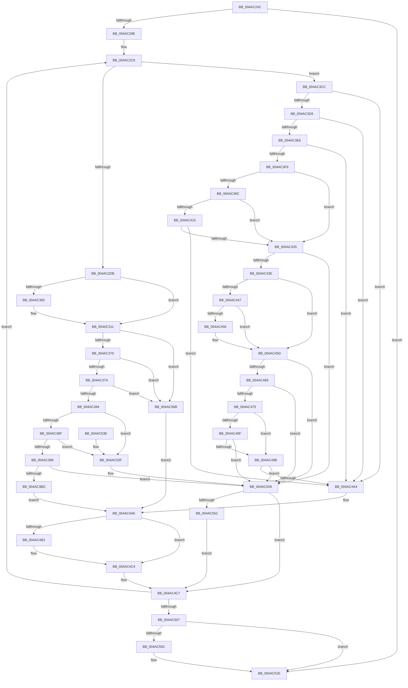

# MiMirrorRemoveInactivePages

- RVA: `0x004AC24C`–`0x004AC584` (길이 `824` bytes)
- VA: `0x00000001404AC24C`
- 실행 섹션: `.text`
- PDB 이름 있음: `예`; PDB Function 태그: `아니요`
- unwind 정보 RVA: `0x0007A18C`
- 디코드: `190`개 명령, `824/824` bytes 표시
- 미해석 바이트: `0` (있으면 어셈블리에 `.byte`로 보존)

> 이 문서는 커널 이미지의 기계어와 PDB 기호를 분석해 생성했습니다. 4번과 5번은 함수 원형과 자료형을 바이너리 사용 방식에서 추정한 C 해석이며 원본 소스 복구 결과는 아닙니다.

## 1. Dependencies

- 직접 호출 지점: **5**; 고유 호출 대상: **4**
- 직접 호출자로 확인된 함수: **1**
- RIP 상대 이미지 참조: **1**

### Outgoing calls
- `0x004AC2DE` → [MiGetBaseResidentPageForBugCheck](../68/MiGetBaseResidentPageForBugCheck_function_0068AB60.md) (function, `0x0068AB60`)
- `0x004AC2F2` → [MiGetPfnPageSizeIndex](../31/MiGetPfnPageSizeIndex_function_0031C710.md) (function, `0x0031C710`)
- `0x004AC39B` → [MiGetLeafVa](../27/MiGetLeafVa_function_0027C0A0.md) (function, `0x0027C0A0`)
- `0x004AC519` → [MiMirrorOmitPagesFromCopy](../2B/MiMirrorOmitPagesFromCopy_function_002B7AF0.md) (function, `0x002B7AF0`)
- `0x004AC55F` → [MiMirrorOmitPagesFromCopy](../2B/MiMirrorOmitPagesFromCopy_function_002B7AF0.md) (function, `0x002B7AF0`)

### Direct callers
- [MiMirrorReduceBlackToActiveAndPrivatePages](MiMirrorReduceBlackToActiveAndPrivatePages_function_004AC018.md) at `0x004AC1D7`

### Static image references
- `0x004AC315` → RVA `0x00011C60` (`.rdata`; read)

## 2. Other-region calls and transfers

- 다른 실행 섹션으로 향하는 call: **0**
- 별도 외부 분기/꼬리 이동을 확인하지 못했습니다.

## 3. Assembly (complete function range)

```asm
004AC24C  48 89 5C 24 10                  mov qword ptr [rsp + 0x10], rbx
004AC251  48 89 6C 24 18                  mov qword ptr [rsp + 0x18], rbp
004AC256  48 89 74 24 20                  mov qword ptr [rsp + 0x20], rsi
004AC25B  57                              push rdi
004AC25C  41 54                           push r12
004AC25E  41 55                           push r13
004AC260  41 56                           push r14
004AC262  41 57                           push r15
004AC264  48 83 EC 20                     sub rsp, 0x20
004AC268  4C 8B E9                        mov r13, rcx
004AC26B  49 B9 00 00 00 00 00 DE FF FF   movabs r9, 0xffffde0000000000
004AC275  8B 49 08                        mov ecx, dword ptr [rcx + 8]
004AC278  48 8D 1C 52                     lea rbx, [rdx + rdx*2]
004AC27C  89 4C 24 50                     mov dword ptr [rsp + 0x50], ecx
004AC280  4D 8B E0                        mov r12, r8
004AC283  48 C1 E3 04                     shl rbx, 4
004AC287  49 8B C1                        mov rax, r9
004AC28A  48 03 D8                        add rbx, rax
004AC28D  33 ED                           xor ebp, ebp
004AC28F  33 FF                           xor edi, edi
004AC291  48 83 CE FF                     or rsi, 0xffffffffffffffff
004AC295  4D 85 C0                        test r8, r8
004AC298  0F 84 80 02 00 00               je 0x1404ac51e
004AC29E  49 BF 00 00 00 00 00 00 00 80   movabs r15, 0x8000000000000000
004AC2A8  49 B8 00 00 00 00 80 F6 FF FF   movabs r8, 0xfffff68000000000
004AC2B2  49 BB FF FF FE FF FF 7F 00 00   movabs r11, 0x7ffffffeffff
004AC2BC  49 BA FF FF FF FF FF F6 FF FF   movabs r10, 0xfffff6ffffffffff
004AC2C6  48 8B 43 28                     mov rax, qword ptr [rbx + 0x28]
004AC2CA  41 BE 01 00 00 00               mov r14d, 1
004AC2D0  48 0F BA E0 28                  bt rax, 0x28
004AC2D5  0F 83 F1 00 00 00               jae 0x1404ac3cc
004AC2DB  48 8B CB                        mov rcx, rbx
004AC2DE  E8 7D E8 1D 00                  call 0x14068ab60
004AC2E3  48 8B C8                        mov rcx, rax
004AC2E6  4C 8B F0                        mov r14, rax
004AC2E9  44 0F B6 78 22                  movzx r15d, byte ptr [rax + 0x22]
004AC2EE  41 83 E7 07                     and r15d, 7
004AC2F2  E8 19 04 E7 FF                  call 0x14031c710
004AC2F7  4D 8B 46 08                     mov r8, qword ptr [r14 + 8]
004AC2FB  4D 85 C0                        test r8, r8
004AC2FE  74 11                           je 0x1404ac311
004AC300  4D 8B 46 08                     mov r8, qword ptr [r14 + 8]
004AC304  48 B9 00 00 00 00 00 00 00 80   movabs rcx, 0x8000000000000000
004AC30E  4C 0B C1                        or r8, rcx
004AC311  4D 8B 4E 28                     mov r9, qword ptr [r14 + 0x28]
004AC315  48 8D 15 44 59 B6 FF            lea rdx, [rip - 0x49a6bc]
004AC31C  8B C0                           mov eax, eax
004AC31E  49 C1 E9 3C                     shr r9, 0x3c
004AC322  41 83 E1 07                     and r9d, 7
004AC326  48 8B 14 C2                     mov rdx, qword ptr [rdx + rax*8]
004AC32A  48 B8 00 00 00 00 00 DE FF FF   movabs rax, 0xffffde0000000000
004AC334  48 8B C0                        mov rax, rax
004AC337  48 8B CB                        mov rcx, rbx
004AC33A  4C 8D 72 FF                     lea r14, [rdx - 1]
004AC33E  48 2B C8                        sub rcx, rax
004AC341  49 F7 D6                        not r14
004AC344  48 C1 F9 04                     sar rcx, 4
004AC348  49 BA AB AA AA AA AA AA AA AA   movabs r10, 0xaaaaaaaaaaaaaaab
004AC352  49 0F AF CA                     imul rcx, r10
004AC356  4C 23 F1                        and r14, rcx
004AC359  4C 2B F1                        sub r14, rcx
004AC35C  4C 03 F2                        add r14, rdx
004AC35F  4D 3B F4                        cmp r14, r12
004AC362  4D 0F 47 F4                     cmova r14, r12
004AC366  41 83 FF 01                     cmp r15d, 1
004AC36A  0F 86 FB 01 00 00               jbe 0x1404ac56b
004AC370  41 83 FF 05                     cmp r15d, 5
004AC374  0F 84 F1 01 00 00               je 0x1404ac56b
004AC37A  49 83 F9 01                     cmp r9, 1
004AC37E  0F 84 E7 01 00 00               je 0x1404ac56b
004AC384  F6 44 24 50 40                  test byte ptr [rsp + 0x50], 0x40
004AC389  0F 84 B0 01 00 00               je 0x1404ac53f
004AC38F  4D 85 C0                        test r8, r8
004AC392  0F 84 A7 01 00 00               je 0x1404ac53f
004AC398  49 8B C8                        mov rcx, r8
004AC39B  E8 00 FD DC FF                  call 0x14027c0a0
004AC3A0  48 B9 FF FF FE FF FF 7F 00 00   movabs rcx, 0x7ffffffeffff
004AC3AA  49 BF 00 00 00 00 00 00 00 80   movabs r15, 0x8000000000000000
004AC3B4  48 3B C1                        cmp rax, rcx
004AC3B7  0F 87 8C 01 00 00               ja 0x1404ac549
004AC3BD  49 B9 00 00 00 00 00 DE FF FF   movabs r9, 0xffffde0000000000
004AC3C7  E9 E2 00 00 00                  jmp 0x1404ac4ae
004AC3CC  8A 43 22                        mov al, byte ptr [rbx + 0x22]
004AC3CF  24 07                           and al, 7
004AC3D1  3C 06                           cmp al, 6
004AC3D3  0F 85 CB 00 00 00               jne 0x1404ac4a4
004AC3D9  48 8B 43 28                     mov rax, qword ptr [rbx + 0x28]
004AC3DD  48 85 C0                        test rax, rax
004AC3E0  0F 88 BE 00 00 00               js 0x1404ac4a4
004AC3E6  48 8B 43 28                     mov rax, qword ptr [rbx + 0x28]
004AC3EA  48 C1 E8 3C                     shr rax, 0x3c
004AC3EE  24 07                           and al, 7
004AC3F0  41 3A C6                        cmp al, r14b
004AC3F3  0F 84 AB 00 00 00               je 0x1404ac4a4
004AC3F9  48 8B 43 18                     mov rax, qword ptr [rbx + 0x18]
004AC3FD  48 BA FF FF FF FF FF FF FF 3F   movabs rdx, 0x3fffffffffffffff
004AC407  48 85 C2                        test rdx, rax
004AC40A  74 29                           je 0x1404ac435
004AC40C  8A 43 22                        mov al, byte ptr [rbx + 0x22]
004AC40F  24 07                           and al, 7
004AC411  3C 06                           cmp al, 6
004AC413  75 20                           jne 0x1404ac435
004AC415  48 8B 43 28                     mov rax, qword ptr [rbx + 0x28]
004AC419  48 BA FF FF FF FF FF 00 00 00   movabs rdx, 0xffffffffff
004AC423  48 23 C2                        and rax, rdx
004AC426  48 BA FE FF FF FF 3F 00 00 00   movabs rdx, 0x3ffffffffe
004AC430  48 3B C2                        cmp rax, rdx
004AC433  74 6F                           je 0x1404ac4a4
004AC435  F6 C1 40                        test cl, 0x40
004AC438  0F 84 0B 01 00 00               je 0x1404ac549
004AC43E  48 8B 4B 08                     mov rcx, qword ptr [rbx + 8]
004AC442  48 85 C9                        test rcx, rcx
004AC445  74 16                           je 0x1404ac45d
004AC447  48 8B 43 28                     mov rax, qword ptr [rbx + 0x28]
004AC44B  48 C1 E8 3C                     shr rax, 0x3c
004AC44F  24 07                           and al, 7
004AC451  41 3A C6                        cmp al, r14b
004AC454  74 07                           je 0x1404ac45d
004AC456  48 8B 4B 08                     mov rcx, qword ptr [rbx + 8]
004AC45A  49 0B CF                        or rcx, r15
004AC45D  49 8B C0                        mov rax, r8
004AC460  48 3B C8                        cmp rcx, rax
004AC463  0F 82 E0 00 00 00               jb 0x1404ac549
004AC469  49 8B C2                        mov rax, r10
004AC46C  48 3B C8                        cmp rcx, rax
004AC46F  0F 87 D4 00 00 00               ja 0x1404ac549
004AC475  48 C1 E1 19                     shl rcx, 0x19
004AC479  49 8B C0                        mov rax, r8
004AC47C  48 C1 E0 19                     shl rax, 0x19
004AC480  48 2B C8                        sub rcx, rax
004AC483  48 C1 F9 10                     sar rcx, 0x10
004AC487  49 8B C0                        mov rax, r8
004AC48A  48 3B C8                        cmp rcx, rax
004AC48D  72 0C                           jb 0x1404ac49b
004AC48F  49 8B C2                        mov rax, r10
004AC492  48 3B C8                        cmp rcx, rax
004AC495  0F 86 AE 00 00 00               jbe 0x1404ac549
004AC49B  49 3B CB                        cmp rcx, r11
004AC49E  0F 87 A5 00 00 00               ja 0x1404ac549
004AC4A4  49 BA AB AA AA AA AA AA AA AA   movabs r10, 0xaaaaaaaaaaaaaaab
004AC4AE  48 85 FF                        test rdi, rdi
004AC4B1  75 11                           jne 0x1404ac4c4
004AC4B3  49 8B C1                        mov rax, r9
004AC4B6  48 8B F3                        mov rsi, rbx
004AC4B9  48 2B F0                        sub rsi, rax
004AC4BC  48 C1 FE 04                     sar rsi, 4
004AC4C0  49 0F AF F2                     imul rsi, r10
004AC4C4  49 03 FE                        add rdi, r14
004AC4C7  8B 4C 24 50                     mov ecx, dword ptr [rsp + 0x50]
004AC4CB  4B 8D 04 76                     lea rax, [r14 + r14*2]
004AC4CF  48 C1 E0 04                     shl rax, 4
004AC4D3  49 BB FF FF FE FF FF 7F 00 00   movabs r11, 0x7ffffffeffff
004AC4DD  48 03 D8                        add rbx, rax
004AC4E0  49 B8 00 00 00 00 80 F6 FF FF   movabs r8, 0xfffff68000000000
004AC4EA  49 B9 00 00 00 00 00 DE FF FF   movabs r9, 0xffffde0000000000
004AC4F4  49 BA FF FF FF FF FF F6 FF FF   movabs r10, 0xfffff6ffffffffff
004AC4FE  4D 2B E6                        sub r12, r14
004AC501  0F 85 BF FD FF FF               jne 0x1404ac2c6
004AC507  48 85 FF                        test rdi, rdi
004AC50A  74 12                           je 0x1404ac51e
004AC50C  49 8B 4D 00                     mov rcx, qword ptr [r13]
004AC510  48 03 EF                        add rbp, rdi
004AC513  4C 8B C7                        mov r8, rdi
004AC516  48 8B D6                        mov rdx, rsi
004AC519  E8 D2 B5 E0 FF                  call 0x1402b7af0
004AC51E  48 8B 5C 24 58                  mov rbx, qword ptr [rsp + 0x58]
004AC523  48 8B C5                        mov rax, rbp
004AC526  48 8B 6C 24 60                  mov rbp, qword ptr [rsp + 0x60]
004AC52B  48 8B 74 24 68                  mov rsi, qword ptr [rsp + 0x68]
004AC530  48 83 C4 20                     add rsp, 0x20
004AC534  41 5F                           pop r15
004AC536  41 5E                           pop r14
004AC538  41 5D                           pop r13
004AC53A  41 5C                           pop r12
004AC53C  5F                              pop rdi
004AC53D  C3                              ret
004AC53E  CC                              int3
004AC53F  49 BF 00 00 00 00 00 00 00 80   movabs r15, 0x8000000000000000
004AC549  48 85 FF                        test rdi, rdi
004AC54C  0F 84 75 FF FF FF               je 0x1404ac4c7
004AC552  49 8B 4D 00                     mov rcx, qword ptr [r13]
004AC556  4C 8B C7                        mov r8, rdi
004AC559  48 8B D6                        mov rdx, rsi
004AC55C  48 03 EF                        add rbp, rdi
004AC55F  E8 8C B5 E0 FF                  call 0x1402b7af0
004AC564  33 FF                           xor edi, edi
004AC566  E9 5C FF FF FF                  jmp 0x1404ac4c7
004AC56B  49 B9 00 00 00 00 00 DE FF FF   movabs r9, 0xffffde0000000000
004AC575  49 BF 00 00 00 00 00 00 00 80   movabs r15, 0x8000000000000000
004AC57F  E9 2A FF FF FF                  jmp 0x1404ac4ae
```

## 4. C-style interpretation (structured pseudocode)

```c
__int64 __fastcall MiMirrorRemoveInactivePages(__int64 a1, __int64 a2, __int64 a3)
{
    __int64 result;
    __int64 v_r12;
    __int64 v_r14;
    __int64 v_r15;
    __int64 v_rbp;
    __int64 v_rbx;
    __int64 v_rdi;
    __int64 v_rsi;
    __int64 v_rsp;
    unsigned __int64 v_stack_p10;
    unsigned __int64 v_stack_p18;
    unsigned __int64 v_stack_p20;
    unsigned int v_stack_p8;

    v_stack_p10 = v_rbx;
    v_stack_p18 = v_rbp;
    v_stack_p20 = v_rsi;
    v_rsp = (v_rsp) - (32);
    v_stack_p8 = (unsigned int)((unsigned int)(*(unsigned int *)(a1 + 8)));
    v_rbx = (a2 + a2 * 2) << (4);
    v_rbx = (v_rbx) + (a4);
    v_rbp = 0;
    v_rdi = 0;
    v_rsi = (v_rsi) | (-1);
    if (a3 == 0) goto loc_004AC51E;
loc_004AC2C6:
    if (condition_is_above_or_equal) goto loc_004AC3CC;
    result = MiGetBaseResidentPageForBugCheck(v_rbx, a2, a3, a4);
    v_r15 = (unsigned int)((*(unsigned __int8 *)(result + 34)) & (7));
    result = MiGetPfnPageSizeIndex(result, a2, a3, a4);
    if (*(unsigned __int64 *)(result + 8) != 0) {
        a3 = *(unsigned __int64 *)(result + 8);
        a3 = (a3) | (result);
    }
    a4 = (*(unsigned __int64 *)(result + 40)) >> (60);
    a4 = (unsigned int)((a4) & (7));
    a1 = (v_rbx) - ((unsigned int)((unsigned int)(result)));
    v_r14 = ~(*(unsigned __int64 *)(v_rip - 4826812 + (unsigned int)((unsigned int)(result)) * 8) - 1);
    a1 = (a1) >> (4);
    a1 = (a1) * (v_r10);
    v_r14 = (v_r14) & (a1);
    v_r14 = (v_r14) - (a1);
    v_r14 = (v_r14) + (*(unsigned __int64 *)(v_rip - 4826812 + (unsigned int)((unsigned int)(result)) * 8));
    if (v_r14 > a3) { v_r14 = a3; }
    if (((unsigned int)(v_r15)) <= 1) goto loc_004AC56B;
    if (((unsigned int)(v_r15)) == 5) goto loc_004AC56B;
    if (a4 == 1) goto loc_004AC56B;
    if (((v_stack_p8) & (64)) == 0) goto loc_004AC53F;
    if (a3 == 0) goto loc_004AC53F;
    result = MiGetLeafVa(a3, *(unsigned __int64 *)(v_rip - 4826812 + (unsigned int)((unsigned int)(result)) * 8), a3, a4);
    if (result > a3) goto loc_004AC549;
    goto loc_004AC4AE;
loc_004AC3CC:
    result = (unsigned __int8)((*(unsigned __int8 *)(v_rbx + 34)) & (7));
    if (((unsigned __int8)(result)) != 6) goto loc_004AC4A4;
    if (sign_flag) goto loc_004AC4A4;
    result = (*(unsigned __int64 *)(v_rbx + 40)) >> (60);
    result = (unsigned __int8)((result) & (7));
    if (((unsigned __int8)(result)) == ((unsigned __int8)(v_r14))) goto loc_004AC4A4;
    if (((*(unsigned __int64 *)(v_rip - 4826812 + (unsigned int)((unsigned int)(result)) * 8)) & (*(unsigned __int64 *)(v_rbx + 24))) == 0) goto loc_004AC435;
    result = (unsigned __int8)((*(unsigned __int8 *)(v_rbx + 34)) & (7));
    if (((unsigned __int8)(result)) != 6) goto loc_004AC435;
    result = (*(unsigned __int64 *)(v_rbx + 40)) & (*(unsigned __int64 *)(v_rip - 4826812 + (unsigned int)((unsigned int)(result)) * 8));
    if (result == (*(unsigned __int64 *)(v_rip - 4826812 + (unsigned int)((unsigned int)(result)) * 8))) goto loc_004AC4A4;
loc_004AC435:
    if ((((unsigned __int8)(a3)) & (64)) == 0) goto loc_004AC549;
    if (*(unsigned __int64 *)(v_rbx + 8) == 0) goto loc_004AC45D;
    result = (*(unsigned __int64 *)(v_rbx + 40)) >> (60);
    result = (unsigned __int8)((result) & (7));
    if (((unsigned __int8)(result)) != ((unsigned __int8)(v_r14))) {
        a1 = *(unsigned __int64 *)(v_rbx + 8);
        a1 = (a1) | (v_r15);
    }
    if (a1 < a3) goto loc_004AC549;
    if (a1 > v_r10) goto loc_004AC549;
    a1 = (a1) << (25);
    result = (a3) << (25);
    a1 = (a1) - (result);
    a1 = (a1) >> (16);
    if (a1 < a3) goto loc_004AC49B;
    if (a1 <= v_r10) goto loc_004AC549;
loc_004AC49B:
    if (a1 > v_r11) goto loc_004AC549;
loc_004AC4A4:
loc_004AC4AE:
    result = v_r10;
    if (0 == 0) {
        result = a4;
        v_rsi = v_rbx;
        v_rsi = (v_rsi) - (result);
        v_rsi = (v_rsi) >> (4);
        v_rsi = (v_rsi) * (v_r10);
    }
    v_rdi = (v_rdi) + (v_r14);
loc_004AC4C7:
    result = (v_r14 + v_r14 * 2) << (4);
    v_rbx = (v_rbx) + (result);
    v_r12 = (a3) - (v_r14);
    if (condition_is_not_equal) goto loc_004AC2C6;
    if (v_rdi != 0) {
        a1 = *(unsigned __int64 *)(a1);
        v_rbp = (v_rbp) + (v_rdi);
        a3 = v_rdi;
        a2 = v_rsi;
        result = MiMirrorOmitPagesFromCopy(a1, a2, a3, a4);
    }
    v_rsp = (v_rsp) + (32);
    return v_rbp;
loc_004AC53F:
loc_004AC549:
    if (v_rdi == 0) goto loc_004AC4C7;
    v_rbp = (v_stack_p18) + (v_rdi);
    result = MiMirrorOmitPagesFromCopy(*(unsigned __int64 *)(a1), v_stack_p20, v_rdi, a4);
    v_rdi = 0;
    goto loc_004AC4C7;
loc_004AC56B:
    goto loc_004AC4AE;
}
```

## 5. (Beta) C Style

```c
int64_t MiMirrorRemoveInactivePages(void *Arg1, void *Arg2, int64_t Arg3)
{
    uint8_t *arg1 = (uint8_t *)Arg1;
    uint8_t *arg2 = (uint8_t *)Arg2;

    int64_t result;
    int64_t local_r12;
    int64_t local_r14;
    int64_t local_r15;
    int64_t local_rbp;
    int64_t local_rbx;
    int64_t local_rdi;
    int64_t local_rsi;
    int64_t local_rsp;
    uint64_t v_stack_p10;
    uint64_t v_stack_p18;
    uint64_t v_stack_p20;
    uint32_t v_stack_p8;

    v_stack_p10 = local_rbx;
    v_stack_p18 = local_rbp;
    v_stack_p20 = local_rsi;
    local_rsp = (local_rsp) - (32);
    v_stack_p8 = (uint32_t)((uint32_t)(*(uint32_t *)(arg1 + 0x8)));
    local_rbx = (Arg2 + Arg2 * 2) << (4);
    local_rbx = (local_rbx) + (a4);
    local_rbp = 0;
    local_rdi = 0;
    local_rsi = (local_rsi) | (-1);
    if (Arg3 == 0) goto loc_004AC51E;
loc_004AC2C6:
    if (condition_is_above_or_equal) goto loc_004AC3CC;
    result = MiGetBaseResidentPageForBugCheck(local_rbx, Arg2, Arg3, a4);
    local_r15 = (uint32_t)((*(uint8_t *)(result + 0x22)) & (7));
    result = MiGetPfnPageSizeIndex(result, Arg2, Arg3, a4);
    if (*(uint64_t *)(result + 0x8) != 0) {
        Arg3 = *(uint64_t *)(result + 0x8);
        Arg3 = (Arg3) | (result);
    }
    a4 = (*(uint64_t *)(result + 0x28)) >> (60);
    a4 = (uint32_t)((a4) & (7));
    Arg1 = (local_rbx) - ((uint32_t)((uint32_t)(result)));
    local_r14 = ~(*(uint64_t *)(v_rip - 0x49A6BC + (uint32_t)((uint32_t)(result)) * 8) - 1);
    Arg1 = (Arg1) >> (4);
    Arg1 = (Arg1) * (local_r10);
    local_r14 = (local_r14) & (Arg1);
    local_r14 = (local_r14) - (Arg1);
    local_r14 = (local_r14) + (*(uint64_t *)(v_rip - 0x49A6BC + (uint32_t)((uint32_t)(result)) * 8));
    if (local_r14 > Arg3) { local_r14 = Arg3; }
    if (((uint32_t)(local_r15)) <= 1) goto loc_004AC56B;
    if (((uint32_t)(local_r15)) == 5) goto loc_004AC56B;
    if (a4 == 1) goto loc_004AC56B;
    if (((v_stack_p8) & (64)) == 0) goto loc_004AC53F;
    if (Arg3 == 0) goto loc_004AC53F;
    result = MiGetLeafVa(Arg3, *(uint64_t *)(v_rip - 0x49A6BC + (uint32_t)((uint32_t)(result)) * 8), Arg3, a4);
    if (result > Arg3) goto loc_004AC549;
    goto loc_004AC4AE;
loc_004AC3CC:
    result = (uint8_t)((*(uint8_t *)(local_rbx + 0x22)) & (7));
    if (((uint8_t)(result)) != 6) goto loc_004AC4A4;
    if (sign_flag) goto loc_004AC4A4;
    result = (*(uint64_t *)(local_rbx + 0x28)) >> (60);
    result = (uint8_t)((result) & (7));
    if (((uint8_t)(result)) == ((uint8_t)(local_r14))) goto loc_004AC4A4;
    if (((*(uint64_t *)(v_rip - 0x49A6BC + (uint32_t)((uint32_t)(result)) * 8)) & (*(uint64_t *)(local_rbx + 0x18))) == 0) goto loc_004AC435;
    result = (uint8_t)((*(uint8_t *)(local_rbx + 0x22)) & (7));
    if (((uint8_t)(result)) != 6) goto loc_004AC435;
    result = (*(uint64_t *)(local_rbx + 0x28)) & (*(uint64_t *)(v_rip - 0x49A6BC + (uint32_t)((uint32_t)(result)) * 8));
    if (result == (*(uint64_t *)(v_rip - 0x49A6BC + (uint32_t)((uint32_t)(result)) * 8))) goto loc_004AC4A4;
loc_004AC435:
    if ((((uint8_t)(Arg3)) & (64)) == 0) goto loc_004AC549;
    if (*(uint64_t *)(local_rbx + 0x8) == 0) goto loc_004AC45D;
    result = (*(uint64_t *)(local_rbx + 0x28)) >> (60);
    result = (uint8_t)((result) & (7));
    if (((uint8_t)(result)) != ((uint8_t)(local_r14))) {
        Arg1 = *(uint64_t *)(local_rbx + 0x8);
        Arg1 = (Arg1) | (local_r15);
    }
    if (Arg1 < Arg3) goto loc_004AC549;
    if (Arg1 > local_r10) goto loc_004AC549;
    Arg1 = (Arg1) << (25);
    result = (Arg3) << (25);
    Arg1 = (Arg1) - (result);
    Arg1 = (Arg1) >> (16);
    if (Arg1 < Arg3) goto loc_004AC49B;
    if (Arg1 <= local_r10) goto loc_004AC549;
loc_004AC49B:
    if (Arg1 > local_r11) goto loc_004AC549;
loc_004AC4A4:
loc_004AC4AE:
    result = local_r10;
    if (0 == 0) {
        result = a4;
        local_rsi = local_rbx;
        local_rsi = (local_rsi) - (result);
        local_rsi = (local_rsi) >> (4);
        local_rsi = (local_rsi) * (local_r10);
    }
    local_rdi = (local_rdi) + (local_r14);
loc_004AC4C7:
    result = (local_r14 + local_r14 * 2) << (4);
    local_rbx = (local_rbx) + (result);
    local_r12 = (Arg3) - (local_r14);
    if (condition_is_not_equal) goto loc_004AC2C6;
    if (local_rdi != 0) {
        Arg1 = *(uint64_t *)(arg1);
        local_rbp = (local_rbp) + (local_rdi);
        Arg3 = local_rdi;
        Arg2 = local_rsi;
        result = MiMirrorOmitPagesFromCopy(Arg1, Arg2, Arg3, a4);
    }
    local_rsp = (local_rsp) + (32);
    return local_rbp;
loc_004AC53F:
loc_004AC549:
    if (local_rdi == 0) goto loc_004AC4C7;
    local_rbp = (v_stack_p18) + (local_rdi);
    result = MiMirrorOmitPagesFromCopy(*(uint64_t *)(arg1), v_stack_p20, local_rdi, a4);
    local_rdi = 0;
    goto loc_004AC4C7;
loc_004AC56B:
    goto loc_004AC4AE;
}
```

### 관측된 메모리 오프셋

구조체 형식이 확인되지 않은 접근은 인자 기준의 오프셋으로만 기록했습니다.

| 기준 인자 | 오프셋 표현 | 폭 (bit) | 접근 |
|---|---:|---:|---|
| `Arg1` | `+ 0x0` | `64` | `R` |
| `Arg1` | `+ 0x8` | `32` | `R` |
| `Arg2` | `+ 0x0 + rdx*2` | `64` | `R` |

## 6. Execution-region graph

[열기: 2D/3D 그래프와 함수 탐색 컨트롤 패널](../../../control-panel.html?section=text&rva=0x004AC24C&view=graph)

- 2D 그래프는 위에서 아래로 흐르고, 3D 그래프는 빈 공간을 드래그해 회전합니다. Shift+드래그는 이동, 휠은 확대·축소, 함수 노드 선택은 대상 보고서 이동입니다.

### Static fallback


