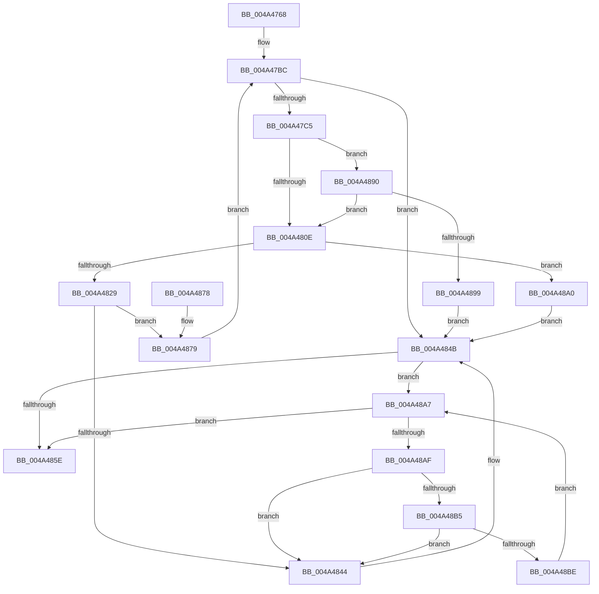

# MiObtainRotateProtectionRanges

- RVA: `0x004A4768`–`0x004A48CE` (길이 `358` bytes)
- VA: `0x00000001404A4768`
- 실행 섹션: `.text`
- PDB 이름 있음: `예`; PDB Function 태그: `아니요`
- unwind 정보 RVA: `0x000B6738`
- 디코드: `104`개 명령, `358/358` bytes 표시
- 미해석 바이트: `0` (있으면 어셈블리에 `.byte`로 보존)

> 이 문서는 커널 이미지의 기계어와 PDB 기호를 분석해 생성했습니다. 4번과 5번은 함수 원형과 자료형을 바이너리 사용 방식에서 추정한 C 해석이며 원본 소스 복구 결과는 아닙니다.

## 1. Dependencies

- 직접 호출 지점: **5**; 고유 호출 대상: **5**
- 직접 호출자로 확인된 함수: **1**
- RIP 상대 이미지 참조: **0**

### Outgoing calls
- `0x004A47B4` → [MiLockWorkingSetShared](../27/MiLockWorkingSetShared_function_0027CBF0.md) (function, `0x0027CBF0`)
- `0x004A47FA` → [MiQueryAddressState](../32/MiQueryAddressState_function_0032C380.md) (function, `0x0032C380`)
- `0x004A481C` → [MiAllocatePool](../35/MiAllocatePool_function_0035B540.md) (function, `0x0035B540`)
- `0x004A4855` → [MiUnlockWorkingSetShared](../27/MiUnlockWorkingSetShared_function_0027D690.md) (function, `0x0027D690`)
- `0x004A48C7` → [ExFreePoolWithTag](../../poolcode/B8/ExFreePoolWithTag_function_00B82870.md) (function, `0x00B82870`)

### Direct callers
- [MiRotateToFrameBufferNoCopy](../../page/A3/MiRotateToFrameBufferNoCopy_function_00A38530.md) at `0x00A3861E`

### Static image references
- 디코드된 RIP-relative 메모리 참조가 없습니다.

## 2. Other-region calls and transfers

- 다른 실행 섹션으로 향하는 call: **1**
  - `0x004A48C7` → [ExFreePoolWithTag](../../poolcode/B8/ExFreePoolWithTag_function_00B82870.md) (`.text` → `POOLCODE`)
- 별도 외부 분기/꼬리 이동을 확인하지 못했습니다.

## 3. Assembly (complete function range)

```asm
004A4768  48 89 5C 24 08                  mov qword ptr [rsp + 8], rbx
004A476D  55                              push rbp
004A476E  56                              push rsi
004A476F  57                              push rdi
004A4770  41 54                           push r12
004A4772  41 55                           push r13
004A4774  41 56                           push r14
004A4776  41 57                           push r15
004A4778  48 8B EC                        mov rbp, rsp
004A477B  48 83 EC 60                     sub rsp, 0x60
004A477F  4C 8B E9                        mov r13, rcx
004A4782  49 8B D9                        mov rbx, r9
004A4785  33 C9                           xor ecx, ecx
004A4787  4D 8B F8                        mov r15, r8
004A478A  48 89 4D F8                     mov qword ptr [rbp - 8], rcx
004A478E  8B F9                           mov edi, ecx
004A4790  89 4D F0                        mov dword ptr [rbp - 0x10], ecx
004A4793  48 8B F2                        mov rsi, rdx
004A4796  66 89 4D 48                     mov word ptr [rbp + 0x48], cx
004A479A  89 4D 50                        mov dword ptr [rbp + 0x50], ecx
004A479D  65 48 8B 04 25 88 01 00 00      mov rax, qword ptr gs:[0x188]
004A47A6  4C 8B B0 B8 00 00 00            mov r14, qword ptr [rax + 0xb8]
004A47AD  49 8D 8E 00 04 00 00            lea rcx, [r14 + 0x400]
004A47B4  E8 37 84 DD FF                  call 0x14027cbf0
004A47B9  44 8A E0                        mov r12b, al
004A47BC  49 3B F7                        cmp rsi, r15
004A47BF  0F 87 86 00 00 00               ja 0x1404a484b
004A47C5  48 8D 45 F8                     lea rax, [rbp - 8]
004A47C9  4D 8B CD                        mov r9, r13
004A47CC  48 89 44 24 40                  mov qword ptr [rsp + 0x40], rax
004A47D1  45 8A C4                        mov r8b, r12b
004A47D4  48 8D 45 48                     lea rax, [rbp + 0x48]
004A47D8  49 8B D7                        mov rdx, r15
004A47DB  48 89 44 24 38                  mov qword ptr [rsp + 0x38], rax
004A47E0  48 8B CE                        mov rcx, rsi
004A47E3  48 8D 45 F0                     lea rax, [rbp - 0x10]
004A47E7  48 89 44 24 30                  mov qword ptr [rsp + 0x30], rax
004A47EC  48 8D 45 50                     lea rax, [rbp + 0x50]
004A47F0  48 89 44 24 28                  mov qword ptr [rsp + 0x28], rax
004A47F5  48 21 7C 24 20                  and qword ptr [rsp + 0x20], rdi
004A47FA  E8 81 7B E8 FF                  call 0x14032c380
004A47FF  8B 45 50                        mov eax, dword ptr [rbp + 0x50]
004A4802  83 E0 07                        and eax, 7
004A4805  83 F8 04                        cmp eax, 4
004A4808  0F 85 82 00 00 00               jne 0x1404a4890
004A480E  BA 28 00 00 00                  mov edx, 0x28
004A4813  41 B8 4D 69 52 62               mov r8d, 0x6252694d
004A4819  8D 4A 18                        lea ecx, [rdx + 0x18]
004A481C  E8 1F 6D EB FF                  call 0x14035b540
004A4821  48 8B C8                        mov rcx, rax
004A4824  48 85 C0                        test rax, rax
004A4827  74 77                           je 0x1404a48a0
004A4829  48 89 70 10                     mov qword ptr [rax + 0x10], rsi
004A482D  48 8B 45 F8                     mov rax, qword ptr [rbp - 8]
004A4831  48 89 41 18                     mov qword ptr [rcx + 0x18], rax
004A4835  8B 45 50                        mov eax, dword ptr [rbp + 0x50]
004A4838  89 41 20                        mov dword ptr [rcx + 0x20], eax
004A483B  48 8B 43 08                     mov rax, qword ptr [rbx + 8]
004A483F  48 39 18                        cmp qword ptr [rax], rbx
004A4842  74 35                           je 0x1404a4879
004A4844  B9 03 00 00 00                  mov ecx, 3
004A4849  CD 29                           int 0x29
004A484B  41 8A D4                        mov dl, r12b
004A484E  49 8D 8E 00 04 00 00            lea rcx, [r14 + 0x400]
004A4855  E8 36 8E DD FF                  call 0x14027d690
004A485A  85 FF                           test edi, edi
004A485C  78 49                           js 0x1404a48a7
004A485E  48 8B 9C 24 A0 00 00 00         mov rbx, qword ptr [rsp + 0xa0]
004A4866  8B C7                           mov eax, edi
004A4868  48 83 C4 60                     add rsp, 0x60
004A486C  41 5F                           pop r15
004A486E  41 5E                           pop r14
004A4870  41 5D                           pop r13
004A4872  41 5C                           pop r12
004A4874  5F                              pop rdi
004A4875  5E                              pop rsi
004A4876  5D                              pop rbp
004A4877  C3                              ret
004A4878  CC                              int3
004A4879  48 89 19                        mov qword ptr [rcx], rbx
004A487C  48 89 41 08                     mov qword ptr [rcx + 8], rax
004A4880  48 89 08                        mov qword ptr [rax], rcx
004A4883  48 8B 75 F8                     mov rsi, qword ptr [rbp - 8]
004A4887  48 89 4B 08                     mov qword ptr [rbx + 8], rcx
004A488B  E9 2C FF FF FF                  jmp 0x1404a47bc
004A4890  83 F8 01                        cmp eax, 1
004A4893  0F 84 75 FF FF FF               je 0x1404a480e
004A4899  BF 45 00 00 C0                  mov edi, 0xc0000045
004A489E  EB AB                           jmp 0x1404a484b
004A48A0  BF 9A 00 00 C0                  mov edi, 0xc000009a
004A48A5  EB A4                           jmp 0x1404a484b
004A48A7  48 8B 0B                        mov rcx, qword ptr [rbx]
004A48AA  48 3B CB                        cmp rcx, rbx
004A48AD  74 AF                           je 0x1404a485e
004A48AF  48 39 59 08                     cmp qword ptr [rcx + 8], rbx
004A48B3  75 8F                           jne 0x1404a4844
004A48B5  48 8B 01                        mov rax, qword ptr [rcx]
004A48B8  48 39 48 08                     cmp qword ptr [rax + 8], rcx
004A48BC  75 86                           jne 0x1404a4844
004A48BE  48 89 03                        mov qword ptr [rbx], rax
004A48C1  33 D2                           xor edx, edx
004A48C3  48 89 58 08                     mov qword ptr [rax + 8], rbx
004A48C7  E8 A4 DF 6D 00                  call 0x140b82870
004A48CC  EB D9                           jmp 0x1404a48a7
```

## 4. C-style interpretation (structured pseudocode)

```c
__int64 __fastcall MiObtainRotateProtectionRanges(__int64 a1, __int64 a2, __int64 a3, __int64 a4)
{
    __int64 result;
    __int64 v_rsp;
    unsigned __int64 v_stack_m40;
    unsigned int v_stack_m48;
    unsigned __int64 v_stack_m58;
    unsigned __int64 v_stack_m60;
    unsigned __int64 v_stack_m68;
    unsigned __int64 v_stack_m70;
    unsigned __int64 v_stack_m78;
    unsigned __int16 v_stack_p10;
    unsigned int v_stack_p18;
    unsigned __int64 v_stack_p8;

    v_stack_p8 = v_rbx;
    v_rsp = (v_rsp) - (96);
    a1 = 0;
    v_stack_m40 = 0;
    v_stack_m48 = 0;
    v_stack_p10 = 0;
    v_stack_p18 = 0;
    result = MiLockWorkingSetShared(*(unsigned __int64 *)(*(unsigned __int64 *)(gs_base + (0 + 392)) + 184) + 1024, a2, a3, a4);
loc_004A47BC:
    if (a2 > a3) goto loc_004A484B;
    v_stack_m58 = v_stack_m40;
    v_stack_m60 = v_stack_p10;
    v_stack_m68 = v_stack_m48;
    v_stack_m70 = v_stack_p18;
    result = MiQueryAddressState(a2, a3, (unsigned __int8)((unsigned __int8)(result)), 0);
    result = (unsigned int)(((unsigned int)(v_stack_p18)) & (7));
    if (((unsigned int)(result)) != 4) goto loc_004A4890;
loc_004A480E:
    result = MiAllocatePool(40 + 24, 40, (unsigned int)(0x6252694DULL), 0);
    if (result == 0) goto loc_004A48A0;
    *(unsigned __int64 *)(result + 16) = a2;
    *(unsigned __int64 *)(result + 24) = v_stack_m40;
    *(unsigned int *)(result + 32) = (unsigned int)((unsigned int)(v_stack_p18));
    if ((*(unsigned __int64 *)(*(unsigned __int64 *)(a4 + 8))) == a4) goto loc_004A4879;
loc_004A4844:
loc_004A484B:
    result = MiUnlockWorkingSetShared(*(unsigned __int64 *)(*(unsigned __int64 *)(gs_base + (0 + 392)) + 184) + 1024, (unsigned __int8)((unsigned __int8)(result)), (unsigned int)(0x6252694DULL), 0);
    if (sign_flag) goto loc_004A48A7;
loc_004A485E:
    v_rsp = (v_rsp) + (96);
    return 0;
loc_004A4879:
    *(unsigned __int64 *)(*(unsigned __int64 *)(*(unsigned __int64 *)(gs_base + (0 + 392)) + 184) + 1024) = v_stack_p8;
    *(unsigned __int64 *)(*(unsigned __int64 *)(*(unsigned __int64 *)(gs_base + (0 + 392)) + 184) + 1024 + 8) = 0;
    *(unsigned __int64 *)(0) = *(unsigned __int64 *)(*(unsigned __int64 *)(gs_base + (0 + 392)) + 184) + 1024;
    *(unsigned __int64 *)(v_stack_p8 + 8) = *(unsigned __int64 *)(*(unsigned __int64 *)(gs_base + (0 + 392)) + 184) + 1024;
    goto loc_004A47BC;
loc_004A4890:
    if (0 == 1) goto loc_004A480E;
    goto loc_004A484B;
loc_004A48A0:
    goto loc_004A484B;
loc_004A48A7:
    if ((*(unsigned __int64 *)(v_stack_p8)) == v_stack_p8) goto loc_004A485E;
    if ((*(unsigned __int64 *)(*(unsigned __int64 *)(v_stack_p8) + 8)) != v_stack_p8) goto loc_004A4844;
    if ((*(unsigned __int64 *)(*(unsigned __int64 *)(*(unsigned __int64 *)(v_stack_p8)) + 8)) != (*(unsigned __int64 *)(v_stack_p8))) goto loc_004A4844;
    *(unsigned __int64 *)(v_stack_p8) = *(unsigned __int64 *)(*(unsigned __int64 *)(v_stack_p8));
    a2 = 0;
    *(unsigned __int64 *)(*(unsigned __int64 *)(*(unsigned __int64 *)(v_stack_p8)) + 8) = v_stack_p8;
    result = ExFreePoolWithTag(*(unsigned __int64 *)(v_stack_p8), a2, (unsigned int)(0x6252694DULL), 0);
    goto loc_004A48A7;
}
```

## 5. (Beta) C Style

```c
int64_t MiObtainRotateProtectionRanges(int64_t Arg1, int64_t Arg2, int64_t Arg3, void *Arg4)
{
    uint8_t *arg4 = (uint8_t *)Arg4;

    int64_t result;
    int64_t local_rsp;
    uint64_t v_stack_m40;
    uint32_t v_stack_m48;
    uint64_t v_stack_m58;
    uint64_t v_stack_m60;
    uint64_t v_stack_m68;
    uint64_t v_stack_m70;
    uint64_t v_stack_m78;
    uint16_t v_stack_p10;
    uint32_t v_stack_p18;
    uint64_t v_stack_p8;

    v_stack_p8 = local_rbx;
    local_rsp = (local_rsp) - (96);
    Arg1 = 0;
    v_stack_m40 = 0;
    v_stack_m48 = 0;
    v_stack_p10 = 0;
    v_stack_p18 = 0;
    result = MiLockWorkingSetShared(*(uint64_t *)(*(uint64_t *)(gs_base + (0 + 0x188)) + 0xB8) + 1024, Arg2, Arg3, Arg4);
loc_004A47BC:
    if (Arg2 > Arg3) goto loc_004A484B;
    v_stack_m58 = v_stack_m40;
    v_stack_m60 = v_stack_p10;
    v_stack_m68 = v_stack_m48;
    v_stack_m70 = v_stack_p18;
    result = MiQueryAddressState(Arg2, Arg3, (uint8_t)((uint8_t)(result)), 0);
    result = (uint32_t)(((uint32_t)(v_stack_p18)) & (7));
    if (((uint32_t)(result)) != 4) goto loc_004A4890;
loc_004A480E:
    result = MiAllocatePool(40 + 24, 40, (uint32_t)(0x6252694DULL), 0);
    if (result == 0) goto loc_004A48A0;
    *(uint64_t *)(result + 0x10) = Arg2;
    *(uint64_t *)(result + 0x18) = v_stack_m40;
    *(uint32_t *)(result + 0x20) = (uint32_t)((uint32_t)(v_stack_p18));
    if ((*(uint64_t *)(*(uint64_t *)(arg4 + 0x8))) == Arg4) goto loc_004A4879;
loc_004A4844:
loc_004A484B:
    result = MiUnlockWorkingSetShared(*(uint64_t *)(*(uint64_t *)(gs_base + (0 + 0x188)) + 0xB8) + 1024, (uint8_t)((uint8_t)(result)), (uint32_t)(0x6252694DULL), 0);
    if (sign_flag) goto loc_004A48A7;
loc_004A485E:
    local_rsp = (local_rsp) + (96);
    return 0;
loc_004A4879:
    *(uint64_t *)(*(uint64_t *)(*(uint64_t *)(gs_base + (0 + 0x188)) + 0xB8) + 0x400) = v_stack_p8;
    *(uint64_t *)(*(uint64_t *)(*(uint64_t *)(gs_base + (0 + 0x188)) + 0xB8) + 0x400 + 0x8) = 0;
    *(uint64_t *)(0) = *(uint64_t *)(*(uint64_t *)(gs_base + (0 + 0x188)) + 0xB8) + 1024;
    *(uint64_t *)(v_stack_p8 + 0x8) = *(uint64_t *)(*(uint64_t *)(gs_base + (0 + 0x188)) + 0xB8) + 1024;
    goto loc_004A47BC;
loc_004A4890:
    if (0 == 1) goto loc_004A480E;
    goto loc_004A484B;
loc_004A48A0:
    goto loc_004A484B;
loc_004A48A7:
    if ((*(uint64_t *)(v_stack_p8)) == v_stack_p8) goto loc_004A485E;
    if ((*(uint64_t *)(*(uint64_t *)(v_stack_p8) + 0x8)) != v_stack_p8) goto loc_004A4844;
    if ((*(uint64_t *)(*(uint64_t *)(*(uint64_t *)(v_stack_p8)) + 0x8)) != (*(uint64_t *)(v_stack_p8))) goto loc_004A4844;
    *(uint64_t *)(v_stack_p8) = *(uint64_t *)(*(uint64_t *)(v_stack_p8));
    Arg2 = 0;
    *(uint64_t *)(*(uint64_t *)(*(uint64_t *)(v_stack_p8)) + 0x8) = v_stack_p8;
    result = ExFreePoolWithTag(*(uint64_t *)(v_stack_p8), Arg2, (uint32_t)(0x6252694DULL), 0);
    goto loc_004A48A7;
}
```

### 관측된 메모리 오프셋

구조체 형식이 확인되지 않은 접근은 인자 기준의 오프셋으로만 기록했습니다.

| 기준 인자 | 오프셋 표현 | 폭 (bit) | 접근 |
|---|---:|---:|---|
| `Arg4` | `+ 0x0` | `64` | `R` |
| `Arg4` | `+ 0x0` | `64` | `W` |
| `Arg4` | `+ 0x8` | `64` | `R` |
| `Arg4` | `+ 0x8` | `64` | `W` |

## 6. Execution-region graph

[열기: 2D/3D 그래프와 함수 탐색 컨트롤 패널](../../../control-panel.html?section=text&rva=0x004A4768&view=graph)

- 2D 그래프는 위에서 아래로 흐르고, 3D 그래프는 빈 공간을 드래그해 회전합니다. Shift+드래그는 이동, 휠은 확대·축소, 함수 노드 선택은 대상 보고서 이동입니다.

### Static fallback


