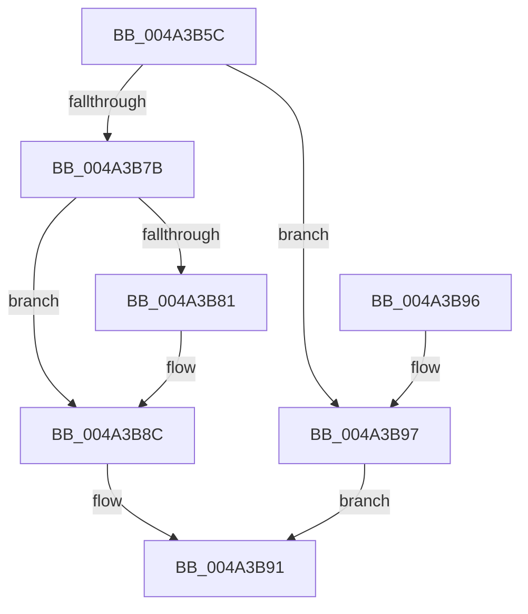

# MiOkToBinMoreLargePtes

- RVA: `0x004A3B5C`–`0x004A3BA6` (길이 `74` bytes)
- VA: `0x00000001404A3B5C`
- 실행 섹션: `.text`
- PDB 이름 있음: `예`; PDB Function 태그: `아니요`
- unwind 정보 RVA: `0x0005D35C`
- 디코드: `22`개 명령, `74/74` bytes 표시
- 미해석 바이트: `0` (있으면 어셈블리에 `.byte`로 보존)

> 이 문서는 커널 이미지의 기계어와 PDB 기호를 분석해 생성했습니다. 4번과 5번은 함수 원형과 자료형을 바이너리 사용 방식에서 추정한 C 해석이며 원본 소스 복구 결과는 아닙니다.

## 1. Dependencies

- 직접 호출 지점: **2**; 고유 호출 대상: **1**
- 직접 호출자로 확인된 함수: **1**
- RIP 상대 이미지 참조: **0**

### Outgoing calls
- `0x004A3B87` → [MiEmptyPteBins](../31/MiEmptyPteBins_function_0031AAE4.md) (function, `0x0031AAE4`)
- `0x004A3B9D` → [MiEmptyPteBins](../31/MiEmptyPteBins_function_0031AAE4.md) (function, `0x0031AAE4`)

### Direct callers
- [sub_00247BC3](../24/Unknown_function_00247BC3.md) at `0x00247C06`

### Static image references
- 디코드된 RIP-relative 메모리 참조가 없습니다.

## 2. Other-region calls and transfers

- 다른 실행 섹션으로 향하는 call: **0**
- 별도 외부 분기/꼬리 이동을 확인하지 못했습니다.

## 3. Assembly (complete function range)

```asm
004A3B5C  48 83 EC 28                     sub rsp, 0x28
004A3B60  48 8B 42 40                     mov rax, qword ptr [rdx + 0x40]
004A3B64  45 8B C8                        mov r9d, r8d
004A3B67  48 85 C0                        test rax, rax
004A3B6A  49 8D 14 01                     lea rdx, [r9 + rax]
004A3B6E  49 0F 4E D1                     cmovle rdx, r9
004A3B72  48 81 FA 80 00 00 00            cmp rdx, 0x80
004A3B79  73 1C                           jae 0x1404a3b97
004A3B7B  48 83 FA 40                     cmp rdx, 0x40
004A3B7F  72 0B                           jb 0x1404a3b8c
004A3B81  33 D2                           xor edx, edx
004A3B83  44 8D 42 04                     lea r8d, [rdx + 4]
004A3B87  E8 58 6F E7 FF                  call 0x14031aae4
004A3B8C  B8 01 00 00 00                  mov eax, 1
004A3B91  48 83 C4 28                     add rsp, 0x28
004A3B95  C3                              ret
004A3B96  CC                              int3
004A3B97  33 D2                           xor edx, edx
004A3B99  44 8D 42 05                     lea r8d, [rdx + 5]
004A3B9D  E8 42 6F E7 FF                  call 0x14031aae4
004A3BA2  33 C0                           xor eax, eax
004A3BA4  EB EB                           jmp 0x1404a3b91
```

## 4. C-style interpretation (structured pseudocode)

```c
__int64 __fastcall MiOkToBinMoreLargePtes(__int64 a1, __int64 a2, int a3)
{
    __int64 result;
    __int64 v_rsp;

    v_rsp = (v_rsp) - (40);
    a2 = (unsigned int)(a3) + *(unsigned __int64 *)(a2 + 64) * 1;
    if (condition_is_less_or_equal) { a2 = (unsigned int)(a3); }
    if (a2 >= 128) goto loc_004A3B97;
    result = *(unsigned __int64 *)(a2 + 64);
    if (a2 >= 64) {
        a2 = 0;
        a3 = a2 + 4;
        result = MiEmptyPteBins(a1, a2, a3, (unsigned int)(a3));
    }
loc_004A3B91:
    v_rsp = (v_rsp) + (40);
    return 1;
loc_004A3B97:
    a2 = 0;
    result = MiEmptyPteBins(a1, a2, a2 + 5, (unsigned int)(a3));
    result = 0;
    goto loc_004A3B91;
}
```

## 5. (Beta) C Style

```c
int64_t MiOkToBinMoreLargePtes(int64_t Arg1, void *Arg2, void *Arg3)
{
    uint8_t *arg2 = (uint8_t *)Arg2;
    uint8_t *arg3 = (uint8_t *)Arg3;

    int64_t result;
    int64_t local_rsp;

    local_rsp = (local_rsp) - (40);
    Arg2 = (uint32_t)(Arg3) + *(uint64_t *)(arg2 + 0x40) * 1;
    if (condition_is_less_or_equal) { Arg2 = (uint32_t)(Arg3); }
    if (Arg2 >= 128) goto loc_004A3B97;
    result = *(uint64_t *)(arg2 + 0x40);
    if (Arg2 >= 64) {
        Arg2 = 0;
        Arg3 = Arg2 + 4;
        result = MiEmptyPteBins(Arg1, Arg2, Arg3, (uint32_t)(Arg3));
    }
loc_004A3B91:
    local_rsp = (local_rsp) + (40);
    return 1;
loc_004A3B97:
    Arg2 = 0;
    result = MiEmptyPteBins(Arg1, Arg2, Arg2 + 5, (uint32_t)(Arg3));
    result = 0;
    goto loc_004A3B91;
}
```

### 관측된 메모리 오프셋

구조체 형식이 확인되지 않은 접근은 인자 기준의 오프셋으로만 기록했습니다.

| 기준 인자 | 오프셋 표현 | 폭 (bit) | 접근 |
|---|---:|---:|---|
| `Arg2` | `+ 0x40` | `64` | `R` |
| `Arg3` | `+ 0x0 + rax*1` | `64` | `R` |

## 6. Execution-region graph

[열기: 2D/3D 그래프와 함수 탐색 컨트롤 패널](../../../control-panel.html?section=text&rva=0x004A3B5C&view=graph)

- 2D 그래프는 위에서 아래로 흐르고, 3D 그래프는 빈 공간을 드래그해 회전합니다. Shift+드래그는 이동, 휠은 확대·축소, 함수 노드 선택은 대상 보고서 이동입니다.

### Static fallback


