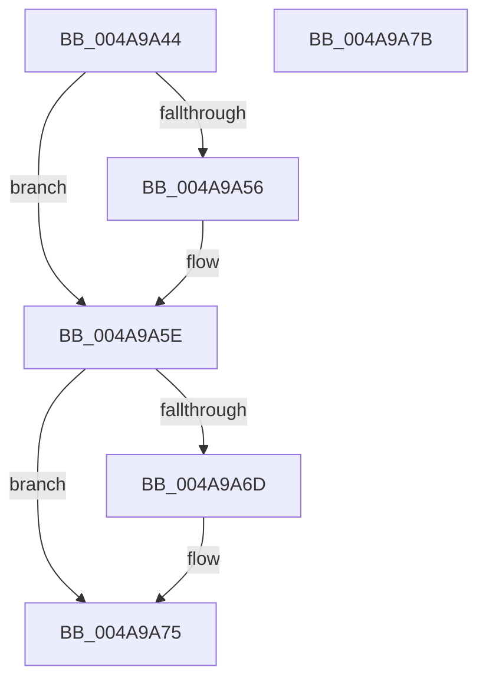

# MiReleasePageFileSectionInfo

- RVA: `0x004A9A44`–`0x004A9A7C` (길이 `56` bytes)
- VA: `0x00000001404A9A44`
- 실행 섹션: `.text`
- PDB 이름 있음: `예`; PDB Function 태그: `아니요`
- unwind 정보 RVA: `0x0005CF00`
- 디코드: `19`개 명령, `56/56` bytes 표시
- 미해석 바이트: `0` (있으면 어셈블리에 `.byte`로 보존)

> 이 문서는 커널 이미지의 기계어와 PDB 기호를 분석해 생성했습니다. 4번과 5번은 함수 원형과 자료형을 바이너리 사용 방식에서 추정한 C 해석이며 원본 소스 복구 결과는 아닙니다.

## 1. Dependencies

- 직접 호출 지점: **3**; 고유 호출 대상: **3**
- 직접 호출자로 확인된 함수: **1**
- RIP 상대 이미지 참조: **0**

### Outgoing calls
- `0x004A9A59` → [MiUnlockProtoPoolPage](../24/MiUnlockProtoPoolPage_function_00246090.md) (function, `0x00246090`)
- `0x004A9A63` → [MiDecrementModifiedWriteCount](../29/MiDecrementModifiedWriteCount_function_00298184.md) (function, `0x00298184`)
- `0x004A9A70` → [MiReleaseControlAreaWaiters](../28/MiReleaseControlAreaWaiters_function_002865F0.md) (function, `0x002865F0`)

### Direct callers
- [MiGetPageFileSectionForReservation](../38/MiGetPageFileSectionForReservation_function_00385E2C.md) at `0x00385ECB`

### Static image references
- 디코드된 RIP-relative 메모리 참조가 없습니다.

## 2. Other-region calls and transfers

- 다른 실행 섹션으로 향하는 call: **0**
- 별도 외부 분기/꼬리 이동을 확인하지 못했습니다.

## 3. Assembly (complete function range)

```asm
004A9A44  40 53                           push rbx
004A9A46  48 83 EC 20                     sub rsp, 0x20
004A9A4A  48 8B D9                        mov rbx, rcx
004A9A4D  48 8B 49 08                     mov rcx, qword ptr [rcx + 8]
004A9A51  48 85 C9                        test rcx, rcx
004A9A54  74 08                           je 0x1404a9a5e
004A9A56  8A 53 20                        mov dl, byte ptr [rbx + 0x20]
004A9A59  E8 32 C6 D9 FF                  call 0x140246090
004A9A5E  48 8B 0B                        mov rcx, qword ptr [rbx]
004A9A61  33 D2                           xor edx, edx
004A9A63  E8 1C E7 DE FF                  call 0x140298184
004A9A68  48 85 C0                        test rax, rax
004A9A6B  74 08                           je 0x1404a9a75
004A9A6D  48 8B C8                        mov rcx, rax
004A9A70  E8 7B CB DD FF                  call 0x1402865f0
004A9A75  48 83 C4 20                     add rsp, 0x20
004A9A79  5B                              pop rbx
004A9A7A  C3                              ret
004A9A7B  CC                              int3
```

## 4. C-style interpretation (structured pseudocode)

```c
__int64 __fastcall MiReleasePageFileSectionInfo(__int64 a1)
{
    __int64 result;
    __int64 v_rsp;

    v_rsp = (v_rsp) - (32);
    if (*(unsigned __int64 *)(a1 + 8) != 0) {
        a2 = *(unsigned __int8 *)(a1 + 32);
        result = MiUnlockProtoPoolPage(*(unsigned __int64 *)(a1 + 8), a2, a3, a4);
    }
    a2 = 0;
    result = MiDecrementModifiedWriteCount(*(unsigned __int64 *)(a1), a2, a3, a4);
    if (result != 0) {
        a1 = result;
        result = MiReleaseControlAreaWaiters(a1, a2, a3, a4);
    }
    v_rsp = (v_rsp) + (32);
    return result;
}
```

## 5. (Beta) C Style

```c
int64_t MiReleasePageFileSectionInfo(void *Arg1)
{
    uint8_t *arg1 = (uint8_t *)Arg1;

    int64_t result;
    int64_t local_rsp;

    local_rsp = (local_rsp) - (32);
    if (*(uint64_t *)(arg1 + 0x8) != 0) {
        a2 = *(uint8_t *)(arg1 + 0x20);
        result = MiUnlockProtoPoolPage(*(uint64_t *)(arg1 + 0x8), a2, a3, a4);
    }
    a2 = 0;
    result = MiDecrementModifiedWriteCount(*(uint64_t *)(arg1), a2, a3, a4);
    if (result != 0) {
        Arg1 = result;
        result = MiReleaseControlAreaWaiters(Arg1, a2, a3, a4);
    }
    local_rsp = (local_rsp) + (32);
    return result;
}
```

### 관측된 메모리 오프셋

구조체 형식이 확인되지 않은 접근은 인자 기준의 오프셋으로만 기록했습니다.

| 기준 인자 | 오프셋 표현 | 폭 (bit) | 접근 |
|---|---:|---:|---|
| `Arg1` | `+ 0x0` | `64` | `R` |
| `Arg1` | `+ 0x8` | `64` | `R` |
| `Arg1` | `+ 0x20` | `8` | `R` |

## 6. Execution-region graph

[열기: 2D/3D 그래프와 함수 탐색 컨트롤 패널](../../../control-panel.html?section=text&rva=0x004A9A44&view=graph)

- 2D 그래프는 위에서 아래로 흐르고, 3D 그래프는 빈 공간을 드래그해 회전합니다. Shift+드래그는 이동, 휠은 확대·축소, 함수 노드 선택은 대상 보고서 이동입니다.

### Static fallback


