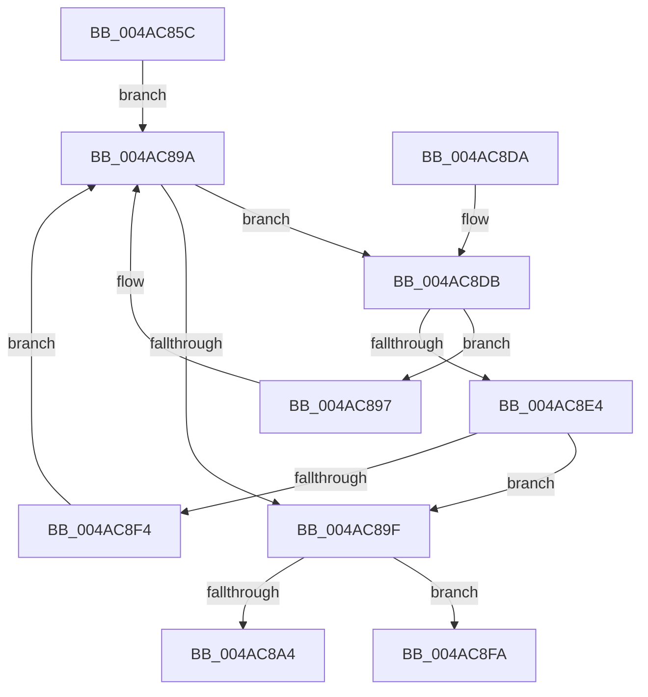

# MiRemoveMappingNode

- RVA: `0x004AC85C`–`0x004AC914` (길이 `184` bytes)
- VA: `0x00000001404AC85C`
- 실행 섹션: `.text`
- PDB 이름 있음: `예`; PDB Function 태그: `아니요`
- unwind 정보 RVA: `0x000B82C4`
- 디코드: `50`개 명령, `184/184` bytes 표시
- 미해석 바이트: `0` (있으면 어셈블리에 `.byte`로 보존)

> 이 문서는 커널 이미지의 기계어와 PDB 기호를 분석해 생성했습니다. 4번과 5번은 함수 원형과 자료형을 바이너리 사용 방식에서 추정한 C 해석이며 원본 소스 복구 결과는 아닙니다.

## 1. Dependencies

- 직접 호출 지점: **4**; 고유 호출 대상: **4**
- 직접 호출자로 확인된 함수: **1**
- RIP 상대 이미지 참조: **2**

### Outgoing calls
- `0x004AC87C` → [ExAcquireSpinLockExclusive](../24/ExAcquireSpinLockExclusive_function_00248690.md) (function, `0x00248690`)
- `0x004AC8AE` → [RtlAvlRemoveNode](../29/RtlAvlRemoveNode_function_00296650.md) (function, `0x00296650`)
- `0x004AC8BD` → [MiReleaseSpinLockExclusive](../24/MiReleaseSpinLockExclusive_function_002482C0.md) (function, `0x002482C0`)
- `0x004AC90E` → [KeBugCheckEx](../4F/KeBugCheckEx_function_004FD660.md) (function, `0x004FD660`)

### Direct callers
- [MmFreeMappingAddress](../../page/A7/MmFreeMappingAddress_function_00A75F20.md) at `0x00A75F3A`

### Static image references
- `0x004AC875` → RVA `0x00E35FA8` (`.data`; read)
- `0x004AC881` → RVA `0x00E35FB0` (`.data`; read)

## 2. Other-region calls and transfers

- 다른 실행 섹션으로 향하는 call: **0**
- 별도 외부 분기/꼬리 이동을 확인하지 못했습니다.

## 3. Assembly (complete function range)

```asm
004AC85C  48 89 5C 24 08                  mov qword ptr [rsp + 8], rbx
004AC861  48 89 6C 24 10                  mov qword ptr [rsp + 0x10], rbp
004AC866  48 89 74 24 18                  mov qword ptr [rsp + 0x18], rsi
004AC86B  57                              push rdi
004AC86C  48 83 EC 30                     sub rsp, 0x30
004AC870  48 8B F9                        mov rdi, rcx
004AC873  8B F2                           mov esi, edx
004AC875  48 8D 0D 2C 97 98 00            lea rcx, [rip + 0x98972c]
004AC87C  E8 0F BE D9 FF                  call 0x140248690
004AC881  48 8B 1D 28 97 98 00            mov rbx, qword ptr [rip + 0x989728]
004AC888  4C 8B C7                        mov r8, rdi
004AC88B  49 81 E0 00 F0 FF FF            and r8, 0xfffffffffffff000
004AC892  40 8A E8                        mov bpl, al
004AC895  EB 03                           jmp 0x1404ac89a
004AC897  48 8B 1B                        mov rbx, qword ptr [rbx]
004AC89A  48 85 DB                        test rbx, rbx
004AC89D  75 3C                           jne 0x1404ac8db
004AC89F  48 85 DB                        test rbx, rbx
004AC8A2  74 56                           je 0x1404ac8fa
004AC8A4  48 8B D3                        mov rdx, rbx
004AC8A7  48 8D 0D 02 97 98 00            lea rcx, [rip + 0x989702]
004AC8AE  E8 9D 9D DE FF                  call 0x140296650
004AC8B3  40 8A D5                        mov dl, bpl
004AC8B6  48 8D 0D EB 96 98 00            lea rcx, [rip + 0x9896eb]
004AC8BD  E8 FE B9 D9 FF                  call 0x1402482c0
004AC8C2  48 8B 6C 24 48                  mov rbp, qword ptr [rsp + 0x48]
004AC8C7  48 8B C3                        mov rax, rbx
004AC8CA  48 8B 5C 24 40                  mov rbx, qword ptr [rsp + 0x40]
004AC8CF  48 8B 74 24 50                  mov rsi, qword ptr [rsp + 0x50]
004AC8D4  48 83 C4 30                     add rsp, 0x30
004AC8D8  5F                              pop rdi
004AC8D9  C3                              ret
004AC8DA  CC                              int3
004AC8DB  48 8B 4B 18                     mov rcx, qword ptr [rbx + 0x18]
004AC8DF  4C 3B C1                        cmp r8, rcx
004AC8E2  72 B3                           jb 0x1404ac897
004AC8E4  48 8B 43 20                     mov rax, qword ptr [rbx + 0x20]
004AC8E8  48 C1 E0 0C                     shl rax, 0xc
004AC8EC  48 03 C1                        add rax, rcx
004AC8EF  4C 3B C0                        cmp r8, rax
004AC8F2  72 AB                           jb 0x1404ac89f
004AC8F4  48 8B 5B 08                     mov rbx, qword ptr [rbx + 8]
004AC8F8  EB A0                           jmp 0x1404ac89a
004AC8FA  48 83 64 24 20 00               and qword ptr [rsp + 0x20], 0
004AC900  BA 06 01 00 00                  mov edx, 0x106
004AC905  4C 8B CE                        mov r9, rsi
004AC908  4C 8B C7                        mov r8, rdi
004AC90B  8D 4A D4                        lea ecx, [rdx - 0x2c]
004AC90E  E8 4D 0D 05 00                  call 0x1404fd660
004AC913  CC                              int3
```

## 4. C-style interpretation (structured pseudocode)

```c
__int64 __fastcall MiRemoveMappingNode(__int64 a1, int a2)
{
    __int64 result;
    __int64 v_rsp;
    unsigned __int64 v_stack_p10;
    unsigned __int64 v_stack_p18;
    unsigned __int64 v_stack_p20;
    unsigned __int64 v_stack_p8;

    v_stack_p8 = v_rbx;
    v_stack_p10 = v_rbp;
    v_stack_p18 = v_rsi;
    v_rsp = (v_rsp) - (48);
    result = ExAcquireSpinLockExclusive(v_rip + 10000172, a2, a3, a4);
    a3 = (a1) & (0xFFFFFFFFFFFFF000ULL);
    goto loc_004AC89A;
loc_004AC897:
loc_004AC89A:
    if (*(unsigned __int64 *)(*(unsigned __int64 *)(v_rip + 10000168)) != 0) goto loc_004AC8DB;
loc_004AC89F:
    if (*(unsigned __int64 *)(*(unsigned __int64 *)(v_rip + 10000168)) == 0) goto loc_004AC8FA;
    result = RtlAvlRemoveNode(v_rip + 10000130, *(unsigned __int64 *)(*(unsigned __int64 *)(v_rip + 10000168)), a3, a4);
    result = MiReleaseSpinLockExclusive(v_rip + 10000107, (unsigned __int8)((unsigned __int8)(result)), a3, a4);
    v_rsp = (v_rsp) + (48);
    return *(unsigned __int64 *)(*(unsigned __int64 *)(v_rip + 10000168));
loc_004AC8DB:
    if (a3 < (*(unsigned __int64 *)(v_stack_p8 + 24))) goto loc_004AC897;
    result = (*(unsigned __int64 *)(v_stack_p8 + 32)) << (12);
    result = (result) + (*(unsigned __int64 *)(v_stack_p8 + 24));
    if (a3 < result) goto loc_004AC89F;
    goto loc_004AC89A;
loc_004AC8FA:
    result = KeBugCheckEx(262 - 44, 262, a1, v_stack_p18);
    return result;
}
```

## 5. (Beta) C Style

```c
int64_t MiRemoveMappingNode(int64_t Arg1, int32_t Arg2)
{
    int64_t result;
    int64_t local_rsp;
    uint64_t v_stack_p10;
    uint64_t v_stack_p18;
    uint64_t v_stack_p20;
    uint64_t v_stack_p8;

    v_stack_p8 = local_rbx;
    v_stack_p10 = local_rbp;
    v_stack_p18 = local_rsi;
    local_rsp = (local_rsp) - (48);
    result = ExAcquireSpinLockExclusive(v_rip + 10000172, Arg2, a3, a4);
    a3 = (Arg1) & (0xFFFFFFFFFFFFF000ULL);
    goto loc_004AC89A;
loc_004AC897:
loc_004AC89A:
    if (*(uint64_t *)(*(uint64_t *)(v_rip + 0x989728)) != 0) goto loc_004AC8DB;
loc_004AC89F:
    if (*(uint64_t *)(*(uint64_t *)(v_rip + 0x989728)) == 0) goto loc_004AC8FA;
    result = RtlAvlRemoveNode(v_rip + 10000130, *(uint64_t *)(*(uint64_t *)(v_rip + 0x989728)), a3, a4);
    result = MiReleaseSpinLockExclusive(v_rip + 10000107, (uint8_t)((uint8_t)(result)), a3, a4);
    local_rsp = (local_rsp) + (48);
    return *(uint64_t *)(*(uint64_t *)(v_rip + 0x989728));
loc_004AC8DB:
    if (a3 < (*(uint64_t *)(v_stack_p8 + 0x18))) goto loc_004AC897;
    result = (*(uint64_t *)(v_stack_p8 + 0x20)) << (12);
    result = (result) + (*(uint64_t *)(v_stack_p8 + 0x18));
    if (a3 < result) goto loc_004AC89F;
    goto loc_004AC89A;
loc_004AC8FA:
    result = KeBugCheckEx(262 - 44, 262, Arg1, v_stack_p18);
    return result;
}
```

## 6. Execution-region graph

[열기: 2D/3D 그래프와 함수 탐색 컨트롤 패널](../../../control-panel.html?section=text&rva=0x004AC85C&view=graph)

- 2D 그래프는 위에서 아래로 흐르고, 3D 그래프는 빈 공간을 드래그해 회전합니다. Shift+드래그는 이동, 휠은 확대·축소, 함수 노드 선택은 대상 보고서 이동입니다.

### Static fallback


