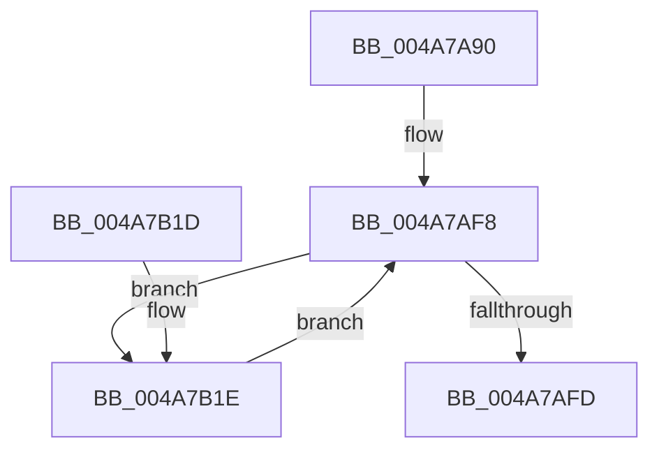

# MiReplenishSlabAllocatorWorker

- RVA: `0x004A7A90`–`0x004A7B31` (길이 `161` bytes)
- VA: `0x00000001404A7A90`
- 실행 섹션: `.text`
- PDB 이름 있음: `예`; PDB Function 태그: `아니요`
- unwind 정보 RVA: `0x000AB684`
- 디코드: `42`개 명령, `161/161` bytes 표시
- 미해석 바이트: `0` (있으면 어셈블리에 `.byte`로 보존)

> 이 문서는 커널 이미지의 기계어와 PDB 기호를 분석해 생성했습니다. 4번과 5번은 함수 원형과 자료형을 바이너리 사용 방식에서 추정한 C 해석이며 원본 소스 복구 결과는 아닙니다.

## 1. Dependencies

- 직접 호출 지점: **4**; 고유 호출 대상: **4**
- 직접 호출자로 확인된 함수: **0**
- RIP 상대 이미지 참조: **1**

### Outgoing calls
- `0x004A7ACF` → [MiReplenishSlabAllocator](../37/MiReplenishSlabAllocator_function_003788E4.md) (function, `0x003788E4`)
- `0x004A7ADB` → [ExAcquireSpinLockExclusive](../24/ExAcquireSpinLockExclusive_function_00248690.md) (function, `0x00248690`)
- `0x004A7B03` → [MiReleaseSpinLockExclusive](../24/MiReleaseSpinLockExclusive_function_002482C0.md) (function, `0x002482C0`)
- `0x004A7B27` → [KeSetEvent](../33/KeSetEvent_function_0033F310.md) (function, `0x0033F310`)

### Direct callers
- 이 함수 시작 RVA로 연결되는 직접 call은 확인되지 않았습니다. 간접 호출은 완전히 역산할 수 없습니다.

### Static image references
- `0x004A7AB1` → RVA `0x00011C60` (`.rdata`; read)

## 2. Other-region calls and transfers

- 다른 실행 섹션으로 향하는 call: **0**
- 별도 외부 분기/꼬리 이동을 확인하지 못했습니다.

## 3. Assembly (complete function range)

```asm
004A7A90  48 89 5C 24 08                  mov qword ptr [rsp + 8], rbx
004A7A95  48 89 6C 24 10                  mov qword ptr [rsp + 0x10], rbp
004A7A9A  48 89 74 24 18                  mov qword ptr [rsp + 0x18], rsi
004A7A9F  57                              push rdi
004A7AA0  48 83 EC 20                     sub rsp, 0x20
004A7AA4  4C 8B 41 68                     mov r8, qword ptr [rcx + 0x68]
004A7AA8  48 8B D9                        mov rbx, rcx
004A7AAB  8B 81 88 00 00 00               mov eax, dword ptr [rcx + 0x88]
004A7AB1  48 8D 0D A8 A1 B6 FF            lea rcx, [rip - 0x495e58]
004A7AB8  48 C1 E8 04                     shr rax, 4
004A7ABC  83 E0 03                        and eax, 3
004A7ABF  8B 14 C1                        mov edx, dword ptr [rcx + rax*8]
004A7AC2  48 8B CB                        mov rcx, rbx
004A7AC5  4C 3B C2                        cmp r8, rdx
004A7AC8  49 0F 43 D0                     cmovae rdx, r8
004A7ACC  45 33 C0                        xor r8d, r8d
004A7ACF  E8 10 0E ED FF                  call 0x1403788e4
004A7AD4  48 8D 73 10                     lea rsi, [rbx + 0x10]
004A7AD8  48 8B CE                        mov rcx, rsi
004A7ADB  E8 B0 0B DA FF                  call 0x140248690
004A7AE0  48 8D BB D8 00 00 00            lea rdi, [rbx + 0xd8]
004A7AE7  48 C7 83 D0 00 00 00 00 00 00 00  mov qword ptr [rbx + 0xd0], 0
004A7AF2  48 8B 1F                        mov rbx, qword ptr [rdi]
004A7AF5  40 8A E8                        mov bpl, al
004A7AF8  48 3B DF                        cmp rbx, rdi
004A7AFB  75 21                           jne 0x1404a7b1e
004A7AFD  40 8A D5                        mov dl, bpl
004A7B00  48 8B CE                        mov rcx, rsi
004A7B03  E8 B8 07 DA FF                  call 0x1402482c0
004A7B08  48 8B 5C 24 30                  mov rbx, qword ptr [rsp + 0x30]
004A7B0D  48 8B 6C 24 38                  mov rbp, qword ptr [rsp + 0x38]
004A7B12  48 8B 74 24 40                  mov rsi, qword ptr [rsp + 0x40]
004A7B17  48 83 C4 20                     add rsp, 0x20
004A7B1B  5F                              pop rdi
004A7B1C  C3                              ret
004A7B1D  CC                              int3
004A7B1E  48 8D 4B 10                     lea rcx, [rbx + 0x10]
004A7B22  45 33 C0                        xor r8d, r8d
004A7B25  33 D2                           xor edx, edx
004A7B27  E8 E4 77 E9 FF                  call 0x14033f310
004A7B2C  48 8B 1B                        mov rbx, qword ptr [rbx]
004A7B2F  EB C7                           jmp 0x1404a7af8
```

## 4. C-style interpretation (structured pseudocode)

```c
__int64 __fastcall MiReplenishSlabAllocatorWorker(__int64 a1)
{
    __int64 result;
    __int64 v_rsp;
    unsigned __int64 v_stack_p10;
    unsigned __int64 v_stack_p18;
    unsigned __int64 v_stack_p8;

    v_stack_p8 = v_rbx;
    v_stack_p10 = v_rbp;
    v_stack_p18 = v_rsi;
    v_rsp = (v_rsp) - (32);
    result = ((unsigned int)(*(unsigned int *)(a1 + 136))) >> (4);
    result = (unsigned int)((result) & (3));
    a2 = (unsigned int)(*(unsigned int *)(v_rip - 4808280 + result * 8));
    if ((*(unsigned __int64 *)(a1 + 104)) >= ((unsigned int)(*(unsigned int *)(v_rip - 4808280 + result * 8)))) { a2 = *(unsigned __int64 *)(a1 + 104); }
    a3 = 0;
    result = MiReplenishSlabAllocator(a1, a2, a3, a4);
    result = ExAcquireSpinLockExclusive(a1 + 16, a2, a3, a4);
    *(unsigned __int64 *)(a1 + 208) = 0;
loc_004A7AF8:
    if ((*(unsigned __int64 *)(a1 + 216)) != (a1 + 216)) goto loc_004A7B1E;
    result = MiReleaseSpinLockExclusive(a1 + 16, (unsigned __int8)((unsigned __int8)(result)), a3, a4);
    v_rsp = (v_rsp) + (32);
    return result;
loc_004A7B1E:
    a3 = 0;
    a2 = 0;
    result = KeSetEvent(v_stack_p8 + 16, a2, a3, a4);
    goto loc_004A7AF8;
}
```

## 5. (Beta) C Style

```c
int64_t MiReplenishSlabAllocatorWorker(void *Arg1)
{
    uint8_t *arg1 = (uint8_t *)Arg1;

    int64_t result;
    int64_t local_rsp;
    uint64_t v_stack_p10;
    uint64_t v_stack_p18;
    uint64_t v_stack_p8;

    v_stack_p8 = local_rbx;
    v_stack_p10 = local_rbp;
    v_stack_p18 = local_rsi;
    local_rsp = (local_rsp) - (32);
    result = ((uint32_t)(*(uint32_t *)(arg1 + 0x88))) >> (4);
    result = (uint32_t)((result) & (3));
    a2 = (uint32_t)(*(uint32_t *)(v_rip - 0x495E58 + result * 8));
    if ((*(uint64_t *)(arg1 + 0x68)) >= ((uint32_t)(*(uint32_t *)(v_rip - 0x495E58 + result * 8)))) { a2 = *(uint64_t *)(arg1 + 0x68); }
    a3 = 0;
    result = MiReplenishSlabAllocator(Arg1, a2, a3, a4);
    result = ExAcquireSpinLockExclusive(Arg1 + 16, a2, a3, a4);
    *(uint64_t *)(arg1 + 0xD0) = 0;
loc_004A7AF8:
    if ((*(uint64_t *)(arg1 + 0xD8)) != (Arg1 + 216)) goto loc_004A7B1E;
    result = MiReleaseSpinLockExclusive(Arg1 + 16, (uint8_t)((uint8_t)(result)), a3, a4);
    local_rsp = (local_rsp) + (32);
    return result;
loc_004A7B1E:
    a3 = 0;
    a2 = 0;
    result = KeSetEvent(v_stack_p8 + 16, a2, a3, a4);
    goto loc_004A7AF8;
}
```

### 관측된 메모리 오프셋

구조체 형식이 확인되지 않은 접근은 인자 기준의 오프셋으로만 기록했습니다.

| 기준 인자 | 오프셋 표현 | 폭 (bit) | 접근 |
|---|---:|---:|---|
| `Arg1` | `+ 0x0` | `64` | `R` |
| `Arg1` | `+ 0x10` | `64` | `R` |
| `Arg1` | `+ 0x68` | `64` | `R` |
| `Arg1` | `+ 0x88` | `32` | `R` |
| `Arg1` | `+ 0xD0` | `64` | `W` |
| `Arg1` | `+ 0xD8` | `64` | `R` |

## 6. Execution-region graph

[열기: 2D/3D 그래프와 함수 탐색 컨트롤 패널](../../../control-panel.html?section=text&rva=0x004A7A90&view=graph)

- 2D 그래프는 위에서 아래로 흐르고, 3D 그래프는 빈 공간을 드래그해 회전합니다. Shift+드래그는 이동, 휠은 확대·축소, 함수 노드 선택은 대상 보고서 이동입니다.

### Static fallback


