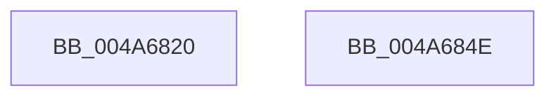

# MiResetAccessBitsTail

- RVA: `0x004A6820`–`0x004A684F` (길이 `47` bytes)
- VA: `0x00000001404A6820`
- 실행 섹션: `.text`
- PDB 이름 있음: `예`; PDB Function 태그: `아니요`
- unwind 정보 RVA: `0x0005D2F4`
- 디코드: `12`개 명령, `47/47` bytes 표시
- 미해석 바이트: `0` (있으면 어셈블리에 `.byte`로 보존)

> 이 문서는 커널 이미지의 기계어와 PDB 기호를 분석해 생성했습니다. 4번과 5번은 함수 원형과 자료형을 바이너리 사용 방식에서 추정한 C 해석이며 원본 소스 복구 결과는 아닙니다.

## 1. Dependencies

- 직접 호출 지점: **1**; 고유 호출 대상: **1**
- 직접 호출자로 확인된 함수: **0**
- RIP 상대 이미지 참조: **1**

### Outgoing calls
- `0x004A6842` → [MiAgeTrimListsTail](../23/MiAgeTrimListsTail_function_00239E90.md) (function, `0x00239E90`)

### Direct callers
- 이 함수 시작 RVA로 연결되는 직접 call은 확인되지 않았습니다. 간접 호출은 완전히 역산할 수 없습니다.

### Static image references
- `0x004A682B` → RVA `0x004A7410` (`MiResetAccessBitsVpabCallback`; read)

## 2. Other-region calls and transfers

- 다른 실행 섹션으로 향하는 call: **0**
- 별도 외부 분기/꼬리 이동을 확인하지 못했습니다.

## 3. Assembly (complete function range)

```asm
004A6820  48 83 EC 38                     sub rsp, 0x38
004A6824  4C 8B 89 B8 00 00 00            mov r9, qword ptr [rcx + 0xb8]
004A682B  48 8D 05 DE 0B 00 00            lea rax, [rip + 0xbde]
004A6832  45 33 C0                        xor r8d, r8d
004A6835  48 89 44 24 20                  mov qword ptr [rsp + 0x20], rax
004A683A  49 8D 51 08                     lea rdx, [r9 + 8]
004A683E  45 8B 49 04                     mov r9d, dword ptr [r9 + 4]
004A6842  E8 49 36 D9 FF                  call 0x140239e90
004A6847  33 C0                           xor eax, eax
004A6849  48 83 C4 38                     add rsp, 0x38
004A684D  C3                              ret
004A684E  CC                              int3
```

## 4. C-style interpretation (structured pseudocode)

```c
__int64 __fastcall MiResetAccessBitsTail(__int64 a1, __int64 a2, int a3)
{
    __int64 result;
    __int64 v_rsp;
    unsigned __int64 v_stack_m18;

    v_rsp = (v_rsp) - (56);
    a3 = 0;
    v_stack_m18 = v_rip + 3038;
    result = MiAgeTrimListsTail(a1, *(unsigned __int64 *)(a1 + 184) + 8, a3, (unsigned int)(*(unsigned int *)(*(unsigned __int64 *)(a1 + 184) + 4)));
    result = 0;
    v_rsp = (v_rsp) + (56);
    return result;
}
```

## 5. (Beta) C Style

```c
int64_t MiResetAccessBitsTail(void *Arg1, int64_t Arg2, int32_t Arg3)
{
    uint8_t *arg1 = (uint8_t *)Arg1;

    int64_t result;
    int64_t local_rsp;
    uint64_t v_stack_m18;

    local_rsp = (local_rsp) - (56);
    Arg3 = 0;
    v_stack_m18 = v_rip + 3038;
    result = MiAgeTrimListsTail(Arg1, *(uint64_t *)(arg1 + 0xB8) + 8, Arg3, (uint32_t)(*(uint32_t *)(*(uint64_t *)(arg1 + 0xB8) + 0x4)));
    result = 0;
    local_rsp = (local_rsp) + (56);
    return result;
}
```

### 관측된 메모리 오프셋

구조체 형식이 확인되지 않은 접근은 인자 기준의 오프셋으로만 기록했습니다.

| 기준 인자 | 오프셋 표현 | 폭 (bit) | 접근 |
|---|---:|---:|---|
| `Arg1` | `+ 0xB8` | `64` | `R` |

## 6. Execution-region graph

[열기: 2D/3D 그래프와 함수 탐색 컨트롤 패널](../../../control-panel.html?section=text&rva=0x004A6820&view=graph)

- 2D 그래프는 위에서 아래로 흐르고, 3D 그래프는 빈 공간을 드래그해 회전합니다. Shift+드래그는 이동, 휠은 확대·축소, 함수 노드 선택은 대상 보고서 이동입니다.

### Static fallback


