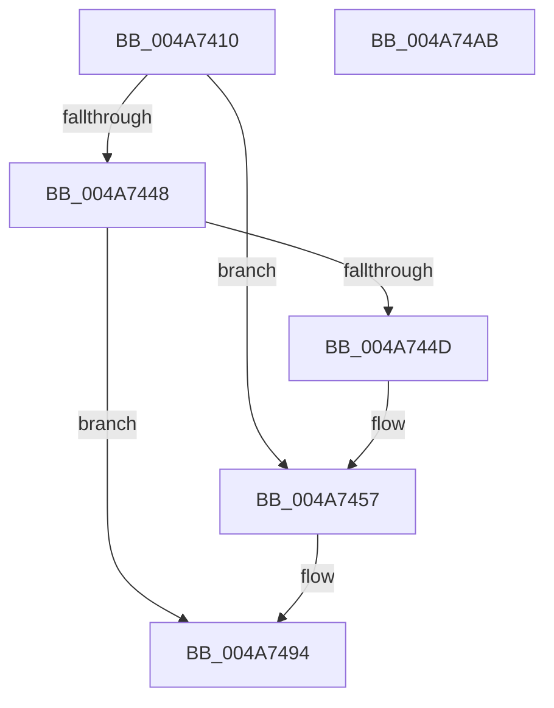

# MiResetAccessBitsVpabCallback

- RVA: `0x004A7410`–`0x004A74AC` (길이 `156` bytes)
- VA: `0x00000001404A7410`
- 실행 섹션: `.text`
- PDB 이름 있음: `예`; PDB Function 태그: `아니요`
- unwind 정보 RVA: `0x00066400`
- 디코드: `42`개 명령, `156/156` bytes 표시
- 미해석 바이트: `0` (있으면 어셈블리에 `.byte`로 보존)

> 이 문서는 커널 이미지의 기계어와 PDB 기호를 분석해 생성했습니다. 4번과 5번은 함수 원형과 자료형을 바이너리 사용 방식에서 추정한 C 해석이며 원본 소스 복구 결과는 아닙니다.

## 1. Dependencies

- 직접 호출 지점: **2**; 고유 호출 대상: **2**
- 직접 호출자로 확인된 함수: **0**
- RIP 상대 이미지 참조: **0**

### Outgoing calls
- `0x004A7434` → [MI_READ_PTE_LOCK_FREE](../28/MI_READ_PTE_LOCK_FREE_function_002828A0.md) (function, `0x002828A0`)
- `0x004A748F` → [MiResetAccessBitPteWorker](../22/MiResetAccessBitPteWorker_function_0022A6B8.md) (function, `0x0022A6B8`)

### Direct callers
- 이 함수 시작 RVA로 연결되는 직접 call은 확인되지 않았습니다. 간접 호출은 완전히 역산할 수 없습니다.

### Static image references
- 디코드된 RIP-relative 메모리 참조가 없습니다.

## 2. Other-region calls and transfers

- 다른 실행 섹션으로 향하는 call: **0**
- 별도 외부 분기/꼬리 이동을 확인하지 못했습니다.

## 3. Assembly (complete function range)

```asm
004A7410  48 89 5C 24 08                  mov qword ptr [rsp + 8], rbx
004A7415  48 89 6C 24 10                  mov qword ptr [rsp + 0x10], rbp
004A741A  48 89 74 24 18                  mov qword ptr [rsp + 0x18], rsi
004A741F  57                              push rdi
004A7420  48 83 EC 30                     sub rsp, 0x30
004A7424  48 8B 69 20                     mov rbp, qword ptr [rcx + 0x20]
004A7428  49 8B F1                        mov rsi, r9
004A742B  49 8B C8                        mov rcx, r8
004A742E  49 8B F8                        mov rdi, r8
004A7431  48 8B DA                        mov rbx, rdx
004A7434  E8 67 B4 DD FF                  call 0x1402828a0
004A7439  48 8B 13                        mov rdx, qword ptr [rbx]
004A743C  33 C9                           xor ecx, ecx
004A743E  4C 8B 54 24 60                  mov r10, qword ptr [rsp + 0x60]
004A7443  F6 C2 02                        test dl, 2
004A7446  75 0F                           jne 0x1404a7457
004A7448  F6 C2 01                        test dl, 1
004A744B  74 47                           je 0x1404a7494
004A744D  41 39 4A 04                     cmp dword ptr [r10 + 4], ecx
004A7451  8D 51 04                        lea edx, [rcx + 4]
004A7454  0F 45 CA                        cmovne ecx, edx
004A7457  48 C1 E8 0C                     shr rax, 0xc
004A745B  48 BA FF FF FF FF FF 00 00 00   movabs rdx, 0xffffffffff
004A7465  48 23 C2                        and rax, rdx
004A7468  4C 8D 0C 40                     lea r9, [rax + rax*2]
004A746C  49 C1 E1 04                     shl r9, 4
004A7470  48 B8 00 00 00 00 00 DE FF FF   movabs rax, 0xffffde0000000000
004A747A  89 4C 24 28                     mov dword ptr [rsp + 0x28], ecx
004A747E  4C 03 C8                        add r9, rax
004A7481  48 8B CD                        mov rcx, rbp
004A7484  4C 89 54 24 20                  mov qword ptr [rsp + 0x20], r10
004A7489  4C 8B C6                        mov r8, rsi
004A748C  48 8B D7                        mov rdx, rdi
004A748F  E8 24 32 D8 FF                  call 0x14022a6b8
004A7494  48 8B 5C 24 40                  mov rbx, qword ptr [rsp + 0x40]
004A7499  33 C0                           xor eax, eax
004A749B  48 8B 6C 24 48                  mov rbp, qword ptr [rsp + 0x48]
004A74A0  48 8B 74 24 50                  mov rsi, qword ptr [rsp + 0x50]
004A74A5  48 83 C4 30                     add rsp, 0x30
004A74A9  5F                              pop rdi
004A74AA  C3                              ret
004A74AB  CC                              int3
```

## 4. C-style interpretation (structured pseudocode)

```c
__int64 __fastcall MiResetAccessBitsVpabCallback(__int64 a1, __int64 a2, __int64 a3, __int64 a4, __int64 a5)
{
    __int64 result;
    __int64 v_rsp;
    unsigned int v_stack_m10;
    unsigned __int64 v_stack_m18;
    unsigned __int64 v_stack_p10;
    unsigned __int64 v_stack_p18;
    unsigned __int64 v_stack_p8;

    v_stack_p8 = v_rbx;
    v_stack_p10 = v_rbp;
    v_stack_p18 = v_rsi;
    v_rsp = (v_rsp) - (48);
    result = MI_READ_PTE_LOCK_FREE(a3, a2, a3, a4);
    a1 = 0;
    if ((((unsigned __int8)(*(unsigned __int64 *)(a2))) & (2)) != 0) goto loc_004A7457;
    if ((((unsigned __int8)(*(unsigned __int64 *)(a2))) & (1)) == 0) goto loc_004A7494;
    if ((*(unsigned int *)(a5 + 4)) != 0) { a1 = (unsigned int)(a1 + 4); }
loc_004A7457:
    result = (result) >> (12);
    result = (result) & (a1 + 4);
    a4 = (result + result * 2) << (4);
    v_stack_m10 = (unsigned int)(a1);
    a4 = (a4) + (result);
    v_stack_m18 = a5;
    result = MiResetAccessBitPteWorker(*(unsigned __int64 *)(a1 + 32), a3, a4, a4);
loc_004A7494:
    result = 0;
    v_rsp = (v_rsp) + (48);
    return result;
}
```

## 5. (Beta) C Style

```c
int64_t MiResetAccessBitsVpabCallback(void *Arg1, void *Arg2, int64_t Arg3, int64_t Arg4, void *Arg5)
{
    uint8_t *arg1 = (uint8_t *)Arg1;
    uint8_t *arg2 = (uint8_t *)Arg2;
    uint8_t *arg5 = (uint8_t *)Arg5;

    int64_t result;
    int64_t local_rsp;
    uint32_t v_stack_m10;
    uint64_t v_stack_m18;
    uint64_t v_stack_p10;
    uint64_t v_stack_p18;
    uint64_t v_stack_p8;

    v_stack_p8 = local_rbx;
    v_stack_p10 = local_rbp;
    v_stack_p18 = local_rsi;
    local_rsp = (local_rsp) - (48);
    result = MI_READ_PTE_LOCK_FREE(Arg3, Arg2, Arg3, Arg4);
    Arg1 = 0;
    if ((((uint8_t)(*(uint64_t *)(arg2))) & (2)) != 0) goto loc_004A7457;
    if ((((uint8_t)(*(uint64_t *)(arg2))) & (1)) == 0) goto loc_004A7494;
    if ((*(uint32_t *)(arg5 + 0x4)) != 0) { Arg1 = (uint32_t)(Arg1 + 4); }
loc_004A7457:
    result = (result) >> (12);
    result = (result) & (Arg1 + 4);
    Arg4 = (result + result * 2) << (4);
    v_stack_m10 = (uint32_t)(Arg1);
    Arg4 = (Arg4) + (result);
    v_stack_m18 = Arg5;
    result = MiResetAccessBitPteWorker(*(uint64_t *)(arg1 + 0x20), Arg3, Arg4, Arg4);
loc_004A7494:
    result = 0;
    local_rsp = (local_rsp) + (48);
    return result;
}
```

### 관측된 메모리 오프셋

구조체 형식이 확인되지 않은 접근은 인자 기준의 오프셋으로만 기록했습니다.

| 기준 인자 | 오프셋 표현 | 폭 (bit) | 접근 |
|---|---:|---:|---|
| `Arg1` | `+ 0x20` | `64` | `R` |
| `Arg2` | `+ 0x0` | `64` | `R` |
| `Arg5` | `+ 0x4` | `32` | `R` |

## 6. Execution-region graph

[열기: 2D/3D 그래프와 함수 탐색 컨트롤 패널](../../../control-panel.html?section=text&rva=0x004A7410&view=graph)

- 2D 그래프는 위에서 아래로 흐르고, 3D 그래프는 빈 공간을 드래그해 회전합니다. Shift+드래그는 이동, 휠은 확대·축소, 함수 노드 선택은 대상 보고서 이동입니다.

### Static fallback


