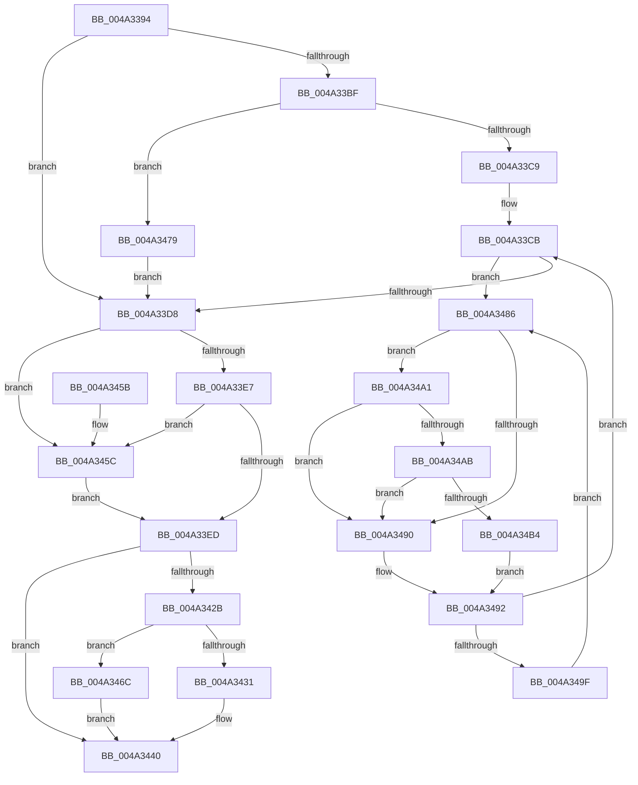

# MiSetPageTablePfnBuddy

- RVA: `0x004A3394`–`0x004A34BD` (길이 `297` bytes)
- VA: `0x00000001404A3394`
- 실행 섹션: `.text`
- PDB 이름 있음: `예`; PDB Function 태그: `아니요`
- unwind 정보 RVA: `0x00080854`
- 디코드: `81`개 명령, `297/297` bytes 표시
- 미해석 바이트: `0` (있으면 어셈블리에 `.byte`로 보존)

> 이 문서는 커널 이미지의 기계어와 PDB 기호를 분석해 생성했습니다. 4번과 5번은 함수 원형과 자료형을 바이너리 사용 방식에서 추정한 C 해석이며 원본 소스 복구 결과는 아닙니다.

## 1. Dependencies

- 직접 호출 지점: **4**; 고유 호출 대상: **4**
- 직접 호출자로 확인된 함수: **7**
- RIP 상대 이미지 참조: **3**

### Outgoing calls
- `0x004A3472` → [MiUnlockPage](../31/MiUnlockPage_function_0031A3E0.md) (function, `0x0031A3E0`)
- `0x004A3479` → [MiLockPageInline](../31/MiLockPageInline_function_0031A340.md) (function, `0x0031A340`)
- `0x004A34AB` → [KiCheckVpBackingLongSpinWaitHypercall](../30/KiCheckVpBackingLongSpinWaitHypercall_function_0030F490.md) (function, `0x0030F490`)
- `0x004A34B6` → [HvlNotifyLongSpinWait](../30/HvlNotifyLongSpinWait_function_0030F460.md) (function, `0x0030F460`)

### Direct callers
- [MiSetSystemCacheReverseMap](../23/MiSetSystemCacheReverseMap_function_00238F58.md) at `0x00238FAD`
- [MiReadPagefilePage](../66/MiReadPagefilePage_function_0066F78C.md) at `0x0066F8C5`
- [MiReadPagefilePage](../66/MiReadPagefilePage_function_0066F78C.md) at `0x0066FA2E`
- [MiCreatePfnTemplate](../67/MiCreatePfnTemplate_function_00671824.md) at `0x006719B5`
- [sub_006F28BE](../6F/Unknown_function_006F28BE.md) at `0x006F296D`
- [MiAllocateTopLevelPage](../../page/A5/MiAllocateTopLevelPage_function_00A5F2EC.md) at `0x00A5F3E7`
- [MiInitializeBootProcess](../../init/C5/MiInitializeBootProcess_function_00C5EEFC.md) at `0x00C5EFE1`
- [MxInsertEnclaveBootPages](../../init/C6/MxInsertEnclaveBootPages_function_00C68CB0.md) at `0x00C68D91`

### Static image references
- `0x004A345C` → RVA `0x00E38BB8` (`.data`; read)
- `0x004A3488` → RVA `0x00FC52AC` (`ALMOSTRO`; reference)
- `0x004A34A1` → RVA `0x00FC6AB8` (`ALMOSTRO`; read)

## 2. Other-region calls and transfers

- 다른 실행 섹션으로 향하는 call: **0**
- 별도 외부 분기/꼬리 이동을 확인하지 못했습니다.

## 3. Assembly (complete function range)

```asm
004A3394  48 8B C4                        mov rax, rsp
004A3397  48 89 58 08                     mov qword ptr [rax + 8], rbx
004A339B  48 89 68 10                     mov qword ptr [rax + 0x10], rbp
004A339F  48 89 70 18                     mov qword ptr [rax + 0x18], rsi
004A33A3  48 89 78 20                     mov qword ptr [rax + 0x20], rdi
004A33A7  41 56                           push r14
004A33A9  48 83 EC 20                     sub rsp, 0x20
004A33AD  45 8B F0                        mov r14d, r8d
004A33B0  48 8B DA                        mov rbx, rdx
004A33B3  48 8B F9                        mov rdi, rcx
004A33B6  40 B5 11                        mov bpl, 0x11
004A33B9  41 83 E6 01                     and r14d, 1
004A33BD  75 19                           jne 0x1404a33d8
004A33BF  41 F6 C0 10                     test r8b, 0x10
004A33C3  0F 84 B0 00 00 00               je 0x1404a3479
004A33C9  33 F6                           xor esi, esi
004A33CB  F0 48 0F BA 6F 18 3F            lock bts qword ptr [rdi + 0x18], 0x3f
004A33D2  0F 82 AE 00 00 00               jb 0x1404a3486
004A33D8  48 B8 FE FF FF FF FF FE FF FF   movabs rax, 0xfffffefffffffffe
004A33E2  48 85 D8                        test rax, rbx
004A33E5  75 75                           jne 0x1404a345c
004A33E7  48 83 FB 01                     cmp rbx, 1
004A33EB  74 6F                           je 0x1404a345c
004A33ED  48 8B 07                        mov rax, qword ptr [rdi]
004A33F0  48 8D 0C 1B                     lea rcx, [rbx + rbx]
004A33F4  48 8B D1                        mov rdx, rcx
004A33F7  48 C1 EB 1F                     shr rbx, 0x1f
004A33FB  48 33 D0                        xor rdx, rax
004A33FE  C1 E3 10                        shl ebx, 0x10
004A3401  48 B8 01 00 00 00 FF FF FF FF   movabs rax, 0xffffffff00000001
004A340B  48 23 D0                        and rdx, rax
004A340E  48 33 D1                        xor rdx, rcx
004A3411  8B CB                           mov ecx, ebx
004A3413  48 89 17                        mov qword ptr [rdi], rdx
004A3416  8B 47 24                        mov eax, dword ptr [rdi + 0x24]
004A3419  33 C8                           xor ecx, eax
004A341B  81 E1 FF FF 00 FC               and ecx, 0xfc00ffff
004A3421  33 CB                           xor ecx, ebx
004A3423  89 4F 24                        mov dword ptr [rdi + 0x24], ecx
004A3426  45 85 F6                        test r14d, r14d
004A3429  75 15                           jne 0x1404a3440
004A342B  40 80 FD 11                     cmp bpl, 0x11
004A342F  75 3B                           jne 0x1404a346c
004A3431  48 B8 FF FF FF FF FF FF FF 7F   movabs rax, 0x7fffffffffffffff
004A343B  F0 48 21 47 18                  lock and qword ptr [rdi + 0x18], rax
004A3440  48 8B 5C 24 30                  mov rbx, qword ptr [rsp + 0x30]
004A3445  48 8B 6C 24 38                  mov rbp, qword ptr [rsp + 0x38]
004A344A  48 8B 74 24 40                  mov rsi, qword ptr [rsp + 0x40]
004A344F  48 8B 7C 24 48                  mov rdi, qword ptr [rsp + 0x48]
004A3454  48 83 C4 20                     add rsp, 0x20
004A3458  41 5E                           pop r14
004A345A  C3                              ret
004A345B  CC                              int3
004A345C  48 2B 1D 55 57 99 00            sub rbx, qword ptr [rip + 0x995755]
004A3463  48 C1 EB 04                     shr rbx, 4
004A3467  48 FF C3                        inc rbx
004A346A  EB 81                           jmp 0x1404a33ed
004A346C  40 8A D5                        mov dl, bpl
004A346F  48 8B CF                        mov rcx, rdi
004A3472  E8 69 6F E7 FF                  call 0x14031a3e0
004A3477  EB C7                           jmp 0x1404a3440
004A3479  E8 C2 6E E7 FF                  call 0x14031a340
004A347E  40 8A E8                        mov bpl, al
004A3481  E9 52 FF FF FF                  jmp 0x1404a33d8
004A3486  FF C6                           inc esi
004A3488  85 35 1E 1E B2 00               test dword ptr [rip + 0xb21e1e], esi
004A348E  74 11                           je 0x1404a34a1
004A3490  F3 90                           pause
004A3492  48 8B 47 18                     mov rax, qword ptr [rdi + 0x18]
004A3496  48 85 C0                        test rax, rax
004A3499  0F 89 2C FF FF FF               jns 0x1404a33cb
004A349F  EB E5                           jmp 0x1404a3486
004A34A1  8B 05 11 36 B2 00               mov eax, dword ptr [rip + 0xb23611]
004A34A7  A8 40                           test al, 0x40
004A34A9  74 E5                           je 0x1404a3490
004A34AB  E8 E0 BF E6 FF                  call 0x14030f490
004A34B0  84 C0                           test al, al
004A34B2  74 DC                           je 0x1404a3490
004A34B4  8B CE                           mov ecx, esi
004A34B6  E8 A5 BF E6 FF                  call 0x14030f460
004A34BB  EB D5                           jmp 0x1404a3492
```

## 4. C-style interpretation (structured pseudocode)

```c
__int64 __fastcall MiSetPageTablePfnBuddy(__int64 a1, __int64 a2, int a3)
{
    __int64 result;
    __int64 v_r14;
    __int64 v_rbx;
    __int64 v_rsi;
    __int64 v_rsp;
    unsigned __int64 v_stack_p10;
    unsigned __int64 v_stack_p18;
    unsigned __int64 v_stack_p20;
    unsigned __int64 v_stack_p8;

    *(unsigned __int64 *)(v_rsp + 8) = v_rbx;
    *(unsigned __int64 *)(v_rsp + 16) = v_rbp;
    *(unsigned __int64 *)(v_rsp + 24) = v_rsi;
    *(unsigned __int64 *)(v_rsp + 32) = v_rdi;
    v_rsp = (v_rsp) - (32);
    v_r14 = (unsigned int)(((unsigned int)(a3)) & (1));
    if (condition_is_not_equal) goto loc_004A33D8;
    if ((((unsigned __int8)(a3)) & (16)) == 0) goto loc_004A3479;
    v_rsi = 0;
loc_004A33CB:
    if (condition_is_below) goto loc_004A3486;
loc_004A33D8:
    if (((v_rsp) & (a2)) != 0) goto loc_004A345C;
    if (a2 == 1) goto loc_004A345C;
loc_004A33ED:
    v_rbx = (a2) >> (31);
    a2 = (a2 + a2 * 1) ^ (*(unsigned __int64 *)(a1));
    v_rbx = (unsigned int)((v_rbx) << (16));
    a2 = (a2) & (*(unsigned __int64 *)(a1));
    a2 = (a2) ^ (a2 + a2 * 1);
    *(unsigned __int64 *)(a1) = a2;
    a1 = (unsigned int)(((unsigned int)((unsigned int)(v_rbx))) ^ ((unsigned int)((unsigned int)(*(unsigned int *)(a1 + 36)))));
    a1 = (unsigned int)((a1) & (0xFC00FFFFULL));
    a1 = (unsigned int)((a1) ^ ((unsigned int)(v_rbx)));
    *(unsigned int *)(a1 + 36) = (unsigned int)(a1);
    if ((unsigned int)(v_r14) != 0) goto loc_004A3440;
    if (17 != 17) goto loc_004A346C;
loc_004A3440:
    v_rsp = (v_rsp) + (32);
    return (unsigned int)(*(unsigned int *)(a1 + 36));
loc_004A345C:
    v_rbx = (v_stack_p8) - (*(unsigned __int64 *)(v_rip + 10049365));
    v_rbx = (v_rbx) >> (4);
    v_rbx = (v_rbx) + 1;
    goto loc_004A33ED;
loc_004A346C:
    result = MiUnlockPage(v_stack_p20, (unsigned __int8)(v_stack_p10), a3, a4);
    goto loc_004A3440;
loc_004A3479:
    result = MiLockPageInline(v_stack_p20, (unsigned __int8)(v_stack_p10), a3, a4);
    goto loc_004A33D8;
loc_004A3486:
    v_rsi = (unsigned int)((v_stack_p18) + 1);
    if (((*(unsigned int *)(v_rip + 11673118)) & ((unsigned int)(v_rsi))) == 0) goto loc_004A34A1;
loc_004A3490:
loc_004A3492:
    if (!sign_flag) goto loc_004A33CB;
    goto loc_004A3486;
loc_004A34A1:
    if ((((unsigned __int8)((unsigned int)(*(unsigned int *)(v_rip + 11679249)))) & (64)) == 0) goto loc_004A3490;
    result = KiCheckVpBackingLongSpinWaitHypercall(v_stack_p20, (unsigned __int8)(v_stack_p10), a3, a4);
    if ((unsigned __int8)(result) == 0) goto loc_004A3490;
    result = HvlNotifyLongSpinWait((unsigned int)((unsigned int)(v_rsi)), (unsigned __int8)(v_stack_p10), a3, a4);
    goto loc_004A3492;
}
```

## 5. (Beta) C Style

```c
int64_t MiSetPageTablePfnBuddy(void *Arg1, int64_t Arg2, int32_t Arg3)
{
    uint8_t *arg1 = (uint8_t *)Arg1;

    int64_t result;
    int64_t local_r14;
    int64_t local_rbx;
    int64_t local_rsi;
    int64_t local_rsp;
    uint64_t v_stack_p10;
    uint64_t v_stack_p18;
    uint64_t v_stack_p20;
    uint64_t v_stack_p8;

    *(uint64_t *)(local_rsp + 0x8) = local_rbx;
    *(uint64_t *)(local_rsp + 0x10) = local_rbp;
    *(uint64_t *)(local_rsp + 0x18) = local_rsi;
    *(uint64_t *)(local_rsp + 0x20) = local_rdi;
    local_rsp = (local_rsp) - (32);
    local_r14 = (uint32_t)(((uint32_t)(Arg3)) & (1));
    if (condition_is_not_equal) goto loc_004A33D8;
    if ((((uint8_t)(Arg3)) & (16)) == 0) goto loc_004A3479;
    local_rsi = 0;
loc_004A33CB:
    if (condition_is_below) goto loc_004A3486;
loc_004A33D8:
    if (((local_rsp) & (Arg2)) != 0) goto loc_004A345C;
    if (Arg2 == 1) goto loc_004A345C;
loc_004A33ED:
    local_rbx = (Arg2) >> (31);
    Arg2 = (Arg2 + Arg2 * 1) ^ (*(uint64_t *)(arg1));
    local_rbx = (uint32_t)((local_rbx) << (16));
    Arg2 = (Arg2) & (*(uint64_t *)(arg1));
    Arg2 = (Arg2) ^ (Arg2 + Arg2 * 1);
    *(uint64_t *)(arg1) = Arg2;
    Arg1 = (uint32_t)(((uint32_t)((uint32_t)(local_rbx))) ^ ((uint32_t)((uint32_t)(*(uint32_t *)(arg1 + 0x24)))));
    Arg1 = (uint32_t)((Arg1) & (0xFC00FFFFULL));
    Arg1 = (uint32_t)((Arg1) ^ ((uint32_t)(local_rbx)));
    *(uint32_t *)(arg1 + 0x24) = (uint32_t)(Arg1);
    if ((uint32_t)(local_r14) != 0) goto loc_004A3440;
    if (17 != 17) goto loc_004A346C;
loc_004A3440:
    local_rsp = (local_rsp) + (32);
    return (uint32_t)(*(uint32_t *)(arg1 + 0x24));
loc_004A345C:
    local_rbx = (v_stack_p8) - (*(uint64_t *)(v_rip + 0x995755));
    local_rbx = (local_rbx) >> (4);
    local_rbx = (local_rbx) + 1;
    goto loc_004A33ED;
loc_004A346C:
    result = MiUnlockPage(v_stack_p20, (uint8_t)(v_stack_p10), Arg3, a4);
    goto loc_004A3440;
loc_004A3479:
    result = MiLockPageInline(v_stack_p20, (uint8_t)(v_stack_p10), Arg3, a4);
    goto loc_004A33D8;
loc_004A3486:
    local_rsi = (uint32_t)((v_stack_p18) + 1);
    if (((*(uint32_t *)(v_rip + 0xB21E1E)) & ((uint32_t)(local_rsi))) == 0) goto loc_004A34A1;
loc_004A3490:
loc_004A3492:
    if (!sign_flag) goto loc_004A33CB;
    goto loc_004A3486;
loc_004A34A1:
    if ((((uint8_t)((uint32_t)(*(uint32_t *)(v_rip + 0xB23611)))) & (64)) == 0) goto loc_004A3490;
    result = KiCheckVpBackingLongSpinWaitHypercall(v_stack_p20, (uint8_t)(v_stack_p10), Arg3, a4);
    if ((uint8_t)(result) == 0) goto loc_004A3490;
    result = HvlNotifyLongSpinWait((uint32_t)((uint32_t)(local_rsi)), (uint8_t)(v_stack_p10), Arg3, a4);
    goto loc_004A3492;
}
```

### 관측된 메모리 오프셋

구조체 형식이 확인되지 않은 접근은 인자 기준의 오프셋으로만 기록했습니다.

| 기준 인자 | 오프셋 표현 | 폭 (bit) | 접근 |
|---|---:|---:|---|
| `Arg1` | `+ 0x0` | `64` | `R` |
| `Arg1` | `+ 0x0` | `64` | `W` |
| `Arg1` | `+ 0x18` | `64` | `R` |
| `Arg1` | `+ 0x18` | `64` | `R/W` |
| `Arg1` | `+ 0x24` | `32` | `R` |
| `Arg1` | `+ 0x24` | `32` | `W` |

## 6. Execution-region graph

[열기: 2D/3D 그래프와 함수 탐색 컨트롤 패널](../../../control-panel.html?section=text&rva=0x004A3394&view=graph)

- 2D 그래프는 위에서 아래로 흐르고, 3D 그래프는 빈 공간을 드래그해 회전합니다. Shift+드래그는 이동, 휠은 확대·축소, 함수 노드 선택은 대상 보고서 이동입니다.

### Static fallback


